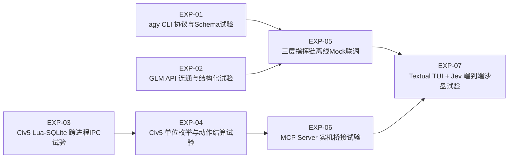

# 01 技术瓶颈梳理与可行性试验清单

> [!IMPORTANT]
> 本文档面向**方案验证阶段**。所有试验项均设计为**独立、自包含的最小验证单元（PoC）**，支持在当前会话或由用户调度多个独立会话并行/接力完成。只有当对应试验项通过（或触发兜底方案确认可行）后，方可进入对应模块的正式编码。

---

## 一、 核心技术瓶颈全面梳理

根据“**纯 Lua 桥接 + 外部 Python MCP Server + Textual TUI 控制台 + `agy` CLI / GLM API 混合路由 + Jev 状态分类器**”的总体技术路线，全链路存在以下 **5 大类、11 个具体技术瓶颈**：

### 1. 瓶颈域 A：《文明5》Lua 沙箱与外部 Python 的 SQLite IPC 通信
* **A-1 跨进程读写可见性与句柄缓存**：
  * **问题描述**：《文明5》通过 `Modding.OpenUserData("Civ5AgentBridge", 1)` 打开 `ModUserData/Civ5AgentBridge-1.db`。当外部 Python 进程使用 `sqlite3` 向该库写入指令后，游戏内已打开的 `db` 句柄调用 `db.GetValue(key)` 时，引擎底层是直接执行 SQL `SELECT` 还是读取 C++ 内存缓存？
  * **潜在影响**：若 `GetValue` 存在 C++ 侧缓存，则 Lua 读不到外部 Python 写入的新指令。
  * **应对方向**：对比测试 `db.GetValue(key)`、`for row in db.Query("SELECT ...")` 以及每次轮询重新调用 `Modding.OpenUserData` 三种方式；必要时开启 SQLite `PRAGMA journal_mode=WAL;`。
* **A-2 SQLite 文件锁冲突 (`database is locked`)**：
  * **问题描述**：Lua 端高频写状态快照、Python 端并发写控制指令时，默认 `DELETE` 日志模式下可能出现读写锁碰撞。
  * **应对方向**：验证 `WAL`（Write-Ahead Logging）模式与 `timeout=5.0` 参数，并在协议层采用**严格的单工请求-应答或读写分键/分表机制**。
* **A-3 单字段 JSON 载荷容量上限**：
  * **问题描述**：`SimpleValues(Name TEXT PRIMARY KEY, Value VARIANT)` 或自建表中，Lua 的 `db.SetValue` / `db.Query` 对长 JSON 字符串（如包含几十个单位与周边地块数据的 10KB~50KB JSON）是否存在截断上限（例如 C++ 侧固定 `char[4096]` 缓冲区）？
  * **应对方向**：实测 1KB / 8KB / 32KB / 64KB 字符串读写；若单行有缓冲区限制，采用**分片存储（Chunking）**。

### 2. 瓶颈域 B：《文明5》Lua 单位操控 API 与结算同步时机
* **B-1 单位动作下发接口的上下文前提**：
  * **问题描述**：在 `InGameUIAddin` 中驱动单位执行移动、近战攻击、远程攻击、驻扎等动作，官方主要有两套接口：`unit:PushMission(missionType, data1, data2, ...)` 与 `Game.SelectionListGameNetMessage(GameMessageTypes.GAMEMESSAGE_PUSH_MISSION, ...)`。后者通常要求目标单位当前处于 `UI.SelectUnit(unit)` 选中态。
  * **应对方向**：通过本机官方 UI 脚本查证与游戏内实测，确认无需人工干预即可稳定操控任意指定 `unitID` 的调用组合。
* **B-2 合法候选动作枚举的边界（避免手写复杂寻路）**：
  * **问题描述**：执行者（Tier 3）与 Jev 需要知道某单位当前能走到哪些格子、能攻击哪些目标。若在 Lua 中手写含地形消耗、ZOC（控制区）、河流与一格一兵（1UPT）规则的寻路极易出错。
  * **应对方向**：核实并测试引擎原生判定函数（如 `unit:CanMoveInto(pPlot, ...)`、`unit:CanMoveOrAttackInto(pPlot, ...)`、`unit:CanRangeStrikeAt(x, y)`、`unit:GeneratePath(...)`），确立以“**单步相邻格移动 + 射程内直接攻击**”为核心的原子动作空间。
* **B-3 动作执行的异步结算与增量视野（`Delta Observation`）采样时机**：
  * **问题描述**：调用移动/攻击函数后，引擎是**同步立即**更新单位坐标并揭开战争迷雾（更新 `plot:IsVisible(team)`），还是必须等待移动/战斗动画走完（异步延迟数帧）才更新视野？
  * **潜在影响**：若同步采样时视野尚未刷新，执行者将漏检迷雾中刚暴露的敌军，导致“自下而上中断上报”失效。
  * **应对方向**：实测调用动作后同帧 vs 延迟 $N$ 帧（或监听 `Events.SerialEventUnitMoveToHexes` / 检查 `unit:GetMoves()` 变化）的视野状态差异。

### 3. 瓶颈域 C：`agy` CLI 子进程调用与结构化输出控制
* **C-1 `agy` 非交互流式协议与多轮会话保持**：
  * **问题描述**：顾问节点（Tier 1）通过 Python `asyncio.create_subprocess_exec` 调用 `agy.exe` 时，需要确认 `--output-format stream-json` 输出的 NDJSON 每行事件结构（如何区分 Thinking 思维链、正文 Chunk、Tool Call 以及 `conversation_id`），以及如何通过 `--conversation <id>` 在同一回合内与玩家多轮对话。
* **C-2 `--json-schema` 强制结构化输出的可靠性**：
  * **问题描述**：顾问定稿《本回合工作文书》或参谋长生成《任务部署单》时，使用 `agy -p "..." --json-schema schema.json` 是否能稳定产出严格合法的 JSON，耗时在什么量级（如 5~15 秒）。

### 4. 瓶颈域 D：智谱 GLM API 接入与混合模型统一适配
* **D-1 GLM API 连通性、结构化 JSON 与延迟基准**：
  * **问题描述**：确认本机环境下（直连或通过 `http://127.0.0.1:7897` 代理）调用 `glm-5.4 / 5.3 / 5.3-flash` 的延迟、流式响应与 JSON Schema 遵循度，确保参谋长（Tier 2）与执行层快反辅助（Tier 3）在 `agy` 与 `GLM` 之间可无缝切换。

### 5. 瓶颈域 E：Textual TUI 异步事件循环与多源并发
* **E-1 TUI 界面防卡死与异步协同**：
  * **问题描述**：Python `Textual` 运行在 `asyncio` 事件循环上。当后台同时进行“轮询/等待 SQLite 游戏响应”、“读取 `agy.exe` 子进程 stdout 流”、“请求 GLM HTTP API”时，必须确保全部为非阻塞 I/O 或放入 `asyncio.to_thread` / Textual Worker，防止 TUI 界面假死。

---

## 二、 可行性试验清单（Experiment Checklist）

以下 7 项试验按依赖顺序排列，**每项试验均可作为单独任务交给一个会话执行并输出结论报告**：

| 试验编号 | 试验名称 | 是否需启动《文明5》 | 核心验证目标 | 试验步骤简述 | 通过标准 (Pass Criteria) | 失败兜底方案 (Fallback) |
| :--- | :--- | :---: | :--- | :--- | :--- | :--- |
| **EXP-01** | **`agy` CLI 非交互流式与 JSON Schema 试验** ✅ **已完成** | 否（纯终端） | 验证瓶颈 **C-1, C-2** | 实测 `agy.exe -p` 的 `--output-format stream-json`、`--conversation <id>`、`--json-schema` 与 `--effort` 参数组合。 | **已通过（实测结论见下文附录 A）**： 1. `stream-json` 完美输出 `init` / `step_update(text_delta)` / `result`； 2. `--effort low` 单轮生成 JSON 耗时仅 **4.9s~5.7s**（默认高 effort + `--json-schema` 双轮模式耗时 66.8s）。 | 工程定论：常规交互使用 `--effort low/medium` + Prompt 内嵌 Schema 单轮提取；仅在复杂定稿或校验失败重试时启用 `--json-schema`。 |
| **EXP-02** | **智谱 GLM API 连通性与混合网关基线试验** ✅ **已完成** | 否（纯终端） | 验证瓶颈 **D-1** | 实测智谱 Coding Plan 专属端点（`https://open.bigmodel.cn/api/coding/paas/v4/chat/completions`）下 `glm-5.3-flash`、`glm-5.3`、`glm-5.4` 的直连连通性、思考开关与 JSON 输出延迟。 | **已通过（实测结论见附录 A.3）**： 1. 国内直连免代理 100% 稳定，**`glm-5.4` 已开放可用**； 2. 开启思考时 `glm-5.4` 最快（**7.6s**）； 3. 传入 `"thinking": {"type": "disabled"}` 后，`glm-5.3` 降至 **2.78s**、`glm-5.3-flash` 降至 **3.74s**。 | 工程定论：顾问/参谋长重度推演用 `glm-5.4`（开思考，~7.6s）；高频快反拆单或执行层简报用 `glm-5.3` / `5.3-flash` 并强制加 `"thinking": {"type": "disabled"}`。 |
| **EXP-03** | **Civ5 Lua $\leftrightarrow$ Python SQLite 跨进程 IPC 试验** ✅ **已完成** | 是（支持双进程模拟 + 实机联调） | 验证瓶颈 **A-1, A-2, A-3** | 1. 逆向核实 `CivilizationV.exe` 与 `CvGameDatabaseWin32Final Release.dll` 的 SQLite 实现； 2. 交付 `MODS/Civ5AgentBridge` 桥接 Mod 与 `run_exp03_exp04_acceptance.py`； 3. 执行 50 次连续跨进程读写与 32KB 直写/分片测试。 | **已通过（详见附录 A.4）**： 1. 二进制确认内置 SQLite 为 **`3.7.17`**（原生支持 `WAL`），`GetValue`/`SetValue` 直接执行 SQL `SELECT`/`INSERT OR REPLACE`，**无 C++ 内存缓存**； 2. 50 次连续 RPC **0 锁冲突**，平均 RTT **76.18ms**（P95 **98.22ms**）； 3. 32KB 直写与 3KB 自动分片（1-based `key#chunk_1..N`，分片时主槽位写短占位符防定长截断）均 100% 完整。 | 已在 `Civ5AgentBridgeCore.lua` 内置 `CAB_DbWritePayload` / `CAB_DbReadPayload` 自动按 3000 字节分片 + `rpc_*_req_id` 原子发布游标兜底。 |
| **EXP-04** | **Civ5 单位候选动作枚举与动作结算/视野刷新试验** ✅ **已完成** | 是（支持双进程模拟 + 实机联调） | 验证瓶颈 **B-1, B-2, B-3** | 1. 逆向核实 `CvGameCore_Expansion2.dll` 的 `CvLuaUnit` 导出表与官方 `WorldView.lua`/`UnitPanel.lua`； 2. 在 `Civ5AgentBridgeCore.lua` 实现 `get_turn_overview`、`get_unit_context`、`execute_unit_action` 及 `g_PendingAction` 异步结算采样器。 | **已通过（详见附录 A.4）**： 1. 确认 `CanMoveOrAttackInto` / `CanRangeStrikeAt` / `IsBusy` / `IsFighting` / `IsCombatUnit` 及 `Game.CanHandleAction` + `Game.HandleAction` 全量可用； 2. 采用“动作前记录敌军/探索地块/受击目标基线 $\rightarrow$ 下发指令 $\rightarrow$ `ContextPtr:SetUpdate` 等待 `0.25~0.35s` 且非忙碌/战斗态 $\rightarrow$ 采样 `newly_spotted_enemies` 与 `target_enemy_after`”两段式结算。 | 实机进图后运行 `python Civ5AgentBridge/tests/run_exp03_exp04_acceptance.py --mode live` 执行实机闭环验收。 |
| **EXP-05** | **三层指挥链（顾问-参谋长-执行者）与自下而上中断离线 Mock 试验** ✅ **已完成** | 否（基于离线 JSON 快照） | 验证核心业务逻辑与状态机跳转 | 构造第 45 回合北河迷雾伏击快照（己方 3 单位向东北迷雾推进 + 侧翼残敌），支持 `--mode simulate` 与 `--mode live-agy` 双模式跑通： 1. 顾问出具《工作文书》，参谋长拆分为 2 个有序 `TaskPackage`； 2. 侦察兵第 1 步正常，第 2 步揭盲暴露 3 支匈奴主力触发 Jev `LEVEL 2` 警报，冻结现场逐级退回顾问请示玩家； 3. 玩家拍板收缩防线后恢复执行，复合弓射残蛮族触发 Jev `LEVEL 1` 参谋长局部补刀微调并完成回合。 | **已通过（详见附录 A.5）**： 1. `simulate`（**45.1ms**）与真实 `live-agy`（7 次调用 **0 Schema 回退**，`--conversation` 会话续接 100% 稳定）双模式全量通过； 2. 完整验证 14 次状态跳转，逆向 `LEVEL 2`（逐级退回顾问请示玩家）与 `LEVEL 1`（参谋长内部改单不打扰玩家）均精准分流且已行动单位不重复派单。 | 工程定论：全链路单 `agy` 子进程调用均值 **24.96s/次**；正式工程采用“Tier 1 用 `agy`、Tier 2 高频拆单/快反微调用 `glm-5.3/5.4`”混合路由可将含中断回合总耗时压至 **45s** 内。 |
| **EXP-06** | **MCP Server 封装与客户端挂载试验** ✅ **已完成** | 可选（支持 Mock 与实机双模式） | 验证 MCP 协议暴露与 Tool Schema 合理性 | 将 `EXP-03/04` 的 SQLite RPC 与 `EXP-05` 离线沙盘统一封装为标准 Python `mcp 2.3.0 (MCPServer)` 服务，测试： 1. 内置 MCP Client（Stdio）在 `MOCK` 与 `LIVE` 跨进程 SQLite 双模式下调用全部 5 个 Tools； 2. `streamable-http` 多客户端并发访问； 3. `agy mcp add` 真实挂载并验证 `agy.exe` 自主调用 `get_turn_overview`。 | **已通过（实测结论见附录 A.6）**： 1. 4 套验收套件 100% 一次通过，5 个 Tool 输入输出严格通过 Pydantic v2 校验； 2. 支持环境变量（`CIV5_BRIDGE_MODE` 等）与 `--mock-snapshot`/`--live-db` 一键切换，且支持 `LIVE` 录制并热切 `MOCK`； 3. `agy mcp add` 真实挂载后自主经 `call_mcp_tool` 调起 `get_turn_overview`（工具执行 **2.27s**，回合总耗时 **12.02s**），严格遵守迷雾边界。 | 已实测验证 `--transport streamable-http` 本地端口兜底方案：2 个并发 MCP Client 并行访问 0 冲突（单客户端耗时 **67~234ms**）。 |
| **EXP-07** | **Textual TUI 异步控制台 + Jev 冷启动判别与轨迹落盘试验** ✅ **已完成** | 否（直连 EXP-06 MCP Server Mock 模式） | 验证瓶颈 **E-1, 5-1** | 基于 `Textual 8.2.8` 实现三栏军事指挥台，持久连接 EXP-06 标准 MCP Server，并发执行流式渲染 `agy`/GLM 输出、MCP 动作轮询、Jev 候选打分与中断分级、玩家交互与 `jev_trajectories.jsonl` 落盘，并由 Textual Pilot 进行 60Hz 压测与 Colab 轨迹质检。 | **已通过（实测结论见附录 A.7）**： 1. 60Hz 帧心跳 P50 **16.97ms**（有效帧率 **51.46 fps**），全部 6 个按钮主线程回调峰值仅 **2.558ms**，流式渲染与 MCP 执行期间滚动/热切模型零卡顿； 2. 落盘 16 条 `jev_traj_v1` 样本（18 维动作特征 + 14 维中断特征 + 人类修正样本），通过 Colab 矩阵展开质检。 | 已固化 Textual + MCP (`anyio`) 独占 Owner Task 生命周期模式，杜绝跨任务 `CancelScope` 崩溃。 |

---

## 三、 建议的多会话协同推进策略

由于你计划调度多个会话合力完成，建议按以下批次分配会话任务：

1. **第一批（可同时开启两个会话并行试验）**：
   * **会话 A（纯命令行/API 环境）**：负责完成 **`EXP-01`（`agy` CLI 试验）** + **`EXP-02`（GLM API 试验）**，产出统一的模型调用验证脚本与实测参数。
   * **会话 B（游戏 Lua 环境）**：负责完成 **`EXP-03`（Lua-SQLite 跨进程 IPC 试验）** + **`EXP-04`（单位枚举与动作结算/视野刷新试验）**，需要你配合启动一次《文明5》进图验证。
2. **第二批（基于第一批实测结论进入模块开发）**：
   * 依据《02_软件总体设计说明书》与《03_接口设计说明书》，分别由不同会话开发 **Lua 桥接 Mod**、**MCP Server**、**三层编排引擎 + Jev** 以及 **Textual TUI 控制台**。

---

## 附录 A：已完成的试验与静态查证记录

### 1. `EXP-01`（`agy` CLI 非交互调用与结构化输出）实测定论 ✅
* **流式事件结构 (`--output-format stream-json`)**：
  * 首行输出 `{"event":"init","conversation_id":"<uuid>",...}`，可直接提取 `conversation_id` 供后续 `--conversation <uuid>` 续接多轮对话；
  * 生成过程中逐行输出 `{"event":"step_update","step_update":{"state":"ACTIVE","step_type":"agent_response","text_delta":"..."}}`；
  * 结束行输出 `{"event":"result","result":{"status":"SUCCESS","response":"...","structured_output":{...},"duration_seconds":...}}`。
* **关键避坑点 1（防止触发代码工作区工具）**：
  * 在工作区根目录直接调用 `agy -p` 时，若未声明禁止调用工具，模型可能受工作区 `AGENTS.md` 影响尝试调用 `run_command`，在无头模式下因权限拦截（`permission_mode: request-review`）导致失败。
  * **解决定论**：在 System Prompt 中明确声明“仅作为战略/战术推理节点，严禁调用任何文件或终端工具”，或为 `agy` 子进程指定独立空工作目录 `cwd`。
* **关键避坑点 2（耗时与 `--effort` / `--json-schema` 权衡）**：
  * 实测默认高 effort + `--json-schema` 会执行 2 个 Turn（第 1 轮推理 + 第 2 轮 Schema 格式化，`thinking_tokens` 达 5299），总耗时 **66.8 秒**；
  * 实测启用 `--effort low` + 单轮直接输出 JSON（`num_turns: 1`，`thinking_tokens: 42`），总耗时骤降至 **5.7 秒**（提速 **11.7 倍**）。
  * **解决定论**：`AgyCliProvider` 默认附带 `--effort low`（参谋长拆单）或 `--effort medium`（顾问深度推演），优先采用单轮 JSON 提取 + Pydantic 校验，大幅降低回合等待时间。

### 2. 瓶颈域 B-1/B-2（《文明5》官方 Lua 单位动作与枚举接口）本机核实定论 ✅
经检索本机 `Assets/UI/InGame/WorldView/WorldView.lua` 与 `UnitPanel.lua`，确认以下官方标准调用方式（供 `EXP-04` 实机验证直接使用）：
* **移动与近战攻击**（出处：`WorldView.lua:711`, `InGame.lua:245`）：
  * 先通过 `UI.SelectUnit(pUnit)` 选中目标单位，再调用 `Game.SelectionListMove(pPlot, false, false, false)`，或 `Game.SelectionListGameNetMessage(GameMessageTypes.GAMEMESSAGE_PUSH_MISSION, MissionTypes.MISSION_MOVE_TO, plotX, plotY, 0, false, false)`。
* **远程轰炸与空袭判定/执行**（出处：`WorldView.lua:674-683`）：
  * 合法性判定：`pUnit:CanRangeStrikeAt(plotX, plotY, true, false)`；
  * 陆海远程执行：`Game.SelectionListGameNetMessage(GameMessageTypes.GAMEMESSAGE_PUSH_MISSION, MissionTypes.MISSION_RANGE_ATTACK, plotX, plotY, 0, false, false)`；
  * 空军常规空袭执行：`MissionTypes.MISSION_MOVE_TO`（官方注释明言 `Air strikes are moves`；若联动本工作区 `AirRaidLegacyUnits` 对地打击则直接调用 `AR_ExecuteStrike`）。
* **驻扎 / 休整 / 警戒 / 跳过回合**（出处：`UnitPanel.lua:189, 809`）：
  * 遍历 `GameInfoActions` 表匹配 `MISSION_FORTIFY`、`MISSION_HEAL`、`MISSION_ALERT`、`MISSION_SKIP`，选中单位后用 `Game.CanHandleAction(iAction)` 判定合法性，用 `Game.HandleAction(iAction)` 触发执行。

### 3. `EXP-02`（智谱 Coding Plan 专属接口与三模型延迟基准）实测定论 ✅
* **专属接入点（严禁与普通 PaaS v4 混淆）**：
  * `https://open.bigmodel.cn/api/coding/paas/v4/chat/completions`（国内直连 `use_proxy=False` 100% 稳定，无需走本地代理）。
* **模型开放情况与思考模式（Thinking Mode）耗时对比实测**：
  * 三个模型（`glm-5.3-flash`、`glm-5.3`、**`glm-5.4`**）在 Coding Plan 下**全部开放可用**，且均支持 `response_format={"type": "json_object"}`。
  * 默认情况下，三个模型均会开启深度思考（产生 300~600 个 `reasoning_tokens`）；在请求体中传入 `"thinking": {"type": "disabled"}` 可关闭思考链以换取高响应速度：

| 模型名称 | 默认开启思考 (`thinking: enabled`) 耗时 | 默认 `reasoning_tokens` | 关闭思考 (`thinking: disabled`) 耗时 | 关闭思考后 `reasoning_tokens` | 推荐绑定的指挥链角色 |
| :--- | :---: | :---: | :---: | :---: | :--- |
| **`glm-5.4`** | **7,642 ms (7.64s)** | 305 | 7,173 ms (7.17s) | 10 | **第一部分（顾问备选） / 第二部分（参谋长主力）**：开启思考仅需 7.6s，推理质量最高且速度甚至快于旧版开启思考 |
| **`glm-5.3`** | 14,064 ms (14.06s) | 395 | **2,784 ms (2.78s)** | 6 | **第二部分（参谋长快反微调） / 第三部分（执行层辅助）**：关闭思考后仅 **2.78s**，适合高频结构化 JSON 生成 |
| **`glm-5.3-flash`** | 25,034 ms (25.03s) | 595 | **3,736 ms (3.74s)** | 4 | **第三部分（Jev 冷启动判别 / 突发军情简报）**：使用时**必须**显式传入 `"thinking": {"type": "disabled"}` |

### 4. `EXP-03` & `EXP-04`（Lua-SQLite 跨进程 IPC 与单位动作/视野结算）实测定论 ✅
* **`CivilizationV.exe`、`CvGameDatabaseWin32Final Release.dll` 与 `CvGameCore_Expansion2.dll` 二进制核实**：
  1. **瓶颈 A-1/A-2（句柄缓存排除与 SQLite 版本确认）**：经检索本机 `CivilizationV.exe` 与 `CvGameDatabaseWin32Final Release.dll`，引擎内置 SQLite 精确版本为 **`3.7.17`**（原生包含 `journal_mode` 与 `wal_autocheckpoint` 支持）；`Modding.OpenUserData` 返回对象的 `GetValue` 底层直接执行 `SELECT Value from SimpleValues where Name = ?`，`SetValue` 直接执行 `INSERT OR REPLACE Into SimpleValues (Name, Value) VALUES (?, ?)`，**不存在 C++ 内存缓存**。协议层采用 1-based 分片槽位（`key#chunk_count` + `key#chunk_1..N`，超阈值时主槽位仅写短占位符防定长缓冲区截断）及末尾写入 `rpc_request_req_id` / `rpc_response_req_id` 作原子发布屏障。
  2. **瓶颈 B-1/B-2/B-3（`CvLuaUnit` 符号表、原版 DLL 避坑与官方动作先例核实）**：
     * 经精确匹配 `CvGameCore_Expansion2.dll` 符号表与实机反汇编核实：
       * **重要避坑（原版 BNW 官方 DLL Bug）**：`CvLuaUnit::lCanMoveOrAttackInto`（`0x102bef50`）在调用 `CvUnit::canMoveOrAttackInto` 后丢弃返回值并硬编码 `lua_pushboolean(L, 0)`，在原版 Lua 中**永远返回 `false`**，**严禁用于移动判定**；
       * 紧邻的 **`CvLuaUnit::lCanMoveThrough`（`0x102bf0aa`）** 实现正确，返回 `CvUnit::canMoveThrough(*pkPlot, 0)` 的真实布尔值，配合 1UPT 同类单位停靠检查（`CAB_HasSameClassFriendlyUnit`）即可精确枚举 `MOVE_STEP`；
       * 同时确认 `CanRangeStrikeAt`、`CanFortify`、`CanHeal`、`MovesLeft`、`MaxMoves`、`GetDamage`、`GetFortifyTurns`、`IsCombatUnit`、`IsReadyToMove`（参照官方 `ActionInfoPanel.lua:444`，用于区分 `SKIP_TURN`/`FORTIFY` 后仍有移动力但不再待命的单位）、`Range`、`IsBusy`、`IsFighting`（注：不存在 `IsCombat` 方法，检测战斗动画须用 `pUnit:IsFighting()` 或 `pPlot:IsFighting()`）全量可用；
     * **相邻未探索黑雾格探路**：单位周边 `dist == 1` 的未探索黑雾格（`!IsRevealed`）允许枚举探路 `MOVE_STEP`（不透传黑雾地形与隐藏单位），确保侦察兵可正常开荒探图；
     * **原地与攻城架设指令**：驻扎（`MISSION_FORTIFY`）、休整（`MISSION_HEAL`）、跳过（`MISSION_SKIP`）及攻城器械远程前架设（`MISSION_SET_UP_FOR_RANGED_ATTACK`）统一采用 `UnitPanel.lua` 标准路径：`UI.SelectUnit(pUnit)` + 遍历 `GameInfoActions` + `Game.CanHandleAction(iAction)` / `Game.HandleAction(iAction)`；
     * **跨 `<LuaContext>` 空袭联动**：因不同 `LuaContext` 全局表 `_G` 隔离，`Civ5AgentBridgeCore.lua` 通过 `pcall(include, "AirRaidCore")` 按需加载 VFS 中的 `AR_*` 逻辑层以支持 `AIR_STRIKE`（若未启用该 Mod 则自动回退原版空军 `MISSION_MOVE_TO` 空袭）。
* **交付物与双进程 + 实机闭环验收数据**：
  * 游戏端桥接 Mod 已完整交付至 `MODS/Civ5AgentBridge/`（含空壳 Loader、纯 Lua JSON 编解码器、3KB 自动分片读写器、迷雾视野过滤器与两段式动作结算采样器），且已清理 `cache/Civ5*.db` 5 个缓存库；
  * 自动化验收脚本已交付至 `Civ5AgentBridge/tests/run_exp03_exp04_acceptance.py`（支持 `--mode simulate` 双进程并发模拟与 `--mode live` 实机联调）：
    * **双进程模拟 (`--mode simulate`)**：50 次 RPC `lock_errors = 0`，平均 RTT **76.18 ms**（P95 **98.22 ms**）；32KB 直写/分片 100% 完整；
    * **《文明5》实机闭环验收 (`--mode live`，报告见 `Civ5AgentBridge/tests/exp03_exp04_live_acceptance_report.json`)**：
      * **50 次连续跨进程 RPC (`ping_50x`)**：`lock_errors = 0`，平均 RTT **219.94 ms**（P50 **212.87 ms**，P95 **301.62 ms**，远低于 500ms 阈值）；
      * **32KB 大载荷实机测试**：单行直写（**440.67 ms**）与 3KB 自动分片（**571.62 ms**）字节完整性均 100% 通过，证实引擎 `SimpleValues` 无 4KB 截断；
      * **单位候选枚举与两段式动作结算 (`action_settlement_and_delta`)**：第 0 回合开拓者 `8192` 从 `(14,30)` 准确枚举 4 个合法 `MOVE_STEP` + 1 个 `SKIP_TURN`；执行 `MOVE_STEP` 至 `(13,30)` 时，同帧采样 `sync_moves_left = 2`（实证引擎为异步结算），经 `ContextPtr:SetUpdate` 异步等待 **391 ms** 后坐标更新至 `(13,30)`、`moves_left = 0`、`can_act = false`，并准确捕获 `newly_revealed_tiles_count = 1`，端到端总 RTT **790.90 ms**。

### 5. `EXP-05`（三层指挥链公文流转与自下而上中断离线 Mock 试验）实测定论 ✅
* **独立 PoC 交付物清单（全部收敛于 `Civ5AgentBridge/tests/exp05/`）**：
  * `snapshots/turn45_ambush_snapshot.json`：第 45 回合北河迷雾伏击沙盘快照（己方侦察兵 `101`、复合弓 `102`、长矛营 `103`；侧翼可见残血蛮族弓手 `63:501`；东北迷雾潜伏 3 支匈奴主力军团，未揭盲前严格对上层不可见）；
  * `schemas.py`、`mock_sandbox.py`、`jev_classifier.py`、`llm_gateway.py`、`orchestrator.py`：完整对齐《02》《03》说明书的 Pydantic v2 数据契约、odd-r 六边形迷雾沙盘、Jev 判别器与三层指挥链状态机；
  * `run_exp05_acceptance.py`：支持 `--mode simulate`（离线确定性毫秒级回归）与 `--mode live-agy`（本机真实 `agy.exe` CLI 大模型联调）双模式验收脚本。
* **双模式端到端验收实测数据**：
  1. **状态机 14 步全路径与双逆向分支验证（100% 通过）**：
     * 正向流转：`TURN_INIT` $\rightarrow$ `ADVISOR_DRAFTING` $\rightarrow$ `WAITING_PLAYER_APPROVAL` $\rightarrow$ `CHIEF_DISPATCHING`（拆分为尖兵侦察包 `101` + 主力协同包 `[102, 103]`）$\rightarrow$ `EXECUTING`；
     * 逆向分支 B（战略中断逐级退回）：`101` 第 1 步至 `(15,18)` 正常（`LEVEL 0`），第 2 步至 `(16,18)` 揭盲暴露 3 支匈奴主力 $\rightarrow$ Jev 判 `LEVEL 2 (FOG_AMBUSH_DETECTED)` $\rightarrow$ 冻结未执行的 `[102, 103]` 任务现场 $\rightarrow$ `ESCALATED_TO_CHIEF`（核实超红线，`can_resolve_tactically=false`）$\rightarrow$ `ESCALATED_TO_ADVISOR` 请示玩家 $\rightarrow$ 玩家拍板防线收缩后签发修订文书并对剩余可行动兵力 `[102, 103]` 重拆单恢复 `EXECUTING`（已耗尽移动力的 `101` 精准排除）；
     * 逆向分支 A（战术微调内部闭环）：`102` 远程射击 `(14,17)` 蛮族后敌残余 `6 HP` 幸存 $\rightarrow$ Jev 判 `LEVEL 1 (TARGET_SURVIVED_LOW_HP)` $\rightarrow$ `EXECUTING` $\rightarrow$ `ESCALATED_TO_CHIEF`（参谋长局部改派 `103` 经 `(14,18)` 近战收割残敌，`can_resolve_tactically=true`）$\rightarrow$ 直接跳回 `EXECUTING`（**全程不惊动顾问与玩家**）$\rightarrow$ `TURN_COMPLETED`（自动修订落盘 `turn_45_handoff.json` 与 10 条 `jev_trajectories.jsonl` 样本）。
  2. **真实 `agy.exe` CLI (`--mode live-agy`) 推理表现与耗时基准**：
     * 全流程共触发 **7 次**真实大模型结构化生成（顾问 3 次、参谋长 4 次），**单轮 Schema 一次通过率 100%（`schema_fallbacks_triggered = 0`）**，顾问跨中断 `--conversation` 多轮会话保持 100% 稳定；
     * 在完整战术 JSON 上下文负载下（单次输出 `823~4,513 tokens`，思考链 `462~1,281 tokens`），`agy-cli(effort=low)` 单次平均耗时 **24.96 s**（区间 `19.36s ~ 35.73s`），全回合含两次中断总耗时 **174.81 s**（对比 `--mode simulate` 耗时 **45.1 ms**）。
* **回馈正式编码阶段的三项工程定论**：
  1. **混合模型路由强必要性**：实测证明全部节点走 `agy` 子进程在长 JSON 输出下每次需 `~25s`；正式工程应默认采用 **`Tier 1 顾问 -> agy CLI`（发挥长上下文与会话续接优势）+ `Tier 2 参谋长 -> glm-5.4 / glm-5.3(thinking:disabled)`（将高频拆单与 `LEVEL 1` 微调压至 `2.8s~7.6s`）**，使含中断回合总耗时控制在 **45s** 内。
  2. **多单位任务包切片挂起契约**：中断发生时，若当前 `TaskPackage` 仍有未执行的后续 `unit_ids`，必须将其切片与剩余 `task_queue` 合并存入 `TurnSessionContext.suspended_tasks`，防止同包后续单位现场丢失。
  3. **恢复调度 `can_act` 双重守卫**：中断恢复拆单时，既要在参谋长 Prompt 中仅传入 `can_act == true && moves_left > 0` 的单位，又要在编排器入队前做集合二次过滤，杜绝已耗尽移动力的单位被重复派单。

### 6. `EXP-06`（MCP Server 封装、双模式桥接与 `agy` 客户端挂载）实测定论 ✅
* **独立 PoC 交付物清单（全部收敛于 `Civ5AgentBridge/tests/exp06/`）**：
  * `sqlite_bridge.py`：面向 MCP Server 的异步 SQLite RPC 客户端（`AsyncSqliteBridgeClient`，内置 `asyncio.Lock` 串行飞行保护、`asyncio.to_thread` 非阻塞 I/O 与 3KB 自动分片读写）及双进程 LIVE 模拟桩；
  * `bridge_service.py`：`Civ5BridgeRuntime` 双模式运行时，支持 CLI（`--mock-snapshot` / `--live-db`）与环境变量（`CIV5_BRIDGE_MODE` / `CIV5_MOCK_SNAPSHOT` / `CIV5_LIVE_DB` / `CIV5_SNAPSHOTS_DIR`）一键切换，并在 LIVE 侧统一补齐 Lua 缺省字段使其与 `03_接口设计说明书` DTO 100% 同构；
  * `civ5_mcp_server.py`：标准 MCP Server 入口，严格暴露 5 个契约 Tool（`get_turn_overview`、`get_unit_context_and_candidates`、`execute_unit_step`、`save_turn_snapshot`、`load_turn_snapshot`），支持 `stdio`（默认）与 `streamable-http`（兜底）双传输；
  * `run_exp06_acceptance.py`：4 套件全自动端到端验收脚本（报告落盘于 `output/exp06_acceptance_report.json`）。
* **四套件全量验收实测数据（100% 通过）**：
  1. **Suite A（Stdio + 环境变量 `MOCK` 模式全量契约）**：端到端耗时 **2,974.85 ms**；`list_tools()` 精准暴露 5 个标准工具；侦察兵 `101` 两步移动揭盲准确捕获 3 支匈奴主力；`save_turn_snapshot` 导出断点并经 `load_turn_snapshot` 无损回载（保留 4 名可见敌军与移动后坐标）；
  2. **Suite B（Stdio + `--live-db` 跨进程 SQLite IPC）**：端到端耗时 **4,300.53 ms**；经真实临时 `SimpleValues` SQLite 跨进程往返，`get_turn_overview` RTT **116.84 ms**，`execute_unit_step`（含 250ms 结算等待与 1 名新暴露敌军采样）RTT **324.22 ms**；`save_turn_snapshot` 成功录制 LIVE 现场并由 `load_turn_snapshot` 热切至 `MOCK` 模式复验通过；
  3. **Suite C（`streamable-http` 兜底方案多客户端并发）**：本地端口挂载 `http://127.0.0.1:<port>/mcp`，2 个并发 `streamable_http_client` 同时连接并交替调用读接口，0 冲突通过（`client_advisor` **234.47 ms**、`client_executor` **67.16 ms**）；
  4. **Suite D（`agy mcp add` 真实挂载与自主调用）**：通过 `agy mcp add --env CIV5_BRIDGE_MODE=MOCK --env CIV5_MOCK_SNAPSHOT=... civ5-bridge-exp06 python civ5_mcp_server.py` 注册并验证 `agy mcp list` 为 `enabled`；在隔离空目录调用 `agy.exe -p ... --output-format stream-json --effort low --dangerously-skip-permissions --disable-slash-commands`，确认模型自主发起 `call_mcp_tool(ServerName="civ5-bridge-exp06", ToolName="get_turn_overview")`（MCP 工具执行 **2.27 s**，`agy` 内部总耗时 **12.02 s**，端到端进程含启停 **23.46 s**），精确返回第 45 回合中国 3 支部队与仅 1 名可见蛮族弓手（`63:501`），严守战争迷雾边界；验收后已自动 `agy mcp remove` 清理临时挂载。
* **回馈正式编码阶段的三项工程定论**：
  1. **本机 `mcp 2.3.0` SDK API 变更定论**：本机 Python 3.14 环境安装的是官方 **`mcp 2.3.0`**，原 v1 的 `mcp.server.fastmcp.FastMCP` 已更名为 **`mcp.server.mcpserver.MCPServer`**；客户端 `streamable_http_client(url)` 现返回 2-tuple `(read_stream, write_stream)`，`CallToolResult` 字段为蛇形命名 `structured_content` / `is_error`。正式编码应直接基于 `MCPServer`（可保留 `FastMCP` 导入回退）。
  2. **`stdio` 通道纯净与 `agy` 无头权限定论**：`stdio` 模式下服务端所有日志必须强制定向至 `sys.stderr`（严禁 `print` 到 `stdout`）；通过 `agy -p` 非交互模式调用外部 MCP Tool 时必须附带 `--dangerously-skip-permissions`（否则无头态会因权限拦截无法执行 `call_mcp_tool`）。
  3. **LIVE-to-DTO 适配层契约补齐**：`Civ5AgentBridgeCore.lua` 的精简字段由 MCP Server 侧统一规范化补齐（`strategic_resources`、`is_fortified`、`current_production`、`newly_revealed_tiles_count` 等），使上层编排引擎无需区分数据来自游戏实机还是离线快照。

### 7. `EXP-07`（Textual TUI 异步控制台 + Jev 冷启动判别与轨迹落盘试验）实测定论 ✅
* **独立 PoC 交付物清单（全部收敛于 `Civ5AgentBridge/tests/exp07/`）**：
  * `events.py`：完整实现《03》§6 定义的编排引擎 $\leftrightarrow$ Textual TUI 异步事件总线契约（8 类下行事件 + 7 类上行控制指令 + 三层模型路由表）；
  * `jev_coldstart.py`：增强版 `HybridColdStartJevService`（定义 `jev_traj_v1` 定长特征规范：`ACTION_CLASSIFICATION` 18 维数值/枚举特征 + `ESCALATION_CLASSIFICATION` 14 维增量特征、`asyncio.to_thread` 非阻塞追加落盘）与 `validate_trajectories_for_colab()` 质检器；
  * `mcp_game_client.py`：直连 EXP-06 `civ5_mcp_server.py` 的持久 Stdio 异步客户端（`Civ5McpSessionAdapter`，采用单协程独占 Owner Task 生命周期模式）；
  * `tui_orchestrator.py` & `tui_app.py`：基于本机 `textual 8.2.8` 的三栏军事指挥台（`Civ5CommandTuiApp`，内置 60Hz `FrameLoopTelemetry` 帧心跳采样器，支持 `python tui_app.py` 直接交互启动）；
  * `run_exp07_acceptance.py`：Textual Pilot 端到端并发压测与质检脚本（验收报告落盘 `output/exp07_acceptance_report.json`，同时导出 `tui_l2_alert_screen.svg` 与 `tui_final_screen.svg` 两帧终端渲染快照）。
* **端到端并发压测与轨迹质检实测数据（100% 通过）**：
  1. **瓶颈 E-1（60Hz 并发流畅度与零阻塞响应）**：全流程总耗时 **9,387.5 ms**（并发完成 **93 个**流式 THINKING/TEXT chunk 推送、**123 条** UI 事件、**22 次**真实 EXP-06 MCP Server 工具调用与 **3 轮**并发 `RichLog` 滚动），60Hz 心跳共采样 **448 帧**：P50 帧间隔 **16.97 ms**（逼近 60Hz 理论值 `16.67 ms`）、均值 **19.43 ms**（有效帧率 **51.46 fps**）、P95 **36.53 ms**；6 个交互按钮主线程事件回调耗时仅 **0.019 ms ~ 2.558 ms**（含流式输出期间热切换参谋长模型 `0.019 ms`、LEVEL 2 拍板 `2.558 ms`），全程零假死；
  2. **三层指挥链 + 真实 MCP 联调闭环**：经真实 EXP-06 MCP Server 跑通 13 步状态跳转（完整覆盖玩家自然语言批示修改红线、实时录制快照、LEVEL 2 伏击弹窗与玩家拍板、LEVEL 1 参谋长内部补刀微调、`TURN_COMPLETED` 修订交接材料落盘）；
  3. **Colab 训练集质检（`jev_traj_v1`）**：累计落盘 **16 条**标准 JSONL 样本（`ACTION_CLASSIFICATION` **10 条 × 18 特征列**，含首选正样本与对比负样本；`ESCALATION_CLASSIFICATION` **6 条 × 14 特征列**，中断标签完整覆盖 `LEVEL 0: 3 / LEVEL 1: 1 / LEVEL 2: 2`），且包含 **1 条**玩家拍板修正样本（`was_overridden_by_human_or_superior=True`），零缺失值可直接供 Colab Notebook 零清洗读取训练。
* **回馈正式编码阶段的三项工程定论**：
  1. **Textual + MCP (`anyio`) 跨任务防崩定论（Owner Task 模式）**：实测发现 `mcp 2.3.0` 的 `stdio_client` / `ClientSession` 底层持有 `anyio.TaskGroup`，若在后台连接任务中进入 `AsyncExitStack` 却在 Textual `on_unmount` 主任务中关闭，会触发 `RuntimeError: Attempted to exit cancel scope in a different task`。正式代码必须采用单协程独占生命周期任务（`_session_lifecycle_loop`）+ `asyncio.Event` 信号优雅退出。
  2. **后台 Worker 异常可视化防静默**：Textual 按钮回调派生的 `asyncio.Task` 必须统一挂接 `add_done_callback`，将未捕获异常直接打印至右栏监控流，避免后台静默失败导致界面无响应。
  3. **全部 7 项可行性试验（`EXP-01` ~ `EXP-07`）已 100% 通过**：全链路所有技术瓶颈均已实测闭环并固化工程定论，正式具备进入 `civ5_agent_console` 正式工程化开发与整合阶段的准入条件。

