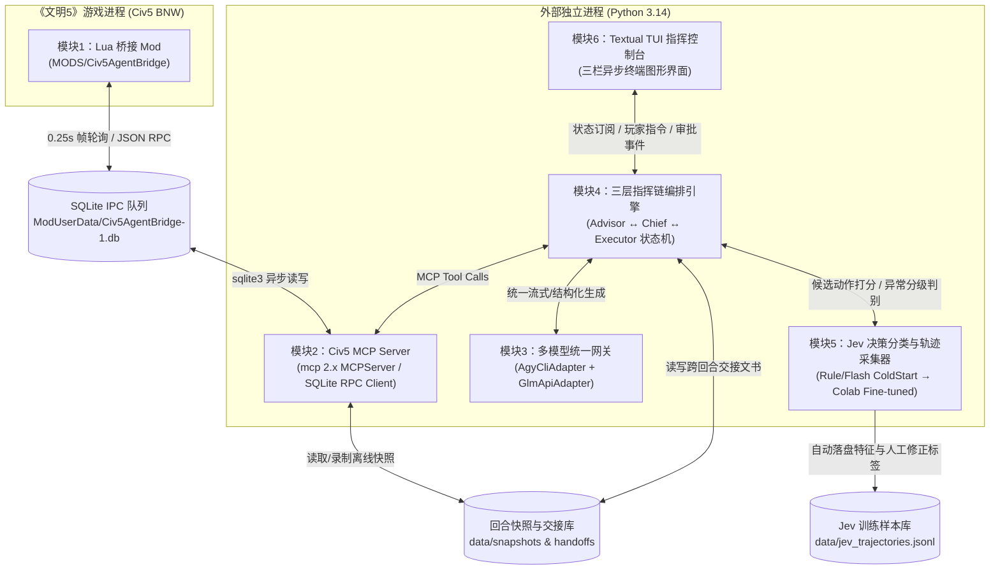
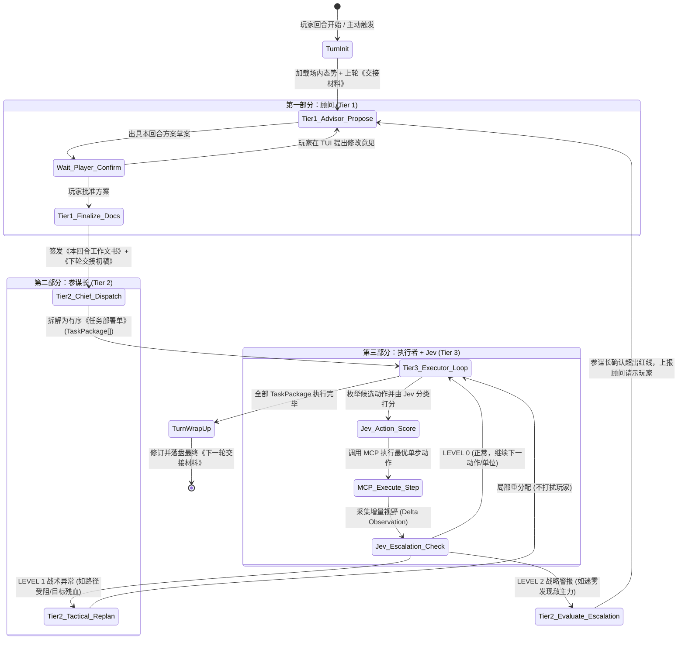

# 02 软件总体设计说明书（Civ5 Agent Command）

> [!NOTE]
> 本文档定义《文明5》智能体指挥系统（**Civ5 Agent Command**）的总体架构、模块划分、职责边界、内部状态变量、事件委托与异步任务流程，供多会话协同开发与联调引用。

---

## 一、 系统定位与四大架构原则

1. **核心目标**：以《文明5：美丽新世界 (BNW)》为沙盘，构建**“顾问（战略拟定与人机对齐）$\leftrightarrow$ 参谋长（战术拆解与局部调度）$\leftrightarrow$ 执行者 + Jev（局部状态分类判别与动作执行）”**的三层智能体指挥链系统。
2. **四大架构约束**：
   * **零 C++ 编译侵入**：游戏侧采用**纯 Lua (`InGameUIAddin`) + `Modding.OpenUserData` (SQLite3)** 暴露可见状态与操作接口，完全不改动现有 Windows / UE 5.3.2 编译环境。
   * **战争迷雾严格合规**：仅暴露当前玩家团队已见（`IsVisible`）与已探索（`IsRevealed`）的数据，严禁透传黑雾区或迷雾内未见敌军信息。
   * **自下而上中断上报（Bottom-Up Escalation）**：执行层每走一步均采集增量视野（`Delta Observation`），经 **Jev 判别器** 评估后，可触发 **LEVEL 1 战术微调（退回参谋长）** 或 **LEVEL 2 战略警报（退回顾问并请示玩家）**。
   * **混合模型路由与离线快照**：支持将 `agy` CLI（Gemini 订阅）与智谱 `GLM-5.4 / 5.3 / 5.3-flash` API 动态分配给不同层级；支持脱离游戏进程使用 JSON 回合快照进行全流程离线调试。

---

## 二、 总体架构与模块拓扑

系统由 **1 个游戏内 Lua Mod** 与 **5 个外部 Python 子模块**（同属 `civ5_agent_console` 工程）组成：

---

## 三、 六大模块职责、主要变量与异步任务设计

### 模块 1：游戏端纯 Lua 桥接 Mod (`MODS/Civ5AgentBridge/`)

* **承担工作**：作为游戏内部的数据采集器与指令执行器。继承 `AirRaidLegacyUnits` 已验证的 **`Loader.xml` 空壳装配模式**，在玩家回合监听 SQLite IPC 队列，导出玩家可见态势，并执行外部发来的单位控制指令。
* **提供功能**：
  1. 回合开始或玩家点击按钮时导出全局可见态势快照（含己方单位驻防态、战略资源储量、城市当前生产品项及已探索敌方/城邦城市列表）；
  2. 提取指定单位周边 $R$ 格局部地形/敌情（区分军民叠栈与敌方城市）并枚举合法候选动作（支持相邻未探索黑雾格探路移动、攻城器械远程前架设 `SETUP_FOR_RANGED` 以及空军全射程 `AIR_STRIKE`）；
  3. 驱动单位执行移动、近战/攻城攻击、远程攻击、攻城架设、驻扎、休整、跳过回合，以及经 `pcall(include, "AirRaidCore")` 跨 `<LuaContext>` 共享 VFS 逻辑联动 `AirRaidLegacyUnits` 的对地打击（未启用时自动回退原版空袭）；
  4. 单步动作结算后的**增量视野与战果对比（`Delta Observation`）**——识别本步新揭开迷雾的地块数（`newly_revealed_tiles_count`）、新暴露的敌方单位（`newly_spotted_enemies`）以及受击敌军的战后残血/击杀状态（`target_enemy_after`）。
* **主要功能变量**：
  * `g_BridgeDB` (`userdata`)：`Modding.OpenUserData("Civ5AgentBridge", 1)` 数据库句柄。
  * `g_PollAccumTime` (`number`)：`ContextPtr:SetUpdate` 帧累加计时器（每 `0.25s` 轮询一次）。
  * `g_LastReqId` (`number`)：已执行的最高请求 ID，防止重复消费。
  * `g_PendingSettlement` (`table | nil`)：当前正在等待移动/攻击动画结算的异步挂起上下文（含动作前视野基线 `baselineVisibleEnemies`）。
* **核心委托与函数**：
  * `CAB_OnActivePlayerTurnStart()`（挂载 `Events.ActivePlayerTurnStart` 委托）：刷新回合号，自动导出初始态势摘要至 SQLite。
  * `CAB_OnFrameUpdate(deltaTime)`（挂载 `ContextPtr:SetUpdate` 异步帧轮询委托）：检查 `g_PendingSettlement` 是否完成移动/战斗结算；若空闲则每 `0.25s` 读取 SQLite `rpc_request` 并分发处理。
  * `CAB_BuildTurnOverview(playerID)`：遍历当前玩家存活单位、城市及地图上对 `activeTeam` 可见（`pPlot:IsVisible(activeTeam)`）的敌方单位，组装全局态势表。
  * `CAB_BuildUnitContextAndCandidates(playerID, unitID, radius)`：枚举单位半径 `radius` 内的已探索地块属性，并调用引擎原生判定接口生成合法候选动作列表。
  * `CAB_DispatchUnitAction(playerID, unitID, actionType, targetX, targetY)`：记录动作前可见敌军集合 $\rightarrow$ 选中并下发单位指令 $\rightarrow$ 进入 `g_PendingSettlement` 等待结算采样。

---

### 模块 2：Civ5 MCP Server (`civ5_agent_console/mcp_server/`)

* **承担工作**：基于官方 `mcp 2.x`（`MCPServer`，原 `FastMCP`）将底层的 SQLite 跨进程通信包装为标准的 **Model Context Protocol (MCP)** 服务，同时提供**“实机联机模式 (`LIVE`)”**与**“离线快照回放模式 (`MOCK`)”**，支持 `stdio`（默认）与 `streamable-http`（多客户端并发兜底）双传输，并支持通过 CLI 参数（`--mock-snapshot` / `--live-db`）或环境变量（`CIV5_BRIDGE_MODE` 等）一键切换。
* **提供功能**：
  1. 封装 SQLite 请求-应答事务（`asyncio.Lock` 串行保护 + `asyncio.to_thread` 非阻塞 I/O）、超时重试、长 JSON 自动分片重组，并将游戏 Lua 原始返回规范化为与 MOCK 模式完全同构的 Pydantic DTO；
  2. 向编排引擎（以及通过 `agy mcp add` 挂载的 `agy` CLI）暴露 5 个标准化只读查询、动作执行与快照管理工具；
  3. 支持将当前游戏回合状态录制为本地 JSON 快照，或在运行期调用 `load_turn_snapshot` 热切换至离线 `MOCK` 模式。
* **主要变量与异步任务**：
  * `runtime_mode` (`Literal["LIVE", "MOCK"]`)：当前运行模式。
  * `sqlite_db_path` (`Path`)：指向 `ModUserData/Civ5AgentBridge-1.db`。
  * `req_lock` (`asyncio.Lock`)：保证同一时刻只有一个 RPC 请求在 SQLite 管道中飞行的异步互斥锁。
  * `async send_ipc_request(method: str, params: dict, timeout: float) -> dict`：后台异步轮询 SQLite 应答的核心协程。

---

### 模块 3：多模型统一网关 (`civ5_agent_console/llm_gateway/`)

* **承担工作**：屏蔽 **`agy` CLI 子进程调用** 与 **智谱 GLM HTTP API 调用** 的底层差异，向上层编排引擎提供统一的流式文本输出与强 Schema 结构化 JSON 生成接口。
* **提供功能**：
  1. **`AgyCliProvider`**：通过 `asyncio.create_subprocess_exec` 在隔离空目录 `cwd` 下驱动 `agy.exe -p --output-format stream-json --disable-slash-commands`，支持 `--effort low|medium`、`--conversation <id>` 会话复用与“单轮提取 + `--json-schema` 降级重试”双保险，实时流式提取思维链（Thinking）与回复正文；
  2. **`GlmApiProvider`**：通过 `httpx.AsyncClient` 直连智谱 Coding Plan 专属端点（`https://open.bigmodel.cn/api/coding/paas/v4/chat/completions`，从环境变量 `ZHIPU_API_KEY` 读取密钥，可选本地代理 `http://127.0.0.1:7897`），调用 `glm-5.4 / 5.3 / 5.3-flash`，支持按角色显式控制 `"thinking": {"type": "enabled" | "disabled"}`、SSE 流式回调与 Pydantic 强类型 JSON 校验；
  3. **`ModelRouter`**：维护 `{Tier1_Advisor, Tier2_Chief, Tier3_Executor}` 三个角色到具体后端及思考/Effort 参数的动态映射表，支持用户在 TUI 中热切换。

---

### 模块 4：三层指挥链编排引擎 (`civ5_agent_console/orchestrator/`)

* **承担工作**：管理每回合的**三阶段正向上下文流转**、**跨回合交接文书持久化**，以及**执行遇险时的自下而上逆向中断重规划状态机**。
* **核心状态机流转图**：

* **主要功能变量（会话上下文 `TurnSessionContext`）**：
  * `turn_number` (`int`)：当前游戏回合号。
  * `phase` (`SessionPhaseEnum`)：当前所处阶段（`TURN_INIT` / `ADVISOR_DRAFTING` / `WAITING_PLAYER_APPROVAL` / `CHIEF_DISPATCHING` / `EXECUTING` / `ESCALATED_TO_CHIEF` / `ESCALATED_TO_ADVISOR` / `TURN_COMPLETED`）。
  * `prev_handoff` (`HandoffDocument`)：从磁盘加载的上一回合交接材料。
  * `active_directive` (`WorkDirective | None`)：当前经玩家批准生效的《本回合工作文书》。
  * `task_queue` (`deque[TaskPackage]`)：参谋长拆分出的待执行任务包队列（已按侦察先行/远程优先/让路优先排序）。
  * `suspended_tasks` (`list[TaskPackage]`)：触发 `LEVEL 1 / LEVEL 2` 中断时冻结挂起的未执行任务包（含当前任务包尚未执行的剩余单位切片，防现场丢失）。
  * `execution_logs` (`list[StepExecutionRecord]`)：本回合已执行的动作与视野变化明细（用于中断上报现场同步及回合末自动修订《下轮交接材料》）。
  * `active_escalation` (`EscalationReport | None`)：当前待处理的下级上报单。
  * `advisor_conv_id` (`str | None`)：同一回合内供顾问跨中断多轮对话复用的会话 ID（如 `agy --conversation <id>`）。
* **单兵步进循环终止判据与跨回合衔接规则**：
  1. **动态步数安全守卫**：为兼容骑兵/装甲单位及道路/铁路高机动场景，单单位单回合最大步进循环上限设为动态值 `max_steps = ceil(max_moves * 3) + 2`（取代固定 4 步硬编码）；当满足以下任一条件时立即结束当前单位循环：`moves_left <= 0`、已抵达 `target_area`、主动执行终结性原地动作（`FORTIFY / HEAL / SKIP_TURN`）、Jev 首选评分为 `VIOLATES_ORDER`，或 `executed == false`（触发异常上报）。
  2. **跨回合人机职责边界**：本系统聚焦战场态势研判与军事/侦察单位指挥。当全部 `TaskPackage` 执行完毕进入 `TURN_COMPLETED` 并落盘 `data/handoffs/turn_{N}_handoff.json` 后，由玩家在游戏内完成城市建造、科技选择、外交等内政操作并手动点击「下一回合」；进入第 $N+1$ 回合后，TUI 检测到 `turn_number` 递增或玩家点击【同步游戏态势】按钮时，自动加载 `turn_{N}_handoff.json` 初始化新一轮 `TurnSessionContext`。

---

### 模块 5：Jev 决策分类器与轨迹采集器 (`civ5_agent_console/jev/`)

* **承担工作**：作为专注于**状态评估与判别**的轻量分类模块，为第三部分（执行层）提供**候选动作评级**与**新情报中断级别判别**，并自动将对局判别样本落盘以供 Colab 微调。
* **两阶段演进设计（共享同一套输入输出签名）**：
  1. **冷启动后端 (`HybridRuleFlashJevBackend`)**：早期无训练数据时，利用结构化战术特征 + `glm-5.3-flash` 少样本分类器完成判别；
  2. **微调模型后端 (`LocalFineTunedJevBackend`)**：加载在 Colab Pro 上微调导出的轻量分类模型权重，本地直接推理。
* **三项核心功能**：
  * **候选动作分类判别**：输出分类标签 `OPTIMAL`（优选）、`ACCEPTABLE`（可行）、`HIGH_RISK`（高危）、`VIOLATES_ORDER`（违令/送死）。
  * **增量视野中断判别**：对比动作前后的敌我态势变化，输出中断级别 `0 (CONTINUE)`、`1 (REPORT_TO_CHIEF)`、`2 (ESCALATE_TO_ADVISOR)`。
  * **轨迹样本自动采集**：采用 `EXP-07` 固化的 **`jev_traj_v1`** 定长特征规范（动作判别 18 维特征列、中断判别 14 维特征列，含对比负样本与人工修正标记），经 `asyncio.to_thread` 非阻塞追加写入 `data/jev_trajectories.jsonl`，供 Colab Pro 零清洗训练。

---

### 模块 6：Textual TUI 指挥控制台 (`civ5_agent_console/tui/`)

* **承担工作**：提供玩家的交互主界面，基于 Python **`Textual 8.x`** 异步终端 UI 框架，以三栏军事指挥台布局实时呈现态势、公文审批与执行流（内置 60Hz 事件循环帧心跳遥测；后台持久 MCP Stdio 会话须遵循 `EXP-07` 实证的**单协程独占 Owner Task 生命周期模式**，避免与 `anyio.TaskGroup` 产生跨任务退出冲突）。
* **界面布局**：
  * **顶部状态栏 (`HeaderBar`)**：显示游戏 SQLite IPC 连接状态、当前回合号、运行模式（`LIVE / MOCK`），以及 Tier 1 / Tier 2 / Tier 3 模型切换器。
  * **左栏：战场态势与部队面板 (`TacticalOverviewPane`)**：展示当前回合我方待命单位、血量/移动力、可见敌军威胁警报，以及「同步游戏态势」与「录制快照」按钮。
  * **中栏：顾问会议室与公文签发台 (`AdvisorCommandPane`)**：上半区为与**顾问（Tier 1）**的流式对话区（含突发军情 `LEVEL 2` 警报横幅）；下半区为**《本回合工作文书》与《下轮交接材料》预览卡片**，附带 `【批准并下发参谋长】`、`【要求顾问修改】`、`【紧急中止执行】` 按钮。
  * **右栏：参谋部部署与执行监控流 (`ExecutionMonitorPane`)**：上半区展示**参谋长（Tier 2）**拆解出的 `TaskPackage` 队列；下半区滚动输出**执行者（Tier 3）+ Jev** 的每一步候选动作打分、MCP 执行结果与上报轨迹。

---

## 四、 模块间通信方式汇总

| 通信链路 | 物理载体 / 协议 | 数据格式 | 同步/异步语义 |
| :--- | :--- | :--- | :--- |
| **模块1 (Lua Mod) $\leftrightarrow$ 模块2 (MCP Server)** | 本地磁盘 SQLite3 (`ModUserData/Civ5AgentBridge-1.db`) | JSON-RPC 2.0 风格键值表 (`rpc_request` / `rpc_response` / `turn_state`) | Lua 侧 `0.25s` 帧轮询；Python 侧 `asyncio` 异步轮询等待结算 |
| **模块2 (MCP Server) $\leftrightarrow$ 模块4 (编排引擎) / `agy`** | 标准 MCP 协议 (In-process Direct Call 或 Stdio / SSE) | MCP Tool Call JSON Schema | 异步 `await mcp_client.call_tool(...)` |
| **模块4 (编排引擎) $\leftrightarrow$ 模块3 (`agy` CLI 后端)** | OS 子进程标准管道 (`stdin/stdout`) | `agy --output-format stream-json` (NDJSON) + `--json-schema` | `asyncio.create_subprocess_exec` 非阻塞流式读取 |
| **模块4 (编排引擎) $\leftrightarrow$ 模块3 (GLM API 后端)** | HTTPS (`httpx.AsyncClient`) | OpenAI 兼容 Chat Completions SSE Stream / JSON Object | 异步 HTTP 流 |
| **模块4 (编排引擎) $\leftrightarrow$ 模块5 (Jev 判别器)** | 进程内 Python 函数调用 + 本地 `jsonl` 文件追加 | Pydantic 强类型 DTO (`JevActionEvalRequest` / `JevEscalationRequest`) | 异步调用 |
| **模块4 (编排引擎) $\leftrightarrow$ 模块6 (Textual TUI)** | 进程内 `Textual Message / Event Bus` 异步消息队列 | Python `@dataclass` 事件对象 | 发布-订阅（后台 Worker 推流，UI 线程响应式重绘） |
