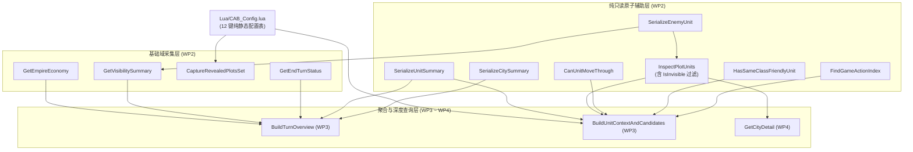
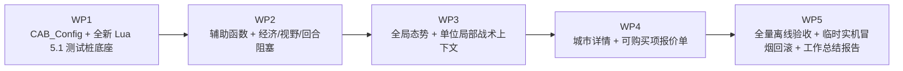

# M1Sub1（游戏内信息收集子模块 `CAB_InfoCollector`）工作计划

> [!IMPORTANT]
> 本计划针对 **模块 1：游戏端纯 Lua 桥接 Mod（`Civ5AgentBridge`）** 中的 **子模块 1：游戏内信息收集子模块（`CAB_InfoCollector`）** 编制，以 `docs/M1/` 下三份上位设计文档（`模块设计说明.md`、`模块内部接口设计.md`、`模块设计进度.md`）为唯一起点，面向多会话接力执行。
>
> **文档不可修改红线**：在 M1Sub1 设计、编码与验收全过程中，**严禁直接修改** `docs/M1/模块设计说明.md`、`docs/M1/模块内部接口设计.md`、`docs/M1/模块设计进度.md`。全部成果、接口增补建议与偏离项统一沉淀至验收后的 `M1Sub1工作总结报告.md`，交由上级评审会话验收后再统一回写上位文档。

---

## 一、 子模块定位、前置可启动性评估与决策定稿

### 1.1 前置依赖与可启动性结论

对照《模块设计说明.md》§2.2 拓扑图与《模块设计进度.md》§三 拆分计划，对 `CAB_InfoCollector` 的实际运行时依赖核查如下：

| 关联模块/工作包 | 计划排布关系 | 实际代码依赖关系 | 是否阻塞 M1Sub1 启动 |
| :--- | :---: | :--- | :---: |
| `CAB_Config.lua`（公共配置表） | 原划入 `M1-S1` | `CAB_InfoCollector` 唯一 `include` 的纯静态配置表 | **不阻塞**：由 M1Sub1 的 WP1 先行交付 |
| `CAB_ExternalIO` / `Civ5AgentBridgeJson` | 原划入 `M1-S1` | **零依赖**（可空字段用 Lua `nil`，不引入 `CAB_JSON_NULL`） | **不阻塞** |
| `CAB_TaskExecutor`（任务执行子模块） | 后续 `M1-S3 / M1-S4` | 反向依赖本子模块（复用本子模块只读函数），本子模块不依赖它 | **不阻塞** |
| `CAB_Dispatcher` / `UI` / `.modinfo` | 后续 `M1-S5` | 调度装配层调用本子模块，本子模块不依赖它 | **不阻塞** |

**结论**：**M1Sub1（`CAB_InfoCollector`）当前阶段无必须先完成的前序子模块依赖，可在本工作计划经用户确认后立即开展编码与测试。**

### 1.2 经用户确认的关键设计决策定稿表（`D-01` ~ `D-08`）

| 决策编号 | 决策主题 | 确认结论 | 对上位三文档的影响（留待总结报告呈报） |
| :---: | :--- | :--- | :--- |
| **D-01** | 基线重设 | **全新重来**：以 `docs/M1/` 三份文档为唯一起点重新规划；允许按本计划重写/替换仓库中已有的 `CAB_Config.lua` 与 `tests/m1sub1/*`、`tests/run_m1sub1_tests.py`。 | 无 |
| **D-02** | 严格隔离边界 | M1Sub1 仅交付 `mod/Lua/CAB_Config.lua`、`mod/Lua/CAB_InfoCollector.lua`、独立测试文件与 `docs/M1/M1Sub1/` 下三份文档；**绝不持久修改** `.modinfo`、`Civ5AgentBridgeCore/UI/Json/Loader`、`deploy_mod.ps1` 及 3 份上位 M1 文档（装配部署归 `M1-S5`）。 | 无 |
| **D-03** | 内部复用函数导出 | `CAB_Collector` 除导出《模块内部接口设计.md》§四的 **7 个主查询接口** 外，同步公开 **7 个纯只读复用辅助函数** 供 `CAB_TaskExecutor` 复用（见 §4.3）。 | 需在总结报告中建议补充至《模块内部接口设计.md》§四 |
| **D-04** | 战争迷雾与防侧信道 | 严格分层（`IsVisible` / `IsRevealed` / 黑雾）；过滤对己方隐形的敌军（`IsInvisible`）；`CanRangeStrikeAt` **仅允许对实时可见格或已探索敌对城市格调用**，严禁探测普通迷雾格；已探索敌城按 §4.2 保留 `hp`/`pop` 并标 `in_fog = true`；相邻黑雾格仅生成探路 `MOVE_STEP` 且不导出任何地块属性。 | 需在总结报告中记录细化后的迷雾防侧信道契约 |
| **D-05** | Mod 兼容性范围 | **不接入 `AirRaidLegacyUnits`**（不 `include("AirRaidCore")`、不调用 `AR_EnumerateTargets`）；**仅面向原生《文明5：BNW v1.0.3.279》及 IGE（Ingame Editor）兼容**。 | **契约偏离项**：需在总结报告中建议从《模块内部接口设计.md》§4.5 移除 `AR_EnumerateTargets` 联动描述 |
| **D-06** | 可空字段、错误形态与半径上限 | 可空字段统一使用 Lua `nil`（省略键，保持对 `CAB_Json` 零依赖）；非法入参统一返回 `{ __is_object = true, error = "..." }`；在 `CAB_Config.lua` 中增补 `MAX_SCAN_RADIUS = 8` 对外部 `radius` 钳制。 | 需在总结报告中建议将 `MAX_SCAN_RADIUS` 补入《模块设计说明.md》§4.1 |
| **D-07** | 双层验收策略 | **第一层（离线自动化）**：本机 Python + `lupa.lua51` 真实 Lua 5.1 语法检查 + 全新引擎桩契约/迷雾/只读守卫测试；**第二层（临时实机冒烟）**：WP5 验收前临时挂载至本机游戏完成原生 BNW + IGE 实机冒烟并检查 `Logs/Lua.log` 零报错，随后**完整回滚全部临时挂载改动**。 | 实机验证记录与待 `M1-S6` 闭环项写入总结报告 |
| **D-08** | 文档命名与阶段边界 | `docs/M1/M1Sub1/` 下统一命名为 `M1Sub1工作计划.md`、`M1Sub1工作进度.md`、`M1Sub1工作总结报告.md`；先评审确认本计划后再启动 WP1 编码。 | 无 |

---

## 二、 工程约束、红线边界与兼容基线

### 2.1 硬性架构约束

1. **纯只读传感器原则（Zero Engine Mutation）**：
   * `CAB_InfoCollector.lua` 严禁调用任何会修改游戏状态、经济、领土、存档或单位指令的接口（包括 `Set*`、`Game.HandleAction`、`Game.DoControl`、`Game.SelectionListMove`、`Game.SelectionListGameNetMessage`、`Game.CityPurchase*`、`Game.CityPushOrder`、`Network.Send*`、`SetScriptData`、`SetRevealed`、`ActivateNotification`、`RemoveNotification` 等）。
   * **唯一允许的临时 UI 副作用**：`BuildUnitContextAndCandidates` 在枚举原地动作（`SETUP_FOR_RANGED` / `FORTIFY` / `HEAL`）时，允许临时调用 `UI.SelectUnit(pUnit)` 配合 `Game.CanHandleAction` 判定，但在判定结束后**必须无条件恢复调用前的选区**（原选中单位仍存活则 `UI.SelectUnit(prevSelected)`；若原无选中则 `UI.ClearSelectionList()`），且需用 `pcall` 兜底确保异常路径也不破坏选区。
2. **单向分层与全局命名空间洁净**：
   * `CAB_Config.lua` 为纯静态常量表：零 `include`、零函数、零引擎调用，仅定义全局变量 `CAB_Config`。
   * `CAB_InfoCollector.lua` 仅允许 `include("CAB_Config")` 一次（禁止引入 `Civ5AgentBridgeJson`、`CAB_ExternalIO`、`AirRaidCore` 等其他文件），仅定义唯一全局变量 `CAB_Collector`，所有内部辅助工具均声明为 `local`。
3. **《文明5：BNW》Lua 5.1 语法与引擎避坑纪律**：
   * 严格使用 Lua 5.1 语法（禁用 Lua 5.2+ 的 `goto`、`table.unpack`、`bit32`、`//` 整除运算符等）。
   * **严禁调用 `pUnit:CanMoveOrAttackInto(pPlot)`**（原版 BNW `CvGameCore_Expansion2.dll` 硬编码返回 `false`），统一改用 `pUnit:CanMoveThrough(pPlot)` + 同类单位 1UPT 检查。
   * 单位可行动判定必须同时检查 `MovesLeft() > 0` 与 `IsReadyToMove() == true`（排除已跳过/已驻扎但 `MovesLeft() > 0` 的单位）。
   * 所有 `GameInfo` 查表与对象属性读取做好越界/空值防护。
4. **代码注释规范**：
   * 每个 Lua 文件头部注明文件职责、依赖关系、对外契约与引擎接口依据；
   * 每个函数上方必须提供中文函数头注释，写明**做什么（What）**、**为什么这么做（Why，特别是引擎避坑或迷雾边界原因）**、输入参数与返回值结构。

### 2.2 战争迷雾与防侧信道 6 条红线（D-04）

| 编号 | 规则说明 | 校验方式 |
| :---: | :--- | :--- |
| **F-01** | **实时可见敌军唯一门槛**：敌方/蛮族单位仅当所在格 `pPlot:IsVisible(activeTeam, false) == true` 时才允许导出。 | 桩测试 + 迷雾泄露回归 |
| **F-02** | **隐形单位强制过滤**：即使地块实时可见，若 `pUnit:IsInvisible(activeTeam, false) == true`（如未反隐的敌方潜艇），**严禁导出**（全图扫描与局部网格均适用）。 | 桩测试专项用例 |
| **F-03** | **远程探测防侧信道**：`BuildUnitContextAndCandidates` 枚举 `RANGE_ATTACK` / `AIR_STRIKE` 候选时，**仅允许对 `isVis == true` 或已探索敌对城市格（`isRev and isHostileCity`）调用 `pUnit:CanRangeStrikeAt`**，严禁对普通迷雾格或黑雾格调用，防止引擎返回 `true` 间接暴露迷雾下敌军位置。 | 桩测试调用日志断言（`queriesOnInvisible`） |
| **F-04** | **迷雾格严格脱敏**：对 `IsRevealed == true` 且 `IsVisible == false` 的地块，`surrounding_tiles` 仅导出静态地形/地貌/丘陵/河流及已探索城市基础信息，**不导出 `improvement`（动态改良）、`friendly_unit_id`、`enemy_unit`**；`visible_enemy_cities` 显式标记 `in_fog = true`。 | 桩测试键集合断言 |
| **F-05** | **黑雾格零信息泄露**：对 `IsRevealed == false` 的地块，绝不加入 `surrounding_tiles` 或 `visible_enemy_cities`；仅对相邻 1 格黑雾且陆/海单位仍有移动力时生成探路 `MOVE_STEP`（不附带任何地形或战斗预览）。 | 桩测试专项用例 |
| **F-06** | **未解锁科技资源屏蔽**：`GetCityDetail` 的 `purchasable_plots` 读取地块资源时必须调用 `pPlot:GetResourceType(activeTeam)`（而非无参/传 `-1`），确保未研究对应科技（如铁器/马术/铝/铀）时不提前泄露战略资源。 | 桩测试专项用例 |

### 2.3 原生 BNW 与 IGE 兼容性要求（D-05）

1. **零跨调用可变缓存**：IGE 允许玩家在回合中随时刷兵、删单位、建城/毁城、改地形、开全图/关全图、改金币/信仰/建筑。`CAB_InfoCollector` 内部不缓存玩家、单位、城市、地块或资源快照，每次调用实时读取引擎最新状态。
2. **存活性与延迟死亡防护**：遍历或按 ID 查找单位/城市时，统一过滤 `nil`、`pUnit:IsDead()`、`pUnit:IsDelayedDeath()`（若方法存在）以及 `not pPlayer:IsAlive()`；对 `Players[i]` 槽位兼容“存活玩家/死玩家/nil”三种形态。
3. **IGE 界面模式友好**：若 `UI.GetInterfaceMode` 可用且当前处于非 `INTERFACEMODE_SELECTION` 模式（如玩家正在打开 IGE 刷地形或手动瞄准），临时选中单位探测动作后仍可靠恢复原选区；不主动切换 `UI.SetInterfaceMode`（本身亦属禁止的写入操作）。
4. **不引入外部 Mod 依赖**：完全不涉及 `AirRaidLegacyUnits`（不探测、不加载 `AirRaidCore`、不调用 `AR_EnumerateTargets`）。

### 2.4 DTO 编码与异常处理约定（D-06）

1. **对象/数组显式区分**：所有期望序列化为 JSON 对象的 Lua 表（含可能为空的字典如 `strategic_resources`、`luxury_resources`、各类 DTO）必须包含 `__is_object = true`；所有列表使用标准 1-based 连续数组 `{}`（不设 `__is_object`）。
2. **可空字段约定**：可空字段（如 `feature`、`improvement`、`friendly_unit_id`、`enemy_unit`、`city`、`combat_preview`、`garrison_unit_id`、`blocking_unit_id`、`blocking_city_id`、`notification_summary`、`resource_type`）在无值时直接留 Lua `nil`（省略键），绝不引入 `CAB_JSON_NULL`。
3. **非法入参兜底**：
   * `GetEmpireEconomy`、`GetEndTurnStatus`、`BuildTurnOverview`、`BuildUnitContextAndCandidates`、`GetCityDetail`：当 `activePlayerID` 无效/未存活，或 `unitID`/`cityID` 不存在/已死亡/非本玩家所属时，统一返回 `{ __is_object = true, error = "<明确英文错误说明>" }`，不抛 Lua 异常。
   * `GetVisibilitySummary(activePlayerID)`：非法玩家时返回 `({ __is_object = true, visible_enemies = {}, visible_enemy_cities = {}, error = "<错误说明>" }, {})`。
   * `CaptureRevealedPlotsSet(activePlayerID, centerX, centerY, radius)`：非法玩家、非法坐标或 `radius < 0` 时安全返回空表 `{}`；正数 `radius` 钳制至 `[0, CAB_Config.MAX_SCAN_RADIUS]`。
4. **数值规范化**：`moves_left` / `max_moves` 除以 `MOVE_DENOMINATOR`（默认 60）后保留两位小数向下截断（`math.floor(val * 100 + 1e-6) / 100` 防浮点误差）；`hp` 恒非负（`math.max(0, maxHp - damage)`）。

---

## 三、 修改与产出文件清单（严格白名单与禁止清单）

### 3.1 M1Sub1 永久产出与可修改文件白名单

| 文件路径（相对 `Civ5AgentBridge/`） | 操作类型 | 所属工作包 | 职责说明 |
| :--- | :---: | :---: | :--- |
| `docs/M1/M1Sub1/M1Sub1工作计划.md` | 新建 | 设计阶段（本会话） | 本计划文档（约束、前置、文件清单、接口、WP 拆分与验收标准） |
| `docs/M1/M1Sub1/M1Sub1工作进度.md` | 新建 & 持续更新 | 设计阶段 ~ WP5 | 多会话进度看板、决策登记、偏离台账与交接日志 |
| `docs/M1/M1Sub1/M1Sub1工作总结报告.md` | 新建 | WP5 | M1Sub1 验收总结与上位文档回写建议报告（供上级评审会话审查） |
| `mod/Lua/CAB_Config.lua` | 全新重写 | WP1 | 全局静态只读配置表（12 键：§4.1 原 11 键 + `MAX_SCAN_RADIUS = 8`） |
| `mod/Lua/CAB_InfoCollector.lua` | 新建 | WP2 ~ WP4 | 子模块 1 正式实现（7 主接口 + 7 复用只读辅助函数） |
| `tests/run_m1sub1_tests.py` | 全新重写 | WP1 | 基于本机 Python + `lupa.lua51` 的 Lua 5.1 语法检查与桩测试入口 |
| `tests/m1sub1/engine_stubs.lua` | 全新重写 | WP1（WP2~4 按需扩充） | 纯净版 Civ5 BNW Lua 5.1 引擎桩、只读守卫、调用日志与世界快照工具 |
| `tests/m1sub1/test_collector.lua` | 全新重写 | WP1 ~ WP4 | 覆盖全部 7 主接口、7 复用函数、迷雾/隐形/侧信道、只读守卫与 IGE 边界的用例集 |

> [!NOTE]
> `git status` 显示工作区中曾有旧文件 `docs/M1/M1Sub1/SubM1工作计划.md` 与 `SubM1工作进度.md` 处于未暂存删除状态；本计划按 D-01/D-08 使用全新文件名 `M1Sub1工作计划.md` 与 `M1Sub1工作进度.md`，不恢复旧文档。

### 3.2 WP5 临时实机冒烟期间临时改动文件（必须完整回滚）

在 WP5 执行**临时实机冒烟验证**期间，为使本机游戏加载 `CAB_Config.lua` 与 `CAB_InfoCollector.lua` 并触发一次只读自检输出至 `Logs/Lua.log`，仅允许**临时**改动以下文件，**冒烟完毕后必须使用 `git checkout` / 清理脚本 100% 回滚原状**：
* `mod/Civ5AgentBridge.modinfo`（临时登记 `CAB_Config.lua`、`CAB_InfoCollector.lua` 及临时冒烟入口，验证后回滚）
* `mod/Lua/Civ5AgentBridgeUI.lua` 或临时测试钩子文件（验证后回滚/删除）
* 游戏 `cache/Civ5*.db` 与 `MODS/Civ5AgentBridge/` 部署同步（验证并回滚后按需恢复部署一致性）

### 3.3 严禁修改文件清单（绝对红线）

* `docs/M1/模块设计说明.md`
* `docs/M1/模块内部接口设计.md`
* `docs/M1/模块设计进度.md`
* `docs/01_技术瓶颈与可行性试验清单.md`、`docs/02_软件总体设计说明书.md`、`docs/03_接口设计说明书.md`
* `mod/Lua/Civ5AgentBridgeCore.lua`、`mod/Lua/Civ5AgentBridgeJson.lua`、`mod/Lua/Civ5AgentBridgeLoader.lua/.xml`、`mod/Lua/Civ5AgentBridgeUI.xml`、`scripts/deploy_mod.ps1`（均不得留下任何持久化修改）

---

## 四、 接口契约、数据结构与内部依赖拓扑

### 4.1 `CAB_Config.lua` 配置键契约（共 12 键）

| 键名 | 类型 | 默认值 | 来源 | M1Sub1 使用情况 |
| :--- | :--- | :--- | :---: | :--- |
| `DB_NAME` | `string` | `"Civ5AgentBridge"` | `模块设计说明.md` §4.1 | 预留给 `CAB_ExternalIO` |
| `DB_VERSION` | `number` | `1` | `模块设计说明.md` §4.1 | 预留给 `CAB_ExternalIO` |
| `CHUNK_SIZE_BYTES` | `number` | `3000` | `模块设计说明.md` §4.1 | 预留给 `CAB_ExternalIO` |
| `POLL_INTERVAL_SEC` | `number` | `0.20` | `模块设计说明.md` §4.1 | 预留给 `CAB_Dispatcher` |
| `HEARTBEAT_INTERVAL_SEC` | `number` | `2.00` | `模块设计说明.md` §4.1 | 预留给 `CAB_Dispatcher` |
| `DEFAULT_UNIT_SETTLE_SEC` | `number` | `0.35` | `模块设计说明.md` §4.1 | 预留给 `CAB_TaskExecutor` |
| `PLOT_BUY_SETTLE_SEC` | `number` | `0.10` | `模块设计说明.md` §4.1 | 预留给 `CAB_TaskExecutor` |
| `MAX_SETTLE_TIMEOUT_SEC` | `number` | `1.50` | `模块设计说明.md` §4.1 | 预留给 `CAB_TaskExecutor` |
| `DEFAULT_SCAN_RADIUS` | `number` | `3` | `模块设计说明.md` §4.1 | **`BuildUnitContextAndCandidates` 默认扫描半径** |
| `DELTA_REVEAL_SCAN_RADIUS` | `number` | `5` | `模块设计说明.md` §4.1 | **`CaptureRevealedPlotsSet` 默认采样半径** |
| `MAX_SCAN_RADIUS` | `number` | `8` | **决策 D-06 增补** | **扫描半径上限钳制，防止超大半径卡死游戏** |
| `ENABLE_DEBUG_LOG` | `boolean` | `true` | `模块设计说明.md` §4.1 | 调试日志开关 |

### 4.2 `CAB_Collector` 7 个主查询接口契约（严格对齐《模块内部接口设计.md》§四）

| # | 函数签名 | 输出 DTO 核心字段（对象均带 `__is_object = true`） | 关键引擎 API 与边界说明 |
| :-: | :--- | :--- | :--- |
| 1 | `CAB_Collector.GetEmpireEconomy(activePlayerID)` | `EconomyDTO`: `gold`, `gold_per_turn`, `science_per_turn`, `culture_per_turn`, `faith_per_turn`, `faith_total`, `happiness`, `is_golden_age`, `strategic_resources` (`dict[str,int]`), `luxury_resources` (`dict[str,int]`) | `Players[id]` 各项产出接口；遍历 `GameInfo.Resources()`，经 `Game.GetResourceUsageType(res.ID)` 区分战略/奢侈资源，仅收录 `GetNumResourceAvailable(res.ID, true) > 0` 的条目。 |
| 2 | `CAB_Collector.GetVisibilitySummary(activePlayerID)` | 双返回 `(VisibilitySummaryDTO, visibleEnemyMap)`： • `VisibilitySummaryDTO`: `visible_enemies` (`EnemyUnitDTO[]`), `visible_enemy_cities` (`EnemyCityDTO[]`, 含 `city_id`, `owner_id`, `owner_name`, `name`, `is_minor_civ`, `is_at_war`, `x`, `y`, `hp`, `pop`, `in_fog`) • `visibleEnemyMap`: `{ [enemy_id] = EnemyUnitDTO }` | 遍历 `0 .. MAX_PLAYERS-1` 非己方存活玩家；敌军要求 `IsVisible(activeTeam, false) and not IsInvisible(activeTeam, false)`；敌城要求 `IsRevealed(activeTeam, false)` 且标注 `in_fog = not IsVisible(...)`。`city_id` 与 `enemy_id` 采用 `"<ownerID>:<id>"` 防跨玩家碰撞。 |
| 3 | `CAB_Collector.CaptureRevealedPlotsSet(activePlayerID, centerX, centerY, radius)` | `table`: `{ ["x:y"] = true, ... }`（纯坐标集合，不带 `__is_object`） | `radius` 缺省取 `CAB_Config.DELTA_REVEAL_SCAN_RADIUS`，钳制至 `[0, MAX_SCAN_RADIUS]`；`Map.GetPlotXY` 包络扫描 + `Map.PlotDistance <= r` + `pPlot:IsRevealed(activeTeam, false)`。 |
| 4 | `CAB_Collector.GetEndTurnStatus(activePlayerID)` | `EndTurnStatusDTO`: `is_turn_active`, `can_end_turn_now`, `blocking_type_id`, `blocking_type_name`, `blocking_unit_id` (可空), `blocking_city_id` (可空), `notification_summary` (可空) | 参照 `ActionInfoPanel.lua`：读取 `pPlayer:IsTurnActive()`、`pPlayer:GetEndTurnBlockingType()`；映射全量 `EndTurnBlockingTypes.*` 枚举名（无阻塞映射为 `"NO_BLOCKING"`）；待命/叠栈取 `GetFirstReadyUnit()`、待晋升遍历找 `IsPromotionReady()`、缺生产遍历找非傀儡/非抵抗/非焚城且 `GetOrderQueueLength() == 0` 的城市；通知摘要通过 `GetEndTurnBlockingNotificationIndex()` 匹配 `GetNotificationIndex(i)` 取 `GetNotificationSummaryStr(i)`；`can_end_turn_now = is_turn_active and blocking_type_name == "NO_BLOCKING"`（若 `UI.CanEndTurn` 存在则与其取逻辑与）。 |
| 5 | `CAB_Collector.BuildTurnOverview(activePlayerID)` | `TurnOverviewDTO`（100% 兼容《03》§2.1 + 扩展字段）：`turn_number`, `active_player_id`, `player_civ`, `yields`（含 `gold`, `gold_per_turn`, `science_per_turn`, `culture_per_turn`, `faith_per_turn`, `faith_total`, `happiness`, `is_golden_age`, `strategic_resources`, `luxury_resources`）, `our_units`, `visible_enemies`, `our_cities`（含 `can_range_strike` 及产出概要）, `visible_enemy_cities`, `end_turn_status` | 聚合调用 `GetEmpireEconomy`、`GetVisibilitySummary`、`GetEndTurnStatus`、`SerializeUnitSummary`、`SerializeCitySummary`；严禁重复写扫描逻辑。 |
| 6 | `CAB_Collector.BuildUnitContextAndCandidates(activePlayerID, unitID, radius)` | `UnitTacticalContextDTO`: `unit`, `surrounding_tiles`, `candidate_actions` | `radius` 默认 `CAB_Config.DEFAULT_SCAN_RADIUS`，钳制至 `[0, MAX_SCAN_RADIUS]`；`scanRadius = max(r, airRange)`（空军范围仍受合理边界保护，或按 `pUnit:Range()` 覆盖空军真实射程）。遵循 F-01~F-05 迷雾红线、原版 `CanMoveThrough` + 1UPT、无 `AirRaidLegacyUnits`、临时选区探测 `SETUP_FOR_RANGED`/`FORTIFY`/`HEAL`/`SKIP_TURN` 并安全恢复选区。 |
| 7 | `CAB_Collector.GetCityDetail(activePlayerID, cityID, includePurchasable)` | `CityDetailDTO`: `city`, `yields`, `production_state`, `garrison_unit_id` (可空), `built_buildings`, `ranged_attack_targets`, `purchasable_buildings`, `purchasable_units`, `purchasable_plots` | `includePurchasable` 默认 `true`（传 `false` 时三个 `purchasable_*` 返回空数组 `[]`）；`ranged_attack_targets` 在 `CanRangeStrikeNow()` 为真时扫描 `CITY_ATTACK_RANGE` 内可见敌军并经 `CanRangeStrikeAt(tx, ty, true, true)` 校验；购买建筑/单位按双层 `IsCanPurchase(false, false, ...)` / `(true, true, ...)` 分别筛候选与 `can_afford_*_now`，含金币与信仰双报价；买地检查 `BUY_PLOTS_DISABLED == 0`，遍历 `0..GetNumCityPlots()-1`，用 `CanBuyPlotAt(px, py, true/false)` 与 `GetBuyPlotCost(px, py)`，资源经 `GetResourceType(activeTeam)` 过滤。 |

### 4.3 `CAB_Collector` 7 个公开的纯只读复用辅助函数（供 `CAB_TaskExecutor` 复用，D-03）

| # | 函数签名 | 返回值与职责说明 |
| :-: | :--- | :--- |
| H1 | `CAB_Collector.SerializeUnitSummary(pUnit)` | 序列化己方单位为 `UnitSummaryDTO`（死/延迟死/nil 返回 `nil`）；结合 `MovesLeft() > 0` 与 `IsReadyToMove()` 判定 `can_act`。 |
| H2 | `CAB_Collector.SerializeEnemyUnit(pEnemyUnit)` | 序列化可见敌军/蛮族单位为 `EnemyUnitDTO`（含 `"<ownerID>:<unitID>"` 复合 `enemy_id`）。 |
| H3 | `CAB_Collector.SerializeCitySummary(pCity)` | 序列化己方城市为 `CitySummaryDTO`（含 `city_id`, `name`, `x`, `y`, `pop`, `hp`, `max_hp`, `current_production`, `turns_left`, `yields`, `can_range_strike`）。 |
| H4 | `CAB_Collector.InspectPlotUnits(pPlot, activePlayerID)` | 扫描**可见**地块上的单位，返回 `(friendlyId, enemyDto)`；军民叠栈优先主战单位（`IsCombatUnit()`），对敌方单位强制过滤 `IsInvisible(activeTeam, false)`。 |
| H5 | `CAB_Collector.CanUnitMoveThrough(pUnit, pPlot)` | `pcall` 包裹 `pUnit:CanMoveThrough(pPlot)`，彻底隔离原版 DLL `CanMoveOrAttackInto` 恒假缺陷。 |
| H6 | `CAB_Collector.HasSameClassFriendlyUnit(pPlot, activePlayerID, isSelfCombat)` | 检查目标格是否存在同类别（同战斗或同民用）的己方存活单位，保障 1UPT 规则准确。 |
| H7 | `CAB_Collector.FindGameActionIndex(actionTypeStr)` | 遍历 `0 .. #GameInfoActions`，用 `Game.CanHandleAction(iAction, 0, 1)` 与 `Game.CanHandleAction(iAction)` 查找当前选中单位合法动作索引。 |

### 4.4 子模块内部依赖拓扑图

---

## 五、 多会话工作包拆分与依赖顺序（`WP1` ~ `WP5`）

为控制单次会话上下文长度、确保每步均可独立编译测试并留下清晰交接点，将 M1Sub1 划分为 **5 个严格串行推进的工作包**：

| 工作包 | 核心目标 | 涉及文件 | 独立完成标准（Done Criteria） | 建议会话数 |
| :---: | :--- | :--- | :--- | :---: |
| **WP1** | **公共配置表与全新 Lua 5.1 桩测试底座** | 重写 `mod/Lua/CAB_Config.lua` 重写 `tests/run_m1sub1_tests.py` 重写 `tests/m1sub1/engine_stubs.lua` 重写 `tests/m1sub1/test_collector.lua` | 1. `CAB_Config.lua` 12 个键类型/默认值完整、零依赖； 2. `python tests/run_m1sub1_tests.py` 可一键完成 Lua 5.1 编译检查（含负向语法自检）+ 桩自检（含只读守卫陷阱、调用日志、世界快照、六边形距离与视野独立性），全部绿灯。 | 1 会话 |
| **WP2** | **`CAB_InfoCollector` 骨架 + 7 辅助函数 + 经济/视野/回合阻塞** | 新建 `mod/Lua/CAB_InfoCollector.lua`（前半） 扩充 `tests/m1sub1/test_collector.lua` | 1. 实现 H1~H7 与 `GetEmpireEconomy`、`GetVisibilitySummary`、`CaptureRevealedPlotsSet`、`GetEndTurnStatus`； 2. 覆盖资源分类/零量过滤、隐形敌军屏蔽、迷雾敌城 `in_fog`、24 种 `EndTurnBlockingTypes` 映射与通知匹配、非法入参兜底； 3. `run_m1sub1_tests.py` 100% 通过且只读守卫违规为 0。 | 1 会话 |
| **WP3** | **全局态势汇总与单位战术上下文/候选动作** | 更新 `mod/Lua/CAB_InfoCollector.lua`（中段） 扩充 `tests/m1sub1/test_collector.lua` | 1. 实现 `BuildTurnOverview`（100% 兼容《03》§2.1 + 扩展经济与阻塞态）与 `BuildUnitContextAndCandidates`； 2. 通过专项测试：1UPT 停靠、`CanMoveThrough` 避坑、相邻黑雾探路不泄露地形、`CanRangeStrikeAt` 不探测普通迷雾格（`queriesOnInvisible == 0`）、空军射程覆盖、选区恢复（含原无选中与异常路径）、IGE 瞬变场景、确认不含 `AirRaidLegacyUnits` 代码； 3. `run_m1sub1_tests.py` 100% 通过。 | 1 会话 |
| **WP4** | **城市详情、城防目标与可购买建筑/单位/地块报价** | 更新 `mod/Lua/CAB_InfoCollector.lua`（收尾） 扩充 `tests/m1sub1/test_collector.lua` | 1. 实现 `GetCityDetail` 全量字段（基础态、分项产出、队列、驻军、真实建筑、远程炮击目标、双层 `IsCanPurchase` 建筑/单位金币与信仰报价、可购地块科技过滤资源与 `BUY_PLOTS_DISABLED` 处理）； 2. 覆盖 `includePurchasable = false`、傀儡/占领/抵抗/焚城、非法 `cityID` / 敌方城市越权拒绝； 3. 全量离线桩测试 100% 通过，模块仅导出唯一全局 `CAB_Collector`。 | 1 会话 |
| **WP5** | **双层总验收、临时实机冒烟回滚与工作总结报告** | 临时挂载验证后**回滚** 新建 `docs/M1/M1Sub1/M1Sub1工作总结报告.md` 更新 `M1Sub1工作进度.md` | 1. 离线全量测试 100% 通过且零只读违规、零全局污染； 2. 完成本机游戏临时挂载实机冒烟（原生 BNW + IGE 场景），确认 7 主接口真实返回有效结构且 `Logs/Lua.log` 零报错； 3. **完整回滚**所有临时挂载改动，`git status` 仅包含白名单产出文件且三份上位 M1 文档零修改； 4. 产出《M1Sub1工作总结报告.md》供上级评审验收。 | 1 会话 |

---

## 六、 验收标准清单（`A-01` ~ `A-10`）与风险防护

### 6.1 验收标准矩阵

| 验收项 | 验收内容 | 判定标准 | 验证手段 |
| :---: | :--- | :--- | :--- |
| **A-01** | Lua 5.1 语法与加载洁净 | `CAB_Config.lua` 与 `CAB_InfoCollector.lua` 通过 `lupa.lua51` `loadstring` 编译；仅 `include("CAB_Config")` 一次；全局变量表仅新增 `CAB_Config` 与 `CAB_Collector`。 | `run_m1sub1_tests.py` 阶段 1 + 冒烟用例 |
| **A-02** | 接口签名与 DTO 完整性 | 7 个主接口 + 7 个复用辅助函数签名与返回字段 100% 对齐本计划 §4.2~4.3 及《03》§2.1/§2.2 向下兼容要求。 | 键集合断言 + 契约用例 |
| **A-03** | 纯只读零写入红线 | 全部测试跑完后，只读守卫记录写入类调用 = 0，世界状态快照前后完全一致；选区探测结束后恢复原选区。 | 引擎桩只读守卫 + 世界快照比对 |
| **A-04** | 战争迷雾与防侧信道红线 | F-01 ~ F-06 全部专项用例通过：隐形敌军不可见、黑雾不泄露属性、普通迷雾格 `CanRangeStrikeAt` 调用次数 = 0、未解锁科技资源不泄露。 | 迷雾回归用例 + 调用日志断言 |
| **A-05** | 原版 DLL 避坑与 1UPT | 代码中零出现 `CanMoveOrAttackInto`；移动候选经 `CanMoveThrough` + 同类单位 1UPT 过滤；已跳过/已驻扎单位 `can_act == false`。 | 静态检视 + 桩测试 |
| **A-06** | 无 `AirRaidLegacyUnits` 且兼容 IGE | 代码中零出现 `AirRaidCore` / `AR_EnumerateTargets`；连续调用反映 IGE 实时改动（无陈旧缓存）；死单位/延迟死亡/空槽位不崩溃。 | 静态检视 + IGE 动态变更用例 |
| **A-07** | 异常入参防御与半径钳制 | 非法 `playerID` / `unitID` / `cityID` / 超大或负 `radius` 均安全返回结构化错误或钳制结果，绝不抛未捕获 Lua 异常。 | 边界异常用例 |
| **A-08** | 城市购买与回合阻塞精度 | `GetCityDetail` 区分“规则可买”与“当前买得起”（金币/信仰双通道）及 `BUY_PLOTS_DISABLED`；`GetEndTurnStatus` 准确识别无阻塞与各类阻塞并定位关联单位/城市/通知。 | 城市与阻塞专项用例 |
| **A-09** | 临时实机冒烟零报错 | 本机游戏实机加载（含 IGE 场景）跑通 7 个主接口冒烟采样，`Logs/Lua.log` 零 Lua 运行时报错，随后临时改动 100% 回滚。 | WP5 实机冒烟日志 + `git diff` 核验 |
| **A-10** | 隔离纪律与总结交付 | `docs/M1/模块设计说明.md`、`模块内部接口设计.md`、`模块设计进度.md` 与其他非白名单文件零持久化改动；完成《M1Sub1工作总结报告.md》与进度闭环。 | `git status` + 文档审阅 |

### 6.2 已知风险与防护措施

1. **引擎桩与实机细微语义偏差风险**：离线桩无法替代真实 `CvGameCore_Expansion2.dll` 对某些返回值类型（如 `GetBuildingFaithPurchaseCost` 传参、`GetEndTurnBlockingType` 枚举数值、`GetNotificationIndex` 0-based/1-based 行为）的真值表现。**防护**：所有核心引擎调用均对照本机 `CvLuaCity.cpp` / 官方 UI Lua 核实，并在 WP5 通过临时实机冒烟完成实证闭环。
2. **临时实机冒烟遗留脏改动风险**：WP5 临时改 `.modinfo` 或 UI 壳层后若忘记还原，会破坏 D-02 严格隔离边界。**防护**：WP5 规定冒烟结束后强制执行 `git status` 与 `git diff` 逐文件复核，确保非白名单文件改动清零后才产出总结报告。
3. **跨会话上下文漂移风险**：多会话接力容易出现字段名、用例编号或进度记录不一致。**防护**：每次新会话启动必须先读本计划与《M1Sub1工作进度.md》，每完成一个 WP 立即更新进度表、交接日志与偏离台账。

---

## 七、 多会话接力执行规程

1. **新会话启动必读顺序**：
   1. `docs/M1/M1Sub1/M1Sub1工作进度.md`（定位当前待执行 WP、已确认决策与上一会话交接事项）；
   2. `docs/M1/M1Sub1/M1Sub1工作计划.md`（本文档，核对本 WP 的文件清单、接口字段、红线与完成标准）；
   3. 按需核对 `docs/M1/模块内部接口设计.md` §四 与 `docs/M1/模块设计说明.md` §三、§四、§六。
2. **会话结束必做动作**：
   1. 运行 `python tests/run_m1sub1_tests.py` 并记录通过/失败/跳过数及只读守卫计数；
   2. 核对 `git status`，确认未触碰禁止清单中的任何文件；
   3. 在 `docs/M1/M1Sub1/M1Sub1工作进度.md` 更新当前 WP 状态、实测摘要与下个 WP 的接力提示。
