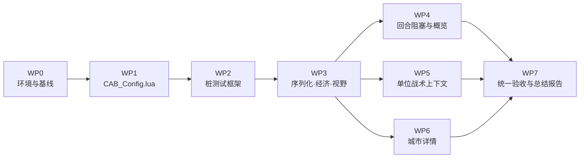
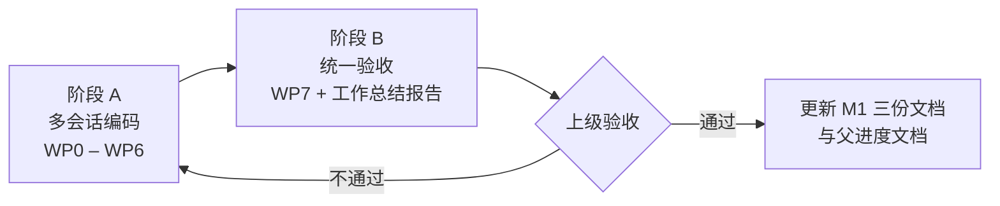

# 子模块 1（游戏内信息收集子模块 CAB_Collector / M1Sub1）工作计划

> [!IMPORTANT]
> 本文档是**模块 1 的子模块 1：游戏内信息收集子模块**（父文档《模块设计进度.md》中的任务包 `M1-S2`）的多会话执行计划，写明工作的约束、前置、修改文件清单、依赖顺序、接口与边界，供多个会话依次推进。执行进度、当前交接与风险跟踪统一记录在同目录的《SubM1工作进度.md》。
>
> 上级设计依据是 `docs/M1/` 下的《模块设计说明.md》《模块内部接口设计.md》《模块设计进度.md》以及 `docs/03_接口设计说明书.md`。与上级文档冲突时按以下顺序取舍：① 本文档 §二「用户决策记录」；② 本文档 §9.2「设计文档勘误表」；③ 其余以上级文档为准。上级文档本身的修订留到上级验收通过后统一回写，清单见 §13.3。

| 项目 | 内容 |
| :--- | :--- |
| 初版日期 | 2026-11-25 |
| 当前状态 | 计划已落盘；**编码尚未开始** |
| 维护规则 | 接口、规则、工作包的实质变更回写本文档；只涉及执行状态的变更写《SubM1工作进度.md》 |

---

## 一、 定位与完成定义

### 1.1 定位

* **源文件**：`Civ5AgentBridge/mod/Lua/CAB_InfoCollector.lua`，导出全局表 `CAB_Collector`。文件名用 `InfoCollector`、表名用 `Collector` 是上级文档的既定命名，不要"纠正"。
* **职责**：把引擎的 Player / City / Unit / Plot / Team 对象转换为可 JSON 序列化的纯 Lua 表，并严格执行战争迷雾过滤。定位是**只读传感器**，不修改任何游戏状态。
* **上级依据**：《模块内部接口设计.md》§四（7 个函数的签名与 DTO）、《模块设计说明.md》§1.2（迷雾红线）、§3.1（功能域）、§六（接口依据）、《03_接口设计说明书.md》§2.1 与 §2.2（`TurnOverviewDTO` 与 `UnitTacticalContextDTO` 的兼容基线）。

### 1.2 整体完成定义

以下 5 条全部满足，子模块 1 才算完成：

1. 7 个对外函数全部实现，签名与《模块内部接口设计.md》§四一致，DTO 键名与 §四及《03》§2.1/§2.2 一致（附加键见 §7.5）。
2. 迷雾规则 F1–F6（§八）全部落实，每条都有对应的自动化用例（§10.3）。
3. 每个引擎调用都在注释中写明本机出处：官方先例（文件:行），或明确标注"无官方先例"及其依据。
4. 桩测试全部通过，只读性守卫零触发，JSON 回环通过。
5. 工作总结报告完成并经上级验收通过，M1 三份文档完成回写（§13.3）。

### 1.3 编号约定

| 前缀 | 含义 | 所在位置 |
| :--- | :--- | :--- |
| `U-xx` | 用户明示决策 | §二 |
| `D-xx` | 默认取舍（非用户明示，上级验收时可否决） | §二 |
| `P-x` | 选中保护规则 | §3.3 |
| `WPn` | 工作包 | §五 |
| `F1`–`F6` | 迷雾口径规则 | §八 |
| `E-x` | 设计文档勘误 | §9.2 |
| `Q-x` | 原型中不得带入的缺陷 | §9.5 |
| `R-x` | 风险与待实机确认项 | §9.6 |
| `T-nn` | 测试用例 | §10.3 |
| `A-n` | 统一验收检查项 | §十二 |

---

## 二、 用户决策记录

### 2.1 用户明示决策（不得擅自更改）

| 编号 | 日期 | 决策 | 影响 |
| :--- | :--- | :--- | :--- |
| `U-01` | 2026-11-25 | 本子模块开工前，先按《模块设计说明.md》§4.1 创建完整的 `CAB_Config.lua`（原属 M1-S1），再写采集逻辑 | 由 WP1 承担；M1-S1 余下部分后续照常进行，只需核对配置表 |
| `U-02` | 2026-11-25 | **不考虑 AirRaidLegacyUnits 模组，只针对原版游戏** | 不 `include("AirRaidCore")`，不调用 `AR_EnumerateTargets`；`AIR_STRIKE` 候选只走原版机制。上级文档中所有联动描述需回写，见 §13.3 |
| `U-03` | 2026-11-25 | 验证方式为引擎桩测试：项目 `.venv` 内安装 `lupa`（内置 Lua 5.1） | WP0、WP2；本子模块阶段不部署实机 |
| `U-04` | 2026-11-25 | 采用多会话依次推进：以本计划与《SubM1工作进度.md》作交接载体；全部工作包完成后统一验收并出工作总结报告，上级验收通过后更新文件 | 全文 |

父文档 D-06 的 4 项待确认决策均不阻塞本子模块；其中第 1 项（模块化拆分替换）是本子模块存在的前提。

### 2.2 默认取舍（随技术方案一并并入，上级验收时可否决）

| 编号 | 取舍 | 理由 |
| :--- | :--- | :--- |
| `D-01` | 附加键（只增不改），清单见 §7.5 | 原型已有的键保持；新增键用于区分盟友与敌对、提供完整信息 |
| `D-02` | 可空字段值为空时省略该键 | 与原型及 JSON 编码器约定一致，Python 侧按"缺失即 null"处理 |
| `D-03` | `turns_to_growth` 在停滞或禁止增长时省略 | 净粮正负已由 `food_net` 表达，不自造哨兵值 |
| `D-04` | 默认扫描半径取 3 | 原型实机默认是 2，按设计 §4.1 的 `DEFAULT_SCAN_RADIUS=3` 执行 |
| `D-05` | 原地动作探测加选中保护（`P-1`–`P-4`） | 原型没有；切换选中会打断玩家正在进行的瞄准 |
| `D-06` | 配置表增加 `MAX_SCAN_RADIUS = 8` | 外部传入超大半径时钳制扫描范围，防止一次查询遍历上百万格卡死游戏 |

---

## 三、 约束

### 3.1 适用的硬性开发纪律（来自工作区根目录 `AGENTS.md`）

| 纪律 | 是否适用 | 落实方式 |
| :--- | :--- | :--- |
| 1 modinfo 路径一律正斜杠 | 本阶段不涉及 | 登记在 M1-S5，见 §十一 |
| 2 import 标记 | 本阶段不涉及 | M1-S5 以 `import="1"` 登记两个新文件 |
| 3 空壳 Loader 入口 | 不涉及 | — |
| 4 改 modinfo 后清缓存 | 不涉及 | — |
| 5 随机数只用 `Game.Rand` | 不适用 | 只读模块不得引入任何随机 |
| 6 `SetRevealed` 擦除探索记忆 | 禁止调用 | 见 §3.3 只读性约束 |
| 7 人口保护 | 不适用 | 不写人口 |
| 8 建筑用 `GetNumRealBuilding` | 适用 | `built_buildings` 只统计真实建造 |
| 9 ScriptData 编码 | 不适用 | 不读写 ScriptData |
| 10 界面文本走文本键 | 适用（变体） | 名称一律经 `Locale.ConvertTextKey` 取官方键；不在代码里硬编码中文数据 |
| 11 接口先查证再用 | 适用 | 只允许调用 §9.1 表内接口；新增接口必须先在本机官方脚本找到先例并补入表中 |

### 3.2 迷雾红线

§八的 F1–F6 是本子模块的硬约束。任何实现取舍与红线冲突时，以红线为准；红线与上级文档字面描述冲突时，按红线实现，并在工作总结报告中列为对上级文档的解释。

### 3.3 只读性约束

* **禁止调用**：任何 `Set*`、购买、下单、移动、结束回合、通知激活或移除、ScriptData 读写、SQLite 写入。
* **唯一允许的状态影响**：原地动作探测时的临时选中切换。原因见 §7.6 的 `ProbeInPlaceActions`，受以下规则约束：
  * `P-1` 仅当 `UI.GetInterfaceMode() == InterfaceModeTypes.INTERFACEMODE_SELECTION` 时才切换选中。
  * `P-2` 目标单位已经是当前选中单位时，不做任何选中操作。
  * `P-3` 探测整体包在 `pcall` 中；无论成功、失败还是中途出错都恢复原状：原先有选中单位则选回，原先没有选中则 `UI.ClearSelectionList()`。
  * `P-4` 玩家处于其他界面模式时不切换选中，改用无副作用的谓词兜底。
* **依据**：官方 `InGame.lua:891-897` 的 `OnUnitSelectionChange` 会强制切回选择模式并清除高亮，切换选中会打断玩家正在进行的瞄准；同局若启用 AirRaidLegacyUnits，其选中事件处理器也会无条件退出选点模式（`AirRaidUI.lua:425-431`）。本子模块不与它联动，但不能干扰它。

### 3.4 依赖方向与命名空间

* 只 `include("CAB_Config")`。不 include JSON、ExternalIO、Executor、Dispatcher、UI 壳层、AirRaidCore。
* 对外只定义全局表 `CAB_Collector`；其余函数全部 `local`。不读写其他子模块的局部状态，不定义额外全局。
* 输出的是纯 Lua 表，不调用 JSON 编码器；与 JSON 层的唯一约定是 `__is_object = true` 标记（见 §3.6）。

### 3.5 禁改清单

| 对象 | 处理 |
| :--- | :--- |
| `docs/M1/模块设计说明.md`、`模块内部接口设计.md`、`模块设计进度.md`，以及 `docs/01`～`03` | 上级文档，验收后由上级会话回写 |
| `mod/Lua/Civ5AgentBridgeCore.lua`、`Civ5AgentBridgeJson.lua`、`Civ5AgentBridgeUI.lua/.xml`、`Civ5AgentBridgeLoader.lua/.xml`、`mod/Civ5AgentBridge.modinfo` | 已实机验证的原型，只读借鉴；登记与退役属 M1-S5。哈希基线见进度文档 §六 |
| `MODS/AirRaidLegacyUnits/`、`MODS/Ingame Editor (v 39)/` | 不读、不写、不联动 |
| `cache/`、`ModUserData/`、`Logs/` 等运行时数据 | 不动 |
| git 提交 | 除非用户当次明确要求，否则不提交 |

### 3.6 注释与代码约定

* **文件头**：写明职责、依赖、引擎接口出处汇总。
* **函数注释**：每个函数上方写做什么、为什么（含引擎避坑原因）、输入、输出。
* **出处格式**：`（官方 Expansion2/UI/InGame/Xxx.lua:行号）`；无官方先例的写明依据。
* **语法**：严格 Lua 5.1，不使用 `goto`、位运算、整数除法等更高版本特性。
* **常量**：可调阈值只从 `CAB_Config` 取；引擎常量从 `GameDefines` 取并带兜底。
* **数值**：移动力与产出保留 2 位小数，其余取整。
* **名称**：经 `Locale.ConvertTextKey` 取官方键，不在代码中硬编码中文数据。`note` 字段沿用原型的英文说明串，它是给智能体读的数据而非界面文本。
* **JSON 约定**：字典带 `__is_object = true`；数组只用 `table.insert` 追加，保证连续无空洞；可空字段省略键（`D-02`）。
* **pcall 约定**：无官方界面脚本先例的调用、探测块、容错块必须包 `pcall`；有官方先例的简单取值不包，以免掩盖问题。`pcall` 失败时的行为要写进函数注释。

---

## 四、 前置条件

### 4.1 依赖关系

| 类别 | 内容 | 状态（2026-11-25） |
| :--- | :--- | :--- |
| 硬前置（代码） | `mod/Lua/CAB_Config.lua` | 不存在，由 WP1 创建 |
| 环境前置 | Python 3.14.6 与 `lupa` | Python 已有；`lupa` 未安装，由 WP0 安装 |
| 上级设计依据 | M1 三份文档 | 已通读并完成接口查证，勘误见 §9.2 |
| 明确不需要 | `CAB_Json`、`CAB_ExternalIO`、`CAB_Executor`、`CAB_Dispatcher`、UI 壳层、modinfo 登记、缓存清理、AirRaidLegacyUnits | — |

### 4.2 环境事实（后续会话直接使用，不必重查）

* **路径**：工作区根为 `<工作区>` = `C:\Users\Admin\Documents\My Games\Sid Meier's Civilization 5`；项目根 `<项目>` = `<工作区>\Civ5AgentBridge`（独立 git 仓库，分支 `main`）；官方脚本根 `<G>` = `C:\Program Files (x86)\Steam\steamapps\common\Sid Meier's Civilization V\Assets`。
* **部署方式**：`<工作区>\MODS\Civ5AgentBridge` 是指向 `<项目>\mod` 的目录联接（`scripts\deploy_mod.ps1:85` 创建）。新文件放进 `mod\Lua\` 后游戏立即可见，但未登记进 `.modinfo` 就不会被加载。
* **Python**：本机只有 `C:\Python314\python.exe`（3.14.6，pip 26.1.2）。`AppData\Roaming\Python\Python311` 只是残留目录，没有解释器，不可用。
* **网络**：pip 未配置镜像，PyPI 直连可达。2026-11-25 以演练模式确认存在 `lupa-2.8-cp314-cp314-win_amd64.whl`，安装不需要编译，也不需要代理。
* **Lua**：本机没有独立 Lua 解释器。Python 3.14 用户站点里有 `luaparser 4.2.0`，但虚拟环境默认看不到用户站点；本计划用 `lupa` 内置的 Lua 5.1 做真实编译，不依赖它。
* **git 忽略**：`.venv/`、`__pycache__/`、`tests/**/output/` 已在 `.gitignore` 中。
* **grep**：本机 `grep` 实为 ugrep。路径含空格和撇号时必须用引号包裹、写成 `C:/...` 形式，并在路径前加 `--`；否则路径会被当成选项。

### 4.3 每个会话的开工检查清单

1. 读进度文档的「当前交接」与「会话交接日志」最后一条。
2. 核对进度文档 §六的基线哈希，确认原型 7 个文件未被改动。
3. 确认上一个工作包已标记完成；若有未决问题，先处理或登记。
4. 确认游戏未运行（本子模块阶段不部署，但若涉及 `mod\` 下已登记文件须格外小心）。
5. 在进度文档看板中把本次工作包置为「进行中」后再动手。

---

## 五、 工作分解与依赖顺序

### 5.1 依赖图



WP4、WP5、WP6 彼此独立，可以任意顺序进行。`CAB_InfoCollector.lua` 采取**分步落盘**：WP3 创建文件骨架并实现第一组函数，WP4 至 WP6 依次追加。每次追加后文件都必须保持可加载、测试全绿。

### 5.2 工作包明细

#### WP0 环境与基线

* **目标**：让后续每个工作包都能"改完即测"，并留下原型文件的基线。
* **涉及文件**：新增 `tests/run_m1sub1_tests.py`（骨架）；新增环境 `.venv/`（不入库）。
* **内容**：
  1. 建环境：在 `<项目>` 下执行 `C:\Python314\python.exe -m venv .venv`，再执行 `.venv\Scripts\python.exe -m pip install lupa`。
  2. 写测试入口骨架，依次执行三个阶段：
     * 语法检查：用 `lupa.lua51` 的 `loadfile` 编译 `mod/Lua/CAB_Config.lua` 与 `mod/Lua/CAB_InfoCollector.lua`；文件尚不存在时打印"待创建"，不判失败。
     * 桩测试：加载 `tests/m1sub1/test_collector.lua`（WP2 填充）。
     * 汇总：打印通过与失败数，有失败时退出码非 0。
  3. 复核进度文档 §六 的基线哈希与当前文件一致。
* **完成判据**：
  * `.venv\Scripts\python.exe -c "import lupa; print(lupa.__version__)"` 输出版本号。
  * 入口脚本可运行；语法检查对原型 4 个 Lua 文件全部通过，证明检查器本身可用。
* **约束**：不改 `.gitignore`。

#### WP1 CAB_Config.lua

* **目标**：补齐唯一的硬前置（`U-01`）。
* **涉及文件**：新增 `mod/Lua/CAB_Config.lua`。
* **内容**：
  1. 定义全局只读表 `CAB_Config`。键与默认值严格按《模块设计说明.md》§4.1：`DB_NAME = "Civ5AgentBridge"`、`DB_VERSION = 1`、`CHUNK_SIZE_BYTES = 3000`、`POLL_INTERVAL_SEC = 0.20`、`HEARTBEAT_INTERVAL_SEC = 2.00`、`DEFAULT_UNIT_SETTLE_SEC = 0.35`、`PLOT_BUY_SETTLE_SEC = 0.10`、`MAX_SETTLE_TIMEOUT_SEC = 1.50`、`DEFAULT_SCAN_RADIUS = 3`、`DELTA_REVEAL_SCAN_RADIUS = 5`、`ENABLE_DEBUG_LOG = true`；另加 `MAX_SCAN_RADIUS = 8`（`D-06`）。
  2. 纯静态表：无函数、无 include、无引擎调用，保证在游戏上下文与桩环境中都能加载。
  3. 文件头注释写明职责、被谁引用、每个键的出处。
* **完成判据**：语法通过；桩加载后断言 12 个键的类型与默认值（`T-01`）。

#### WP2 桩测试框架

* **目标**：搭好引擎桩测试框架，后续工作包只加用例和所需的桩方法。
* **涉及文件**：新增 `tests/m1sub1/engine_stubs.lua`、`tests/m1sub1/test_collector.lua`；完善 `tests/run_m1sub1_tests.py`。
* **内容**：
  1. include 垫片：`include(name)` 从 `mod/Lua/<name>.lua` 加载，并记录已加载名单。
  2. 合成世界构建器：按规格生成玩家、队伍、单位、城市和一张带行偏移的六边形网格地图；每格可独立设置可见、已探索、地形、地貌、河流、改良、资源、归属。桩的偏移方向不必与真实引擎一致，因为被测代码不自行做偏移运算，只经由 `Map.GetPlotXY` 与 `Map.PlotDistance`。
  3. 调用日志：记录 `CanMoveThrough`、`CanRangeStrikeAt`、`CanRangeStrikeNow`、`CanHandleAction`、`SelectUnit`、`ClearSelectionList` 等调用的参数，以及被查询地块当时的可见性，供泄露回归断言（`T-68`）。
  4. 只读守卫：写入类接口一旦被调用立即报错。名单至少包括 `Set*`、`CityPurchaseBuilding`、`CityPurchaseUnit`、`CityPushOrder`、`SendCityBuyPlot`、`HandleAction`、`DoControl`、`SelectionListMove`、`SelectionListGameNetMessage`、`ActivateNotification`、`RemoveNotification`、`SetScriptData`、`SetRevealed`。
  5. 断言与用例注册工具、结果汇总。
  6. 冒烟用例（`T-00`、`T-01`）。
* **完成判据**：入口脚本输出汇总；只读守卫与调用日志可用（用一条故意违规的临时用例验证后删除）。
* **提醒**：桩验证的是本模块的逻辑，不是引擎的真实行为。桩的签名必须与 §9.1 的查证结果一致，否则测试会固化错误的调用方式。

#### WP3 序列化、经济与视野

* **目标**：实现全部序列化器与两个全局查询，并创建 `CAB_InfoCollector.lua` 骨架。
* **涉及文件**：新增 `mod/Lua/CAB_InfoCollector.lua`。
* **内容**：
  1. 文件骨架：文件头、`include("CAB_Config")`、`CAB_Collector = {}`、模块级常量、通用工具（§7.6 通用组）。
  2. 序列化器：`SerializeUnitSummary`、`SerializeEnemyUnit`、`SerializeEnemyCity`、`SerializeCitySummary`、`CollectCityYields`。
  3. 视野扫描：`ForEachOtherPlayer`、`ScanVisibleEnemies`、`ScanEnemyCities`。
  4. 对外函数：`GetEmpireEconomy`、`GetVisibilitySummary`、`CaptureRevealedPlotsSet`（含 `ForEachPlotInRange`）。
* **完成判据**：`T-10` 至 `T-12`、`T-20` 至 `T-26`、`T-30` 至 `T-33` 通过；文件语法通过。
* **提醒**：`SerializeCitySummary` 与 `CollectCityYields` 在本工作包只实现并单测，到 WP4 才被 `BuildTurnOverview` 引用。

#### WP4 回合阻塞与概览

* **目标**：实现阻塞诊断与回合概览。
* **涉及文件**：`mod/Lua/CAB_InfoCollector.lua`（追加）。
* **内容**：`BuildBlockingTypeNames`、`FindBlockingUnit`、`FindBlockingCity`、`GetBlockingNotificationSummary`、`GetEndTurnStatus`、`BuildTurnOverview`。
* **完成判据**：`T-40` 至 `T-47`、`T-50` 至 `T-53` 通过。

#### WP5 单位战术上下文

* **目标**：实现局部网格与候选动作枚举。本工作包体量最大，迷雾与选中保护的核心都在这里。
* **涉及文件**：`mod/Lua/CAB_InfoCollector.lua`（追加）。
* **内容**：`InspectPlotUnits`、`HasSameClassFriendlyUnit`、`CanStepInto`、`IsStaticPassable`、`EstimateStepCost`、`BuildTileDto`、`FindGameActionIndex`、`ProbeInPlaceActions`、四个候选枚举器、`BuildUnitContextAndCandidates`。
* **完成判据**：`T-60` 至 `T-75` 通过；其中泄露回归 `T-68` 与选中保护 `T-69` 至 `T-72` 为必过项。

#### WP6 城市详情

* **目标**：实现单座己方城市的深度面板数据。
* **涉及文件**：`mod/Lua/CAB_InfoCollector.lua`（追加）。
* **内容**：`CollectPurchasableBuildings`、`CollectPurchasableUnits`、`CollectPurchasablePlots`、`CollectRangedAttackTargets`、`GetCityDetail`。
* **完成判据**：`T-80` 至 `T-89` 通过。

#### WP7 统一验收与总结报告

* **目标**：对整个子模块做统一验收，形成工作总结报告，交上级验收。
* **涉及文件**：新增 `docs/M1/M1Sub1/SubM1工作总结报告.md`；更新《SubM1工作进度.md》。
* **内容**：
  1. 跑全量测试，补 JSON 回环与只读性总检（`T-90` 至 `T-92`）。
  2. 逐项走 §十二 的验收清单。
  3. 接口出处复核：逐个引擎调用对照 §9.1，确认注释里的出处与实际调用一致。
  4. DTO 对照：逐函数对照上级文档 §四的签名与字段，标明一致、扩展、纠正三类。
  5. 按 §13.2 写工作总结报告。
  6. 更新进度文档：看板、交接、日志，状态改为"待上级验收"。
* **完成判据**：§十二 全部勾选；报告完成；进度文档已更新。

### 5.3 建议会话划分

| 会话 | 工作包 | 说明 |
| :---: | :--- | :--- |
| 1 | WP0 + WP1 + WP2 | 三个都较小，合计一个会话 |
| 2 | WP3 | 序列化器多，用例多 |
| 3 | WP4 + WP6 | 两者中等体量且互相独立 |
| 4 | WP5 | 体量最大，独占一个会话 |
| 5 | WP7 | 验收与报告 |

这只是建议。原则是一个会话的工作量以能完整收工（测试全绿、进度文档已更新）为准；宁可少做一个工作包，也不要留半成品跨会话。

---

## 六、 修改文件清单

### 6.1 新增与修改

| 操作 | 路径（相对项目根） | 归属 | 说明 |
| :--- | :--- | :---: | :--- |
| 新增 | `mod/Lua/CAB_Config.lua` | WP1 | 全局只读配置表 |
| 新增 | `mod/Lua/CAB_InfoCollector.lua` | WP3 至 WP6 | 子模块主体，分步落盘 |
| 新增 | `tests/run_m1sub1_tests.py` | WP0、WP2 | 测试入口 |
| 新增 | `tests/m1sub1/engine_stubs.lua` | WP2，各工作包按需扩充 | 引擎桩 |
| 新增 | `tests/m1sub1/test_collector.lua` | WP2，各工作包按需扩充 | 用例与断言 |
| 新增 | `docs/M1/M1Sub1/SubM1工作总结报告.md` | WP7 | 交上级验收 |
| 修改 | `docs/M1/M1Sub1/SubM1工作进度.md` | 每个会话 | 看板、交接、日志 |
| 修改 | `docs/M1/M1Sub1/SubM1工作计划.md` | 仅实质变更 | 接口、规则、工作包有变时 |
| 环境 | `.venv/` | WP0 | 不入库 |

运行测试的命令（在 `<项目>` 下）：

```text
.venv\Scripts\python.exe tests\run_m1sub1_tests.py
```

### 6.2 不改动

见 §3.5 禁改清单。特别注意：本子模块阶段**不改 `.modinfo`**。两个新 Lua 文件的登记以及 UI 壳层的 `include("CAB_InfoCollector")` 都属于 M1-S5。

---

## 七、 接口设计

本章只写签名、输入输出与逻辑，不写代码实现。所有函数的引擎调用出处见 §9.1。

### 7.1 对外函数总表

| 函数 | 输入 | 输出 | 主要工作 |
| :--- | :--- | :--- | :--- |
| `CAB_Collector.GetEmpireEconomy(activePlayerID)` | 玩家 ID | `EconomyDTO` | 读国库与各项每回合产出、快乐度、黄金时代；按资源用途分战略与奢侈两表 |
| `CAB_Collector.GetVisibilitySummary(activePlayerID)` | 玩家 ID | `(VisibilitySummaryDTO, enemyMap)` | 扫描其他存活玩家的单位与城市，按迷雾规则过滤；第二返回值供执行层做动作前后对比 |
| `CAB_Collector.CaptureRevealedPlotsSet(activePlayerID, centerX, centerY, radius)` | 玩家 ID、中心坐标、半径 | `{"x:y" = true}` | 六边形半径内所有已探索格的坐标集合 |
| `CAB_Collector.GetEndTurnStatus(activePlayerID)` | 玩家 ID | `EndTurnStatusDTO` | 诊断能否结束回合，以及阻塞对象 |
| `CAB_Collector.BuildTurnOverview(activePlayerID)` | 玩家 ID | `TurnOverviewDTO` | 汇总全局可见态势，100% 兼容《03》§2.1 并附扩展字段 |
| `CAB_Collector.BuildUnitContextAndCandidates(activePlayerID, unitID, radius)` | 玩家 ID、单位 ID、半径 | `UnitTacticalContextDTO` 或 `{error}` | 导出周边网格与全部合法候选动作 |
| `CAB_Collector.GetCityDetail(activePlayerID, cityID, includePurchasable)` | 玩家 ID、城市 ID、是否含报价 | `CityDetailDTO` 或 `{error}` | 单座己方城市的深度面板数据 |

入参非法时统一返回 `{ __is_object = true, error = "…" }`，见 §7.7。所有函数同步返回，无委托、无事件注册、无异步任务。

### 7.2 DTO 字段表

标注"附加"的键是 `D-01` 新增的，其余与上级文档及《03》一致。

**UnitSummaryDTO**（`SerializeUnitSummary`）

| 键 | 类型 | 取值方式 |
| :--- | :--- | :--- |
| `unit_id` | int | `GetID()` |
| `name` | str | `Locale.ConvertTextKey(GetName())` |
| `unit_type` | str | `GameInfo.Units[GetUnitType()].Type` |
| `domain` | `LAND`、`AIR`、`SEA` | `GetDomainType()` 映射 |
| `x`、`y` | int | `GetX()`、`GetY()` |
| `hp` | int | `max(0, MAX_HIT_POINTS − GetDamage())` |
| `max_hp` | int | `GameDefines["MAX_HIT_POINTS"]`，兜底 100 |
| `moves_left` | float | `MovesLeft() / MOVE_DENOMINATOR`，保留 2 位 |
| `max_moves` | float | `MaxMoves() / MOVE_DENOMINATOR`，保留 2 位 |
| `combat_str` | int | `GetBaseCombatStrength()` |
| `ranged_str` | int | `GetBaseRangedCombatStrength()` |
| `range` | int | `Range()` |
| `is_fortified` | bool | `GetFortifyTurns() > 0` |
| `can_act` | bool | `MovesLeft() > 0` 且 `IsReadyToMove() == true`，用于区分"仍有移动力但已跳过"的单位 |

**EnemyUnitDTO**（`SerializeEnemyUnit`）

| 键 | 类型 | 取值方式 |
| :--- | :--- | :--- |
| `enemy_id` | str | `"拥有者ID:单位ID"` |
| `owner_id` | int（附加） | `GetOwner()` |
| `owner_name` | str | `Players[拥有者]:GetName()` |
| `is_barbarian` | bool | `IsBarbarian()` |
| `is_at_war` | bool（附加） | `Teams[己方队伍]:IsAtWar(该单位队伍)` |
| `unit_type`、`x`、`y`、`hp`、`combat_str`、`ranged_str` | — | 口径同 UnitSummaryDTO |

**EnemyCityDTO**（`SerializeEnemyCity`）

| 键 | 类型 | 取值方式 |
| :--- | :--- | :--- |
| `city_id` | str | `"拥有者ID:城市ID"` |
| `owner_id` | int（附加） | 城市拥有者 |
| `owner_name` | str | `Players[拥有者]:GetName()` |
| `name` | str（附加） | `GetName()` |
| `is_minor_civ` | bool | `IsMinorCiv()` |
| `is_at_war` | bool | `Teams[己方队伍]:IsAtWar(pCity:GetTeam())` |
| `x`、`y` | int | `GetX()`、`GetY()` |
| `hp` | int | `max(0, GetMaxHitPoints() − GetDamage())`，迷雾城市也输出真实值（F5） |
| `pop` | int | `GetPopulation()`，迷雾城市也输出真实值（F5） |
| `in_fog` | bool | 所在格 `IsVisible` 为假 |

**城市产出表**（`CollectCityYields`）

| 键 | 类型 | 取值方式 |
| :--- | :--- | :--- |
| `food` | float | `GetYieldRate(YIELD_FOOD)` |
| `food_net` | float | `FoodDifference()`，可为负 |
| `production` | int | `floor(GetYieldRate(YIELD_PRODUCTION) × (1 + GetProductionModifier() / 100))` |
| `gold` | float | `GetYieldRate(YIELD_GOLD)` |
| `science` | float | `GetYieldRate(YIELD_SCIENCE)` |
| `culture` | float | `GetJONSCulturePerTurn()` |
| `faith` | float | `GetFaithPerTurn()` |
| `turns_to_growth` | int，仅城市详情 | `GetFoodTurnsLeft()`；停滞或禁止增长时省略（`D-03`） |

**CitySummaryDTO**（`SerializeCitySummary`）

| 键 | 类型 | 取值方式 |
| :--- | :--- | :--- |
| `city_id` | int | `GetID()` |
| `name` | str | `GetName()` |
| `x`、`y`、`pop` | int | `GetX()`、`GetY()`、`GetPopulation()` |
| `hp` | int | `max(0, GetMaxHitPoints() − GetDamage())` |
| `max_hp` | int（附加） | `GetMaxHitPoints()` |
| `current_production` | str | `GetProductionNameKey()` 经 `Locale.ConvertTextKey`；无生产时为 `"NONE"`（原型同款） |
| `turns_left` | int | `GetProductionTurnsLeft()`（原型同款） |
| `yields` | dict | 上面的城市产出表，不含 `turns_to_growth` |
| `can_range_strike` | bool | `CanRangeStrikeNow()` |

**EconomyDTO**

| 键 | 类型 | 取值方式 |
| :--- | :--- | :--- |
| `gold` | int | `GetGold()` |
| `gold_per_turn` | int | `CalculateGoldRate()` |
| `science_per_turn` | float | `GetScience()` |
| `culture_per_turn` | int | `GetTotalJONSCulturePerTurn()` |
| `faith_per_turn` | int | `GetTotalFaithPerTurn()` |
| `faith_total` | int | `GetFaith()` |
| `happiness` | int | `GetExcessHappiness()` |
| `is_golden_age` | bool | `IsGoldenAge()` |
| `strategic_resources` | dict[str,int] | 用途为战略且 `GetNumResourceAvailable(id, true) > 0` 的资源 |
| `luxury_resources` | dict[str,int] | 用途为奢侈且 `GetNumResourceTotal(id, true) > 0` 的资源 |

**VisibilitySummaryDTO 与 enemyMap**

| 名称 | 结构 | 说明 |
| :--- | :--- | :--- |
| `VisibilitySummaryDTO` | `{ visible_enemies: list[EnemyUnitDTO], visible_enemy_cities: list[EnemyCityDTO] }` | 第一返回值，对外输出 |
| `enemyMap` | `{ [enemy_id] = EnemyUnitDTO }` | 第二返回值，内部使用，以 `enemy_id` 为键 |

**EndTurnStatusDTO**

| 键 | 类型 | 取值方式 |
| :--- | :--- | :--- |
| `is_turn_active` | bool | `IsTurnActive()` |
| `can_end_turn_now` | bool | 回合激活，且不在处理消息，且 `UI.CanEndTurn()` |
| `blocking_type_id` | int | `GetEndTurnBlockingType()` 原始值 |
| `blocking_type_name` | str | 无阻塞为 `"NO_BLOCKING"`；否则为枚举名；查不到为 `"UNKNOWN_BLOCKING"` |
| `blocking_unit_id` | int，可省略 | 见 §7.3 |
| `blocking_city_id` | int，可省略 | 见 §7.3 |
| `notification_summary` | str，可省略 | 阻塞通知的摘要文本 |

**TurnOverviewDTO**

| 键 | 类型 | 说明 |
| :--- | :--- | :--- |
| `turn_number` | int | `Game.GetGameTurn()` |
| `active_player_id` | int | 玩家 ID |
| `player_civ` | str | `GetCivilizationShortDescription()` |
| `yields` | dict | `gold`、`gold_per_turn`、`science_per_turn`、`culture_per_turn`、`faith_per_turn`、`happiness`、`strategic_resources` 共 7 键，与上级 §4.4 一致；奢侈与信仰存量不在此处，经 `GetEmpireEconomy` 获取 |
| `our_units` | list[UnitSummaryDTO] | 全部己方存活单位 |
| `visible_enemies` | list[EnemyUnitDTO] | 口径同 `GetVisibilitySummary` |
| `our_cities` | list[CitySummaryDTO] | 全部己方城市 |
| `visible_enemy_cities` | list[EnemyCityDTO] | 口径同 `GetVisibilitySummary` |
| `end_turn_status` | EndTurnStatusDTO | 复用 `GetEndTurnStatus` |

**TileDTO**

| 键 | 类型 | 取值方式 |
| :--- | :--- | :--- |
| `x`、`y` | int | 地块坐标 |
| `distance` | int | 到目标单位的六边形距离 |
| `visibility` | `VISIBLE` 或 `REVEALED_FOG` | 当前可见，或已探索但被迷雾覆盖 |
| `terrain` | str | 地形的 `Type`，查不到为 `UNKNOWN` |
| `feature` | str，可省略 | 地貌的 `Type`；无地貌时省略 |
| `is_hills`、`has_river` | bool | `IsHills()`、`IsRiver()` |
| `improvement` | str，可省略 | 仅可见格输出（F1） |
| `friendly_unit_id` | int，可省略 | 仅可见格输出；己方单位 ID |
| `enemy_unit` | EnemyUnitDTO，可省略 | 仅可见格输出；军民叠栈时优先暴露战斗单位 |
| `city` | dict，可省略 | 已知城市，结构见下 |

`TileDTO.city` 的键名沿用原型：`city_id`（int）、`owner_id`（int）、`name`（str）、`is_hostile`（bool），另加 `in_fog`（bool，附加）。

**CandidateActionDTO**

| 键 | 类型 | 说明 |
| :--- | :--- | :--- |
| `action_id` | str | 从 `ACT_01` 起顺延 |
| `action_type` | 8 种之一 | 见 §7.4 |
| `target_x`、`target_y` | int | 目标坐标；原地动作为单位所在格 |
| `estimated_cost_moves` | float | 见 §7.4 |
| `combat_preview` | dict，可省略 | `{ target_enemy_type, target_hp_before, terrain_modifier_note }` |
| `note` | str | 英文说明串 |

**CityDetailDTO**

| 键 | 类型 | 内容 |
| :--- | :--- | :--- |
| `city` | dict | `city_id`、`name`、`x`、`y`、`pop`、`hp`、`max_hp`、`combat_str`、`is_capital`、`is_puppet`、`is_occupied`、`is_in_resistance`、`is_razing` |
| `yields` | dict | 城市产出表，含 `turns_to_growth` |
| `production_state` | dict | `current_item`、`order_queue_length`、`turns_left` |
| `garrison_unit_id` | int，可省略 | `GetGarrisonedUnit()` 的 ID |
| `built_buildings` | list[dict] | 每项 `{ building_id, building_type, name, count }` |
| `ranged_attack_targets` | list[dict] | 每项 `{ x, y, target_enemy_type, target_hp_before }` |
| `purchasable_buildings` | list[dict] | 每项 `{ building_id, building_type, name, gold_cost, faith_cost, can_afford_gold_now, can_afford_faith_now }` |
| `purchasable_units` | list[dict] | 每项 `{ unit_type_id, unit_type, name, gold_cost, faith_cost, can_afford_gold_now, can_afford_faith_now }` |
| `purchasable_plots` | list[dict] | 每项 `{ x, y, gold_cost, can_afford_now, terrain, feature, is_hills, resource_type }` |
| `warnings` | list[str]（附加） | 仅当某个容错块出错时出现 |

### 7.3 各对外函数的实现要点

**`GetEmpireEconomy`**
1. 取玩家，不存在则返回错误 DTO。
2. 读各项产出与快乐度。
3. 遍历 `GameInfo.Resources()`，按 `Game.GetResourceUsageType(row.ID)` 分类填入两张资源表；两张表都要带 `__is_object = true`，保证为空时序列化成 `{}` 而不是 `[]`。

**`GetVisibilitySummary`**
1. 取玩家与队伍。
2. `ScanVisibleEnemies`：遍历其他存活玩家的 `Units()`，同时满足"所在格 `IsVisible`"与"对该队伍非隐形"（F2）才导出。
3. `ScanEnemyCities`：遍历其他存活玩家的 `Cities()`，所在格 `IsRevealed` 即导出并标注 `in_fog`（F5）。
4. 返回 `(dto, enemyMap)`；玩家不存在时返回 `(错误 DTO, {})`。

**`CaptureRevealedPlotsSet`**
1. 用 `ForEachPlotInRange` 遍历，收集 `IsRevealed` 为真的格，键为 `"x:y"`。
2. 玩家不存在时返回空表。越界或取不到地块时跳过，不报错。

**`GetEndTurnStatus`**
1. 读回合激活状态与阻塞类型原始值。
2. `can_end_turn_now`：回合激活，且 `Game.IsProcessingMessages()` 为假，且 `UI.CanEndTurn()` 为真。
3. `blocking_type_name`：`BuildBlockingTypeNames` 在首次调用时由引擎枚举表 `EndTurnBlockingTypes` 建立"数值到名称"的反查表，并内置 24 个已知成员名作为兜底；无阻塞输出 `"NO_BLOCKING"`。
4. `blocking_unit_id`：
   * 待晋升类：首个 `IsPromotionReady()` 为真的单位。
   * 待命与叠栈类（`ENDTURN_BLOCKING_UNITS`、`UNIT_NEEDS_ORDERS`、`STACKED_UNITS`）：首个非自动、非延迟死亡且 `IsReadyToMove()` 的单位，找不到再退回 `GetFirstReadyUnit()`。叠栈类取到的不一定是叠栈的那一个，属于已知局限。
5. `blocking_city_id`：
   * 缺生产：首个 `GetOrderQueueLength() == 0` 的非傀儡、非暴动城市。
   * 城市可炮击：首个 `CanRangeStrikeNow()` 的城市。
6. `notification_summary`：用 `GetEndTurnBlockingNotificationIndex()` 定位后取 `GetNotificationSummaryStr(i)`。

**`BuildTurnOverview`**
1. 依次收集己方单位、己方城市、可见敌军、已探索敌城。敌军与敌城各扫描一次，不重复遍历。
2. `yields` 按 §7.2 只放 7 个键。
3. `end_turn_status` 直接复用 `GetEndTurnStatus`。

**`BuildUnitContextAndCandidates`**
1. 校验玩家与单位；单位不存在或已阵亡返回错误 DTO。
2. `radius` 缺省取 `CAB_Config.DEFAULT_SCAN_RADIUS`，再钳制到 `[0, MAX_SCAN_RADIUS]`；空军单位的扫描半径取 `max(radius, Range())`。
3. `ForEachPlotInRange` 遍历：只导出"距离不超过 `radius` 且已探索"的地块（F1）。
4. 按 §7.4 枚举候选动作。
5. 返回 `{ unit, surrounding_tiles, candidate_actions }`。

**`GetCityDetail`**
1. `pPlayer:GetCityByID(cityID)`；城市不存在或不属己方返回错误 DTO。
2. 填 `city`：`combat_str` 取 `floor(GetStrengthValue() / 100)`（见 §9.3）；`hp` 与 `max_hp` 由 `GetMaxHitPoints()` 与 `GetDamage()` 推出。
3. 填 `yields`、`production_state`、`garrison_unit_id`、`built_buildings`。
4. `ranged_attack_targets`：仅当 `CanRangeStrikeNow()` 为真；射程取 `GameDefines.CITY_ATTACK_RANGE`；目标先过 F3 闸门再调 `pCity:CanRangeStrikeAt(x, y, true, true)`。
5. `includePurchasable` 不为假时，填三个报价表：
   * 建筑与单位：官方同款双层判定。金币池与信仰池各判一次"规则上可买"（`IsCanPurchase(false, false, …)`），两池取并集；再用 `IsCanPurchase(true, true, …)` 分别填 `can_afford_*_now`；不能用某种货币购买时省略对应的 `*_cost`。
   * 地块：`BUY_PLOTS_DISABLED` 不为 0 时为空表；否则遍历 `0 .. GetNumCityPlots()-1`，`CanBuyPlotAt(x, y, true)` 为真的才列入，`CanBuyPlotAt(x, y, false)` 填 `can_afford_now`；资源按 F6 暴露。
6. 容错：炮击目标块与三个报价块各自包 `pcall`。某块出错时该块返回空表，并把 `"块名: 错误信息"` 追加到 `warnings`。

### 7.4 候选动作枚举细则

"有移动力"指 `MovesLeft() > 0`。所有候选只在有移动力时枚举。

| 动作 | 触发条件 | 引擎判定 | 移动消耗 | 战斗预览 | note |
| :--- | :--- | :--- | :--- | :--- | :--- |
| `MOVE_STEP` 探路 | 相邻、未探索、非空军 | 无 | 1.0 | 无 | `Explore adjacent unrevealed hex` |
| `MOVE_STEP` 可见格 | 相邻、可见；该格无可见敌军；无城市或为己方城市 | `CanMoveThrough(pPlot)` 为真，且该格没有同类己方单位 | 静态估算 | 无 | `Step move to adjacent hex` |
| `MOVE_STEP` 不可见已探索格 | 相邻、已探索但不可见 | 只用静态规则 `IsStaticPassable`，不调用引擎判定（F4） | 1.0 | 无 | 同上 |
| `MELEE_ATTACK` | 相邻；目标格有可见交战敌军或交战敌城；自身是未登船的近战战斗单位；目标格非不可通行；域匹配 | 无，纯谓词判定 | 1.0 | 有 | `Melee attack target` |
| `RANGE_ATTACK` 或 `AIR_STRIKE` | `CanRangeStrike()` 为真；距离在 1 到 `Range()` 之间；过 F3 闸门 | `CanRangeStrikeAt(x, y, true, true)` | 1.0 | 有 | `RANGE_ATTACK at (x,y)` 或 `AIR_STRIKE at (x,y)` |
| `SETUP_FOR_RANGED` | 探测为真，或谓词 `IsMustSetUpToRangedAttack()` 兜底为真 | 探测见下 | 1.0 | 无 | `Set up siege unit for ranged attack` |
| `FORTIFY` | 探测为真，或谓词 `IsEverFortifyable()` 兜底为真 | 探测见下 | 1.0 | 无 | `Fortify / Alert at current tile` |
| `HEAL` | 探测为真，或谓词 `IsHurt()` 且 `CanHeal(所在格)` 兜底为真 | 探测见下 | 1.0 | 无 | `Heal at current tile` |
| `SKIP_TURN` | 不探测 | 无 | 0.0 | 无 | `Hold / Skip remaining movement this turn` |

补充规则：

* **近战单位的自身条件**：`IsCombatUnit()` 为真、`IsEmbarked()` 为假、`Range() == 0`、`GetBaseCombatStrength() > 0`、`IsCanAttack()` 为真。域匹配指陆地单位的目标非水域，或海上单位的目标为水域或敌城。
* **战斗预览**：`target_enemy_type` 为敌军的 `unit_type`，攻击城市时为 `ENEMY_CITY`；`target_hp_before` 为敌军血量或城市真实血量（原型硬编码 100，属缺陷 Q-7）；`terrain_modifier_note` 为 `HILLS` 或 `FLAT`。
* **移动消耗估算**：可见格按静态地形估算——基础 1，丘陵 2，再取地貌行 `Movement` 列中较大的数值；忽略道路、渡河与科技修正。查不到或不是数值时按 1。
* **原地动作探测**（`ProbeInPlaceActions`）：
  1. 目标单位已是当前选中单位（`UI.GetHeadSelectedUnit()`）：直接探测，不动选中（`P-2`）。
  2. 否则，若界面模式不是默认选择模式：走谓词兜底，不动选中（`P-1`、`P-4`）。
  3. 否则：记下原选中单位，`UI.SelectUnit(pUnit)`，在 `pcall` 内依次查找 `MISSION_SET_UP_FOR_RANGED_ATTACK`、`MISSION_FORTIFY`、`MISSION_ALERT`、`MISSION_HEAL`，最后恢复原选中（`P-3`）。
  4. `FindGameActionIndex` 遍历 `GameInfoActions`，`action.Type` 等于目标串且 `Game.CanHandleAction(iAction)` 为真即返回索引。

### 7.5 附加键清单（`D-01`）

| 位置 | 键 | 理由 |
| :--- | :--- | :--- |
| EnemyUnitDTO | `owner_id` | 原型已输出 |
| EnemyUnitDTO | `is_at_war` | 区分交战敌军与同队盟友。城邦盟友的单位也会出现在 `visible_enemies` 中 |
| EnemyCityDTO | `owner_id` | 与敌军口径一致，便于按拥有者筛选 |
| EnemyCityDTO | `name` | 原型已输出；没有城市名，智能体无法理解目标 |
| TileDTO.city | `in_fog` | 标明该城市是否处于迷雾 |
| CitySummaryDTO | `max_hp` | 判断城防状态 |
| CityDetailDTO | `warnings` | 容错块出错时说明原因，避免空列表被误读为"无可选项" |
| CAB_Config | `MAX_SCAN_RADIUS` | 见 `D-06` |

### 7.6 内部辅助函数

全部为 `local`。

| 分组 | 函数 | 来源 | 作用 |
| :--- | :--- | :--- | :--- |
| 通用 | `Log(msg)` | 新写 | `ENABLE_DEBUG_LOG` 为真时向日志输出，带模块前缀 |
| 通用 | `Round2(v)`、`ErrorDto(msg)`、`GetPlayer(id)` | 新写 | 小工具 |
| 通用 | `IsAtWar(team, playerID)` | 新写 | 判断己方队伍是否与某玩家交战，玩家不存在时返回假 |
| 通用 | `ForEachOtherPlayer(playerID, fn)` | 新写 | 遍历其他存活玩家 |
| 通用 | `ForEachPlotInRange(cx, cy, radius, fn)` | 新写 | 正方形包络扫描加距离过滤 |
| 序列化 | `SerializeUnitSummary(pUnit)` | 平移原型 `CAB_SerializeUnitSummary` | 见 §7.2 |
| 序列化 | `SerializeEnemyUnit(pUnit, team)` | 平移原型 `CAB_SerializeEnemyUnit` | 增加隐形过滤与 `is_at_war` |
| 序列化 | `SerializeEnemyCity(pCity, …)` | 新写，原型中为内联块 | 见 §7.2 |
| 序列化 | `SerializeCitySummary(pCity)` | 原型内联块扩展 | 见 §7.2 |
| 序列化 | `CollectCityYields(pCity)` | 新写 | 见 §7.2 |
| 视野 | `ScanVisibleEnemies(pPlayer)` | 平移原型 `CAB_ScanVisibleEnemies` | 返回列表与字典 |
| 视野 | `ScanEnemyCities(pPlayer)` | 原型内联块 | 返回列表 |
| 阻塞 | `BuildBlockingTypeNames()` | 新写 | 数值到名称的反查表 |
| 阻塞 | `FindBlockingUnit(pPlayer, typeId)`、`FindBlockingCity(pPlayer, typeId)` | 新写 | 定位阻塞对象 |
| 阻塞 | `GetBlockingNotificationSummary(pPlayer)` | 新写 | 取通知摘要 |
| 战术 | `InspectPlotUnits(pPlot, playerID, team)` | 平移原型 `CAB_InspectPlotUnits` | 同格军民叠栈优先暴露战斗单位；增加隐形过滤 |
| 战术 | `HasSameClassFriendlyUnit(pPlot, playerID, isCombat)` | 平移原型 `CAB_HasSameClassFriendlyUnit` | 1UPT 同类检查 |
| 战术 | `CanStepInto(pUnit, pPlot, …)` | 平移原型 `CAB_CanUnitMoveThrough` | 可见格的移动合法性 |
| 战术 | `IsStaticPassable(pUnit, pPlot)` | 新写 | 不可见格的静态规则（F4） |
| 战术 | `EstimateStepCost(pUnit, pPlot, isVisible)` | 新写 | 移动消耗估算 |
| 战术 | `BuildTileDto(…)` | 原型内联块 | TileDTO |
| 战术 | `FindGameActionIndex(typeStr)` | 平移原型 `CAB_FindGameActionIndex` | 见 §7.4 |
| 战术 | `ProbeInPlaceActions(pUnit)` | 原型内联块重构 | 见 §7.4 |
| 战术 | `EnumerateMoveCandidates`、`EnumerateMeleeCandidates`、`EnumerateRangeStrikeCandidates`、`EnumerateInPlaceCandidates` | 原型内联块拆分 | 四个候选枚举器：移动、近战、射程打击、原地动作各一个函数 |
| 城市 | `CollectPurchasableBuildings`、`CollectPurchasableUnits`、`CollectPurchasablePlots`、`CollectRangedAttackTargets` | 新写 | 见 §7.3 |

### 7.7 错误约定

* 入参非法（玩家、单位、城市不存在，或城市不属己方）返回 `{ __is_object = true, error = "…" }`。`error` 是英文说明串，与原型一致。
* 引擎取值中途失败不向外抛错：有官方先例的简单取值直接取值；容错块按 §7.3 的 `GetCityDetail` 第 6 点处理。
* 不使用 `CAB_JSON_NULL`。可空字段省略键（`D-02`），由上层 JSON 编码器自然省略。

---

## 八、 迷雾口径规则

上级《模块设计说明.md》§1.2 定义了三档视野，本章把它落成可测试的规则。**任何实现取舍与这些规则冲突时，以规则为准。**

| 编号 | 规则 | 依据 | 落实位置 | 对应用例 |
| :--- | :--- | :--- | :--- | :--- |
| `F1` | **导出三档**。当前可见格导出全部；已探索但不可见的格只导出静态地形、地貌、河流与已知城市，不导出单位与改良；未探索格不导出任何信息，仅允许相邻格的探路 `MOVE_STEP` | 上级 §1.2 | `BuildTileDto`、`InspectPlotUnits` | `T-61`、`T-62`、`T-63` |
| `F2` | **隐形单位**。所有单位遍历都过滤掉对该队伍 `IsInvisible` 的单位，不能因为所在格"可见"就暴露潜艇等 | 官方 `PlotMouseoverInclude.lua:302` | `ScanVisibleEnemies`、`InspectPlotUnits` | `T-22` |
| `F3` | **攻击候选可见性闸门**。射程攻击与空袭只对满足官方右键闸门（`IsVisibleEnemyUnit` 或 `IsEnemyCity`）的格子调用引擎判定，不对迷雾格调 `CanRangeStrikeAt` | 官方 `WorldView.lua:692` | 射程枚举器、`CollectRangedAttackTargets` | `T-68`、`T-87` |
| `F4` | **移动候选**。相邻可见格用 `CanMoveThrough` 加同类 1UPT 检查；相邻不可见格只按静态地形规则判断，不调用任何可能反映隐藏内容的引擎判定；相邻未探索格一律列出 | 上级 §1.2；原型缺陷 Q-1 | `CanStepInto`、`IsStaticPassable` | `T-63`、`T-64`、`T-68` |
| `F5` | **迷雾城市**。已探索但不可见的敌城照常输出 `hp` 与 `pop` 的真实值，并标注 `in_fog = true` | 上级 §4.2 的字段表 | `SerializeEnemyCity` | `T-23` |
| `F6` | **资源**。可购地块的资源只在 `GetResourceType(activeTeam) >= 0` 时输出 | 上级 §4.6 | `CollectPurchasablePlots` | `T-86` |

对规则的几点说明：

* **为什么要有 F3**：原型对射程内所有已探索格都调用 `CanRangeStrikeAt`。若引擎对迷雾中的隐藏单位返回真，"某格出现了攻击候选"本身就等于告诉智能体"那格藏了兵"。`CanRangeStrikeAt` 第 4 个参数的含义与迷雾下的返回值无法在本机静态核实（`R-2`），所以按最坏情况设计：不可见格不问引擎。官方右键路径本来也是先过这道闸门再调用。
* **为什么要有 F4**：同理，用 `CanMoveThrough` 过滤迷雾格的移动候选，会让"候选缺席"反映隐藏阻挡物的存在。`CanMoveThrough` 对各种占位情况的返回值同样无法静态核实（`R-1`）。
* **F4 的"相邻不可见格"何时出现**：己方单位自带至少 1 格视野，其相邻格必然可见，所以这个分支只在单位视野为 0 时触发。原版没有这类单位，该分支是防御性的，但必须有测试覆盖。
* **F5 为什么输出真实值**：上级 §4.2 的字段表明确列出了 `hp` 与 `pop`，用户此前对迷雾城市也定过"真实数据加标注、不做降级隐藏"的口径。这一点在上级验收时复核（`R-8`）。
* **F1 的推论**：`TileDTO` 对迷雾格输出地形、地貌、丘陵、河流，不输出 `improvement`、`friendly_unit_id`、`enemy_unit`；`city` 子结构照常输出并带 `in_fog`。城市的存在对已见面文明从来不是秘密，所以读取迷雾格上的城市对象不算泄露。

---

## 九、 引擎接口查证结论

2026-11-25 对本子模块涉及的全部引擎调用做了本机查证：先由三路只读调研搜索官方脚本，再由主会话逐条复核行号。查证对象是官方安装目录的 Lua 脚本与核心 DLL 中的方法名字符串。

### 9.1 接口先例表

**路径前缀**

| 前缀 | 实际路径 |
| :--- | :--- |
| `<G>` | `C:\Program Files (x86)\Steam\steamapps\common\Sid Meier's Civilization V\Assets` |
| `E2/` | `<G>\DLC\Expansion2\UI\InGame\` |
| `BASE/` | `<G>\UI\InGame\` |
| `TUT:` | `<G>\DLC\Expansion\Tutorial\lua\TutorialChecks.lua` |
| `XML/` | `<G>\Gameplay\XML\` |
| `CORE:` | `<项目>\mod\Lua\Civ5AgentBridgeCore.lua`（原型） |
| `IGE/` | `<工作区>\MODS\Ingame Editor (v 39)\` |

**全局与 Game**

| 接口 | 先例 | 备注 |
| :--- | :--- | :--- |
| `Game.GetGameTurn()` | `E2/TopPanel.lua:237` | |
| `Game.IsProcessingMessages()` | `E2/WorldView/ActionInfoPanel.lua:104` | |
| `Game.CanHandleAction(iAction)` | `E2/WorldView/UnitPanel.lua:285` | 表示"现在能否执行"。`(iAction, 0, 1)` 是 `:206` 的可见性测试，第二参数含义未知，不使用 |
| `Game.GetResourceUsageType(id)` | `E2/TopPanel.lua:193` | |
| `GameInfo.Resources()` | `E2/TopPanel.lua:190` | |
| `GameInfo.Units()`、`GameInfo.Buildings()` | `E2/Popups/ProductionPopup.lua:394`、`:522` | |
| `GameInfoActions[i].Type` | `E2/WorldView/UnitPanel.lua:101`、`:202` | 动作类型串即任务类型名，如 `MISSION_FORTIFY` |
| `GameDefines["MOVE_DENOMINATOR"]` | `E2/WorldView/UnitPanel.lua:639` | |
| `GameDefines["MAX_HIT_POINTS"]` | `E2/PlotMouseoverInclude.lua:349` | |
| `GameDefines.MAX_PLAYERS` | `E2/WorldView/DiploCorner.lua:328` | 原型 `CORE:162` 实机使用 |
| `GameDefines.CITY_ATTACK_RANGE` | `BASE/Bombardment.lua:25` | |
| `GameDefines["BUY_PLOTS_DISABLED"]` | `E2/CityView/CityView.lua:1539` | |
| `Teams[t]:IsAtWar(t2)` | `E2/CityBannerManager.lua:213` | |
| `Locale.ConvertTextKey` | 广泛使用 | 建筑名的同款写法见 `E2/Popups/ProductionPopup.lua:579` |

**Player**

| 接口 | 先例 | 备注 |
| :--- | :--- | :--- |
| `GetTeam()` | `E2/TopPanel.lua:11` | |
| `IsTurnActive()` | `E2/WorldView/ActionInfoPanel.lua:100` | |
| `IsAlive()`、`IsMinorCiv()` | `E2/PlotMouseoverInclude.lua:54` | |
| `IsBarbarian()` | `BASE/TurnProcessing.lua:60` | |
| `GetName()` | `E2/DiploList.lua:313` | |
| `GetCivilizationShortDescription()` | `E2/Popups/CultureOverview.lua:1290` | 返回的是已转换的字符串 |
| `GetGold()`、`CalculateGoldRate()` | `E2/TopPanel.lua:62-63` | |
| `GetScience()` | `E2/TopPanel.lua:34` | |
| `GetTotalJONSCulturePerTurn()` | `E2/TopPanel.lua:151` | |
| `GetFaith()`、`GetTotalFaithPerTurn()` | `E2/TopPanel.lua:173` | |
| `GetExcessHappiness()` | `E2/TopPanel.lua:96` | |
| `IsGoldenAge()` | `E2/WorldView/EnemyUnitPanel.lua:470` | |
| `GetNumResourceAvailable(id, true)` | `E2/TopPanel.lua:203` | |
| `GetNumResourceTotal(id, true)` | `E2/Popups/HappinessInfo.lua:637` | |
| `Units()`、`Cities()` | `E2/UnitList.lua:113`、`E2/Popups/EconomicGeneralInfo.lua:66` | |
| `GetUnitByID(id)`、`GetCityByID(id)` | `E2/UnitFlagManager.lua:81`、`E2/Popups/ProductionPopup.lua:73` | |
| `GetEndTurnBlockingType()`、`GetEndTurnBlockingNotificationIndex()` | `E2/WorldView/ActionInfoPanel.lua:117-118` | |
| `GetNumNotifications()`、`GetNotificationIndex(i)`、`GetNotificationSummaryStr(i)`、`GetNotificationStr(i)` | `E2/WorldView/ActionInfoPanel.lua:399-403` | 摘要文本是已本地化的字符串 |
| `GetFirstReadyUnit()` | `E2/WorldView/ActionInfoPanel.lua:154` | 可能返回自动化的单位，见 `:536` 的官方注释 |

**Unit**

| 接口 | 先例 | 备注 |
| :--- | :--- | :--- |
| `GetID()` | `E2/UnitList.lua:116` | |
| `GetUnitType()` | `E2/UnitFlagManager.lua:318` | |
| `GetName()` | `E2/WorldView/UnitPanel.lua:425` | 返回文本键 |
| `GetDomainType()` | `E2/UnitFlagManager.lua:86` | |
| `GetDamage()` | `E2/PlotMouseoverInclude.lua:349` | 血量为 `MAX_HIT_POINTS` 减去伤害 |
| `GetCurrHitPoints()`、`GetMaxHitPoints()` | `E2/UnitFlagManager.lua:387` | |
| `MovesLeft()` | `E2/WorldView/UnitPanel.lua:152`、`E2/UnitList.lua:135` | 原始移动力点数 |
| `MaxMoves()` | `E2/UnitList.lua:220`、`E2/WorldView/UnitPanel.lua:641` | |
| `GetBaseCombatStrength()`、`GetBaseRangedCombatStrength()` | `E2/Popups/MilitaryOverview.lua:258`、`:265` | |
| `Range()` | `E2/WorldView/UnitPanel.lua:626` | 空军射程也是它 |
| `GetFortifyTurns()` | `E2/UnitList.lua:178` | |
| `IsReadyToMove()` | `E2/WorldView/ActionInfoPanel.lua:539` | |
| `IsPromotionReady()` | `E2/WorldView/ActionInfoPanel.lua:142` | |
| `IsAutomated()`、`IsDelayedDeath()` | `E2/WorldView/ActionInfoPanel.lua:539`、`E2/UnitFlagManager.lua:649` | |
| `IsCombatUnit()`、`IsEmbarked()` | `E2/UnitFlagManager.lua:83` | |
| `IsDead()` | `E2/UnitFlagManager.lua:649` | |
| `IsInvisible(team, bIsDebug)` | `E2/PlotMouseoverInclude.lua:302` | F2 的依据 |
| `GetPlot()`、`GetX()`、`GetY()` | `E2/UnitFlagManager.lua:206`、`E2/InGame.lua:466` | |
| `GetOwner()` | `E2/PlotMouseoverInclude.lua:313` | |
| `CanRangeStrike()` | `BASE/Bombardment.lua:33`、`:287` | 该文件只在基础版目录，Expansion2 经 `E2/InGame.lua:12` 引入 |
| `CanRangeStrikeAt(x, y, true, true)` | `E2/WorldView/WorldView.lua:423`（空袭）、`:471`（远程） | 官方点击校验写法 |
| `IsCanAttack()` | `TUT:1233`、`BASE/WorldView/WorldView.lua:692` | |
| `IsMustSetUpToRangedAttack()` | `TUT:2358` | |
| `IsEverFortifyable()` | `E2/WorldView/UnitPanel.lua:1122` | |
| `IsHurt()`、`CanHeal(plot)` | `TUT:552` | 参数是单位所在格 |

**City**

| 接口 | 先例 | 备注 |
| :--- | :--- | :--- |
| `GetID()`、`GetName()`、`GetPopulation()` | `E2/Popups/EconomicGeneralInfo.lua:670`、`:79`、`:112` | |
| `GetX()`、`GetY()` | `E2/Popups/ProductionPopup.lua:304` | |
| `GetMaxHitPoints()`、`GetDamage()` | `E2/Popups/EconomicGeneralInfo.lua:95` | 城市血量由两者相减得到 |
| `GetStrengthValue()` | `E2/Popups/EconomicGeneralInfo.lua:73` | 原始值是 100 倍，官方处处除以 100 |
| `IsCapital()`、`IsPuppet()`、`IsOccupied()` | `E2/Popups/EconomicGeneralInfo.lua:82`、`:85`、`:88` | |
| `IsResistance()`、`IsRazing()` | `E2/CityBannerManager.lua:278`、`:270` | |
| `GetOwner()`、`GetTeam()` | `E2/Popups/EconomicGeneralInfo.lua:634`、`E2/WorldView/EnemyUnitPanel.lua:2163` | |
| `Plot()` | `BASE/Bombardment.lua:27` | |
| `GetNumCityPlots()`、`GetCityIndexPlot(i)` | `E2/CityView/CityView.lua:2025-2026` | |
| `GetGarrisonedUnit()` | `E2/CityBannerManager.lua:331` | |
| `GetOrderQueueLength()` | `E2/Popups/ProductionPopup.lua:222` | |
| `IsProduction()`、`IsProductionProcess()`、`GetProductionTurnsLeft()` | `E2/CityBannerManager.lua:371`、`:373` | |
| `GetProductionNameKey()` | `E2/CityBannerManager.lua:422` | 返回文本键 |
| `GetYieldRate(YIELD_PRODUCTION)`、`GetProductionModifier()` | `E2/Popups/ProductionPopup.lua:289-290` | 产能要乘上加成 |
| `GetYieldRate(YIELD_SCIENCE)`、`GetYieldRate(YIELD_GOLD)` | `E2/Popups/ProductionPopup.lua:292`、`:301` | |
| `GetYieldRate(YIELD_FOOD)` | `E2/Popups/EconomicGeneralInfo.lua:587` | |
| `FoodDifference()` | `E2/Popups/EconomicGeneralInfo.lua:120`、`:150` | 净粮 |
| `GetJONSCulturePerTurn()`、`GetFaithPerTurn()` | `E2/Popups/ProductionPopup.lua:302-303` | |
| `GetFood()`、`GrowthThreshold()`、`GetFoodTurnsLeft()` | `E2/CityView/CityView.lua:862-873` | |
| `IsFoodProduction()`、`FoodDifferenceTimes100()` | `E2/Popups/EconomicGeneralInfo.lua:137-140` | 判断禁止增长与停滞 |
| `CanRangeStrikeNow()` | `E2/CityBannerManager.lua:37` | 只有城市有此方法 |
| `CanRangeStrikeAt(x, y, true, true)` | `E2/WorldView/WorldView.lua:518` | 城市炮击的官方点击校验 |
| `IsCanPurchase(...)`、`GetUnitPurchaseCost(unitID)`、`GetUnitFaithPurchaseCost(unitID, true)` | `E2/Popups/ProductionPopup.lua:428`、`:432`、`:436`、`:449`、`:453`、`:457` | 金币池与信仰池各判一次 |
| `GetBuildingPurchaseCost(buildingID)`、`GetBuildingFaithPurchaseCost(buildingID)` | `E2/Popups/ProductionPopup.lua:563`、`:571`、`:575`、`:593`、`:601`、`:605` | |

**Plot 与 Map**

| 接口 | 先例 | 备注 |
| :--- | :--- | :--- |
| `IsRevealed(team, bIsDebug)`、`IsVisible(team, bIsDebug)` | `E2/PlotHelpManager.lua:125`、`:130` | |
| `GetNumUnits()`、`GetUnit(i)` | `E2/PlotMouseoverInclude.lua:298`、`:301` | 下标从 0 开始 |
| `GetOwner()`、`GetPlotCity()`、`IsCity()` | `E2/CityView/CityView.lua:2031`、`E2/PlotMouseoverInclude.lua:382`、`:380` | |
| `GetTerrainType()`、`GetFeatureType()` | `E2/PlotMouseoverInclude.lua:153`、`:87` | 无地貌时返回 -1 |
| `IsHills()`、`IsRiver()`、`IsMountain()` | `E2/PlotMouseoverInclude.lua:161`、`:172`、`:125` | |
| `IsWater()` | `E2/CityView/CityView.lua:2086` | |
| `GetImprovementType()` | `E2/WorldView/UnitPanel.lua:1452` | |
| `GetResourceType(team)` | `E2/PlotMouseoverInclude.lua:215-216` | 参数是队伍 ID，不可见时返回负值 |
| `IsVisibleEnemyUnit(ePlayer)`、`IsEnemyCity(pUnit)` | `E2/WorldView/WorldView.lua:692` | F3 的依据 |
| `IsFighting()` | `E2/WorldView/WorldView.lua:418` | |
| `GetX()`、`GetY()` | `E2/CityView/CityView.lua:2001-2002` | |
| `Map.GetPlot(x, y)` | `E2/CityBannerManager.lua:966` | |
| `Map.GetPlotXY(x, y, dx, dy)`、`Map.PlotDistance(x1, y1, x2, y2)` | `E2/InGame.lua:600`、`:604` | 包络扫描加距离过滤的完整写法见 `E2/InGame.lua:598-614`、`BASE/Bombardment.lua:90-132` |
| `Map.GetNumPlots()`、`Map.GetPlotByIndex(i)`、`Map.GetGridSize()` | `E2/InGame.lua:90-91`、`E2/GenericWorldAnchor.lua:8` | |

**UI 与枚举**

| 接口 | 先例 | 备注 |
| :--- | :--- | :--- |
| `UI.GetHeadSelectedUnit()` | `E2/WorldView/UnitPanel.lua:823` | |
| `UI.SelectUnit(pUnit)` | `E2/WorldView/ActionInfoPanel.lua:145` | |
| `UI.ClearSelectionList()` | `E2/CityBannerManager.lua:1018` | |
| `UI.GetInterfaceMode()` | `E2/InGame.lua:297` | |
| `UI.CanEndTurn()` | `E2/WorldView/ActionInfoPanel.lua:170` | |
| `InterfaceModeTypes.INTERFACEMODE_SELECTION` | `E2/WorldView/WorldView.lua:427` | |
| `DomainTypes.DOMAIN_LAND`、`DOMAIN_SEA`、`DOMAIN_AIR` | `E2/UnitFlagManager.lua:86` | |
| `YieldTypes.YIELD_GOLD`、`YIELD_FAITH`、`YIELD_PRODUCTION`、`YIELD_SCIENCE`、`YIELD_FOOD` | `E2/Popups/ProductionPopup.lua:289-301`、`:428-449` | |
| `ResourceUsageTypes.RESOURCEUSAGE_STRATEGIC`、`RESOURCEUSAGE_LUXURY` | `BASE/ResourceList.lua:97`、`:103` | 该枚举只有战略、奢侈、加成三个成员 |

**回合阻塞枚举的 24 个成员**（核心 DLL 中的名称，供 WP4 建立兜底表）：

`ENDTURN_BLOCKING_UNITS`、`ENDTURN_BLOCKING_UNIT_NEEDS_ORDERS`、`ENDTURN_BLOCKING_UNIT_PROMOTION`、`ENDTURN_BLOCKING_STACKED_UNITS`、`ENDTURN_BLOCKING_RESEARCH`、`ENDTURN_BLOCKING_FREE_TECH`、`ENDTURN_BLOCKING_PRODUCTION`、`ENDTURN_BLOCKING_POLICY`、`ENDTURN_BLOCKING_FREE_POLICY`、`ENDTURN_BLOCKING_DIPLO_VOTE`、`ENDTURN_BLOCKING_MINOR_QUEST`、`ENDTURN_BLOCKING_CITY_RANGE_ATTACK`、`ENDTURN_BLOCKING_FOUND_PANTHEON`、`ENDTURN_BLOCKING_FOUND_RELIGION`、`ENDTURN_BLOCKING_ENHANCE_RELIGION`、`ENDTURN_BLOCKING_ADD_REFORMATION_BELIEF`、`ENDTURN_BLOCKING_FAITH_GREAT_PERSON`、`ENDTURN_BLOCKING_STEAL_TECH`、`ENDTURN_BLOCKING_MAYA_LONG_COUNT`、`ENDTURN_BLOCKING_FREE_ITEMS`、`ENDTURN_BLOCKING_LEAGUE_CALL_FOR_PROPOSALS`、`ENDTURN_BLOCKING_LEAGUE_CALL_FOR_VOTES`、`ENDTURN_BLOCKING_CHOOSE_ARCHAEOLOGY`、`ENDTURN_BLOCKING_CHOOSE_IDEOLOGY`。无阻塞的成员是 `NO_ENDTURN_BLOCKING_TYPE`。

### 9.2 设计文档勘误表

上级文档写错或需要修订的地方，共 6 条。其余接口名（`IsCanPurchase` 的参数形态、`GetBuildingPurchaseCost`、`CanBuyPlotAt`、`GetBuyPlotCost`、`GetResourceType(team)`、`CanRangeStrikeAt(x, y, true, true)`、`GetEndTurnBlockingType`、`GetFirstReadyUnit`、`GetOrderQueueLength` 等）均核实无误。

| 编号 | 位置 | 文档写法 | 实际情况 | 处理 |
| :--- | :--- | :--- | :--- | :--- |
| `E-1` | 设计说明 §六-2 | `IsReadyToMove` 的出处写作 `ActionInfoPanel.lua:444` | 实际是 `:531` 与 `:539` | 实现注释写正确行号 |
| `E-2` | 设计说明 §六-3 | 购买候选池的出处写作 `ProductionPopup.lua:136-161, 428-605` | `136-161` 是购买执行前的守卫；候选池构建在 `428-623` | 按实际行号引用 |
| `E-3` | 设计说明 §六-4 | 买地的出处写作 `CityView.lua:2003, 2138-2161` | `2003` 是写入调用 `Network.SendCityBuyPlot`；只读先例是 `2000` 与 `2138-2161` | 只读部分按实际行号引用 |
| `E-4` | 接口设计 §4.5 | "对已探索格用 `CanMoveThrough` 加同类单位 1UPT 检查" | "已探索"包含迷雾格，对迷雾格这样做有泄露风险 | 按 `F4` 收窄为相邻可见格 |
| `E-5` | 接口设计 §4.5 | 空袭候选"含联动 `AR_EnumerateTargets`" | 用户决定不联动（`U-02`） | 移除 |
| `E-6` | 接口设计 §4.3 | `blocking_type_name` 的示例值 `"NO_BLOCKING"` | 引擎枚举中没有这个名字，无阻塞的成员是 `NO_ENDTURN_BLOCKING_TYPE` | 仍按文档示例输出 `"NO_BLOCKING"` |

### 9.3 设计未指定取值接口的字段

上级文档只规定了字段名，没有规定用什么接口取值。下表是实现时的官方补充，**不是文档错误**。写在这里是为了避免后续会话凭记忆猜接口名——其中多个"想当然"的名字在引擎里并不存在。

| 字段 | 官方实际接口 | 容易误用的名字 |
| :--- | :--- | :--- |
| 城市 `hp`、`max_hp` | `GetMaxHitPoints()` 减 `GetDamage()` | `GetHitPoints`、`GetDefenseDamage` |
| 城市 `combat_str` | `floor(GetStrengthValue() / 100)` | 直接取 `GetStrengthValue()` |
| 城市 `food` | `GetYieldRate(YIELD_FOOD)` | `GetFoodPerTurn` |
| 城市 `food_net` | `FoodDifference()` | `GetFoodDifference` |
| 城市 `production`、`gold`、`science` | `GetYieldRate(YIELD_…)`，产能另乘生产加成 | `GetProductionPerTurn`、`GetGoldPerTurn`、`GetSciencePerTurn`、`GetYieldPerTurn` |
| `turns_to_growth` | `GetFoodTurnsLeft()` | `GetTurnsLeftUntilGrowth` |
| 单位 `moves_left`、`max_moves` | `MovesLeft()`、`MaxMoves()` 除以 `MOVE_DENOMINATOR` | `GetMovesLeft` |
| 单位 `range` | `Range()` | `GetRange`、`GetAirRange` |
| 单位 `is_fortified` | `GetFortifyTurns() > 0` | `IsFortified` |
| 六边形距离 | `Map.PlotDistance(x1, y1, x2, y2)` | `Map.GetPlotDistance`、`Map.GetHexDistance` |
| 建筑、单位的显示名 | 行的 `Description` 经 `Locale` 转换 | — |
| 地形、地貌、改良、资源的类型串 | 行的 `Type` 列 | 官方界面读的是 `Description`，见 §9.4 |

### 9.4 无官方界面脚本先例或先例较弱的接口

| 接口 | 情况 | 依据 | 使用要求 |
| :--- | :--- | :--- | :--- |
| `pUnit:CanMoveThrough(pPlot)` | 官方 Lua 中零调用 | 原型的逆向核实结论（`CORE:333-335`，地址 `0x102bf0aa`）；核心 DLL 中存在该名 | 包 `pcall`；只用于可见格 |
| `pPlot:IsImpassable()` | 界面脚本零调用 | 先例只在地图生成脚本 `Gameplay/Lua/MapGenerator.lua:618`；核心 DLL 中存在该名 | 包 `pcall`，失败按不可通行处理 |
| `pCity:GetNumRealBuilding(id)` | 官方界面脚本无 | `IGE/Panels/IGE_CitiesPanel.lua:151`；AirRaid 模组 `AirRaidCore.lua:217` 实机使用 | 可直接用 |
| `GameInfo` 行的 `Type` 列 | 官方界面不读地形、地貌、改良、资源这四张表的 `Type` | 同为数据库列镜像，`GameInfo.Civilizations[...].Type` 有官方先例（`E2/TechPopup.lua:15`）；`IGE/IGE_API_Data.lua:131`、`:291`、`:373` 分别读地形、地貌、资源行的 `Type` | 读取后判空 |
| 地貌行 `Movement` 列 | 无界面先例 | 数据表列确实存在（`XML/Terrain/CIV5Features.xml`）；基础地形不写该列 | 类型校验，非数值按 1 |
| `TUT:` 下的先例 | 教程脚本，不是界面上下文 | `IsCanAttack`、`IsMustSetUpToRangedAttack`、`IsHurt`、`CanHeal` | 只作兜底谓词，包 `pcall` |

**明确不存在的名字，不得使用**：`CanMoveInto`、`CanAttackInto`、`CanAttack`、`CanAirAttack`、`CanAirStrike`、`CanSetup`、`IsSetup`、`CanEverSetup`、`GetAirRange`、`GetMovesLeft`、`GetPlotDistance`、`GetHexDistance`、`IsResourceLuxury`、`GetLuxuryHappiness`、`Game.GetNotifications`、`UI.GetCombatPrediction…`、`UI.RecallSelection`、`UI.SelectNextReadyUnit`、`pPlot:GetUnits()`。

**存在但有坑的名字**：

* `CanMoveOrAttackInto`：官方 DLL 绑定有缺陷，恒返回假（上级设计说明 §六-1 已记录），严禁调用。
* `CanMove`、`CanAttack`、`CanRebaseTo`：DLL 中有，但官方 Lua 零调用，没有参数形态可循，不用。
* `CanFortify`：官方 Lua 零调用。用 `IsEverFortifyable()` 代替。
* `GetCombatPrediction`：官方 `EnemyUnitPanel.lua:771` 使用，返回的是枚举而不是表。本子模块的 `combat_preview` 不用它。
* `UI.GetInterfaceMode`、`UI.CanEndTurn`、`UI.GetHeadSelectedUnit`、`UI.SelectUnit`、`UI.ClearSelectionList` 属于主程序 `CivilizationV.exe` 而不是核心 DLL，在核心 DLL 里 grep 不到是正常的。

### 9.5 原型函数索引与已知缺陷

原型中可以平移的只读函数（`CORE:` 为 `mod/Lua/Civ5AgentBridgeCore.lua`）：

| 原型函数 | 行 | 去向 |
| :--- | :--- | :--- |
| `CAB_SerializeUnitSummary` | 73-122 | `SerializeUnitSummary` |
| `CAB_SerializeEnemyUnit` | 128-148 | `SerializeEnemyUnit` |
| `CAB_ScanVisibleEnemies` | 155-182 | `ScanVisibleEnemies` |
| `CAB_BuildTurnOverview` | 188-279 | 拆入 `ScanEnemyCities`、`SerializeCitySummary`、`BuildTurnOverview` |
| `CAB_FindGameActionIndex` | 286-297 | `FindGameActionIndex` |
| `CAB_InspectPlotUnits` | 304-328 | `InspectPlotUnits` |
| `CAB_CanUnitMoveThrough` | 337-344 | `CanStepInto` |
| `CAB_HasSameClassFriendlyUnit` | 350-362 | `HasSameClassFriendlyUnit` |
| `CAB_BuildUnitContextAndCandidates` | 368-569 | 拆入战术组各函数 |
| 已探索格基线采集 | 596-603 | `CaptureRevealedPlotsSet` |

**原型的实机覆盖范围**：据实机验收记录，当时场上只有 1 个开拓者、0 座城市、0 个可见敌军。所以己方城市、敌城、交战判定、射程打击、驻扎与休整、联动路径**从未实机执行过**，不能当作"已验证"。

**拆分时不得带入的缺陷**：

| 编号 | 位置 | 缺陷 | 纠正方式 |
| :--- | :--- | :--- | :--- |
| `Q-1` | `CORE:477-478` | 对迷雾相邻格调 `CanMoveThrough` | `F4` |
| `Q-2` | `CORE:485-486` | 对射程内所有已探索格调 `CanRangeStrikeAt`，且第 4 个参数传 `false` | `F3`；改用 `(true, true)` |
| `Q-3` | `CORE:513-526` | 联动空袭候选不按已探索过滤 | 本子模块已无联动 |
| `Q-4` | `CORE:155-182`、`304-328` | 没有 `IsInvisible` 过滤 | `F2` |
| `Q-5` | `CORE:530-561` | 探测块没有 `pcall`；原先无选中时不恢复；不看界面模式 | `P-1` 至 `P-4` |
| `Q-6` | `CORE:426` | `isHostileCity` 可能为 nil，导致 `city.is_hostile` 键缺失 | 统一为布尔值 |
| `Q-7` | `CORE:472` | 攻击城市时预览血量硬编码 100 | 用城市真实血量 |
| `Q-8` | `CORE:414`、`:475`、`:479` | 移动消耗恒为 1.0 | 静态估算 |
| `Q-9` | `CORE:291` | 同时要求两种 `CanHandleAction` 形态 | 只用 `(iAction)` |
| `Q-10` | `CORE:95` | 出处行号过期 | 写正确行号 |
| `Q-11` | `CORE:379` | 默认半径 2 | 取配置的 3 |

**坐标读取的纪律**：实机验收记录中的候选顺序与"坐标直接相加"的朴素映射不符，说明 `Map.GetPlotXY` 的 `dx`、`dy` 不是简单的下标偏移。实现时坐标一律从返回的地块对象重读（`GetX()`、`GetY()`），距离一律用 `Map.PlotDistance` 过滤，不得自行换算。

### 9.6 风险与待实机确认项

| 编号 | 事项 | 影响 | 处理 |
| :--- | :--- | :--- | :--- |
| `R-1` | `CanMoveThrough` 对同格友军（战斗单位、民用单位、驻军城）的返回值未知 | 1UPT 检查可能冗余或不足 | 本地无法静态确认；M1-S6 实机验证 |
| `R-2` | `CanRangeStrikeAt` 第 4 个参数的含义未知，迷雾下的返回值未知 | 已由 `F3` 规避 | 同上 |
| `R-3` | `Game.CanHandleAction` 是否有副作用未知 | 官方只把它当谓词用（`E2/WorldView/UnitPanel.lua:878` 起） | 同上 |
| `R-4` | `Map.GetPlotXY` 与 `Map.PlotDistance` 在卷绕地图接缝处的行为未验证 | 接缝附近的半径扫描可能漏格或重复 | 同上，建议用一张卷绕地图测试 |
| `R-5` | 城市详情、阻塞诊断、原地动作探测中的多数接口只有先例、没有实机证据 | 接口形态若有偏差，只能实机发现 | 同上 |
| `R-6` | 视野为 0 的单位是否存在 | `F4` 的不可见相邻格分支是否实际触发 | 低风险，属防御性分支 |
| `R-7` | 执行层若对迷雾格做预校验并返回区分性的错误，同样会泄露 | 属于 M1-S3 的设计问题 | 写入工作总结报告，交上级处理 |
| `R-8` | `F5`（迷雾城市输出真实血量与人口）是否符合上级本意 | 若要求降级隐藏，只需改 `SerializeEnemyCity` 一处 | 上级验收时确认 |
| `R-9` | 桩测试验证的是本模块的逻辑，不是引擎的真实行为 | 接口调用形态错误只能实机发现 | 桩的签名严格按 §9.1 |
| `R-10` | 默认模式下的短暂切换选中仍会触发官方面板与其他 mod 的选中事件 | 面单重建、高亮清除 | 已由 `P-1` 至 `P-4` 压到最小 |

---

## 十、 测试设计

### 10.1 桩框架结构

| 文件 | 职责 |
| :--- | :--- |
| `tests/run_m1sub1_tests.py` | 入口。创建 `lupa.lua51` 运行时，先做语法检查，再加载桩与用例，最后汇总并设置退出码 |
| `tests/m1sub1/engine_stubs.lua` | 提供假的全局环境：`Game`、`Map`、`UI`、`Players`、`Teams`、`GameInfo`、`GameInfoActions`、`GameDefines`、各枚举表、`Locale`，以及 include 垫片、世界构建器、调用日志、只读守卫 |
| `tests/m1sub1/test_collector.lua` | 用例与断言。每个用例构建自己的小世界，互不共享状态 |

桩提供的方法名、参数顺序、返回类型必须与 §9.1 一致。

### 10.2 世界构建器的最小能力

* 网格不小于 20×20，坐标与距离的换算由桩的 `Map.GetPlotXY` 与 `Map.PlotDistance` 完成。
* 每格可设置：可见、已探索、地形、地貌、丘陵、河流、改良、资源、归属、城市、单位列表。
* 每个单位可设置：拥有者、类型、域、伤害、移动力、是否准备移动、是否战斗单位、是否登船、是否隐形，以及 `CanRangeStrike`、`CanRangeStrikeAt`、`CanMoveThrough` 的返回值。
* 每座城市可设置：拥有者、人口、伤害、产出、生产队列、`CanRangeStrikeNow`、`IsCanPurchase`、`CanBuyPlotAt` 等的返回值。
* 可设置队伍间的交战关系、玩家的回合激活状态、阻塞类型、通知列表、当前选中单位、界面模式。

### 10.3 用例清单

| 编号 | 工作包 | 验证内容 |
| :--- | :---: | :--- |
| `T-00` | WP2 | 冒烟：桩环境可加载 `CAB_InfoCollector.lua`（文件尚不存在时跳过） |
| `T-01` | WP1、WP2 | `CAB_Config` 的 12 个键的类型与默认值 |
| `T-10` | WP3 | `EconomyDTO` 的键齐全、类型正确 |
| `T-11` | WP3 | 战略资源只列可用量大于 0 的；奢侈资源按持有量 |
| `T-12` | WP3 | 没有资源时两张表带对象标记，序列化为 `{}` |
| `T-20` | WP3 | 可见敌军被导出，字段齐全 |
| `T-21` | WP3 | 迷雾中的敌军、未探索格的敌军都不导出 |
| `T-22` | WP3、WP5 | 所在格可见但对己方隐形的单位不导出 |
| `T-23` | WP3 | 迷雾城市导出并标 `in_fog`，带 `hp` 与 `pop` |
| `T-24` | WP3 | 未探索格上的城市不导出 |
| `T-25` | WP3 | `enemyMap` 以 `enemy_id` 为键，与列表一一对应 |
| `T-26` | WP3 | 同队盟友的单位 `is_at_war` 为假 |
| `T-30` | WP3 | 半径 0、1、2 的已探索格数量正确 |
| `T-31` | WP3 | 未探索格不计入 |
| `T-32` | WP3 | 中心靠近地图边缘时不报错 |
| `T-33` | WP3 | 玩家不存在时返回空表 |
| `T-40` | WP4 | 无阻塞：`NO_BLOCKING`，`can_end_turn_now` 为真 |
| `T-41` | WP4 | 24 种阻塞类型的名称映射 |
| `T-42` | WP4 | 待命类阻塞定位到单位 |
| `T-43` | WP4 | 待晋升阻塞定位到单位 |
| `T-44` | WP4 | 缺生产阻塞定位到城市，跳过傀儡与暴动城市 |
| `T-45` | WP4 | 城市可炮击阻塞定位到城市 |
| `T-46` | WP4 | 通知摘要 |
| `T-47` | WP4 | 回合未激活时 `can_end_turn_now` 为假 |
| `T-50` | WP4 | 概览包含《03》§2.1 的全部键 |
| `T-51` | WP4 | 概览的扩展键 |
| `T-52` | WP4 | 城市摘要带 `yields` 与 `can_range_strike` |
| `T-53` | WP4 | 玩家不存在时返回错误 DTO |
| `T-60` | WP5 | 单位不存在或已阵亡时返回错误 DTO |
| `T-61` | WP5 | 只导出半径内且已探索的地块 |
| `T-62` | WP5 | 迷雾格有地形、无改良、无单位 |
| `T-63` | WP5 | 相邻未探索格给出探路 `MOVE_STEP`，且不导出地块 |
| `T-64` | WP5 | 可见空格给出 `MOVE_STEP` |
| `T-65` | WP5 | 同类己方单位阻挡；战斗单位与民用单位可以叠放 |
| `T-66` | WP5 | 近战攻击候选与战斗预览 |
| `T-67` | WP5 | 远程与空袭候选 |
| `T-68` | WP5 | **泄露回归**，见 §10.4 |
| `T-69` | WP5 | 原地动作探测后恢复原选中单位 |
| `T-70` | WP5 | 探测中途出错，仍然恢复选中 |
| `T-71` | WP5 | 原先没有选中单位时，探测后清空选中 |
| `T-72` | WP5 | 玩家处于其他界面模式时不切换选中，走谓词兜底 |
| `T-73` | WP5 | 半径缺省取配置值；超大值被钳制 |
| `T-74` | WP5 | 空军单位的扫描半径覆盖射程 |
| `T-75` | WP5 | 军民叠栈时优先暴露战斗单位 |
| `T-80` | WP6 | 城市不存在或不属己方时返回错误 DTO |
| `T-81` | WP6 | 城市基础属性；`combat_str` 已除以 100 |
| `T-82` | WP6 | 城市产出；`turns_to_growth` 的省略规则 |
| `T-83` | WP6 | 已建建筑只统计真实建造 |
| `T-84` | WP6 | 可购建筑：金币池与信仰池取并集，`*_cost` 的省略规则 |
| `T-85` | WP6 | 可购单位，同上 |
| `T-86` | WP6 | 可购地块与资源暴露（`F6`） |
| `T-87` | WP6 | 炮击目标过 `F3` 闸门 |
| `T-88` | WP6 | `includePurchasable` 为假时不输出三个报价表 |
| `T-89` | WP6 | 容错块出错时返回空表并写入 `warnings` |
| `T-90` | WP7 | JSON 回环，见 §10.6 |
| `T-91` | WP7 | 只读性总检，见 §10.5 |
| `T-92` | WP7 | 全部 DTO 无数组空洞；字典都带对象标记 |

### 10.4 泄露回归方法

`T-68` 是本子模块最重要的用例，做法如下：

1. 在世界中放置一个远程单位，射程覆盖若干格。其中一些格设为迷雾（已探索但不可见）或未探索，并在这些格上放置敌军。
2. 运行 `BuildUnitContextAndCandidates`。
3. 断言一：这些格上的敌军没有出现在任何输出里。
4. 断言二：调用日志中，`CanMoveThrough` 与 `CanRangeStrikeAt` 从未以"不可见格"为参数被调用过。
5. 断言三：不可见格上没有出现攻击候选。
6. 另设一个对照：同样的敌军放在可见格时，攻击候选正常出现，证明闸门没有误伤。

### 10.5 只读性守卫

* 桩对写入类接口设置陷阱，被调用即报错并记录（名单见 WP2）。
* 每条用例结束后比较世界快照，确认任何单位、城市、地块的属性都没有变化。
* 允许的例外只有 `UI.SelectUnit` 与 `UI.ClearSelectionList`，并且只允许出现在原地动作探测中，用例要断言调用次数符合 `P-1` 至 `P-4`。
* `T-91` 在全部用例跑完后断言陷阱零触发。

### 10.6 JSON 回环

`T-90` 用原型现成的 `Civ5AgentBridgeJson.lua` 编码每个 DTO，把字符串交给 Python 的 `json.loads`，检查：

* 是合法 JSON。
* 本应为空字典的字段解析为 `{}` 而不是 `[]`。
* 没有形如 `{"1": …}` 的数字字符串键，那是数组出现空洞的迹象。
* 可空字段缺失时，Python 侧得到的是"键不存在"，而不是 `null` 或异常。

---

## 十一、 边界

### 11.1 本子模块负责

* `mod/Lua/CAB_Config.lua` 与 `mod/Lua/CAB_InfoCollector.lua` 两个文件的完整实现。
* 7 个对外函数的签名、DTO 与迷雾口径。
* 引擎桩测试框架与全部用例。
* 工作总结报告，以及给上级的文档回写清单。

### 11.2 本子模块不负责

| 事项 | 归属 |
| :--- | :--- |
| `CAB_Json` 命名空间包装、`CAB_ExternalIO` 全套接口 | M1-S1 |
| 单位动作执行、结算、城市内政、结束回合 | M1-S3、M1-S4 |
| 调度、RPC 路由、帧循环 | M1-S5 |
| 在 `.modinfo` 中登记两个新文件，在 UI 壳层 `include("CAB_InfoCollector")` | M1-S5 |
| 清理缓存、部署 | M1-S5 |
| 实机验收 | M1-S6 |
| 与 AirRaidLegacyUnits 联动 | 不做（`U-02`） |
| 修订 M1 三份文档与《03》 | 上级验收通过后（§13.3） |

### 11.3 与其他工作包的交界

* **对 M1-S1**：`CAB_Config.lua` 已由 WP1 建好，S1 只需核对，不必重写。
* **对 M1-S3、M1-S4**：执行层通过 `GetVisibilitySummary` 的第二返回值与 `CaptureRevealedPlotsSet` 取动作前后的基线。两个函数的调用方必须使用**同一个中心坐标与半径**调用前后两次，否则求差没有意义。执行层对迷雾格的预校验存在与本模块同类的泄露风险（`R-7`）。
* **对 M1-S5**：登记时两个文件都要 `import="1"`，加载顺序是先 `CAB_Config` 再 `CAB_InfoCollector`。本子模块不需要初始化调用，文件加载后 `CAB_Collector` 即可用。
* **对 M1-S6**：实机验收需要覆盖 §9.6 的 `R-1` 至 `R-5`，并重点看原型从未实机跑过的路径。

---

## 十二、 统一验收标准

WP7 逐项核对，全部满足后才能把状态改为"待上级验收"。

| 编号 | 检查项 | 通过标准 |
| :--- | :--- | :--- |
| `A-1` | 文件与登记 | 两个新文件存在；`.modinfo` 未改；原型 7 个文件的哈希与进度文档 §六 一致 |
| `A-2` | 签名对齐 | 7 个对外函数的名称、参数顺序与上级文档 §四 逐项一致 |
| `A-3` | DTO 对齐 | 键名与上级文档及《03》一致；所有附加键都在 §7.5 的清单内 |
| `A-4` | 迷雾规则 | `F1` 至 `F6` 每条都有用例且通过 |
| `A-5` | 只读性 | `T-91` 零触发；代码中没有写入类调用 |
| `A-6` | 接口出处 | 每个引擎调用的注释都有出处，且与 §9.1 一致；没有使用 §9.4 列出的禁用名 |
| `A-7` | 注释规范 | 文件头齐全；每个函数都有中文的做什么、为什么、输入、输出 |
| `A-8` | 命名空间 | 只新增全局表 `CAB_Config` 与 `CAB_Collector` |
| `A-9` | 依赖方向 | 采集文件只有一行 `include("CAB_Config")` |
| `A-10` | 测试 | 全量测试通过，入口脚本退出码为 0 |
| `A-11` | JSON 回环 | `T-90` 通过 |
| `A-12` | 缺陷清零 | §9.5 的 `Q-1` 至 `Q-11` 逐条确认没有带入 |
| `A-13` | 总结报告 | 报告完成，含 §13.3 的回写清单与 §9.6 的风险项 |

---

## 十三、 工作总结报告与流程

### 13.1 三段式流程



* **阶段 A（多会话编码）**：每个会话完成一个或几个工作包，收工时更新《SubM1工作进度.md》。
* **阶段 B（统一验收）**：全部工作包完成后，由一个会话执行 WP7，按 §十二 自检并写出工作总结报告，状态改为"待上级验收"。验收会话与编码会话可以不是同一个，这样更利于发现问题。
* **阶段 C（上级验收与文件更新）**：上级会话评审报告与代码。通过后按 §13.3 更新 M1 三份文档与父进度文档；不通过则在《SubM1工作进度.md》登记整改项，回到阶段 A。

### 13.2 工作总结报告提纲

报告路径：`docs/M1/M1Sub1/SubM1工作总结报告.md`。读者是没有参与过这些会话的评审者，内容必须自包含，不能只写"见某会话"。

1. **范围与结论**：做了什么、没做什么、用户决策（`U-01` 至 `U-04`）的落实情况、整体结论。
2. **函数对照表**：7 个接口逐项对照上级文档 §四 的签名与 DTO 字段，标明一致、扩展、纠正三类。
3. **接口出处表**：每个引擎调用的官方先例（文件:行），无官方先例的单独列出并写明依据。
4. **迷雾合规论证**：`F1` 至 `F6` 的规则、依据与对应的测试用例。
5. **验证证据**：测试命令、通过数、失败数，JSON 回环结果，只读性检查结果。
6. **对上级文档的勘误与变更建议**：即 §13.3 的清单，写成可直接照做的条目。
7. **默认取舍的确认请求**：`D-01` 至 `D-06`，逐条说明理由，请上级确认或否决。
8. **遗留风险与待实机确认项**：§9.6 的 `R-1` 至 `R-10`，写明哪些需要 M1-S6 覆盖、建议怎么测。
9. **文件清单与哈希**：新增与修改的全部文件及其哈希。

### 13.3 验收通过后需回写上级文档的清单

本清单由上级会话在验收通过后执行。在此之前，任何人不得修改 M1 三份文档。

**《模块内部接口设计.md》**

1. §4.5：删除"含联动 `AR_EnumerateTargets`"（`E-5`）。
2. §4.5：把"对已探索格用 `CanMoveThrough`"改为"对相邻可见格用 `CanMoveThrough`"，并补一句迷雾格按静态规则处理（`E-4`）。
3. §4.3：注明 `blocking_type_name` 覆盖全部 24 个成员，`"NO_BLOCKING"` 是对无阻塞的约定输出（`E-6`）。
4. §4.6：补注 `turns_to_growth` 在停滞或禁止增长时省略（`D-03`）。
5. 各 DTO：如上级采纳，补入 §7.5 的附加键（`D-01`）。
6. §五 5.1 与 5.2 中的 AirRaidLegacyUnits 探测与 `AR_ExecuteStrike` 分支属于任务执行子模块，按 `U-02` 的精神应一并移除，**由其负责人确认后处理**，本子模块不代为修改。

**《模块设计说明.md》**

1. §六-2：`ActionInfoPanel.lua:444` 改为 `:531` 与 `:539`（`E-1`）。
2. §六-3：候选池出处改为 `ProductionPopup.lua:428-623`（`E-2`）。
3. §六-4：只读先例改为 `CityView.lua:2000` 与 `2138-2161`（`E-3`）。
4. §3.1：补一句候选动作的迷雾口径以本计划的 `F1` 至 `F6` 为准（`E-4`）。该节本身没有联动描述。
5. §六：视需要补充 §9.3 的"官方实际接口"表，避免后续会话猜接口名。
6. §4.1：如上级采纳，配置表增加 `MAX_SCAN_RADIUS`（`D-06`）。
7. §3.2：联动描述属于任务执行子模块，同上由其负责人处理。

**《模块设计进度.md》**

1. §三：`M1-S1` 的"涉及文件"中去掉 `CAB_Config.lua`，或注明已由本子模块完成（`U-01`）。
2. §三：`M1-S2` 一行指向本目录，状态按实际更新。
3. §三：`M1-S3` 一行的"安全联动探测 AirRaidCore"按 `U-02` 的精神应一并移除，**由其负责人确认后处理**。
4. §五：追加日志，记录本子模块的验收结论。
5. 视需要在 §三 增加一行，指向 `docs/M1/M1Sub1/`。

**《03_接口设计说明书.md》**

* 仅当上级采纳附加键时，在 §2.1 与 §2.2 备注 `D-01` 的附加键。非阻塞项。

### 13.4 报告写作要求

* 结论先行：先写"是否达到 §十二 的全部标准"，再展开证据。
* 凡是"已验证"的说法都要给出命令或用例编号；凡是"未验证"的说法都要指向 §9.6 的编号。
* 对上级文档的每一条修改建议都要写清位置、原文、建议改成什么。
* 不要把桩测试的通过写成"实机验证通过"。两者不是一回事。

---

## 附录： 本次查证未覆盖的事项

* **桩环境与游戏沙箱的差异**：`lupa` 的 Lua 5.1 是标准库完整的解释器；游戏沙箱裁掉了 `os`、`io` 等库。本子模块不使用这些库，桩测试不受影响，但这意味着桩测试发现不了"误用了沙箱里不存在的库"这类问题。
* **引擎方法在 DLL 中"存在"的含义**：§9.4 提到的 DLL 查证只是确认方法名字符串存在，不能证明它绑定在期望的对象上。正式依据仍以官方脚本的调用先例为准。
* **性能**：`BuildTurnOverview` 与 `GetVisibilitySummary` 每次都遍历全部玩家的单位与城市。在大地图、多数文明的后期，耗时未测。M1-S6 实机验收时留意。
