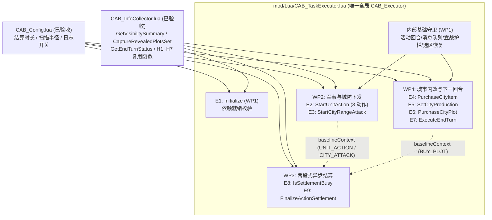
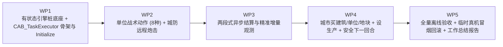

# M1Sub2（游戏内任务执行子模块 `CAB_TaskExecutor`）工作计划

> [!IMPORTANT]
> 本计划针对 **模块 1：游戏端纯 Lua 桥接 Mod（`Civ5AgentBridge`）** 中的 **子模块 2：游戏内任务执行子模块（`CAB_TaskExecutor`）** 编制，以 `docs/M1/` 下三份上位设计文档（`模块设计说明.md`、`模块内部接口设计.md`、`模块设计进度.md`，含已同步的 `SYNC-01` ~ `SYNC-05`）以及已正式验收的 M1Sub1 成果为起点，面向多会话接力执行（对应原《模块设计进度.md》中的 `M1-S3` + `M1-S4` 及子模块独立验收）。
>
> **文档与文件隔离红线（D-01）**：在 M1Sub2 设计、编码与验收全过程中，**严禁持久化修改** `docs/M1/` 下三份上位文档、顶层《01~03》文档、已验收的 M1Sub1 文件（`CAB_Config.lua`、`CAB_InfoCollector.lua`、`tests/m1sub1/*`、`tests/run_m1sub1_tests.py`）以及其他 Mod 壳层文件。全部接口细化、参数增补与上位文档同步建议统一登记于《M1Sub2工作进度.md》台账，并最终汇总至《M1Sub2工作总结报告.md》供上级 M1 评审验收后统一回写。

---

## 一、 子模块定位、前置可启动性评估与决策定稿

### 1.1 前置依赖与可启动性结论

对照《模块设计说明.md》§2.2 依赖拓扑图与《模块设计进度.md》§三 现状，对 `CAB_TaskExecutor` 的全部运行时依赖逐项核查如下：

| 关联模块 / 文件 | 依赖方向与内容 | 当前交付状态 | 是否阻塞 M1Sub2 启动 |
| :--- | :--- | :---: | :---: |
| `mod/Lua/CAB_Config.lua`（12 键公共配置表） | `CAB_TaskExecutor` 直接读取 `DEFAULT_UNIT_SETTLE_SEC`、`PLOT_BUY_SETTLE_SEC`、`MAX_SETTLE_TIMEOUT_SEC`、`DELTA_REVEAL_SCAN_RADIUS`、`MAX_SCAN_RADIUS`、`ENABLE_DEBUG_LOG` | ✅ **已验收**（M1Sub1 交付） | **不阻塞** |
| `mod/Lua/CAB_InfoCollector.lua`（`CAB_Collector`） | `CAB_TaskExecutor` 直接复用主接口（`GetVisibilitySummary`、`CaptureRevealedPlotsSet`、`GetEndTurnStatus`）及 7 个公开只读辅助函数（`H1`~`H7`） | ✅ **已验收**（M1Sub1 交付，14 项导出完备） | **不阻塞** |
| `CAB_ExternalIO` / `Civ5AgentBridgeJson` | **零依赖**（所有可空字段采用 Lua `nil` 省略键，对象表标 `__is_object = true`，由调度层负责交 `ExternalIO` 序列化） | 待 `M1-S1` 收尾 | **不阻塞** |
| `CAB_Dispatcher` / `UI` / `.modinfo` | 调度装配层单向调用本子模块并驱动 `IsSettlementBusy` 帧轮询，本子模块不反向依赖调度层 | 待 `M1-S5` 实施 | **不阻塞** |

**结论**：**M1Sub2（`CAB_TaskExecutor`）的全部前序依赖（`CAB_Config` 与 `CAB_InfoCollector`）均已验收就绪，当前零阻塞依赖，可在本工作计划经用户确认后立即按 `WP1` ~ `WP5` 推进。**

### 1.2 经用户确认的关键设计决策定稿表（`D-01` ~ `D-07`）

| 决策编号 | 决策主题 | 确认结论 | 对上位三文档的影响（留待总结报告呈报） |
| :---: | :--- | :--- | :--- |
| **D-01** | 文件隔离边界与完整接口范围 | 沿用 M1Sub1 严格隔离纪律：仅持久化交付 `mod/Lua/CAB_TaskExecutor.lua`、独立测试文件（`tests/run_m1sub2_tests.py` + `tests/m1sub2/*`）与 `docs/M1/M1Sub2/` 下三份文档；严禁持久化改动上位三文档、M1Sub1 已验收文件与其余 Mod 文件。完整保留 `CAB_Executor` 全部 **9 个导出函数**（含同源扩展的买单位、设生产队列与城市远程炮击）。 | 同步拍板《模块设计进度.md》§二 决策项 2（`SYNC-M2-01`）与进度看板覆盖 `M1-S3`+`M1-S4`（`SYNC-M2-05`） |
| **D-02** | 前置校验强度、迷雾防侧信道与防误宣战 | 严格同源前置校验：校验玩家活动回合（`IsTurnActive`）与消息队列非忙（`not Game.IsProcessingMessages()`），复用 `CAB_Collector` 的 `H4`~`H7` 保持与采集层 100% 同源判定；严禁对普通迷雾/黑雾格调用 `CanRangeStrikeAt`；默认拦截对非交战中立势力的攻击，同时为 `StartUnitAction` / `StartCityRangeAttack` 提供向后兼容的可选参数 `allowDeclareWar`（默认 `false`）；任何前置校验失败均保持**零引擎写入副作用且无痕恢复原 UI 选区**。 | 建议增补可选参数 `allowDeclareWar` 至《模块内部接口设计.md》§5.2/§5.3 及 §七 IPC 映射表（`SYNC-M2-02`） |
| **D-03** | `allowDeclareWar == true` 无弹窗宣战机制 | 当 `allowDeclareWar == true` 且目标归属非交战中立文明/城邦时，先校验 `pTeam:CanDeclareWar(targetTeam)`——若受和约或规则限制无法宣战则直接拦截报错；通过则显式调用 `pTeam:DeclareWar(targetTeam)` 后再下发攻击指令（彻底避免引擎弹出模态“是否宣战”确认框卡死自动化流程），并在 `baselineContext` 与结算结果中记录 `war_declared = true` 与目标玩家/团队 ID。 | 同 `SYNC-M2-02`，补充显式宣战逻辑与 `war_declared` 字段 |
| **D-04** | 两段式异步结算与增量观测精准口径 | 1. 动作前 `revealedBefore` 采用**双圆心联合采样** `CaptureRevealedPlotsSet(id, beforeX, beforeY, min(r+1, MAX_SCAN_RADIUS)) ∪ CaptureRevealedPlotsSet(id, targetX, targetY, r)`，彻底消除移动 1 格时圆周前沿已探索格的揭盲假阳性； 2. `FinalizeActionSettlement` 统一附带 `timed_out`（反映结算时是否仍处于忙碌态）； 3. `BUY_PLOT` 严格按实时地块归属 `pPlot:GetOwner() == activePlayerID` 判定 `purchased` 真值； 4. `CITY_ATTACK` 补充 `city_id` 与 `city_after`（复用 `SerializeCitySummary`），单位攻城或城市炮击敌城时补充 `target_city_after`（含 `city_id`/`hp`/`captured`/`destroyed`）。 | 建议在《模块内部接口设计.md》§5.8 细化精准结算与扩展字段契约（`SYNC-M2-03`） |
| **D-05** | `ExecuteEndTurn` 安全诊断与守卫式自动跳过 | 同步拍板《模块设计进度.md》§二 决策项 3：默认 `autoSkipReadyUnits = false`，存在任何阻塞均安全拒绝并返回含 `blocking_info` 的结构化结果；当 `autoSkipReadyUnits == true` 时，**先调用 `CAB_Collector.GetEndTurnStatus`**，仅当当前阻塞为可跳过的待命单位类（`ENDTURN_BLOCKING_UNITS` / `ENDTURN_BLOCKING_UNIT_NEEDS_ORDERS`）才跳过非死亡、非待晋升、非同类非法叠栈的待命单位（记录 `auto_skipped_unit_ids` 并恢复原选区）后再复查；若当前已是硬阻塞则不浪费单位行动力直接返回 `BLOCKED`；无阻塞时调用 `Game.DoControl(CONTROL_ENDTURN)` 并立即返回 `WAITING_NEXT_TURN`。 | 拍板《模块设计进度.md》§二 决策项 3（`SYNC-M2-01`）并细化《模块内部接口设计.md》§5.7（`SYNC-M2-04`） |
| **D-06** | 双层验收与独立有状态引擎桩真实联调 | **第一层（离线自动化）**：新建 `tests/run_m1sub2_tests.py`、`tests/m1sub2/engine_stubs.lua`、`tests/m1sub2/test_executor.lua`（零修改 M1Sub1 测试），在 `lupa.lua51` 中做全量 Lua 5.1 语法编译与 3 项负向自检，并在有状态 BNW 引擎桩上**同时加载真实 `CAB_Config.lua` + 真实 `CAB_InfoCollector.lua` + `CAB_TaskExecutor.lua`** 完成真实跨模块联调验证；**第二层（临时真机冒烟）**：WP5 在本机原生 BNW + IGE 临时挂载验证真实动作执行、`Logs/Lua.log` 零报错，随后 **100% 回滚**临时挂载改动。 | 真机冒烟实证与待 `M1-S6` 全链路闭环事项写入总结报告 |
| **D-07** | 5 工作包拆分、命名与本会话边界 | `docs/M1/M1Sub2/` 统一命名为 `M1Sub2工作计划.md`、`M1Sub2工作进度.md`、`M1Sub2工作总结报告.md`；按 `WP1` ~ `WP5` 串行推进；本会话仅交付计划与进度文档，经用户评审确认后再启动 `WP1` 编码。 | 无 |

---

## 二、 工程约束、安全红线与兼容基线

### 2.1 硬性架构约束

1. **单向依赖与命名空间洁净**：
   * `mod/Lua/CAB_TaskExecutor.lua` 仅允许 `include("CAB_Config")` 与 `include("CAB_InfoCollector")` 各一次；**严禁引入** `Civ5AgentBridgeJson`、`CAB_ExternalIO`、`CAB_Dispatcher` 或第三方 `AirRaidCore`。
   * 仅导出唯一全局变量 `CAB_Executor`（含 9 个公开接口函数）；全部内部校验、动作分发与结算辅助函数一律声明为 `local`；模块私有状态仅保留 `local s_Initialized = false`（与《模块设计说明.md》§4.2 对齐），不保留跨调用实体缓存。
2. **原生《文明5：BNW v1.0.3.279》Lua 5.1 语法与引擎避坑纪律**：
   * 严守 Lua 5.1 语法（禁止 `goto`、`//`、`table.unpack`、`bit32` 等 Lua 5.2+ 特性）。
   * **严禁出现与调用 `CanMoveOrAttackInto`**（原版 BNW DLL 硬编码返回 `false`），统一复用 `CAB_Collector.CanUnitMoveThrough(pUnit, pPlot)` 与 `CAB_Collector.HasSameClassFriendlyUnit(...)`。
   * **严禁出现与调用 `AirRaidCore` / `AR_ExecuteStrike` / `AR_EnumerateTargets`**，空军打击严格使用原生 BNW 接口（`CanRangeStrikeAt` 校验 + `SelectionListGameNetMessage(GAMEMESSAGE_PUSH_MISSION, MissionTypes.MISSION_MOVE_TO, tx, ty, 0, false, false)`）。
   * 严禁调用任何修改存档持久化数据的接口（如 `SetScriptData`），确保 `AffectsSavedGames = 0` 无存档污染。
3. **写操作安全门槛（Active Turn & Message Queue Gate）**：
   * 所有 6 个驱动引擎状态变更的接口（`StartUnitAction`、`StartCityRangeAttack`、`PurchaseCityItem`、`SetCityProduction`、`PurchaseCityPlot`、`ExecuteEndTurn`）在执行任何写操作前，必须强制校验：
     1. `activePlayerID` 为合法整数且 `Players[activePlayerID]` 存在且存活（`IsAlive()`）；
     2. `pPlayer:IsTurnActive() == true`（严禁在 AI 回合向引擎注入网络/动作包）；
     3. `not (Game.IsProcessingMessages and Game.IsProcessingMessages())`（防止引擎消息队列忙碌时并发发包引发崩溃或丢包）。
4. **代码注释与可维护性规范**：
   * 文件头部注明模块职责、依赖关系、9 个导出契约、安全红线及本机官方 UI 脚本依据（`WorldView.lua`、`UnitPanel.lua`、`ProductionPopup.lua`、`CityView.lua`、`ActionInfoPanel.lua`）；
   * 每个函数上方必须提供中文函数头注释，写明**做什么（What）**、**为什么这么做（Why，特别是引擎避坑或安全门控原因）**、输入参数与返回值结构。

### 2.2 执行层 6 条安全与迷雾红线（`E-01` ~ `E-06`）

| 编号 | 红线名称 | 强制执行规则 | 验证方式 |
| :---: | :--- | :--- | :--- |
| **E-01** | **非活动回合零写入** | 当 `not pPlayer:IsTurnActive()` 或 `Game.IsProcessingMessages() == true` 时，一切写操作接口必须立即拒绝，**零引擎写调用、零 UI 选区变更**。 | 桩测试调用审计断言 |
| **E-02** | **前置校验失败零副作用** | `StartUnitAction` / `StartCityRangeAttack` / `PurchaseCityItem` / `SetCityProduction` / `PurchaseCityPlot` 在任意前置校验失败时，不得下发任何移动/攻击/宣战/购买/队列/结束回合指令，且若因原地动作探测临时切换过 UI 选区，必须经 `pcall` 无条件恢复原选区。 | 桩测试写操作计数 = 0 + 选区断言 |
| **E-03** | **远程攻击防迷雾侧信道** | `StartUnitAction`（`RANGE_ATTACK` / `AIR_STRIKE`）与 `StartCityRangeAttack` **严禁对普通迷雾格（`IsRevealed and not IsVisible` 且非交战敌城）或未探索黑雾格（`not IsRevealed`）调用 `CanRangeStrikeAt`**，彻底杜绝以执行接口反向探测迷雾下隐匿敌军或隐形单位（`IsInvisible`）。 | 桩测试 `queriesOnForbiddenFog == 0` 断言 |
| **E-04** | **防误宣战与可控显式宣战** | 默认 `allowDeclareWar = false` 时，对非交战中立文明/城邦单位或城市的 `MELEE_ATTACK` / `RANGE_ATTACK` / `AIR_STRIKE` / `CITY_ATTACK` 必须明确拦截报错（不触发 `DeclareWar` 也不发攻击包）；当 `allowDeclareWar == true` 时，必须先检 `CanDeclareWar(targetTeam)` 通过后才显式调用 `DeclareWar(targetTeam)`（和约期强制拦截）。 | 桩测试中立/和约/显式宣战专项用例 |
| **E-05** | **黑雾探路与零信息泄露** | `MOVE_STEP` 允许非空军存活且有移动力的单位向相邻 1 格未探索黑雾（`not IsRevealed`）探路移动，前置校验不窥探黑雾地形/敌军；结算后仅汇总真正揭开后的可见结果。 | 桩测试相邻黑雾探路与揭盲用例 |
| **E-06** | **原生 BNW + IGE 实时无缓存** | 零跨调用可变缓存（`GameDefines.BUY_PLOTS_DISABLED`、`GameDefines.CITY_ATTACK_RANGE`、`GameDefines.MAX_HIT_POINTS` 等按次实时读取）；统一过滤 `nil`、`IsDead()`、`IsDelayedDeath()` 及死亡/空玩家槽位；绝不调用 `UI.SetInterfaceMode`（不干扰 IGE 编辑工具状态）。 | 静态检视 + IGE 动态改图/刷兵/改金币用例 |

### 2.3 DTO 编码与返回值统一约定

1. **三元组返回契约**：
   * 动作启动类（`StartUnitAction`、`StartCityRangeAttack`、`PurchaseCityPlot`）：成功返回 `(true, nil, baselineContext)`；失败返回 `(false, "<明确英文错误说明>", nil)`。
   * 即时执行类（`PurchaseCityItem`、`SetCityProduction`）：成功返回 `(true, nil, resultDto)`；失败返回 `(false, "<明确英文错误说明>", nil)`。
   * 回合控制类（`ExecuteEndTurn`）：成功提交返回 `(true, nil, endTurnResultDto)`；因回合阻塞拒绝时返回 `(false, "End turn blocked: " .. blockingName, endTurnResultDto)`（附带完整 `blocking_info` 与已执行的 `auto_skipped_unit_ids`）；因非法玩家/非活动回合/消息队列忙拒绝时返回 `(false, "<错误说明>", nil)`。
2. **DTO 编码规范（零 `CAB_Json` 依赖）**：
   * 所有返回给调度层用于 JSON 序列化的结果 DTO 表（及其嵌套字典）统一携带 `__is_object = true`；所有数组使用 1-based 连续 Lua 表（不加 `__is_object`）；可空字段无值时直接留 Lua `nil`（省略键）。
   * 内部传递的 `baselineContext` 仅供 `CAB_Dispatcher` 暂存并透传给 `IsSettlementBusy` / `FinalizeActionSettlement`，不直接对外序列化。
3. **非法入参零未捕获异常**：所有公开接口对 `nil`、非整数坐标/ID、非法枚举字符串、不存在或非己方归属的 `unitID` / `cityID` 均做显式类型守卫，绝不抛出未捕获 Lua 运行时错误。

---

## 三、 修改与产出文件清单（严格白名单与禁止清单）

### 3.1 M1Sub2 永久产出与可修改文件白名单

| 文件路径（相对 `Civ5AgentBridge/`） | 操作类型 | 所属工作包 | 职责说明 |
| :--- | :---: | :---: | :--- |
| `docs/M1/M1Sub2/M1Sub2工作计划.md` | 新建 | 设计阶段（本会话） | 本工作计划（前置评估、决策 D-01~D-07、红线、9 接口详设、WP1~WP5 与验收矩阵） |
| `docs/M1/M1Sub2/M1Sub2工作进度.md` | 新建 & 持续更新 | 设计阶段 ~ WP5 | 多会话总览看板、决策表、WP 进度表、上位文档回写台账与交接日志 |
| `docs/M1/M1Sub2/M1Sub2工作总结报告.md` | 新建 | WP5 | M1Sub2 结项验收报告与上位文档回写建议书（供上级 M1 评审审查） |
| `mod/Lua/CAB_TaskExecutor.lua` | 新建 | WP1 ~ WP4 | 子模块 2 正式实现（唯一全局 `CAB_Executor`，共 9 个导出接口） |
| `tests/run_m1sub2_tests.py` | 新建 | WP1 | 基于本机 Python + `lupa.lua51` 的 Lua 5.1 语法检查（含负向自检）+ 有状态引擎桩联调验收入口 |
| `tests/m1sub2/engine_stubs.lua` | 新建 | WP1（WP2~4 按需扩充） | 支持真实写操作状态演进的 BNW Lua 5.1 引擎桩（移动/战斗/阵亡/宣战/揭盲/购买/换产/买地/动画帧推进/结束回合 + 调用日志审计） |
| `tests/m1sub2/test_executor.lua` | 新建 | WP1 ~ WP4 | 同时加载真实 `CAB_Config` + `CAB_InfoCollector` + `CAB_TaskExecutor` 的全量验收用例集 |

### 3.2 WP5 临时实机冒烟期间临时改动文件（必须 100% 回滚）

在 WP5 执行本机《文明5：BNW》+ IGE **临时实机冒烟**期间，仅允许临时改动以下文件，**冒烟完毕后必须 100% 回滚并同步还原 `MODS/Civ5AgentBridge/`**：
* `mod/Civ5AgentBridge.modinfo`（临时登记 `CAB_Config.lua`、`CAB_InfoCollector.lua`、`CAB_TaskExecutor.lua` 及临时冒烟驱动脚本，验证后 `git checkout` 回滚）
* `mod/Lua/Civ5AgentBridgeUI.lua` 或临时冒烟驱动文件（如 `mod/Lua/CAB_M1Sub2Smoke.lua`，验证后回滚/删除）
* 游戏 `cache/Civ5*.db` 与 `MODS/Civ5AgentBridge/` 临时部署（验证并回滚后镜像恢复一致性）

### 3.3 严禁修改文件清单（绝对红线）

* `docs/M1/模块设计说明.md`、`docs/M1/模块内部接口设计.md`、`docs/M1/模块设计进度.md`
* `docs/01_技术瓶颈与可行性试验清单.md`、`docs/02_软件总体设计说明书.md`、`docs/03_接口设计说明书.md`
* `docs/M1/M1Sub1/*`（已结项归档）
* `mod/Lua/CAB_Config.lua`、`mod/Lua/CAB_InfoCollector.lua`（已验收的 M1Sub1 交付物，零修改）
* `tests/run_m1sub1_tests.py`、`tests/m1sub1/engine_stubs.lua`、`tests/m1sub1/test_collector.lua`（已验收的 M1Sub1 测试套件，零修改）
* `mod/Lua/Civ5AgentBridgeCore.lua`、`Civ5AgentBridgeJson.lua`、`Civ5AgentBridgeLoader.lua/.xml`、`Civ5AgentBridgeUI.xml`、`scripts/deploy_mod.ps1`（均不得留下任何持久化修改）

---

## 四、 接口契约、数据结构与内部依赖拓扑

### 4.1 `CAB_Executor` 9 个导出接口契约总表

| # | 函数签名 | 结算模式 | 返回值 / 核心 DTO 结构 | 关键校验、引擎 API 与实现要点 |
| :-: | :--- | :---: | :--- | :--- |
| **E1** | `CAB_Executor.Initialize()` | 同步 | `boolean` | 校验全局 `CAB_Config`（含关键结算/半径键）与 `CAB_Collector`（14 项依赖函数存在）均已加载就绪，置 `s_Initialized = true` 返回 `true`；不探测 `AirRaidCore`。 |
| **E2** | `CAB_Executor.StartUnitAction(activePlayerID, unitID, actionType, targetX, targetY, allowDeclareWar)` | **两段式异步** | `(ok, errMsg, baselineContext)` | 1. 门控校验活动回合、消息队列非忙、单位存活且属于玩家、`actionType` 合法； 2. 按 8 种动作执行同源前置校验（复用 `H4`~`H7`；远程/空袭严禁探测普通迷雾与黑雾；攻中立按 `D-02/D-03` 守卫或显式 `CanDeclareWar`+`DeclareWar`）； 3. 采集动作前基线：双圆心联合 `revealedBefore`、`baselineEnemyMap`、`targetEnemyBefore`、`targetCityBefore`、`beforeX/Y`、`beforeMoves`、`warDeclaredInfo`； 4. 选中单位并调用官方 API（`SelectionListMove` / `SelectionListGameNetMessage` / `Game.HandleAction`），返回 `settlementKind = "UNIT_ACTION"` 的 `baselineContext`（含 `minWaitSec = CAB_Config.DEFAULT_UNIT_SETTLE_SEC`、`maxTimeoutSec = CAB_Config.MAX_SETTLE_TIMEOUT_SEC`）。 |
| **E3** | `CAB_Executor.StartCityRangeAttack(activePlayerID, cityID, targetX, targetY, allowDeclareWar)` | **两段式异步** | `(ok, errMsg, baselineContext)` | 1. 校验活动回合、消息队列非忙、己方城市存在且 `pCity:CanRangeStrikeNow() == true`； 2. 目标格必须实时可见（`IsVisible`），复用 `InspectPlotUnits` 过滤隐形敌军；严禁对迷雾/黑雾调用 `CanRangeStrikeAt`；校验敌军交战态或按 `allowDeclareWar` 执行 `CanDeclareWar`+`DeclareWar`；校验 `pCity:CanRangeStrikeAt(tx, ty, true, true) == true`； 3. 采集可见敌军/目标格敌军基线，参照 `WorldView.lua:519` 执行 `UI.ClearSelectionList()` $\rightarrow$ `UI.SelectCity(pCity)` $\rightarrow$ `Game.SelectedCitiesGameNetMessage(GAMEMESSAGE_DO_TASK, TASK_RANGED_ATTACK, tx, ty)` $\rightarrow$ `Events.SpecificCityInfoDirty` $\rightarrow$ `UI.ClearSelectedCities()`； 4. 返回 `settlementKind = "CITY_ATTACK"` 的 `baselineContext`。 |
| **E4** | `CAB_Executor.PurchaseCityItem(activePlayerID, cityID, itemCategory, itemKeyOrId, yieldTypeStr)` | **同步即时** | `(ok, errMsg, PurchaseItemResultDTO)` | 1. 默认 `itemCategory = "BUILDING"`、`yieldTypeStr = "GOLD"`；支持 Type 字符串或整数 ID 解析 `GameInfo.Buildings` / `GameInfo.Units`； 2. 参照 `ProductionPopup.lua:136-161`：调用 `IsCanPurchase(true, true, uID, bID, -1, eYield)` 全规则校验；若失败，再调 `IsCanPurchase(false, false, ...)` 精准区分错误原因（科技/前置未满足或已拥有 vs 金币/信仰不足或城内已有同类单位叠栈）； 3. 记录购买前余额与城内己方单位 ID 集合，调用 `Game.CityPurchaseBuilding(pCity, bID, eYield)` 或 `Game.CityPurchaseUnit(pCity, uID, eYield)` 并触发 `SpecificCityInfoDirty`； 4. 回读新余额、实际 `cost_paid`、新生 `spawned_unit_id`（买单位时比对城格/玩家单位集增量）及 `city_summary_after = CAB_Collector.SerializeCitySummary(pCity)` 直接返回。 |
| **E5** | `CAB_Executor.SetCityProduction(activePlayerID, cityID, orderCategory, itemKeyOrId, clearQueue)` | **同步即时** | `(ok, errMsg, SetProductionResultDTO)` | 1. 校验非傀儡/非抵抗/非焚城状态；按 `orderCategory`（`"BUILDING"`/`"UNIT"`/`"PROJECT"`/`"PROCESS"`）解析目标条目与 `OrderTypes.ORDER_CONSTRUCT/TRAIN/CREATE/MAINTAIN`； 2. 分别校验 `pCity:CanConstruct` / `CanTrain` / `CanCreate` / `CanMaintain`； 3. 参照 `ProductionPopup.lua:133` 调用 `Game.CityPushOrder(pCity, eOrder, iData, false, clearQueue ~= false, true)` 并触发 `SpecificCityInfoDirty`； 4. 返回 `{ __is_object = true, city_id, order_category, item_type, current_production, turns_left, order_queue_length }`。 |
| **E6** | `CAB_Executor.PurchaseCityPlot(activePlayerID, cityID, plotX, plotY)` | **短延迟异步** | `(ok, errMsg, baselineContext)` | 1. 实时读取 `GameDefines.BUY_PLOTS_DISABLED == 0`，校验城市归属且非傀儡/非抵抗/非焚城； 2. 参照 `CityView.lua:2003, 2143`：校验 `pCity:CanBuyPlotAt(px, py, false)`；若为 `false`，用 `CanBuyPlotAt(px, py, true)` 精准区分“金币不足（附 `GetBuyPlotCost` 与当前国库余额）”与“该坐标不在本城合法买地范围”； 3. 记录 `goldBefore` 与 `expectedCost`，调用 `Network.SendCityBuyPlot(cityID, px, py)`（若城市界面开启则安全调用 `UI.UpdateCityScreen()`）； 4. 返回 `settlementKind = "BUY_PLOT"` 的 `baselineContext`（`minWaitSec = CAB_Config.PLOT_BUY_SETTLE_SEC`、`maxTimeoutSec = CAB_Config.MAX_SETTLE_TIMEOUT_SEC`）。 |
| **E7** | `CAB_Executor.ExecuteEndTurn(activePlayerID, autoSkipReadyUnits)` | **同步提交 + 跨回合** | `(ok, errMsg, EndTurnResultDTO \| nil)` | 1. 门控校验活动回合与消息队列非忙； 2. 先调用 `CAB_Collector.GetEndTurnStatus(activePlayerID)`； 3. 若 `autoSkipReadyUnits == true` 且当前阻塞属于可跳过的待命单位类（`ENDTURN_BLOCKING_UNITS` / `ENDTURN_BLOCKING_UNIT_NEEDS_ORDERS`）：记录当前选区，遍历己方存活单位，对满足 `IsReadyToMove() == true`、非 `IsPromotionReady()`、且非同格非法叠栈的单位依次下发 `MISSION_SKIP`（记录 `auto_skipped_unit_ids`），结束后恢复原选区，再重新调用 `GetEndTurnStatus` 复查； 4. 若复查结果 `can_end_turn_now ~= true`：安全中止，返回 `(false, "End turn blocked: " .. blockingName, { turn_ended = false, ended_turn_number = turn, auto_skipped_unit_ids = ..., status = "BLOCKED", blocking_info = endTurnStatus })`； 5. 若 `can_end_turn_now == true`：调用 `Game.DoControl(GameInfoTypes.CONTROL_ENDTURN)` 立即返回 `(true, nil, { turn_ended = true, ended_turn_number = turn, auto_skipped_unit_ids = ..., status = "WAITING_NEXT_TURN" })`。 |
| **E8** | `CAB_Executor.IsSettlementBusy(baselineContext)` | 帧轮询只读 | `boolean` | 1. `UNIT_ACTION`：单位仍存活时检查 `pUnit:IsBusy()`、`pUnit:IsFighting()` 或单位当前格/目标格 `IsFighting()`； 2. `CITY_ATTACK`：检查目标格 `pTargetPlot:IsFighting()`； 3. `BUY_PLOT`：检查 `pTargetPlot:GetOwner() ~= baselineContext.activePlayerID`； 4. 非法或空 `baselineContext` 安全返回 `false`。 |
| **E9** | `CAB_Executor.FinalizeActionSettlement(baselineContext, settleWaitMs)` | 结算采样 | `ActionExecutionResultDTO` / `PurchasePlotResultDTO` | 1. 计算 `timedOut = CAB_Executor.IsSettlementBusy(baselineContext)`； 2. `UNIT_ACTION`：组装完全兼容《03》§2.3 的 `ActionExecutionResultDTO`（含 `executed = true`, `action_type`, `target_x`, `target_y`, `settle_wait_ms`, `timed_out`, `war_declared`（若宣战）, `unit_died`, `unit_after`, `delta_observation = { newly_revealed_tiles_count, newly_spotted_enemies, newly_spotted_count, target_enemy_after, target_city_after }`）； 3. `CITY_ATTACK`：组装 `{ executed = true, action_type = "CITY_RANGE_ATTACK", city_id, city_after, target_x, target_y, settle_wait_ms, timed_out, war_declared, delta_observation }`； 4. `BUY_PLOT`：核验 `newOwner == activePlayerID`，组装 `{ purchased = (newOwner == activePlayerID), error_reason (未翻转时), city_id, x, y, cost_paid, expected_cost, gold_before, gold_after, new_owner_id, settle_wait_ms, timed_out }`。 |

### 4.2 8 种单位战术动作（`StartUnitAction`）分发细则表

| `actionType` | 前置校验核心规则（全部遵循 E-01 ~ E-06） | 原生 BNW 引擎分发指令 |
| :--- | :--- | :--- |
| **`MOVE_STEP`** | 非空军、`MovesLeft > 0`、`dist == 1`；若目标格已探索：不可有敌方存活单位或非己方城市，且 `CAB_Collector.CanUnitMoveThrough(pUnit, pPlot) == true` 且 `not CAB_Collector.HasSameClassFriendlyUnit(pPlot, activePlayerID, isCombat)`；若目标格未探索黑雾：允许探路移动且不读取黑雾地形/单位。 | `UI.SelectUnit(pUnit)` $\rightarrow$ `Game.SelectionListMove(pTargetPlot, false, false, false)` |
| **`MELEE_ATTACK`** | 非空军、`MovesLeft > 0`、`dist == 1`、战斗近战单位（`IsCombatUnit`、`Range == 0`、`combat_str > 0`、`IsCanAttack` 未禁攻）、非不可通行格、陆海兵种域匹配（陆军禁水、海军限水或敌城）；目标格须存在实时可见非己方单位或已探索非己方城市；交战校验（默认必须 `IsAtWar`；`allowDeclareWar == true` 时先 `CanDeclareWar` + `DeclareWar`）。 | `UI.SelectUnit(pUnit)` $\rightarrow$ `Game.SelectionListMove(pTargetPlot, false, false, false)` |
| **`RANGE_ATTACK`** | 非空军、`MovesLeft > 0`、`Range > 0`、`1 <= dist <= Range`；**防侧信道（E-03）**：仅允许对 `isVis` 或已探索非己方城市格校验（普通迷雾与黑雾直接拒绝，零 `CanRangeStrikeAt` 调用）；交战态或显式宣战校验通过后，校验 `pUnit:CanRangeStrikeAt(tx, ty, true, false) == true`。 | `UI.SelectUnit(pUnit)` $\rightarrow$ `Game.SelectionListGameNetMessage(GAMEMESSAGE_PUSH_MISSION, MissionTypes.MISSION_RANGE_ATTACK, tx, ty, 0, false, false)` |
| **`AIR_STRIKE`** | 空军单位（`DOMAIN_AIR`）、`MovesLeft > 0`、`1 <= dist <= Range`；**防侧信道（E-03）**：仅允许对 `isVis` 或已探索非己方城市格校验；交战态或显式宣战校验通过后，校验 `pUnit:CanRangeStrikeAt(tx, ty, true, false) == true`（纯原生 BNW，无 `AirRaidCore`）。 | `UI.SelectUnit(pUnit)` $\rightarrow$ `Game.SelectionListGameNetMessage(GAMEMESSAGE_PUSH_MISSION, MissionTypes.MISSION_MOVE_TO, tx, ty, 0, false, false)` |
| **`SETUP_FOR_RANGED`** | `MovesLeft > 0`；在 `pcall` 临时选中单位后校验 `CAB_Collector.FindGameActionIndex("MISSION_SET_UP_FOR_RANGED_ATTACK") ~= nil`（失败则恢复原选区并返回错返）。 | `Game.HandleAction(iAction)` |
| **`FORTIFY`** | `MovesLeft > 0`；临时选中单位后依次查找 `MISSION_FORTIFY` / `MISSION_ALERT` / `MISSION_SLEEP`（或回退校验 `pUnit:CanFortify(uPlot)`）；均不可用则恢复原选区返回错返。 | 优先 `Game.HandleAction(iAction)`，否则 `SelectionListGameNetMessage(GAMEMESSAGE_PUSH_MISSION, MissionTypes.MISSION_FORTIFY, ux, uy, 0, false, false)` |
| **`HEAL`** | `MovesLeft > 0`；临时选中单位后查找 `MISSION_HEAL`（或回退校验 `pUnit:CanHeal(uPlot)`）；不可用则恢复原选区返回错返。 | 优先 `Game.HandleAction(iAction)`，否则 `SelectionListGameNetMessage(GAMEMESSAGE_PUSH_MISSION, MissionTypes.MISSION_HEAL, ux, uy, 0, false, false)` |
| **`SKIP_TURN`** | `MovesLeft > 0` 且 `IsReadyToMove() ~= false`；临时选中单位后优先查 `MISSION_SKIP`。 | 优先 `Game.HandleAction(iAction)`，否则 `SelectionListGameNetMessage(GAMEMESSAGE_PUSH_MISSION, skipMission, pUnit:GetID(), 0, 0, false)` |

### 4.3 `CAB_TaskExecutor` 跨模块与内部依赖拓扑图

---

## 五、 多会话工作包拆分与依赖顺序（`WP1` ~ `WP5`）

为控制单次会话上下文窗口、确保每个阶段均可独立编译运行全量回归并留下清晰交接点，将 M1Sub2 划分为 **5 个严格串行推进的工作包**（与 M1Sub1 节奏对称）：

| 工作包 | 核心目标 | 涉及新增/修改文件 | 独立完成标准（Done Criteria） | 建议会话数 |
| :---: | :--- | :--- | :--- | :---: |
| **WP1** | **独立有状态 BNW 引擎桩底座 + `CAB_TaskExecutor` 骨架与 `Initialize`** | 新建 `tests/run_m1sub2_tests.py` 新建 `tests/m1sub2/engine_stubs.lua` 新建 `tests/m1sub2/test_executor.lua` 新建 `mod/Lua/CAB_TaskExecutor.lua`（骨架 + `Initialize` + 内部守卫） | 1. `python tests/run_m1sub2_tests.py` 通过全部 Lua 5.1 语法编译（含 3 项负向语法自检）并支持 `--filter`； 2. 有状态引擎桩可真实加载 `CAB_Config` + `CAB_InfoCollector` + `CAB_TaskExecutor` 并验证状态演进（移动、战斗损血/阵亡、揭盲、宣战、扣费买建筑/单位/地块、队列更新、忙碌动画帧推进、`CONTROL_ENDTURN`）及红线审计（禁令 `CanMoveOrAttackInto` / `AirRaidCore` / `queriesOnForbiddenFog` / 写操作日志）； 3. `CAB_Executor.Initialize()` 与全局加载洁净（仅新增 `CAB_Executor`）自检全绿。 | 1 会话 |
| **WP2** | **单位战术动作下发（`StartUnitAction`）与城防远程炮击（`StartCityRangeAttack`）** | 更新 `mod/Lua/CAB_TaskExecutor.lua` 扩充 `tests/m1sub2/test_executor.lua` | 1. 实现 `StartUnitAction`（8 种动作全分支）与 `StartCityRangeAttack`； 2. 覆盖验证：活动回合/消息队列门控（E-01）、失败零写副作用与选区恢复（E-02）、远程/空袭/城防炮击对普通迷雾与黑雾零 `CanRangeStrikeAt` 调用（E-03）、默认防误宣战 + `allowDeclareWar=true` 显式宣战 + 和约拦截（E-04）、相邻黑雾探路（E-05）、`CanMoveThrough`+1UPT、原版空军空袭（零 `AirRaidCore`）； 3. `run_m1sub2_tests.py` 100% 通过。 | 1 会话 |
| **WP3** | **两段式异步结算与精准增量观测（`IsSettlementBusy` + `FinalizeActionSettlement`）** | 更新 `mod/Lua/CAB_TaskExecutor.lua` 扩充 `tests/m1sub2/test_executor.lua` | 1. 实现 `IsSettlementBusy` 与 `FinalizeActionSettlement`，全覆盖 `UNIT_ACTION`、`CITY_ATTACK`、`BUY_PLOT` 三类 `settlementKind`； 2. 覆盖验证：双圆心联合 `revealedBefore` 消除 1 格移动圆周边缘揭盲假阳性（验证真实揭盲准确计数且已探索格不被误计）、新发现敌军 `newly_spotted_enemies`（屏蔽隐形单位）、受击敌军残血与击杀判定、己方单位反击阵亡（`unit_died=true, unit_after=nil`）、攻城残血/占领/毁城 `target_city_after`、城防炮击 `city_after`、买地成功与兜底超时未翻转归属（`purchased=false, timed_out=true`）； 3. `run_m1sub2_tests.py` 100% 通过。 | 1 会话 |
| **WP4** | **城市内政执行（买建筑/单位/地块、设生产）与安全下一回合（`ExecuteEndTurn`）** | 更新 `mod/Lua/CAB_TaskExecutor.lua`（收尾） 扩充 `tests/m1sub2/test_executor.lua` | 1. 实现 `PurchaseCityItem`（建筑/单位 × 金币/信仰双通道、Type/ID 双入参、错误细分、新生 `spawned_unit_id` 准确识别与 `city_summary_after`）、`SetCityProduction`（4 类订单与 `clearQueue` 控制）、`PurchaseCityPlot`（`BUY_PLOTS_DISABLED` 实时检查、余额不足 vs 越界细分、联动 WP3 短结算）与 `ExecuteEndTurn`（守卫式自动跳过非晋升非叠栈待命单位、硬阻塞零浪费拦截、无阻塞调 `CONTROL_ENDTURN` 立返）； 2. `T-00` 升级为精确校验 `CAB_Executor` 全部 9 项导出及静态红线扫查；补齐 IGE 动态变阵与非法入参防御用例； 3. 全量离线测试 100% 通过，且同步复跑 `run_m1sub1_tests.py` 确认 M1Sub1 零回退。 | 1 会话 |
| **WP5** | **双层总验收、原生 BNW/IGE 临时实机冒烟回滚与工作总结报告** | 临时挂载验证后**100% 回滚** 新建 `docs/M1/M1Sub2/M1Sub2工作总结报告.md` 更新 `M1Sub2工作进度.md` | 1. 全量跑通 `run_m1sub2_tests.py` 与 `run_m1sub1_tests.py` 双套件绿灯； 2. 配合用户在本机《文明5：BNW v1.0.3.279》（原生 + IGE 辅助构图/刷金币/刷单位）临时挂载完成 `CAB_TaskExecutor` 实机冒烟，实证单位移动/攻击/原地动作与结算、买建筑/买单位/设生产/买地块、城防炮击（若场景具备）与安全下一回合（含阻塞诊断），确认 `Logs/Lua.log` 零报错； 3. **100% 回滚**全部临时挂载改动并同步 `MODS/Civ5AgentBridge/`，经 `git status` / `git diff` 确认仅留白名单文件； 4. 产出《M1Sub2工作总结报告.md》呈报上级 M1 评审验收。 | 1 会话 |

---

## 六、 验收标准清单（`A-01` ~ `A-10`）与风险防护

### 6.1 验收标准矩阵

| 验收项 | 验收内容 | 判定标准 | 验证手段 |
| :---: | :--- | :--- | :--- |
| **A-01** | Lua 5.1 语法与加载洁净 | `CAB_TaskExecutor.lua` 通过 `lupa.lua51` `loadstring` 编译（含 3 项负向自检）；仅 `include("CAB_Config")` 与 `include("CAB_InfoCollector")` 各一次；全局仅新增 `CAB_Executor`（精确 9 项函数导出）。 | `run_m1sub2_tests.py` 阶段 1 + `T-00` |
| **A-02** | 9 接口签名与 DTO 契约 | 全部 9 个导出函数签名、三元组返回值与 DTO 字段 100% 对齐本计划 §4.1 及《03》§2.3 向下兼容契约；对象表全带 `__is_object = true`，可空字段省略（零 `CAB_Json` 依赖）。 | 契约用例 + 键集合断言 |
| **A-03** | 活动回合门控与失败零副作用 | 满足 E-01 / E-02：非活动回合或消息队列忙时写调用 = 0；任意前置校验失败时写调用 = 0 且原 UI 选区完整恢复。 | 桩写操作审计日志 + 选区断言 |
| **A-04** | 同源校验、迷雾防侧信道与宣战护栏 | 满足 E-03 / E-04 / E-05：源码零出现 `CanMoveOrAttackInto`；远程/空袭/城防对普通迷雾与黑雾 `queriesOnForbiddenFog == 0`；默认阻断误宣战，`allowDeclareWar=true` 经 `CanDeclareWar` 守卫后显式 `DeclareWar` 且和约期拦截；相邻黑雾探路不泄露地形。 | 静态扫描 + 迷雾/宣战专项用例 |
| **A-05** | 两段式异步结算与增量精度 | 双圆心联合采样消除 1 格移动揭盲假阳性；准确捕获 `newly_spotted_enemies`（过滤隐形）、`target_enemy_after`（残血/击杀）、`unit_died`、`target_city_after`、`city_after`、`timed_out` 及 `BUY_PLOT` 真实归属判定。 | 异步结算与超时专项用例 |
| **A-06** | 城市内政全能力精度 | `PurchaseCityItem`（建筑/单位 × 金币/信仰、Type/ID、错误细分、新生 `spawned_unit_id`）、`SetCityProduction`（4 类订单 + `clearQueue`）、`PurchaseCityPlot`（`BUY_PLOTS_DISABLED` + 余额/越界细分 + 短结算）全部通过，触发 `SpecificCityInfoDirty` 并回读最新摘要。 | 城市内政专项用例 |
| **A-07** | `ExecuteEndTurn` 安全闭环 | 默认 `autoSkipReadyUnits=false` 遇阻立返完整 `blocking_info`；为 `true` 时遵循守卫式跳过（硬阻塞不浪费待命单位，待命阻塞安全跳过非晋升非叠栈单位并复查）；无阻塞时调 `CONTROL_ENDTURN` 立即返回 `WAITING_NEXT_TURN`。 | 下一回合多阻塞场景用例 |
| **A-08** | 原生 BNW + IGE 兼容与零外部 Mod | 源码零出现 `AirRaidCore` / `AR_ExecuteStrike` / `AR_EnumerateTargets` / `SetScriptData` / `SetInterfaceMode`；零跨调用实体缓存，实时响应 IGE 修改；真实联调已验收的 `CAB_InfoCollector` 且 `run_m1sub1_tests.py` 零回退。 | 静态扫描 + IGE 用例 + 双套件复跑 |
| **A-09** | 临时真机冒烟零报错与 100% 回滚 | 本机原生 BNW + IGE 实机冒烟跑通核心执行接口，`Logs/Lua.log` 零语法/运行时错误，且临时挂载改动 100% 回滚清理干净。 | WP5 实机冒烟日志 + `git diff` 核验 |
| **A-10** | 文件隔离纪律与结项文档交付 | 禁止清单文件零持久化修改；《M1Sub2工作进度.md》与《M1Sub2工作总结报告.md》（含完整 `SYNC-M2-*` 上位文档回写建议）交付闭环。 | `git status` + 文档审阅 |

### 6.2 已知风险与防护措施

1. **单位动作与城市购买的实机 UI 状态副作用风险**：`SelectionListMove`、`SelectedCitiesGameNetMessage`、`Game.CityPurchaseUnit` 在真实游戏客户端中涉及引擎异步消息队列、单位选中态与 `Events.SpecificCityInfoDirty` 触发。**防护**：严格对齐本机官方 `WorldView.lua` / `ProductionPopup.lua` / `CityView.lua` / `ActionInfoPanel.lua` 调用序列，所有外部事件调用加存在性判断与 `pcall` 防护，并在 WP5 通过真实客户端冒烟实证。
2. **显式 `DeclareWar` 在城邦/和平条约/联防条约下的边界风险**：在 BNW 中，对受和约保护的文明、自身盟友或已死亡团队调用 `DeclareWar` 存在规则约束。**防护**：严格前置校验 `pTeam:CanDeclareWar(targetTeam)`（且先确认目标玩家存活、非己方团队、非蛮族），任何不满足均提前拦截返回可读错误，绝不越权调用。
3. **跨会话上下文漂移与 M1Sub1 意外篡改风险**：多会话推进中若修改了已验收的 M1Sub1 文件或上位三文档，将破坏模块验收基线。**防护**：每次会话结束必须同时执行 `git -C Civ5AgentBridge status --short` 核对白名单，并在 WP4/WP5 复跑 `run_m1sub1_tests.py` 确保零回归。

---

## 七、 多会话接力执行规程

1. **新会话启动必读顺序**：
   1. `docs/M1/M1Sub2/M1Sub2工作进度.md`（定位当前待执行 WP、已确认决策 `D-01`~`D-07` 与上一会话交接提示）；
   2. `docs/M1/M1Sub2/M1Sub2工作计划.md`（本文档，核对当前 WP 的接口契约、红线与完成标准）；
   3. 按需核对 `docs/M1/模块内部接口设计.md` §五 与 `mod/Lua/CAB_InfoCollector.lua` 对应导出函数签名。
2. **会话结束必做动作**：
   1. 运行 `python Civ5AgentBridge/tests/run_m1sub2_tests.py` 并记录语法/用例通过数与守卫审计统计；
   2. 核对 `git -C Civ5AgentBridge status --short`，确认未触碰禁止清单中的任何文件；
   3. 在 `docs/M1/M1Sub2/M1Sub2工作进度.md` 更新当前 WP 状态、实测摘要、偏离/增补台账及下个 WP 的交接提示。
