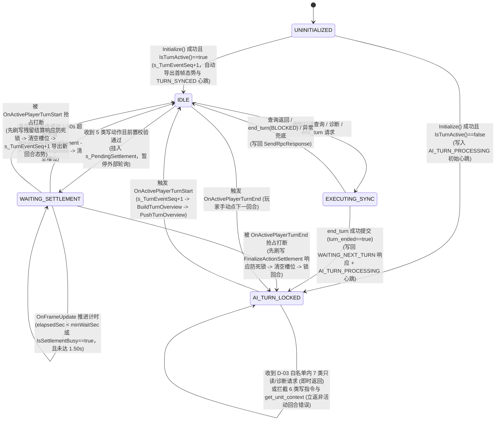
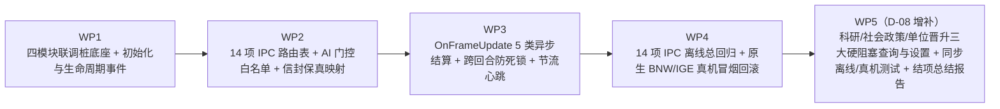

# M1Sub3（调度控制子模块 `CAB_Dispatcher`）工作计划

> [!IMPORTANT]
> 本计划针对 **模块 1：游戏端纯 Lua 桥接 Mod（`Civ5AgentBridge`）** 中的 **子模块 3：调度控制子模块（`CAB_Dispatcher`）** 编制，以 `docs/M1/` 下三份上位设计文档（`模块设计说明.md`、`模块内部接口设计.md`、`模块设计进度.md`，含已回写的 `SYNC-01`~`SYNC-05` 与 `SYNC-M2-01`~`SYNC-M2-06`）以及已正式验收的 M1Sub1、M1Sub2 交付物为基线，面向多会话协作接力执行。
>
> **文档与文件隔离红线（D-01）**：在 M1Sub3 规划、编码与验收全过程中，**严禁持久化修改** `docs/M1/` 下三份上位文档、顶层《01~03》设计文档、已验收的 M1Sub1 / M1Sub2 文件（`CAB_Config.lua`、`CAB_InfoCollector.lua`、`CAB_TaskExecutor.lua`、`tests/m1sub1/*`、`tests/m1sub2/*`、`tests/run_m1sub1_tests.py`、`tests/run_m1sub2_tests.py`）以及现有 Mod 壳层文件（`Civ5AgentBridgeUI.lua/.xml`、`Civ5AgentBridgeLoader.lua/.xml`、`Civ5AgentBridgeCore.lua`、`Civ5AgentBridgeJson.lua`、`Civ5AgentBridge.modinfo`、`scripts/deploy_mod.ps1`）。全部接口细化、门控消歧与上位文档同步建议统一登记于《M1Sub3工作进度.md》台账，并在 WP4 汇总至《M1Sub3工作总结报告.md》供上级 M1 评审验收后统一回写。

---

## 一、 子模块定位、前置可启动性评估与决策定稿

### 1.1 前置依赖与可启动性结论

对照《模块设计说明.md》§2.2 拓扑图与《模块设计进度.md》§三 当前状态，对 `CAB_Dispatcher` 的运行时依赖逐项核查如下：

| 关联模块 / 文件 | 依赖方向与交互内容 | 当前交付状态 | 是否阻塞 M1Sub3 启动 |
| :--- | :--- | :---: | :---: |
| `mod/Lua/CAB_Config.lua`（12 键公共配置表） | `CAB_Dispatcher` 直接读取 `POLL_INTERVAL_SEC`、`HEARTBEAT_INTERVAL_SEC`、`DEFAULT_UNIT_SETTLE_SEC`、`PLOT_BUY_SETTLE_SEC`、`MAX_SETTLE_TIMEOUT_SEC`、`ENABLE_DEBUG_LOG` | ✅ **已验收**（M1Sub1 交付） | **不阻塞** |
| `mod/Lua/CAB_InfoCollector.lua`（`CAB_Collector`） | `CAB_Dispatcher` 直接调用 6 个对外只读查询接口（`BuildTurnOverview`、`BuildUnitContextAndCandidates`、`GetEmpireEconomy`、`GetVisibilitySummary`、`GetCityDetail`、`GetEndTurnStatus`） | ✅ **已验收**（M1Sub1 交付，14 项导出完备） | **不阻塞** |
| `mod/Lua/CAB_TaskExecutor.lua`（`CAB_Executor`） | `CAB_Dispatcher` 直接调用全部 9 个导出接口（`Initialize`、5 类异步写动作启动接口、`ExecuteEndTurn`、`IsSettlementBusy`、`FinalizeActionSettlement`） | ✅ **已验收**（M1Sub2 交付，覆盖 5 类 `settlementKind`） | **不阻塞** |
| `mod/Lua/CAB_ExternalIO.lua`（`CAB_ExternalIO`，子模块 4） | `CAB_Dispatcher` 单向调用 `Initialize`、`PushTurnOverview`、`WriteHeartbeat`、`SendRpcResponse`、`PollIncomingRequest`（《模块内部接口设计.md》§三 契约已冻结） | ⏳ 待子模块 4 交付 | **不阻塞**（采用守卫式按需 `include` + 离线契约桩 / WP4 临时真机垫片解耦） |
| `Civ5AgentBridgeUI.lua` + `.modinfo` 正式装配 | UI 宿主单向调用 `CAB_Dispatcher` 并注入 `uiStatusCallback`；需待子模块 4 与子模块 3 均验收后统一收口替换 | 待 `M1-S5` 最终装配步 | **不阻塞**（按 D-01 解耦后置） |

**结论**：**M1Sub3（`CAB_Dispatcher`）的核心业务下游依赖（`CAB_Config`、`CAB_InfoCollector`、`CAB_TaskExecutor`）已 100% 验收就绪；尚未开发的 `CAB_ExternalIO` 接口契约已在《模块内部接口设计.md》§三 完全冻结，可通过守卫式按需加载与契约桩完整解耦。M1Sub3 当前零阻塞依赖，可在本计划审阅确认后立即按 `WP1` ~ `WP4` 推进。**

### 1.2 经用户确认的关键设计决策定稿表（`D-01` ~ `D-07`）

| 决策编号 | 决策主题 | 确认结论 | 对上位三文档的影响（留待总结报告呈报） |
| :---: | :--- | :--- | :--- |
| **D-01** | 交付边界与文件隔离纪律 | 沿用 M1Sub1/Sub2 严格隔离纪律：聚焦交付 `mod/Lua/CAB_Dispatcher.lua`、独立测试套件（`tests/run_m1sub3_tests.py` + `tests/m1sub3/*`）及 `docs/M1/M1Sub3/` 下三份文档；严禁持久化修改上位三文档、已验收 M1Sub1/Sub2 文件及 UI/`.modinfo` 壳层；WP4 临时真机冒烟使用临时垫片并在验证后 **100% 回滚**，将 `Civ5AgentBridgeUI.lua` 重构与 `.modinfo` 正式装配留待子模块 4 完成后统一收口。 | 建议在《模块设计进度.md》§三 细化 `M1-S5` 中调度核（M1Sub3）与最终壳层装配的交接状态（`SYNC-M3-04`） |
| **D-02** | 跨子模块守卫式加载与依赖自检 | `CAB_Dispatcher.lua` 顶部采用 `if CAB_X == nil then include("...") end` 按需加载 `CAB_Config`、`CAB_InfoCollector`、`CAB_TaskExecutor`、`CAB_ExternalIO`（防止《文明5》VFS `include()` 二次执行重置 `local` 状态，且天然支持测试桩预先注入全局 `CAB_ExternalIO` 而后续正式装配零改代码）；`CAB_Dispatcher.Initialize` 逐项校验四模块导出契约与下游 `Initialize` 返回值。 | 建议在《模块内部接口设计.md》§1.1 补充 VFS 守卫式按需 `include` 规范说明（`SYNC-M3-03`） |
| **D-03** | 非活动回合（`AI_TURN_LOCKED`）门控白名单消歧 | 消除《模块设计说明.md》§3.3 与《模块内部接口设计.md》§六 口径差异：当处于 `"AI_TURN_LOCKED"` 或 `not pPlayer:IsTurnActive()` 时，**放行 7 个零选区副作用的只读与诊断接口**（`ping`、`test_large_payload`、`get_end_turn_status`、`get_empire_economy`、`get_visibility_summary`、`get_turn_overview`、`get_city_detail`），**拦截全部 6 个写指令及需临时切换 UI 选区的 `get_unit_context`**，立即返回 `"Player turn is not active (AI turn in progress)"`。 | 建议修订《模块内部接口设计.md》§六 `OnExternalRequestReceived` 门控白名单描述（`SYNC-M3-01`） |
| **D-04** | RPC 响应信封（`ok/data/error`）保真映射契约 | 1. 协议/未知方法错误、非活动回合/挂起态门控拦截、RPC 参数校验错误、`CAB_Collector` 返回含 `error` 字段结果、`ExecuteEndTurn` 门控失败（`resultDto == nil`）及 5 类写动作启动前置校验失败（`baselineContext == nil`），统一调 `SendRpcResponse(reqId, false, nil, errMsg)`； 2. **已产出完整结构化业务 DTO 的分支**——含 `end_turn` 因待办阻塞返回 `status = "BLOCKED"`（带 `blocking_info` 与 `auto_skipped_unit_ids`）及 `FinalizeActionSettlement` 结算结果（含超时未达成 `purchased=false` / `executed=false`）——统一调 `SendRpcResponse(reqId, true, resultDto, nil)`，避免 Python `sqlite_bridge.py` 因 `ok=false` 抛异常丢弃关键诊断详情；且 `end_turn` 仅在 `resultDto.turn_ended == true` 时切入 `AI_TURN_LOCKED`。 | 建议在《模块内部接口设计.md》§六 & §七 明确 `end_turn(BLOCKED)` 与异步结算结果的信封保真约定（`SYNC-M3-03`） |
| **D-05** | 异步结算跨回合防死锁、参数钳制与原型字段退役 | 1. **抢占刷写防死锁**：若 `WAITING_SETTLEMENT` 期间触发 `OnActivePlayerTurnEnd`、`OnActivePlayerTurnStart` 或重初始化，先对挂起任务调用 `pcall(CAB_Executor.FinalizeActionSettlement, ...)` 刷写 `SendRpcResponse`（异常时降级写回中断错返）再清空 `s_PendingSettlement`，杜绝外部客户端 8s 超时死等； 2. **挂起期重入保护**：挂起期暂停轮询，若外部异常重入调 `OnExternalRequestReceived` 则拒返 Busy 错误且不破坏在途结算； 3. `execute_unit_action` 可选参数 `settle_delay_sec` 钳制于 `[0, MAX_SETTLE_TIMEOUT_SEC]` 覆盖 `minWaitSec` 并统一走帧结算，正式退役 EXP-04 双倍扫描字段 `sync_frame_comparison`。 | 建议在《模块内部接口设计.md》§六 补充跨回合抢占刷写防死锁机制说明（`SYNC-M3-02`） |
| **D-06** | 导出接口可观测性与手动同步护栏 | 1. 导出《模块内部接口设计.md》§六 全部 **6 个核心入口函数**，并增补第 **7 个纯只读诊断快照函数 `CAB_Dispatcher.GetRuntimeState()`**（返回浅拷贝表，零私有状态引用泄露）； 2. `OnManualSyncClicked()` 仅在已初始化、玩家活动回合且 `s_BridgeState == "IDLE"` 时导出 `turn_overview_auto` 且**不递增 `s_TurnEventSeq`**（避免外部误判新回合），挂起或 AI 回合点击仅更新 UI 提示不覆写快照。 | 建议在《模块内部接口设计.md》§六 登记 `CAB_Dispatcher.GetRuntimeState()` 及手动同步护栏细则（`SYNC-M3-02`） |
| **D-07** | 文档命名、工作包拆分与本会话边界 | 对齐前序目录统一命名为 `M1Sub3工作计划.md`、`M1Sub3工作进度.md`、`M1Sub3工作总结报告.md`；原 `WP1`~`WP4` 完成 14 项基础 IPC 与真机冒烟闭环，后续按 `D-08` 追加 **`WP5`** 由新会话完成三大硬阻塞设置功能及同步测试，最终结项总结报告顺延至 `WP5` 验收完成后统一收口。 | 无 |
| **D-08** | **`WP5` 需求增补：三大回合硬阻塞设置能力（2026-11-27 用户拍板）** | 在 `WP4` 完成既有 14 项 IPC 真机闭环后，新增 **`WP5`** 交由新会话完整交付**科研选择（`ENDTURN_BLOCKING_RESEARCH`）**、**社会政策（`ENDTURN_BLOCKING_POLICY`）**与**单位晋升（`ENDTURN_BLOCKING_UNIT_PROMOTION`）**的只读查询 + 安全写动作 + IPC 路由与同步离线/真机测试： 1. **跨子模块增量特批**：因三项能力需由采集层枚举合法候选项、执行层校验并下发原生 BNW 引擎写指令、调度层统一路由与异步/同步结算，特批 `WP5` 新会话在保持前序既有接口 100% 向下兼容的前提下，增量扩展 `CAB_InfoCollector.lua`、`CAB_TaskExecutor.lua`、`CAB_Dispatcher.lua` 及三套测试（`tests/m1sub1/*`、`tests/m1sub2/*`、`tests/m1sub3/*`）； 2. **上位文档与壳层红线不变**：仍严禁持久化修改 `docs/M1/` 三份上位文档、顶层《01~03》文档及 Mod 壳层文件（`.modinfo`、`Civ5AgentBridgeUI.lua` 等），全部新增契约登记于 `SYNC-M3-05` 待上级评审统一回写。 | 建议在《模块内部接口设计.md》§四/§五/§六/§七 增补三类硬阻塞查询与设置接口契约（`SYNC-M3-05`） |

---

## 二、 工程约束、安全红线与统一约定

### 2.1 硬性架构约束

1. **职责纯净与单向分层依赖**：
   * `CAB_Dispatcher.lua` 作为模块 1 的**纯状态机与事件路由枢纽**，严禁直接调用 `Modding.OpenUserData` 或读写 SQLite 键值，严禁直接调用 `CAB_JsonEncode` / `CAB_JsonDecode`，严禁直接调用任何修改游戏沙盘的引擎动作 API（如 `SelectionListMove`、`CityPurchase*`、`SendCityBuyPlot`、`DoControl`、`UI.SelectUnit`、`SetScriptData` 等）——全部数据采集委托 `CAB_Collector`，全部游戏写动作与忙碌探测委托 `CAB_Executor`，全部序列化分片与 SQLite 读写委托 `CAB_ExternalIO`。
   * 仅导出唯一全局变量 `CAB_Dispatcher`（精确 7 个公开函数 `D1` ~ `D7`）；所有内部状态变量、路由处理器与校验工具一律声明为 `local`。
2. **原生《文明5：BNW v1.0.3.279》Lua 5.1 语法纪律**：
   * 严格遵循 Lua 5.1 语法（禁用 `goto`、`//` 整除、`table.unpack`、`bit32` 等 Lua 5.2+ 特性）。
   * 对引擎全局表（`Game`、`Players`）及外部传入的 `reqObj`、`params`、`deltaTime`、`uiStatusCallback` 全程做空值/类型/NaN 守卫，通过 `pcall` 隔离下游回调异常，确保任何异常路径下状态机均可自愈回退至合法状态（绝不永久卡死在 `EXECUTING_SYNC` 或悬空 `WAITING_SETTLEMENT`）。
3. **代码注释与可追溯性规范**：
   * 文件头部写明模块职责、守卫式依赖关系、7 个公开接口清单、6 条调度安全红线（`S-01` ~ `S-06`）与上位契约依据；
   * 每个公开与内部 `local` 函数上方均提供详尽中文注释，写明**做什么（What）**、**为什么这么做（Why，特别是状态机防死锁、门控消歧或信封保真原因）**、输入参数与返回值结构。

### 2.2 调度控制层 6 条安全红线（`S-01` ~ `S-06`）

| 编号 | 红线名称 | 强制执行规则 | 验证方式 |
| :---: | :--- | :--- | :--- |
| **S-01** | **零越层直调引擎写接口与 SQLite** | `CAB_Dispatcher.lua` 严禁出现或调用 `Modding.OpenUserData`、`SimpleValues`、`CAB_Json*`、`SelectionListMove`、`SelectionListGameNetMessage`、`SelectedCitiesGameNetMessage`、`CityPurchase*`、`CityPushOrder`、`SendCityBuyPlot`、`Game.DoControl`、`UI.SelectUnit`、`UI.SetInterfaceMode`、`SetScriptData`、`CanMoveOrAttackInto`、`AirRaidCore`。 | 静态源码扫描 + 桩红线守卫 |
| **S-02** | **非活动回合严格白名单门控** | 当 `s_BridgeState == "AI_TURN_LOCKED"` 或当前激活玩家不存在/未存活/`IsTurnActive() ~= true` 时，仅允许路由 D-03 规定的 7 个无选区副作用只读/诊断方法；对全部 6 个写指令及 `get_unit_context` 必须零下游调用直接拒返明确错误。 | 桩测试 AI 回合全 14 方法矩阵断言 |
| **S-03** | **单工异步结算互斥与零丢回执** | 同一时刻至多允许 1 个在途 `s_PendingSettlement`；挂起期间 `OnFrameUpdate` 严禁调用 `PollIncomingRequest`；任何生命周期切换（`TurnEnd` / `TurnStart` / 重初始化）清空挂起前**必须**完成一次 `SendRpcResponse` 收口，保证每个进入调度器的 `req_id` 100% 有且仅有 1 次响应写回。 | 请求-响应 `1:1` 幂等计数断言 |
| **S-04** | **状态机异常自愈（防永久卡锁）** | 同步路由执行期（`EXECUTING_SYNC`）或异步结算收尾期（`FinalizeActionSettlement`）内部一律用 `pcall` 包裹；即便下游抛出意外运行时错误，也必须兜底写回 `ok = false` 错误响应并将 `s_BridgeState` 恢复至 `"IDLE"`（或非活动回合时恢复 `"AI_TURN_LOCKED"`）。 | 注入下游故障异常自愈用例 |
| **S-05** | **手动同步防脏写与序号隔离** | `OnManualSyncClicked` 在未初始化、`WAITING_SETTLEMENT`、`AI_TURN_LOCKED` 或非玩家活动回合时严禁调用 `PushTurnOverview` 覆写快照；合法导出时严禁递增 `s_TurnEventSeq`（`s_TurnEventSeq` 仅在真实玩家回合开始或活动回合首帧初始化导出时递增）。 | 手动同步多状态护栏用例 |
| **S-06** | **帧时钟净化与单帧尖峰防护** | `OnFrameUpdate(deltaTime)` 必须过滤 `nil`、非数值、`NaN`、`<= 0` 及无穷大 `deltaTime`；结算计时单帧步进增量钳制上限 `0.50s`（防止窗口切出/卡顿单帧跨过 `1.50s` 硬超时而未给引擎留出检查窗口），且每次判定优先依据 `elapsedSec >= minWaitSec and not IsSettlementBusy`。 | 畸形 `deltaTime` 与卡顿尖峰用例 |

---

## 三、 修改与产出文件清单（严格白名单与禁止清单）

### 3.1 M1Sub3 永久产出与可修改文件白名单

| 文件路径（相对 `Civ5AgentBridge/`） | 操作类型 | 所属工作包 | 职责说明 |
| :--- | :---: | :---: | :--- |
| `docs/M1/M1Sub3/M1Sub3工作计划.md` | 新建 | 设计阶段（本会话） | 本计划文档（前置评估、决策 `D-01`~`D-07`、红线、状态机、7 导出接口与 14 方法路由详设、`WP1`~`WP4` 及验收标准） |
| `docs/M1/M1Sub3/M1Sub3工作进度.md` | 新建 & 持续更新 | 设计阶段 ~ WP4 | 多会话总览看板、决策表、WP 进度追踪表、`SYNC-M3-*` 上位文档回写台账与交接日志 |
| `docs/M1/M1Sub3/M1Sub3工作总结报告.md` | 新建 | WP5（最终结项） | M1Sub3（含 WP1~WP5 全量交付）结项验收报告与上位文档回写建议书（供上级 M1 评审审查） |
| `mod/Lua/CAB_Dispatcher.lua` | 新建 & 扩充 | WP1 ~ WP3、WP5 | 子模块 3 正式实现（唯一全局 `CAB_Dispatcher`，精确 7 个公开接口；WP5 扩充科研/政策/晋升 6 项 IPC 路由至 20 项） |
| `mod/Lua/CAB_InfoCollector.lua` / `mod/Lua/CAB_TaskExecutor.lua` | WP5 特批增量扩充 | WP5（按 D-08） | 严保既有接口零破坏、零回归，仅增量新增科研/社会政策/单位晋升三组只读候选项查询与安全执行接口 |
| `tests/run_m1sub3_tests.py` | 新建 | WP1 | 基于本机 Python + `lupa.lua51` 的 Lua 5.1 语法检查（覆盖全量已交付 Lua 文件 + 3 项负向自检）与四模块联调桩测试入口 |
| `tests/m1sub3/engine_stubs.lua` | 新建 & 扩充 | WP1、WP5 | 独立有状态 BNW Lua 5.1 引擎桩 + **`CAB_ExternalIO` 标准契约模拟桩**（WP5 补齐科研树、社会政策树/分支与单位晋升引擎桩及跨帧队列模拟） |
| `tests/m1sub3/test_dispatcher.lua` | 新建 & 扩充 | WP1 ~ WP3、WP5 | 覆盖初始化、状态机、生命周期、全量 IPC 路由、AI 门控白名单、异步结算、超时、跨回合抢占刷写、异常自愈、节流心跳及 WP5 三大硬阻塞全链路用例 |
| `tests/m1sub1/*` / `tests/m1sub2/*` | WP5 特批增量扩充 | WP5（按 D-08） | 同步扩充三类硬阻塞查询与执行专项单测，确保三套件回归全绿且既有 36 + 33 条用例零退化 |

### 3.2 WP4 临时实机冒烟期间临时改动文件（必须 100% 回滚）

在 WP4 执行本机《文明5：BNW v1.0.3.279》+ IGE **临时真机冒烟验证**期间，仅允许临时改动以下文件（提供极薄 SQLite `CAB_ExternalIO` 临时垫片驱动真实 `CAB_Dispatcher` 跑通回合推送、14 类路由与 5 类跨帧结算），**冒烟完毕后必须 100% 回滚并清理还原 `MODS/Civ5AgentBridge/` 与缓存**：
* `mod/Civ5AgentBridge.modinfo`（临时登记 `CAB_Config`、`CAB_InfoCollector`、`CAB_TaskExecutor`、`CAB_Dispatcher` 及临时冒烟脚本，验证后还原）
* `mod/Lua/Civ5AgentBridgeUI.lua` 或临时冒烟驱动文件 `mod/Lua/CAB_M1Sub3Smoke.lua`（验证后还原/删除）
* 游戏 `MODS/Civ5AgentBridge/` 与未运行态 `cache/Civ5*.db`（回滚后同步执行 `deploy_mod.ps1 -ForceCopy -ClearCache` 恢复原状）

### 3.3 严禁持久化修改文件清单（绝对红线）

* `docs/M1/模块设计说明.md`、`docs/M1/模块内部接口设计.md`、`docs/M1/模块设计进度.md`
* `docs/01_技术瓶颈与可行性试验清单.md`、`docs/02_软件总体设计说明书.md`、`docs/03_接口设计说明书.md`
* `docs/M1/M1Sub1/*`、`docs/M1/M1Sub2/*`（已结项归档）
* `mod/Lua/CAB_Config.lua`（已验收配置常量表，若无新阈值需求保持零修改）；`mod/Lua/CAB_InfoCollector.lua`、`mod/Lua/CAB_TaskExecutor.lua`、`tests/m1sub1/*`、`tests/m1sub2/*` 在 `WP1`~`WP4` 期间严禁触碰，仅于 `WP5` 按 `D-08` 授权做向后兼容增量扩充
* `mod/Lua/Civ5AgentBridgeCore.lua`、`Civ5AgentBridgeJson.lua`、`Civ5AgentBridgeLoader.lua/.xml`、`Civ5AgentBridgeUI.lua/.xml`、`mod/Civ5AgentBridge.modinfo`、`scripts/deploy_mod.ps1`

---

## 四、 核心状态机、接口契约与 14 项 IPC 路由详设

### 4.1 内部私有状态变量清单（全部 `local`）

严格对齐《模块设计说明.md》§4.2 并细化内部控制标志如下：

| 私有变量名 | 类型 | 初始值 | 状态职责说明 |
| :--- | :--- | :---: | :--- |
| `s_Initialized` | `boolean` | `false` | 标记 `CAB_Dispatcher.Initialize` 是否已通过全部依赖自检并完成初始化 |
| `s_BridgeState` | `string` | `"UNINITIALIZED"` | 核心运行状态枚举：`"UNINITIALIZED"` / `"IDLE"` / `"EXECUTING_SYNC"` / `"WAITING_SETTLEMENT"` / `"AI_TURN_LOCKED"` |
| `s_PollAccumSec` | `number` | `0.0` | 空闲帧轮询间隔累加器（满 `CAB_Config.POLL_INTERVAL_SEC = 0.20` 触发一次 `PollIncomingRequest`） |
| `s_HeartbeatAccumSec` | `number` | `0.0` | 空闲帧心跳间隔累加器（满 `CAB_Config.HEARTBEAT_INTERVAL_SEC = 2.00` 触发一次 `WriteHeartbeat`） |
| `s_TurnEventSeq` | `number` | `0` | 本局递增的玩家回合同步序号（活动回合首帧初始化导出及每次 `OnActivePlayerTurnStart` 时自增 1；手动同步不自增） |
| `s_PendingSettlement` | `table \| nil` | `nil` | 在途异步结算槽位：`{ reqId, method, settlementKind, baselineInfo, elapsedSec, minWaitSec, maxTimeoutSec }` |
| `s_UiStatusCallback` | `function \| nil` | `nil` | 外部注入的 UI 状态栏刷新委托 `function(statusText: string) -> nil`（调用时经 `pcall` 保护） |

### 4.2 状态机完整流转图

### 4.3 `CAB_Dispatcher` 7 个公开导出接口契约总表（`D1` ~ `D7`）

| 编号 | 函数签名 | 返回值 | 分步职责与实现逻辑说明 |
| :---: | :--- | :---: | :--- |
| **D1** | `CAB_Dispatcher.Initialize(uiStatusCallback)` | `boolean` | 1. 若存在未决 `s_PendingSettlement`（热重载重初始化保护），先调用内部抢占刷写辅助函数收口旧响应； 2. 校验 `CAB_Config`（6 个必需数值/布尔键）、`CAB_Collector`（7 个查询函数）、`CAB_Executor`（9 个公开函数）与 `CAB_ExternalIO`（`Initialize`/`WritePayload`/`ReadPayload`/`PushTurnOverview`/`WriteHeartbeat`/`SendRpcResponse`/`PollIncomingRequest` 共 7 项）全部存在，任一缺失则输出错误日志、置 `s_Initialized = false` 并返回 `false`； 3. 绑定 `s_UiStatusCallback`（非函数类型置 `nil`），依次调用 `CAB_Executor.Initialize()` 与 `CAB_ExternalIO.Initialize(CAB_Dispatcher.OnExternalRequestReceived)`，任一返回非真则置 `s_Initialized = false` 并返回 `false`； 4. 重置 `s_PollAccumSec = 0`、`s_HeartbeatAccumSec = 0`、`s_Initialized = true`； 5. 检查当前激活玩家是否处于活动回合（`isActivePlayerTurnNow()`）：若是则置 `s_BridgeState = "IDLE"`、`s_TurnEventSeq = s_TurnEventSeq + 1`，执行首帧全局态势采集推送并刷新 UI 为 `"Agent: Turn <N> Synced"`；若否则置 `s_BridgeState = "AI_TURN_LOCKED"`，调用 `CAB_ExternalIO.WriteHeartbeat("AI_TURN_PROCESSING", s_TurnEventSeq)` 并刷新 UI 为 `"Agent: AI Turn..."`；返回 `true`。 |
| **D2** | `CAB_Dispatcher.OnActivePlayerTurnStart()` | `nil` | 1. 若 `not s_Initialized` 则直接返回； 2. **防死锁收口（D-05）**：若 `s_PendingSettlement ~= nil`，先调用抢占刷写函数完成 `FinalizeActionSettlement` + `SendRpcResponse` 并清空槽位； 3. 重置 `s_PollAccumSec = 0`、`s_HeartbeatAccumSec = 0`，置 `s_BridgeState = "IDLE"`，`s_TurnEventSeq = s_TurnEventSeq + 1`； 4. 读取 `activePlayerID = Game.GetActivePlayer()`，经 `pcall` 调用 `CAB_Collector.BuildTurnOverview(activePlayerID)`；若成功且无 `error` 字段，调用 `CAB_ExternalIO.PushTurnOverview(overview, s_TurnEventSeq)` 并更新 UI 为 `"Agent: Turn <N> Synced"`；若采集异常则降级写 `WriteHeartbeat("IDLE", s_TurnEventSeq)` 并记录诊断日志。 |
| **D3** | `CAB_Dispatcher.OnActivePlayerTurnEnd()` | `nil` | 1. 若 `not s_Initialized` 则直接返回； 2. **防死锁收口（D-05）**：若 `s_PendingSettlement ~= nil`，先抢占刷写结算响应并清空槽位； 3. 将 `s_BridgeState` 切换为 `"AI_TURN_LOCKED"`，重置心跳累加器 `s_HeartbeatAccumSec = 0`，调用 `CAB_ExternalIO.WriteHeartbeat("AI_TURN_PROCESSING", s_TurnEventSeq)`，刷新 UI 状态栏为 `"Agent: AI Turn..."`。 |
| **D4** | `CAB_Dispatcher.OnManualSyncClicked()` | `nil` | 1. 若 `not s_Initialized` 则直接返回； 2. **状态护栏（D-06 / S-05）**：若 `s_PendingSettlement ~= nil` 或 `s_BridgeState == "WAITING_SETTLEMENT"`，仅刷新 UI 为 `"Agent: Busy (Settling...)"` 并返回；若 `s_BridgeState == "AI_TURN_LOCKED"` 或 `not isActivePlayerTurnNow()`，置 `s_BridgeState = "AI_TURN_LOCKED"`、刷新 UI 为 `"Agent: AI Turn..."` 并返回； 3. 在合法玩家活动回合 `IDLE` 态下，**保持 `s_TurnEventSeq` 不变**，调用 `CAB_Collector.BuildTurnOverview(activePlayerID)` + `CAB_ExternalIO.PushTurnOverview(overview, s_TurnEventSeq)` 强制刷新 `turn_overview_auto`，更新 UI 为 `"Agent: Turn <N> Synced"`。 |
| **D5** | `CAB_Dispatcher.OnExternalRequestReceived(reqObj)` | `nil` | 1. 校验 `reqObj` 为 `table` 且提取 `reqId`（非法空对象安全忽略；若 `reqId` 合法但调度器未初始化则立返错误响应）； 2. **挂起互斥守卫（D-05 / S-03）**：若 `s_PendingSettlement ~= nil` 或 `s_BridgeState == "WAITING_SETTLEMENT"`，立即对新 `reqId` 调用 `SendRpcResponse(reqId, false, nil, "Bridge is busy waiting for pending settlement")` 并返回，绝不污染在途结算； 3. 实时同步活动回合态：检查 `turnActive = isActivePlayerTurnNow()`（若 `not turnActive` 且当前为 `"IDLE"` 则自动对齐为 `"AI_TURN_LOCKED"`；若 `turnActive` 且当前为 `"AI_TURN_LOCKED"` 则对齐回 `"IDLE"` 以容错未触发事件的读档/IGE 切人场景）； 4. **非活动回合门控（D-03 / S-02）**：若 `not turnActive` 且 `method` 不在 7 项白名单中，立即调用 `SendRpcResponse(reqId, false, nil, "Player turn is not active (AI turn in progress)")` 返回； 5. 刷新 UI 为 `"Agent: " .. method .. " (#" .. reqId .. ")"`，按 §4.4 路由表在 `pcall` 保护下分发处理（同步分支临时置 `"EXECUTING_SYNC"` 并在完成后恢复 `"IDLE"` 或切 `"AI_TURN_LOCKED"`；异步分支装配 `s_PendingSettlement` 并置 `"WAITING_SETTLEMENT"`）。 |
| **D6** | `CAB_Dispatcher.OnFrameUpdate(deltaTime)` | `nil` | 1. 若 `not s_Initialized` 则直接返回；净化帧间隔 `dt`（非有限正数置 `0`）； 2. **分支一：推进在途异步结算（`s_PendingSettlement ~= nil`）**：    * 将单帧结算步进钳制为 `stepDt = math.min(dt, 0.50)`，累加 `pending.elapsedSec = pending.elapsedSec + stepDt`；    * 检查 `isBusy = safeIsSettlementBusy(pending.baselineInfo)`；    * 若 `(pending.elapsedSec >= pending.minWaitSec and not isBusy)` 或 `(pending.elapsedSec >= pending.maxTimeoutSec)`：计算 `elapsedMs = math.floor(pending.elapsedSec * 1000 + 0.5)`，先取出 `pending` 清空 `s_PendingSettlement = nil` 并恢复 `s_BridgeState = isActivePlayerTurnNow() and "IDLE" or "AI_TURN_LOCKED"`，经 `pcall` 调用 `CAB_Executor.FinalizeActionSettlement(pending.baselineInfo, elapsedMs)` 并通过 `SendRpcResponse` 写回，刷新 UI 为 `"Agent: Settled #" .. pending.reqId`；随后直接 `return`（本帧不轮询新请求）；    * 若尚未满足结算条件，直接 `return`； 3. **分支二：空闲态节流轮询与周期心跳**：    * 累加 `s_PollAccumSec = s_PollAccumSec + dt`，当 `>= CAB_Config.POLL_INTERVAL_SEC` 时置 `s_PollAccumSec = 0` 并经 `pcall` 调用 `CAB_ExternalIO.PollIncomingRequest()`（若本轮触发了挂起结算则立即结束本帧）；    * 累加 `s_HeartbeatAccumSec = s_HeartbeatAccumSec + dt`，当 `>= CAB_Config.HEARTBEAT_INTERVAL_SEC` 时置 `s_HeartbeatAccumSec = 0`，按当前状态写入 `"IDLE"` 或 `"AI_TURN_PROCESSING"` 心跳。 |
| **D7** | `CAB_Dispatcher.GetRuntimeState()` | `table` | 返回内部运行态的纯只读浅拷贝快照（带 `__is_object = true`，零私有引用暴露）：`{ initialized, bridge_state, turn_event_seq, has_pending_settlement, pending_req_id, pending_method, pending_kind, poll_accum_sec, heartbeat_accum_sec }`。 |

### 4.4 对外 14 个 SQLite IPC 方法精确路由、入参校验与信封映射表

| # | `method` 名称 | AI 回合放行 (D-03) | 结算模式 | 入参提取与前置类型校验（`params`） | 下游目标调用与响应信封映射（D-04 / D-05） |
| :-: | :--- | :---: | :---: | :--- | :--- |
| 1 | `ping` | ✅ **放行** | 同步即时 | `echo = (params.echo ~= nil) and tostring(params.echo) or "pong"` | 内建组装 `{ __is_object = true, pong = echo, turn = getGameTurn(), active_player = getActivePlayerID(), is_turn_active = isActivePlayerTurnNow(), status = s_BridgeState, turn_seq = s_TurnEventSeq }` $\rightarrow$ `SendRpcResponse(reqId, true, data, nil, false)` |
| 2 | `test_large_payload` | ✅ **放行** | 同步即时 | `target_bytes`: 可选非负整数（缺省 `32768`，硬上限钳制如 `524288` 防恶意 OOM）；`use_chunk = (params.use_chunk == true)`；`payload = tostring(params.payload or "")` | 内建生成 `pad = string.rep("X", targetBytes)`，组装 `{ __is_object = true, received_len = #payload, generated_len = #pad, payload_blob = pad }` $\rightarrow$ `SendRpcResponse(reqId, true, data, nil, use_chunk)` |
| 3 | `get_turn_overview` | ✅ **放行** | 同步即时 | 无必填项 | 调 `CAB_Collector.BuildTurnOverview(activePlayerID)`；若 `res.error ~= nil` 则返 `(false, nil, res.error)`，否则返 `(true, res, nil)` |
| 4 | `get_empire_economy` | ✅ **放行** | 同步即时 | 无必填项 | 调 `CAB_Collector.GetEmpireEconomy(activePlayerID)`；按 `res.error` 映射 `(false, nil, err)` 或 `(true, res, nil)` |
| 5 | `get_visibility_summary` | ✅ **放行** | 同步即时 | 无必填项 | 调 `CAB_Collector.GetVisibilitySummary(activePlayerID)` 取第 1 返回值 `visDto`；按 `visDto.error` 映射 `(false, nil, err)` 或 `(true, visDto, nil)` |
| 6 | `get_city_detail` | ✅ **放行** | 同步即时 | `city_id`: 必填有限整数（缺失/非整数直接返 `ok=false`）；`include_purchasable`: 可选布尔（非 `false` 均视为 `true`，传 `false` 透传 `false`） | 调 `CAB_Collector.GetCityDetail(activePlayerID, cityId, includePurchasable)`；按 `res.error` 映射 `(false, nil, err)` 或 `(true, res, nil)` |
| 7 | `get_end_turn_status` | ✅ **放行** | 同步即时 | 无必填项 | 调 `CAB_Collector.GetEndTurnStatus(activePlayerID)`；按 `res.error` 映射 `(false, nil, err)` 或 `(true, res, nil)` |
| 8 | `get_unit_context` | ❌ **拦截** | 同步即时 | `unit_id`: 必填有限整数；`radius`: 可选有限整数（`nil` 时透传 `nil` 由采集层取 `DEFAULT_SCAN_RADIUS = 3`；若传入非数字则拒返 `ok=false`） | 调 `CAB_Collector.BuildUnitContextAndCandidates(activePlayerID, unitId, radius)`；按 `res.error` 映射 `(false, nil, err)` 或 `(true, res, nil)` |
| 9 | `execute_unit_action` | ❌ **拦截** | **两段式异步** (`UNIT_ACTION`) | `unit_id`: 必填有限整数；`action_type`: 必填非空字符串；`target_x` / `target_y`: 可选有限整数；`allow_declare_war`: 可选布尔（`== true`）；`settle_delay_sec`: 可选有限数（钳制于 `[0, MAX_SETTLE_TIMEOUT_SEC]`） | 调 `CAB_Executor.StartUnitAction(activePlayerID, unitId, actionType, tx, ty, allowDeclareWar)`；失败返 `(false, nil, err)`；成功则若传了合法 `settle_delay_sec` 覆盖 `minWaitSec`，挂入 `s_PendingSettlement` 并置 `"WAITING_SETTLEMENT"`（正式退役 `sync_frame_comparison`） |
| 10 | `execute_city_attack` | ❌ **拦截** | **两段式异步** (`CITY_ATTACK`) | `city_id`、`target_x`、`target_y`: 均为必填有限整数；`allow_declare_war`: 可选布尔（`== true`） | 调 `CAB_Executor.StartCityRangeAttack(activePlayerID, cityId, tx, ty, allowDeclareWar)`；失败返 `(false, nil, err)`；成功挂入 `s_PendingSettlement` 置 `"WAITING_SETTLEMENT"` |
| 11 | `purchase_city_item` | ❌ **拦截** | **短延迟异步** (`PURCHASE_ITEM`) | `city_id`: 必填有限整数；`item`: 必填（非空字符串或有限整数）；`item_category`: 可选字符串（缺省 `"BUILDING"`）；`yield_type`: 可选字符串（缺省 `"GOLD"`） | 调 `CAB_Executor.PurchaseCityItem(activePlayerID, cityId, itemCategory, item, yieldType)`；失败返 `(false, nil, err)`；成功挂入 `s_PendingSettlement`（`minWaitSec = 0.10s`）置 `"WAITING_SETTLEMENT"` |
| 12 | `set_city_production` | ❌ **拦截** | **短延迟异步** (`SET_PRODUCTION`) | `city_id`: 必填有限整数；`order_category`: 必填非空字符串；`item`: 必填（非空字符串或有限整数）；`clear_queue`: 可选布尔（`clear_queue ~= false`） | 调 `CAB_Executor.SetCityProduction(activePlayerID, cityId, orderCategory, item, clearQueue)`；失败返 `(false, nil, err)`；成功挂入 `s_PendingSettlement`（`minWaitSec = 0.10s`）置 `"WAITING_SETTLEMENT"` |
| 13 | `purchase_city_plot` | ❌ **拦截** | **短延迟异步** (`BUY_PLOT`) | `city_id`、`target_x`、`target_y`: 均为必填有限整数（兼容读取 `plot_x`/`plot_y` 作为备选别名，主契约为 `target_x`/`target_y`） | 调 `CAB_Executor.PurchaseCityPlot(activePlayerID, cityId, tx, ty)`；失败返 `(false, nil, err)`；成功挂入 `s_PendingSettlement`（`minWaitSec = 0.10s`）置 `"WAITING_SETTLEMENT"` |
| 14 | `end_turn` | ❌ **拦截** | **同步提交 + 跨回合** | `auto_skip_ready_units`: 可选布尔（`== true`） | 调 `CAB_Executor.ExecuteEndTurn(activePlayerID, autoSkip)`： • 若 `resultDto == nil`（门控失败）：返 `(false, nil, err)`； • 若 `resultDto ~= nil` 且 `resultDto.turn_ended ~= true`（`BLOCKED`）：保持 `"IDLE"`，返 `(true, resultDto, nil)` 保真透传 `blocking_info`； • 若 `resultDto ~= nil` 且 `resultDto.turn_ended == true`：返 `(true, resultDto, nil)`，随即将 `s_BridgeState` 置为 `"AI_TURN_LOCKED"`、调 `WriteHeartbeat("AI_TURN_PROCESSING", s_TurnEventSeq)` 并更新 UI 为 `"Agent: AI Turn..."`。 |

---

## 五、 多会话工作包拆分与依赖顺序（`WP1` ~ `WP5`）

结合 `CAB_Dispatcher` 高内聚控制流特征及 `D-08` 增补需求，将 M1Sub3 拆分为 **5 个边界清晰、每包均可独立编译与自动化回归的串行工作包**：

| 工作包 | 核心目标 | 涉及新增/修改文件 | 独立完成标准（Done Criteria） | 建议会话数 |
| :---: | :--- | :--- | :--- | :---: |
| **WP1** | **四模块真实联调测试底座（含 `CAB_ExternalIO` 契约桩）+ `CAB_Dispatcher` 骨架、初始化与回合生命周期事件** | 新建 `tests/run_m1sub3_tests.py` 新建 `tests/m1sub3/engine_stubs.lua` 新建 `tests/m1sub3/test_dispatcher.lua` 新建 `mod/Lua/CAB_Dispatcher.lua`（`Initialize`、`GetRuntimeState`、`OnActivePlayerTurnStart`、`OnActivePlayerTurnEnd`、`OnManualSyncClicked`） | 1. `python Civ5AgentBridge/tests/run_m1sub3_tests.py` 完成全量已交付 Lua 文件语法编译（含 3 项负向语法自检）并支持 `--filter`； 2. `tests/m1sub3/engine_stubs.lua` 在有状态 BNW 引擎桩之上内置 100% 符合《模块内部接口设计.md》§三 的 `CAB_ExternalIO` 契约模拟桩（记录出站快照、心跳序列、RPC 响应栈、入站模拟队列与故障注入开关），实现真实加载 `CAB_Config` + `CAB_InfoCollector` + `CAB_TaskExecutor` + `CAB_Dispatcher` 四模块闭环； 3. 覆盖验证守卫式按需 `include`（零重复重置下游状态）、依赖缺失拦截、活动/非活动回合双态 `Initialize`、`TurnStart`/`TurnEnd` 状态流转与 `s_TurnEventSeq` 递增、`OnManualSyncClicked` 多状态护栏（不递增 `s_TurnEventSeq`）。 | 1 会话 |
| **WP2** | **`OnExternalRequestReceived` 全量 14 个 IPC 方法路由、AI 回合门控白名单与信封保真映射** | 更新 `mod/Lua/CAB_Dispatcher.lua` 扩充 `tests/m1sub3/test_dispatcher.lua` | 1. 完整实现 §4.4 全部 14 个 IPC 方法的参数校验、下游分发与未知方法拦截； 2. 验证 D-03 非活动回合门控矩阵：7 个白名单方法正常返回、6 个写方法及 `get_unit_context` 精准拦截且下游零调用； 3. 验证 D-04 信封保真映射：`CAB_Collector` 实体缺失转 `ok=false`、5 类写动作前置校验失败转 `ok=false`、`end_turn(BLOCKED)` 返 `ok=true` 且完整保留 `blocking_info` / `auto_skipped_unit_ids` 并维持 `IDLE`、`end_turn(WAITING_NEXT_TURN)` 返 `ok=true` 并立即切入 `AI_TURN_LOCKED` 刷新心跳； 4. 验证 5 类写动作成功下发后准确组装 `s_PendingSettlement`（含 `execute_unit_action` 的 `settle_delay_sec` 钳制）并切入 `WAITING_SETTLEMENT`。 | 1 会话 |
| **WP3** | **`OnFrameUpdate` 异步帧推进引擎、跨回合抢占刷写防死锁、异常自愈与节流轮询/心跳** | 更新 `mod/Lua/CAB_Dispatcher.lua`（收尾） 扩充 `tests/m1sub3/test_dispatcher.lua` | 1. 完整实现 `OnFrameUpdate(deltaTime)`：覆盖 `UNIT_ACTION`、`CITY_ATTACK`、`PURCHASE_ITEM`、`SET_PRODUCTION`、`BUY_PLOT` 全部 5 类两段式结算闭环、最小等待时长与忙碌态联合判定、`1.50s` 硬超时兜底（`timed_out = true`）及 `sync_frame_comparison` 退役核验； 2. 验证 D-05 / S-03 / S-04 / S-06：挂起期暂停 `PollIncomingRequest`、异常重入拒返 Busy 不丢在途任务、`TurnEnd`/`TurnStart`/重初始化抢占时先刷写 `FinalizeActionSettlement` 响应再清槽位（请求-响应 `1:1` 零遗漏）、下游抛异常时 `pcall` 自愈回 `IDLE`、畸形 `deltaTime` 与单帧 `>0.50s` 尖峰钳制； 3. 验证空闲态 `0.20s` 轮询节流与 `2.00s` 心跳节流精度；`T-00` 精确锁定 `CAB_Dispatcher` 7 项导出与静态红线扫查，复跑 M1Sub3 + M1Sub2 + M1Sub1 三套件全绿。 | 1 会话 |
| **WP4** | **14 项基础 IPC 三套件离线总验收与原生 BNW/IGE 临时真机冒烟回滚** | 临时挂载验证并 **100% 回滚** 更新 `M1Sub3工作计划.md`（按 D-08 增补 WP5） 更新 `M1Sub3工作进度.md` | 1. 独立复跑 `run_m1sub3_tests.py`（`25/25`）、`run_m1sub2_tests.py`（`33/33`）、`run_m1sub1_tests.py`（`36/36`）三套离线测试 100% 通过且红线违规为 `0`； 2. 编写极薄 SQLite `CAB_ExternalIO` 临时真机冒烟垫片，配合用户在本机《文明5：BNW v1.0.3.279》+ IGE 环境中验证真实 `CAB_Dispatcher` 全链路（首帧自动推送、14 项路由、5 类写动作跨帧结算、手动同步护栏、AI 门控拦截、`end_turn` 跨回合自动推送 `Turn 0 → Turn 1`），核验 `Logs/Lua.log` 零语法/运行时错误并留存 `ModUserData/Civ5AgentBridge-1.db` 量化证据； 3. 用户退出游戏后 **100% 回滚**全部临时挂载改动并执行 `deploy_mod.ps1 -ForceCopy -ClearCache` 还原部署与缓存，复跑三套件全绿且经 `git status` 核验仅留白名单文件。 | 1 会话 |
| **WP5** | **（`D-08` 增补）三大回合硬阻塞设置能力（科研选择、社会政策、单位晋升）全栈实现、同步离线/真机测试与最终结项总结报告** | 增量扩充 `mod/Lua/CAB_InfoCollector.lua` 增量扩充 `mod/Lua/CAB_TaskExecutor.lua` 扩充 `mod/Lua/CAB_Dispatcher.lua` 扩充 `tests/m1sub1/*`、`tests/m1sub2/*`、`tests/m1sub3/*` 临时真机冒烟并 100% 回滚 新建 `docs/M1/M1Sub3/M1Sub3工作总结报告.md` 更新 `M1Sub3工作进度.md` | 1. **官方 BNW 脚本 API 核实**：先核查本机《文明5：BNW》官方 `TechTree.lua` / `TechPopup.lua`、`SocialPolicyPopup.lua`、`UnitPanel.lua` 确认原生接口与 NetMessage 是否跨帧生效（若为异步 NetMessage 队列则沿用短延迟异步结算 `0.10s` 契约，避免同帧回读旧态）； 2. **采集层增量只读接口（3 项）**：`GetResearchOptions(activePlayerID)`（当前研究、剩余回合、全部 `CanResearch` 可选科技及时代/成本/自由科技状态）、`GetPolicyOptions(activePlayerID)`（当前文化、下一政策花费、免费政策数、可开启政策分支 `CanAdoptPolicyBranch` 与可采纳具体政策 `CanAdoptPolicy`）、`GetUnitPromotions(activePlayerID, unitID)`（单位是否 `IsPromotionReady()`、可获晋升列表 `CanAcquirePromotion` 与对应动作描述）； 3. **执行层安全写接口（3 项）**：`SetResearchTech(activePlayerID, techKeyOrId)`（对应 `ENDTURN_BLOCKING_RESEARCH` / `ENDTURN_BLOCKING_FREE_TECH`）、`AdoptPolicyOrBranch(activePlayerID, targetCategory, keyOrId)`（支持开启分支 `"BRANCH"` 与采纳政策 `"POLICY"`，对应 `ENDTURN_BLOCKING_POLICY` / `ENDTURN_BLOCKING_FREE_POLICY`）、`PromoteUnit(activePlayerID, unitID, promotionKeyOrId)`（严格保护原 UI 选区并在 `pcall` 下无条件恢复，对应 `ENDTURN_BLOCKING_UNIT_PROMOTION`）；三者均严格遵守 `E-01` 活动回合门控与 `E-02` 前置校验零副作用； 4. **调度层路由扩展（14 → 20 项 IPC）**：新增 `get_research_options`、`get_policy_options`（可入 AI 回合只读白名单）、`get_unit_promotions`（确认无选区副作用后入白名单，若有选区探测则与 `get_unit_context` 同级拦截），以及 `set_research_tech`、`adopt_policy`、`promote_unit`（AI 回合严格拦截，按真机实测决定同步即时或短延迟异步结算）； 5. **同步自动化与真机测试**：补齐三套件引擎桩与专项单测（含合法/非法/前置未满/重复选择/AI 回合门控/消除对应 `ENDTURN_BLOCKING_*` 阻塞后顺利 `end_turn`），跑通 M1Sub1 + M1Sub2 + M1Sub3 全绿；再用临时 SQLite 垫片配合原生 BNW + IGE 真机实证“不手工点任何科研/政策/晋升按钮，纯 RPC 解除三大硬阻塞并完成 `end_turn` 推进回合”，验证 `Logs/Lua.log` 零报错后 **100% 回滚**； 6. **最终结项交付**：汇总 WP1~WP5 全量实证产出《`docs/M1/M1Sub3/M1Sub3工作总结报告.md`》（含 `A-01`~`A-11` 对账与 `SYNC-M3-01`~`SYNC-M3-05` 回写建议书）并闭环更新《`M1Sub3工作进度.md`》。 | 1~2 会话 |

---

## 六、 验收标准清单（`A-01` ~ `A-10`）与风险防护

### 6.1 验收标准矩阵

| 验收项 | 验收内容 | 判定标准 | 验证手段 |
| :---: | :--- | :--- | :--- |
| **A-01** | Lua 5.1 语法与命名空间洁净 | `CAB_Dispatcher.lua` 通过 `lupa.lua51` `loadstring` 编译（含 3 项负向自检）；采用守卫式按需 `include`；全局仅新增 `CAB_Dispatcher` 且精确导出 `D1`~`D7` 共 7 个函数；满足红线 S-01 零越层直调。 | `run_m1sub3_tests.py` 阶段 1 + `T-00` |
| **A-02** | 依赖自检与双态初始化闭环 | `Initialize` 对任一缺失配置键或下游函数安全返回 `false`；在玩家活动回合初始化置 `IDLE`、`turn_seq=1` 并自动推送首帧态势；在非活动回合初始化置 `AI_TURN_LOCKED` 并写 `AI_TURN_PROCESSING` 心跳。 | WP1 初始化矩阵用例 |
| **A-03** | 回合生命周期与手动同步护栏 | `OnActivePlayerTurnStart` 递增 `turn_seq` 并推送新回合态势；`OnActivePlayerTurnEnd` 锁入 `AI_TURN_LOCKED`；`OnManualSyncClicked` 严格遵守 S-05（挂起/AI 回合不脏写，合法导出不递增 `turn_seq`）。 | WP1 生命周期与按钮用例 |
| **A-04** | 全量 14 项 IPC 路由与入参守卫 | §4.4 全部 14 个方法准确路由且字段与上位文档 100% 对齐；缺失/错型参数、未知方法均零未捕获异常并返回清晰英文错误。 | WP2 全 14 方法正向与畸形入参用例 |
| **A-05** | 非活动回合白名单门控（D-03） | `AI_TURN_LOCKED` 或 `not IsTurnActive()` 下，7 个白名单只读/诊断接口正常响应；6 个写接口与 `get_unit_context` 100% 拦截且下游 `CAB_Executor` / `BuildUnitContextAndCandidates` 调用次数为 `0`。 | WP2 门控矩阵与调用计数断言 |
| **A-06** | RPC 信封保真与 `end_turn` 切态（D-04） | `CAB_Collector` 报错与写动作前置校验失败返 `ok=false`；`end_turn(BLOCKED)` 返 `ok=true`、完整携带 `blocking_info`/`auto_skipped_unit_ids` 且维持 `IDLE`；`end_turn(WAITING_NEXT_TURN)` 返 `ok=true` 并立即切入 `AI_TURN_LOCKED`。 | WP2 信封保真与下一回合用例 |
| **A-07** | 5 类异步动作两段式帧结算（D-05） | `UNIT_ACTION`（含 `settle_delay_sec` 钳制，无 `sync_frame_comparison`）、`CITY_ATTACK`、`PURCHASE_ITEM`、`SET_PRODUCTION`、`BUY_PLOT` 五类挂起结算及 `1.50s` 超时兜底全部精准闭环。 | WP3 五类跨帧结算与超时用例 |
| **A-08** | 跨回合抢占防死锁、重入保护与异常自愈 | 满足 S-03 / S-04 / S-06：挂起期暂停轮询、重入拒返 Busy、跨回合打断必先刷写响应保证请求-响应 `1:1` 零丢失、下游抛错自愈回合法态、畸形/尖峰 `deltaTime` 零误判。 | WP3 抢占/故障注入/时钟异常用例 |
| **A-09** | 前序子模块零回归与真机冒烟 100% 回滚 | `run_m1sub1_tests.py`（36/36）与 `run_m1sub2_tests.py`（33/33）零回退；本机原生 BNW + IGE 临时真机冒烟全绿、`Logs/Lua.log` 零报错，且临时挂载改动 100% 回滚还原。 | WP4 三套件联跑 + 真机日志 + `git status` |
| **A-10** | 文件隔离纪律与结项文档闭环 | 禁止清单文件零持久化改动（WP5 仅按 D-08 做向后兼容增量扩充）；《M1Sub3工作进度.md》与《M1Sub3工作总结报告.md》（含完整 `SYNC-M3-01`~`SYNC-M3-05` 回写建议）齐备闭环。 | `git diff` + 文档审阅 |
| **A-11** | 三大硬阻塞查询与设置能力闭环（`D-08` / WP5） | 科研选择（`ENDTURN_BLOCKING_RESEARCH`）、社会政策（`ENDTURN_BLOCKING_POLICY`）、单位晋升（`ENDTURN_BLOCKING_UNIT_PROMOTION`）三组查询/设置接口及 IPC 路由全覆盖，支持纯 RPC 解除三大硬阻塞并推进回合；三套件离线自动化与原生 BNW + IGE 真机冒烟全绿且临时改动 100% 回滚。 | WP5 三套件专项用例 + 真机冒烟日志 |

### 6.2 已知风险与防护措施

1. **读档或 IGE 切人导致引擎未触发 `ActivePlayerTurnStart` 的状态失步风险**：在游戏内直接读档或使用 IGE 切换控制文明时，`s_BridgeState` 可能停留在旧值。**防护**：在 `OnExternalRequestReceived`、`OnManualSyncClicked` 与 `OnFrameUpdate` 结算恢复点均调用实时辅助函数 `isActivePlayerTurnNow()` 交叉核验 `Players[Game.GetActivePlayer()]:IsTurnActive()`，发现状态失步时自动对齐状态机。
2. **`test_large_payload` 传入超大 `target_bytes` 导致 Lua 5.1 内存暴涨风险**：若外部误传数千万字节，`string.rep` 可能引发客户端卡顿或内存溢出。**防护**：对 `target_bytes` 做非负整数校验并施加安全上限钳制（如最大 `524288` 字节 = 512KB，足以覆盖 32KB~128KB 分片压测需求）。
3. **跨会话协作误触已验收文件或壳层文件风险**：每次会话收尾强制执行 `git -C Civ5AgentBridge status --short` 白名单核验，并同步复跑 M1Sub1 / M1Sub2 测试套件。

---

## 七、 多会话接力执行规程

1. **新会话启动必读顺序**：
   1. `docs/M1/M1Sub3/M1Sub3工作进度.md`（定位当前待执行 WP、已确认决策 `D-01`~`D-07` 与上一会话交接说明）；
   2. `docs/M1/M1Sub3/M1Sub3工作计划.md`（本文档，核对当前 WP 的接口签名、路由规则、红线与完成标准）；
   3. 按需核对 `docs/M1/模块内部接口设计.md` §三/§六/§七 及 `mod/Lua/CAB_TaskExecutor.lua` 导出签名。
2. **会话结束必做动作**：
   1. 运行 `python Civ5AgentBridge/tests/run_m1sub3_tests.py`（WP3/WP4 同步复跑 `run_m1sub2_tests.py` 与 `run_m1sub1_tests.py`），记录通过数与守卫审计统计；
   2. 运行 `git -C Civ5AgentBridge status --short`，确认零触碰禁止清单中的任何文件；
   3. 即时更新 `docs/M1/M1Sub3/M1Sub3工作进度.md` 中对应 WP 状态、实测摘要、偏离/增补台账及下一会话交接指引。
