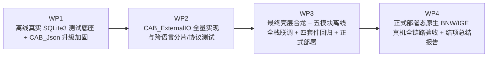

# M1Sub4（外部交互子模块 `CAB_ExternalIO` + `CAB_Json` 与最终壳层合龙）工作计划

> [!IMPORTANT]
> 本计划针对 **模块 1：游戏端纯 Lua 桥接 Mod（`Civ5AgentBridge`）** 中的 **子模块 4：外部交互子模块（`CAB_ExternalIO` + `CAB_Json`）** 以及 **模块 1 最终壳层合龙（`Civ5AgentBridgeUI.lua` 精简重构、`Civ5AgentBridge.modinfo` 正式装配、`Civ5AgentBridgeCore.lua` 退役收口与正式部署验收）** 编制。本文档以 `docs/M1/` 下三份上位设计文档（`模块设计说明.md`、`模块内部接口设计.md`、`模块设计进度.md`，含已回写的 `SYNC-01`~`SYNC-05`、`SYNC-M2-01`~`SYNC-M2-06` 与 `SYNC-M3-01`~`SYNC-M3-05`）及已正式验收的 M1Sub1、M1Sub2、M1Sub3 交付物为基线，面向多会话协作接力执行。
>
> **文档与文件隔离红线（D-01）**：在 M1Sub4 规划、编码、合龙与真机验收全过程中，**严禁修改** `docs/M1/` 下三份上位设计文档、顶层《01~03》设计文档、已结项的 `docs/M1/M1Sub1~3/*`、已验收的核心业务源码（`mod/Lua/CAB_Config.lua`、`CAB_InfoCollector.lua`、`CAB_TaskExecutor.lua`、`CAB_Dispatcher.lua`）、前序三套测试（`tests/run_m1sub1~3_tests.py`、`tests/m1sub1~3/*`）、已实证的 UI/Loader 骨架与部署脚本（`Civ5AgentBridgeUI.xml`、`Civ5AgentBridgeLoader.lua/.xml`、`scripts/deploy_mod.ps1`）以及历史实验目录（`tests/exp05~07/*`）。全部需同步回写上位文档的事项统一登记于《M1Sub4工作进度.md》`SYNC-M4-*` 台账，并在 WP4 汇总至《M1Sub4工作总结报告.md》供上级 M1 评审统一回写（顶层《02》《03》文档同步与全量双模归档另由 `M1-S6` 收口）。

---

## 一、 子模块定位、前置可启动性评估与决策定稿

### 1.1 前置依赖与可启动性结论

对照《模块设计说明.md》§2.2 拓扑图与《模块设计进度.md》§三 当前状态，模块 1 前三大业务子模块已 100% 验收就绪，对 M1Sub4 与最终合龙的全部前置依赖逐项核查如下：

| 关联模块 / 文件 | 依赖方向与交互内容 | 当前交付状态 | 是否阻塞 M1Sub4 启动 |
| :--- | :--- | :---: | :---: |
| `mod/Lua/CAB_Config.lua`（12 键公共配置表） | `CAB_ExternalIO` 直接读取 `DB_NAME`、`DB_VERSION`、`CHUNK_SIZE_BYTES`、`ENABLE_DEBUG_LOG` | ✅ **已验收**（M1Sub1 交付） | **不阻塞** |
| `mod/Lua/Civ5AgentBridgeJson.lua`（纯 Lua JSON 底座） | `CAB_ExternalIO` 依赖 `CAB_Json.Encode` / `CAB_Json.Decode`；当前仅导出旧全局函数且需边界加固 | 🟡 原型已实证，待 WP1 升级 `CAB_Json` | **由 WP1 本身完成** |
| `mod/Lua/CAB_InfoCollector.lua`（17 项只读接口） | 由 `CAB_Dispatcher` 调度，最终合龙时一并注册入 `.modinfo` 参与全栈运行 | ✅ **已验收**（M1Sub1 + M1Sub3 WP5 交付） | **不阻塞** |
| `mod/Lua/CAB_TaskExecutor.lua`（12 项执行接口 / 8 类结算） | 由 `CAB_Dispatcher` 调度，最终合龙时一并注册入 `.modinfo` 参与全栈运行 | ✅ **已验收**（M1Sub2 + M1Sub3 WP5 交付） | **不阻塞** |
| `mod/Lua/CAB_Dispatcher.lua`（7 项公开接口 / 20 项 IPC） | 已预埋守卫式 `if CAB_ExternalIO == nil then include("CAB_ExternalIO") end`，自检 `CAB_ExternalIO` 7 项核心接口并注入 `OnExternalRequestReceived` 回调 | ✅ **已验收**（M1Sub3 交付，零改代码即可合龙） | **不阻塞** |
| `mod/Lua/Civ5AgentBridgeUI.xml` + `Loader.lua/.xml` + `scripts/deploy_mod.ps1` | 已在原生 BNW v1.0.3.279 上多轮实证零闪退的空壳装配结构与镜像部署/清缓存脚本 | ✅ **已实证就绪** | **不阻塞** |

**结论**：**模块 1 前序三大子模块（`CAB_Config`、`CAB_InfoCollector`、`CAB_TaskExecutor`、`CAB_Dispatcher`）已 100% 验收定型，且 `CAB_Dispatcher` 已按 `D-02` 守卫式加载规范预留无缝对接点。M1Sub4 当前零阻塞依赖，可直接按 `WP1` ~ `WP4` 串行推进，完成后即达成模块 1（游戏端纯 Lua 桥接 Mod）的正式工程合龙与实机部署！**

### 1.2 经用户确认的关键设计决策定稿表（`D-01` ~ `D-06`）

| 决策编号 | 决策主题 | 确认结论 | 对上位三文档的影响（留待总结报告呈报） |
| :---: | :--- | :--- | :--- |
| **D-01** | M1Sub4 范围边界与严格文件隔离 | 覆盖 **子模块 4（`CAB_ExternalIO` + `CAB_Json`）** 与 **模块 1 最终壳层合龙（`Civ5AgentBridgeUI.lua` + `Civ5AgentBridge.modinfo` + `Civ5AgentBridgeCore.lua` 退役收口 + 正式部署）**（对应 `M1-S1` 剩余部分与 `M1-S5` 合龙收口）；严守前序隔离红线，不直接修改 `docs/M1/` 上位三文档、顶层《01~03》文档、前序已验收 4 个业务 Lua 文件及 `tests/run_m1sub1~3_tests.py` / `tests/m1sub1~3/*`，全部回写项登记于 `SYNC-M4-*` 台账，`M1-S6` 顶层文档回写与归档另行收口。 | 建议在《模块设计进度.md》§三 同步标记 `M1-S1` 与 `M1-S5` 全部完成（`SYNC-M4-03`） |
| **D-02** | 原型单体 `Civ5AgentBridgeCore.lua` 退役策略 | 从 `mod/Civ5AgentBridge.modinfo` 的 `<Files>` 中彻底移除 `Lua/Civ5AgentBridgeCore.lua`（游戏 VFS 零加载、运行时彻底退役），同时将 `mod/Lua/Civ5AgentBridgeCore.lua` 替换为**极简合法 Lua 5.1 退役存根文件**（仅保留退役说明注释，彻底清除旧单体代码与遗留 `AirRaidCore`/`CanMoveOrAttackInto` 引用），从而在不修改前序 `run_m1sub1~3_tests.py`（均将该文件列为必填语法正样本）的前提下保持全部回归套件 100% 全绿。 | 建议在《模块设计说明.md》§2.1 与《模块设计进度.md》§二 决策项 1 闭环退役方式（`SYNC-M4-03`） |
| **D-03** | `Civ5AgentBridgeJson.lua`（`CAB_Json`）升级与加固粒度 | 100% 保留旧全局符号（`CAB_JsonEncode`、`CAB_JsonDecode`、`CAB_JSON_NULL`）向下兼容，新增 **`CAB_Json = { Encode = CAB_JsonEncode, Decode = CAB_JsonDecode, NULL = CAB_JSON_NULL }`** 命名空间包装；同步落地 4 项生产边界加固：① `Decode` 拦截根值后的非法尾随字符；② 严格校验 `\uXXXX` 四位十六进制并支持 UTF-16 代理对转 4 字节 UTF-8；③ `Encode` 增加循环引用检测与最大递归深度限制（防 Lua 5.1 栈溢出）；④ 严格校验非法字面量、未转义控制字符与未闭合结构。 | 建议在《模块内部接口设计.md》§3.1 补充 `CAB_Json.NULL` 与 4 项生产边界加固细则（`SYNC-M4-01`） |
| **D-04** | `CAB_ExternalIO` 核心通信语义、UTF-8 分片边界与导出契约 | 严格落实《模块内部接口设计.md》§三 全部 7 项契约接口 + UTF-8 首字节对齐 3KB 分片，并确立 3 项工程加固：① `PushTurnOverview` 落盘全部分片后追加写入 `turn_overview_auto_seq` 作为原子发布序号屏障（随后写 `TURN_SYNCED` 心跳，与 M1Sub3 真机实证一致）；② 仅当 `rpc_session_id` 变更为新非空值时才重置 `s_LastProcessedReqId = 0`（绝不对旧客户端凭 `req_id` 变小盲猜重置），且 JSON 解码为非对象（如 `null`/数字/字符串/数组）时由 `CAB_ExternalIO` 直接拦截写回协议错返；③ 参照 `CAB_Dispatcher` 增补第 **8 个纯只读诊断接口 `CAB_ExternalIO.GetRuntimeState()`**（零 DB 句柄与回调闭包泄露）。 | 建议在《模块内部接口设计.md》§3.2~§3.6 与《模块设计说明.md》§3.4/§4.2 增补 3 项加固契约（`SYNC-M4-02`） |
| **D-05** | 最终壳层合龙、Python 验收客户端归属与部署规范 | ① `mod/Lua/Civ5AgentBridgeUI.lua` 精简重构为纯事件转发壳层：顶部自底向上守卫式按需加载 6 个 Lua 模块（`CAB_Config` → `Civ5AgentBridgeJson` → `CAB_ExternalIO` → `CAB_InfoCollector` → `CAB_TaskExecutor` → `CAB_Dispatcher`），仅当 `CAB_Dispatcher.Initialize(onUiStatusUpdate)` 返回 `true` 时挂载 4 项引擎/按钮回调（失败则显示错误提示文案）；② `mod/Civ5AgentBridge.modinfo` 登记全部 **10 个正式 VFS 文件**（全 `import="1"`、正斜杠、移除 `Core`）；③ 不改动历史 `tests/exp06/sqlite_bridge.py`，在 M1Sub4 自有真机驱动脚本 `tests/m1sub4/live_smoke_client.py` 中落地 `sqlite3` `text_factory = bytes` 拼片解码与 `rpc_session_id` 握手协议；④ 正式部署统一采用 `scripts/deploy_mod.ps1 -ForceCopy -ClearCache`。 | 建议在《模块设计说明.md》§2.1 登记最终 10 文件 `.modinfo` 清单（`SYNC-M4-03`） |
| **D-06** | 工作包拆分（`WP1`~`WP4`）、离线真实 SQLite3 验证与 WP4 不回滚真机验收 | 文档沿用前序命名：`M1Sub4工作计划.md`、`M1Sub4工作进度.md`、`M1Sub4工作总结报告.md`；拆分为 `WP1`~`WP4` 共 4 个串行工作包（每包约 1 会话）；离线测试在 `lupa.lua51` 背后对接**真实 Python `sqlite3` `SimpleValues` 数据库**实证跨语言 UTF-8 分片与协议互操作；**WP4 直接运行正式部署态 Mod 进行真机全链路验收，零临时垫片，验收通过后保留正式部署态不回滚**；本会话仅产出计划与进度两份文档。 | 无 |

---

## 二、 工程约束、安全红线与统一约定

### 2.1 硬性架构约束

1. **职责纯净与单向分层依赖（防腐层定位）**：
   * `CAB_ExternalIO.lua` 是模块 1 **唯一持有 SQLite 数据库句柄（`Modding.OpenUserData`）的通信防腐层**。它严禁反向调用或直接引用 `CAB_Dispatcher`、`CAB_Collector`、`CAB_Executor`，严禁调用任何修改游戏沙盘的引擎写接口（如 `SelectionListMove`、`CityPurchase*`、`SendCityBuyPlot`、`Game.DoControl`、`UI.SelectUnit`、`SetScriptData` 等）；仅通过启动注入的 `s_OnMessageCallback` 委托向上层单向通知新请求。
   * `Civ5AgentBridgeUI.lua` 精简后为**纯 UI 壳层与引擎事件挂载点**，严禁包含任何 SQLite 读写、JSON 编解码、RPC 方法路由或动作结算逻辑，全部业务流严格转发给 `CAB_Dispatcher`。
2. **原生《文明5：BNW v1.0.3.279》Lua 5.1 语法与 VFS 纪律**：
   * 严格遵循 Lua 5.1 语法（禁用 `goto`、`//` 整除、`table.unpack`、`bit32` 等 Lua 5.2+ 特性），所有新改 Lua 文件须通过 `lupa.lua51` 编译校验及 3 项负向语法自检。
   * 跨模块加载严格遵守守卫式按需加载规范（`if CAB_X == nil then include("...") end`），杜绝 Civ5 VFS 重复执行 `include()` 重置模块私有 `local` 状态。
   * `.modinfo` 严格遵守 `AGENTS.md` 硬性纪律：全部路径正斜杠 `/`、被 `include()` 或 `<LuaContext>` 引用文件全部 `import="1"`、唯一 `InGameUIAddin` 为空壳 `Lua/Civ5AgentBridgeLoader.lua`、`AffectsSavedGames = 0`、修改 `<Files>` 后必清 `cache/Civ5*.db`。
3. **代码注释与可追溯性规范**：
   * 每个新建或重构的 Lua 文件头部写明文件职责、依赖关系、导出接口清单、安全红线与上位契约出处；
   * 每个公开函数与内部 `local` 辅助函数上方均须提供详尽中文注释，写明**做什么（What）**、**为什么这么做（Why，特别是 UTF-8 分片边界、发布屏障顺序与水位线防重放原因）**、输入参数与返回值结构。

### 2.2 外部交互层与合龙壳层 6 条安全红线（`I-01` ~ `I-06`）

| 编号 | 红线名称 | 强制执行规则 | 验证方式 |
| :---: | :--- | :--- | :--- |
| **I-01** | **单向分层与零游戏写副作用** | `CAB_ExternalIO.lua` 与 `Civ5AgentBridgeJson.lua` 严禁引用 `CAB_Dispatcher`、`CAB_Collector`、`CAB_Executor`，严禁出现或调用任何游戏写指令（`SelectionListMove`、`SelectionListGameNetMessage`、`SelectedCitiesGameNetMessage`、`CityPurchase*`、`CityPushOrder`、`SendCityBuyPlot`、`SendResearch`、`SendUpdatePolicies`、`HandleAction`、`DoControl`、`UI.SelectUnit`、`UI.SetInterfaceMode`、`SetScriptData`、`CanMoveOrAttackInto`、`AirRaidCore`）；`Civ5AgentBridgeUI.lua` 严禁直接调用 `Modding.OpenUserData`、`SimpleValues` 或 `CAB_Json*`。 | 静态源码扫描 + 桩红线守卫 |
| **I-02** | **UTF-8 多字节分片边界绝对安全** | `CAB_ExternalIO.WritePayload` 在分片切片时，若右边界落于 UTF-8 续字节前（即下一字节 `0x80..0xBF`），必须向前回退对齐至完整 UTF-8 字符边界（并带向前推进防死循环守卫）；每个分片均可独立按 UTF-8 解码，且拼接结果与原串 100% 字节一致。 | 真实 Python `sqlite3` 文本态 + `bytes` 态双向大包（简/繁中文 + 4 字节 UTF-8）断言 |
| **I-03** | **原子发布屏障写入顺序不可颠倒** | ① `SendRpcResponse` 必须先完成 `rpc_response`（含 `#chunk_1..N` 与 `#chunk_count`）全部落盘，**最后一步**才写入 `rpc_response_req_id`；② `PushTurnOverview` 必须先完成 `turn_overview_auto` 全部分片落盘，随后写入 `turn_overview_auto_seq`，**最后**再写入 `bridge_heartbeat("TURN_SYNCED", turnSeq)`；任一前置写入失败时严禁推进发布屏障键。 | DB 写入事件顺序审计用例 |
| **I-04** | **请求水位线单调与严格会话重置** | `Initialize` 必须对齐库内已有 `rpc_request_req_id` 与 `rpc_session_id` 防止读档/重载重放历史指令；`PollIncomingRequest` 仅当 `rpc_session_id` 变更为新的非空字符串时才重置 `s_LastProcessedReqId = 0`；同一 `req_id` 严禁触发两次回调；处理前即刻推进 `s_LastProcessedReqId = reqId`，确保即使下游抛错也不会陷入死循环重试同一坏请求。 | 重载防重放 + 会话切换 + 故障不重试用例 |
| **I-05** | **通信防腐层异常全隔离（零崩溃帧循环）** | `CAB_Json.Decode` 经 `pcall` 包裹且拦截尾随垃圾与畸形转义；`CAB_Json.Encode` 拦截循环引用与超深嵌套；`PollIncomingRequest` 对 JSON 解码失败或解码结果非对象表（`nil`/数字/字符串/纯数组）直接写回 `ok = false` 协议错返，不向上冒泡；调用 `s_OnMessageCallback` 经 `pcall` 保护，回调抛错时兜底写回 `ok = false` 响应；SQLite 句柄为空或读写抛错时返回 `false`/`nil` 不崩溃游戏帧循环。 | 畸形 JSON / 非对象 / 回调异常 / DB 故障注入用例 |
| **I-06** | **只读诊断隔离与合龙装配零遗漏** | `CAB_ExternalIO.GetRuntimeState()` 仅返回浅拷贝基础标量表，严禁泄露 `s_BridgeDB` 句柄或 `s_OnMessageCallback` 函数引用；`Civ5AgentBridge.modinfo` 全部 10 文件均为正斜杠 + `import="1"` 且零遗留 `Civ5AgentBridgeCore.lua`；部署后 `MODS/Civ5AgentBridge/` 与 `mod/` 镜像一致且 5 个缓存库已清理。 | 诊断快照隔离用例 + `.modinfo` 结构校验脚本 |

---

## 三、 修改与产出文件清单（严格白名单与禁止清单）

### 3.1 M1Sub4 永久产出与可修改文件白名单

| 文件路径（相对 `Civ5AgentBridge/`） | 操作类型 | 所属工作包 | 职责说明 |
| :--- | :---: | :---: | :--- |
| `docs/M1/M1Sub4/M1Sub4工作计划.md` | 新建 | 设计阶段（本会话） | 本计划文档（前置评估、决策 `D-01`~`D-06`、红线 `I-01`~`I-06`、`CAB_Json`/`CAB_ExternalIO`/UI 壳层详设、`WP1`~`WP4` 与验收标准） |
| `docs/M1/M1Sub4/M1Sub4工作进度.md` | 新建 & 持续更新 | 设计阶段 ~ WP4 | 多会话总览看板、决策表、`WP1`~`WP4` 进度追踪、`SYNC-M4-*` 上位文档回写台账与交接日志 |
| `docs/M1/M1Sub4/M1Sub4工作总结报告.md` | 新建 | WP4（最终结项） | M1Sub4（含外部交互子模块与模块 1 最终合龙）结项验收报告与上位文档回写建议书 |
| `mod/Lua/Civ5AgentBridgeJson.lua` | 升级加固 | WP1 | 新增 `CAB_Json` 命名空间（100% 兼容旧全局函数），落实 D-03 4 项编解码边界加固 |
| `mod/Lua/CAB_ExternalIO.lua` | 新建 | WP2 | 子模块 4 正式实现（唯一全局 `CAB_ExternalIO`，精确 8 个公开接口 `X1`~`X8`） |
| `mod/Lua/Civ5AgentBridgeUI.lua` | 精简重构 | WP3 | 最终壳层合龙：精简为纯事件挂载壳层，自底向上守卫式加载 6 模块，挂载 4 项引擎/UI 回调 |
| `mod/Civ5AgentBridge.modinfo` | 正式更新 | WP3 | 登记全部 10 个正式 VFS 文件（全 `import="1"`、正斜杠、移除 `Civ5AgentBridgeCore.lua`），更新描述信息 |
| `mod/Lua/Civ5AgentBridgeCore.lua` | 退役存根替换 | WP3 | 按 D-02 替换为极简合法 Lua 5.1 退役说明存根，清除旧单体逻辑且保持 `run_m1sub1~3_tests.py` 100% 全绿 |
| `tests/run_m1sub4_tests.py` | 新建 | WP1 ~ WP3 | 基于 Python + `lupa.lua51` + 真实 `sqlite3` 的三阶段离线验收入口（全量 13 文件 Lua 5.1 语法 + 3 负向自检 + 跨语言 SQLite/五模块合龙测试 + `.modinfo` 校验 + `--filter`） |
| `tests/m1sub4/db_stubs.lua` | 新建 & 扩充 | WP1 ~ WP3 | 对接 Python 真实 `sqlite3` `SimpleValues` 的 `Modding.OpenUserData` 桩、写顺序审计钩子、故障注入开关及 WP3 五模块+UI 壳层全栈联调引擎桩 |
| `tests/m1sub4/test_external_io.lua` | 新建 & 扩充 | WP1 ~ WP3 | 覆盖 `CAB_Json` 加固单测、`CAB_ExternalIO` 8 接口/UTF-8 分片/会话重置/屏障顺序/异常隔离测试，以及 WP3 五模块+UI 壳层端到端联调用例 |
| `tests/m1sub4/live_smoke_client.py` | 新建 | WP4 | 采用 `sqlite3` `text_factory = bytes` 拼片解码与 `rpc_session_id` 协议的正式部署态真机全链路验收驱动脚本 |

### 3.2 严禁修改文件清单（绝对红线）

* `docs/M1/模块设计说明.md`、`docs/M1/模块内部接口设计.md`、`docs/M1/模块设计进度.md`
* `docs/01_技术瓶颈与可行性试验清单.md`、`docs/02_软件总体设计说明书.md`、`docs/03_接口设计说明书.md`
* `docs/M1/M1Sub1/*`、`docs/M1/M1Sub2/*`、`docs/M1/M1Sub3/*`（已结项归档）
* `mod/Lua/CAB_Config.lua`、`mod/Lua/CAB_InfoCollector.lua`、`mod/Lua/CAB_TaskExecutor.lua`、`mod/Lua/CAB_Dispatcher.lua`（已验收业务模块零修改，真实验证零侵入合龙）
* `mod/Lua/Civ5AgentBridgeUI.xml`、`mod/Lua/Civ5AgentBridgeLoader.lua`、`mod/Lua/Civ5AgentBridgeLoader.xml`、`scripts/deploy_mod.ps1`
* `tests/run_m1sub1_tests.py`、`tests/run_m1sub2_tests.py`、`tests/run_m1sub3_tests.py`、`tests/m1sub1/*`、`tests/m1sub2/*`、`tests/m1sub3/*`
* `tests/exp05/*`、`tests/exp06/*`、`tests/exp07/*`、`tests/run_exp03_exp04_acceptance.py`

---

## 四、 `CAB_Json`、`CAB_ExternalIO` 与最终合龙壳层详细设计

### 4.1 `Civ5AgentBridgeJson.lua`（`CAB_Json`）升级详设（`D-03`）

1. **命名空间与向后兼容导出**：
   * 保留既有全局符号：`CAB_JSON_NULL`、`CAB_JsonEncode(val)`、`CAB_JsonDecode(str)`；
   * 新增统一命名空间表：`CAB_Json = { Encode = CAB_JsonEncode, Decode = CAB_JsonDecode, NULL = CAB_JSON_NULL }`；
   * 全部内部解析/转义辅助函数维持 `local`。
2. **4 项生产边界加固细则**：
   * **加固 1（`Decode` 尾随垃圾拦截）**：`CAB_ParseValue(str, 1)` 返回 `(val, nextIdx)` 后，执行 `nextIdx = CAB_SkipWhitespace(str, nextIdx)`，若 `nextIdx <= #str` 则 `error("JSON trailing characters at pos " .. tostring(nextIdx))`；
   * **加固 2（`\uXXXX` 严格校验与 UTF-16 代理对转 UTF-8）**：校验 `hex` 长度恰好为 4 且匹配 `"^[0-9a-fA-F][0-9a-fA-F][0-9a-fA-F][0-9a-fA-F]$"`（非法则报错）；若 `0xD800 <= code <= 0xDBFF`（高代理），必须紧跟 `\uYYYY` 且 `0xDC00 <= low <= 0xDFFF`（低代理），按 `cp = 0x10000 + (code - 0xD800) * 1024 + (low - 0xDC00)` 编码为标准 4 字节 UTF-8；孤立低代理或无配对高代理直接报错；非法转义字符（非 `"`, `\`, `/`, `b`, `f`, `n`, `r`, `t`, `u`）及字符串内未转义 ASCII 控制字符（`< 0x20`）直接报错；
   * **加固 3（`Encode` 循环引用与深度上限防护）**：内部递归函数 `encodeValue(val, depth, visiting)` 维护当前递归栈访问表 `visiting[tbl] = true`（退出时置 `nil`）与最大深度上限 `MAX_ENCODE_DEPTH = 64`；检测到循环引用或超深嵌套时抛出明确错误（避免 Lua 5.1 C 栈溢出崩溃游戏），由调用方 `CAB_ExternalIO` 的 `pcall` 安全接管并写回错误响应；
   * **加固 4（字面量与数字边界校验）**：解析 `true`/`false`/`null` 时确保匹配完整字面量且后接合法分隔符/空白/结尾；严格遵守 `NaN`/`±inf` 编码为 `"null"`、`__is_object = true` 强制输出 `{...}`（省略 `__is_object` 键本身）。

### 4.2 `CAB_ExternalIO.lua` 内部私有状态与 8 个公开接口契约（`X1` ~ `X8`）

#### （一）内部私有状态变量（全部 `local`）

| 私有变量名 | 类型 | 初始值 | 状态职责说明 |
| :--- | :--- | :---: | :--- |
| `s_Initialized` | `boolean` | `false` | 标记 `CAB_ExternalIO.Initialize` 是否已成功打开数据库并绑定回调 |
| `s_BridgeDB` | `userdata \| table \| nil` | `nil` | `Modding.OpenUserData(CAB_Config.DB_NAME, CAB_Config.DB_VERSION)` 句柄 |
| `s_LastProcessedReqId` | `number` | `0` | 已消费处理的最新 `rpc_request_req_id` 单调水位线 |
| `s_ActiveSessionId` | `string` | `""` | 当前活跃外部会话标识（对应 SQLite 键 `rpc_session_id`） |
| `s_OnMessageCallback` | `function \| nil` | `nil` | `CAB_Dispatcher` 注入的新外部请求到达通知委托 |

#### （二）UTF-8 首字节边界对齐切片算法（`WritePayload` 核心）

当 `forceChunked == true` 或 `#s > chunkSize`（其中 `chunkSize = CAB_Config.CHUNK_SIZE_BYTES`，默认 `3000`，容错兜底最小为 `4`）时，循环切分 `startIdx .. #s`：
1. 若 `#s == 0` 且 `forceChunked == true`：写入 1 个空分片 `<key>#chunk_1 = ""`、`<key>#chunk_count = "1"`、`<key> = "__CHUNKED__:0"`；
2. 否则每轮令 `endIdx = math.min(startIdx + chunkSize - 1, #s)`；
3. 若 `endIdx < #s`，检查下一字节 `nextByte = s:byte(endIdx + 1)`：
   * 只要 `endIdx >= startIdx` 且 `nextByte ~= nil` 且 `nextByte >= 128 and nextByte <= 191`（UTF-8 续字节 `10xxxxxx`，最多回退 3 步），执行 `endIdx = endIdx - 1` 并重查 `nextByte = s:byte(endIdx + 1)`；
   * **向前推进兜底守卫**：若极端损坏字节流导致回退后 `endIdx < startIdx`，强制恢复 `endIdx = math.min(startIdx + chunkSize - 1, #s)`，保证每轮至少消费 1 字节绝不死循环；
4. 依次通过 `pcall` 写入 `<key>#chunk_<idx> = s:sub(startIdx, endIdx)`，全部完成后写入 `<key>#chunk_count = tostring(totalChunks)` 与主槽位 `<key> = "__CHUNKED__:" .. tostring(#s)`；任一 `SetValue` 异常立即中止并返回 `false`。

#### （三）`CAB_ExternalIO` 8 个公开导出接口契约总表（`X1` ~ `X8`）

| 编号 | 函数签名 | 返回值 | 分步职责与实现逻辑说明 |
| :---: | :--- | :---: | :--- |
| **X1** | `CAB_ExternalIO.Initialize(onMessageCallback)` | `(boolean, string \| nil)` | 1. 校验 `CAB_Config`（`DB_NAME`、`DB_VERSION`、`CHUNK_SIZE_BYTES`）、`CAB_Json`（`Encode`、`Decode`）、`Modding.OpenUserData` 与入参 `type(onMessageCallback) == "function"`，任一缺失则置 `s_Initialized = false` 返回 `(false, errMsg)`； 2. 经 `pcall` 调用 `Modding.OpenUserData(CAB_Config.DB_NAME, CAB_Config.DB_VERSION)` 获取句柄；若失败或返回 `nil` 返回 `(false, "OpenUserData failed: ...")`； 3. 读取库内已有 `rpc_request_req_id`（转非负有限整数，缺省 `0`）与 `rpc_session_id`（缺省 `""`）校准 `s_LastProcessedReqId` 与 `s_ActiveSessionId`，防重载重放历史指令； 4. 保存 `s_BridgeDB`、`s_OnMessageCallback = onMessageCallback`，置 `s_Initialized = true`，返回 `(true, nil)`。 |
| **X2** | `CAB_ExternalIO.WritePayload(key, strValue, forceChunked)` | `boolean` | 校验 `s_BridgeDB ~= nil` 且 `key` 为非空字符串；按上述 UTF-8 首字节边界对齐算法写入分片或单槽位（单槽位同步写 `<key>#chunk_count = "0"`）；全程 `pcall` 保护，成功返回 `true`，异常返回 `false`。 |
| **X3** | `CAB_ExternalIO.ReadPayload(key)` | `string \| nil` | 校验 `s_BridgeDB ~= nil` 且 `key` 为非空字符串；先读取 `<key>#chunk_count`：若为正整数 `N`，循环读取 `<key>#chunk_1 .. N` 经 `table.concat` 重组返回（若任一片缺失返回 `nil` 或按异常兜底）；若为 `0` 或缺失，直接读取返回 `GetValue(key)`；异常返回 `nil`。 |
| **X4** | `CAB_ExternalIO.PushTurnOverview(overviewTable, turnSeq)` | `boolean` | 1. 校验 `s_BridgeDB ~= nil` 且 `type(overviewTable) == "table"`； 2. 经 `pcall(CAB_Json.Encode, overviewTable)` 序列化；失败则打错误日志返回 `false`； 3. 调用 `WritePayload("turn_overview_auto", jsonStr, false)` 落盘全部分片；失败返回 `false`（严禁推进屏障，红线 `I-03`）； 4. 写入原子序号屏障 `turn_overview_auto_seq = tostring(math.floor(tonumber(turnSeq) or 0))`； 5. 调用 `WriteHeartbeat("TURN_SYNCED", turnSeq)`，返回综合写入结果。 |
| **X5** | `CAB_ExternalIO.WriteHeartbeat(statusStr, turnSeq)` | `boolean` | 1. 校验 `s_BridgeDB ~= nil`； 2. 安全采集当前引擎只读标量：`turn`（`Game.GetGameTurn()`）、`active_player`（`Game.GetActivePlayer()`）、`is_turn_active`（`Players[activePlayer]:IsTurnActive() == true`）、`status`（`tostring(statusStr or "IDLE")`）、`turn_seq`（非负整数）、`last_req_id`（`s_LastProcessedReqId`）、`clock_ms`（`math.floor((os and os.clock and os.clock() or 0) * 1000)`）； 3. 组装带 `__is_object = true` 的表经 `CAB_Json.Encode` 编码写入 `bridge_heartbeat` 键，返回 `boolean`。 |
| **X6** | `CAB_ExternalIO.SendRpcResponse(reqId, ok, dataTable, errMsg, forceChunked)` | `boolean` | 1. 校验 `s_BridgeDB ~= nil`； 2. 组装标准信封 `{ __is_object = true, req_id = reqId, ok = (ok == true), data = dataTable, error = errMsg }`； 3. 经 `pcall(CAB_Json.Encode, resp)` 编码；若 `dataTable` 编码意外失败（如含非法循环引用），降级编码 `{ __is_object = true, req_id = reqId, ok = false, error = "JSON encode error: ..." }`； 4. 调用 `WritePayload("rpc_response", encoded, forceChunked == true)`；若失败直接返回 `false`（严禁提前更新 `rpc_response_req_id`，红线 `I-03`）； 5. **最后一步**写入原子发布屏障 `s_BridgeDB.SetValue("rpc_response_req_id", tostring(reqId))`，返回 `true`。 |
| **X7** | `CAB_ExternalIO.PollIncomingRequest()` | `boolean` | 1. 若 `not s_Initialized` 或 `s_BridgeDB == nil` 则直接返回 `false`； 2. 轻量检查会话变更：读取 `incomingSession = safeGetValue("rpc_session_id")`；若 `type(incomingSession) == "string"` 且 `incomingSession ~= ""` 且 `incomingSession ~= s_ActiveSessionId`，更新 `s_ActiveSessionId = incomingSession` 并重置 `s_LastProcessedReqId = 0`（严格遵循 `D-04`/`I-04`）； 3. 轻量检查请求屏障：`reqId = parsePositiveInt(safeGetValue("rpc_request_req_id"))`；若 `reqId == nil` 或 `reqId <= s_LastProcessedReqId`，立即返回 `false`（零额外 SQLite 查询）； 4. 发现新请求：立即推进水位线 `s_LastProcessedReqId = reqId`（防坏请求重复触发）；调用 `ReadPayload("rpc_request")` 读取完整载荷； 5. 若 `rawJson == nil or rawJson == ""`：直接 `SendRpcResponse(reqId, false, nil, "Empty RPC request payload")` 返回 `true`； 6. 调 `CAB_Json.Decode(rawJson)`：若解码报错则直接 `SendRpcResponse(reqId, false, nil, "JSON decode error: " .. tostring(decodeErr))` 返回 `true`；若解码结果不是 JSON 对象表（`type(reqObj) ~= "table"` 或为纯数组无 `method` 字符串键）则直接 `SendRpcResponse(reqId, false, nil, "Invalid RPC request: expected JSON object")` 返回 `true`； 7. 规范化请求包：`reqObj.req_id = reqId`、`reqObj.params = (type(reqObj.params) == "table") and reqObj.params or {}`、`reqObj.session_id = reqObj.session_id or (s_ActiveSessionId ~= "" and s_ActiveSessionId or nil)`； 8. 经 `pcall(s_OnMessageCallback, reqObj)` 主动通知调度层；若回调抛出未捕获 Lua 异常，兜底调用 `SendRpcResponse(reqId, false, nil, "Dispatcher callback error: " .. tostring(cbErr))`；返回 `true`。 |
| **X8** | `CAB_ExternalIO.GetRuntimeState()` | `table` | 返回纯只读浅拷贝诊断快照（带 `__is_object = true`，零句柄/闭包暴露）：`{ initialized, db_connected, last_processed_req_id, active_session_id, has_callback, chunk_size_bytes }`。 |

### 4.3 最终壳层合龙详设（`Civ5AgentBridgeUI.lua` + `.modinfo` + `Core` 退役存根）

1. **`mod/Lua/Civ5AgentBridgeUI.lua` 精简重构设计（~90 行）**：
   * 顶部严格按底层到上层依赖顺序执行守卫式按需加载：
     1. `if CAB_Config == nil then include("CAB_Config") end`
     2. `if CAB_Json == nil then include("Civ5AgentBridgeJson") end`
     3. `if CAB_ExternalIO == nil then include("CAB_ExternalIO") end`
     4. `if CAB_Collector == nil then include("CAB_InfoCollector") end`
     5. `if CAB_Executor == nil then include("CAB_TaskExecutor") end`
     6. `if CAB_Dispatcher == nil then include("CAB_Dispatcher") end`
   * 定义 `local function CAB_UpdateStatusLabel(statusText)`：安全判定 `Controls and Controls.BridgeStatusLabel` 后调用 `SetText(tostring(statusText or ""))`；
   * 定义 `local function CAB_Bootstrap()`：校验 `CAB_Dispatcher` 就绪，调用 `local ok = CAB_Dispatcher.Initialize(CAB_UpdateStatusLabel)`；
     * 若 `ok == true`：挂载 4 项宿主回调——`Controls.BridgeSyncButton:RegisterCallback(Mouse.eLClick, CAB_Dispatcher.OnManualSyncClicked)`、`Events.ActivePlayerTurnStart.Add(CAB_Dispatcher.OnActivePlayerTurnStart)`、`Events.ActivePlayerTurnEnd.Add(CAB_Dispatcher.OnActivePlayerTurnEnd)`、`ContextPtr:SetUpdate(CAB_Dispatcher.OnFrameUpdate)`，输出启动日志；
     * 若 `ok ~= true`：刷新状态栏为 `"Agent Bridge: Init Failed"` 并打印错误日志，不挂载帧循环以免刷屏报错。
2. **`mod/Civ5AgentBridge.modinfo` 正式 10 文件清单**：
   * `<Files>` 严格登记以下 10 项（全部 `import="1"`、正斜杠 `/`、零 `Civ5AgentBridgeCore.lua`）：
     1. `Lua/CAB_Config.lua`
     2. `Lua/Civ5AgentBridgeJson.lua`
     3. `Lua/CAB_ExternalIO.lua`
     4. `Lua/CAB_InfoCollector.lua`
     5. `Lua/CAB_TaskExecutor.lua`
     6. `Lua/CAB_Dispatcher.lua`
     7. `Lua/Civ5AgentBridgeUI.xml`
     8. `Lua/Civ5AgentBridgeUI.lua`
     9. `Lua/Civ5AgentBridgeLoader.lua`
     10. `Lua/Civ5AgentBridgeLoader.xml`
   * 保留 `id="c5a8b901-71d5-48fa-9d32-b265eb5fd373"`、`AffectsSavedGames=0`、`SupportsSinglePlayer=1`、`SupportsMultiplayer=0`、`Game min/maxversion="1.0.3.279"` 与 `<EntryPoint type="InGameUIAddin" file="Lua/Civ5AgentBridgeLoader.lua">`，更新 `<Teaser>` 与 `<Description>`。
3. **`mod/Lua/Civ5AgentBridgeCore.lua` 退役存根**：
   * 替换为约 15 行纯中文注释说明（注明原型单体已正式拆解至 `CAB_Config` / `CAB_InfoCollector` / `CAB_TaskExecutor` / `CAB_Dispatcher` / `CAB_ExternalIO` 并从 `.modinfo` 卸载，仅留空合法 Lua 5.1 文件以保障前序回归脚本语法正样本零改动通过），零全局变量、零 `include`、零引擎调用。

---

## 五、 多会话工作包拆分与依赖顺序（`WP1` ~ `WP4`）

| 工作包 | 核心目标 | 涉及新增/修改文件 | 独立完成标准（Done Criteria） | 建议会话数 |
| :---: | :--- | :--- | :--- | :---: |
| **WP1** | **离线跨语言 SQLite3 测试底座 + `Civ5AgentBridgeJson.lua`（`CAB_Json`）升级加固与专项单测** | 新建 `tests/run_m1sub4_tests.py` 新建 `tests/m1sub4/db_stubs.lua` 新建 `tests/m1sub4/test_external_io.lua` 升级 `mod/Lua/Civ5AgentBridgeJson.lua` | 1. `python Civ5AgentBridge/tests/run_m1sub4_tests.py` 跑通全量 Lua 5.1 语法检查（含 3 项负向语法自检）与 `--filter` 过滤； 2. `db_stubs.lua` 在 `lupa.lua51` 内对接 Python 真实 `sqlite3` 临时库（`SimpleValues(Name TEXT Primary Key, Value VARIANT)`）并提供写顺序日志与故障注入开关； 3. `Civ5AgentBridgeJson.lua` 导出 `CAB_Json = { Encode, Decode, NULL }` 并保持旧全局函数 100% 兼容，通过 `CAB_Json` 全量单测（含 `__is_object`、`CAB_JSON_NULL`、中文直通、`\uXXXX` 与 UTF-16 代理对 4 字节 UTF-8、尾随垃圾拦截、循环引用与超深嵌套拦截、畸形控制字符拦截）； 4. 复跑 `run_m1sub1~3_tests.py` 零回归。 | 1 会话 |
| **WP2** | **`mod/Lua/CAB_ExternalIO.lua` 全量实现（`X1`~`X8`）与跨语言 UTF-8 分片/会话/屏障/异常隔离测试** | 新建 `mod/Lua/CAB_ExternalIO.lua` 扩充 `tests/m1sub4/db_stubs.lua` 扩充 `tests/m1sub4/test_external_io.lua` | 1. 完整实现 `CAB_ExternalIO` 精确 8 个导出接口（`X1`~`X8`），通过静态源码红线扫描（`I-01` 零违规）； 2. **跨语言真实 SQLite3 互操作实证（`I-02`）**：验证 0B / 2999B / 3000B / 3001B / 32KB+ 载荷、纯繁体中文（3 字节 UTF-8 跨越 3000B 边界）、4 字节 UTF-8 表情符号及 `forceChunked=true` 场景下，Python 默认 UTF-8 文本读取单分片 **0 次 `OperationalError`** 且 `text_factory = bytes` 拼接回读 100% 字节无损； 3. 验证原子屏障写入顺序（`I-03`：`rpc_response` 分片先于 `rpc_response_req_id`、`turn_overview_auto` 先于 `turn_overview_auto_seq` 与 `bridge_heartbeat`）、重载防重放与严格 `rpc_session_id` 重置（`I-04`）、损坏 JSON/非对象请求/回调异常/DB 异常全隔离（`I-05`）及 `GetRuntimeState()` 零引用泄露（`I-06`）； 4. 复跑 `run_m1sub1~4_tests.py` 全部退出码 `0`。 | 1 会话 |
| **WP3** | **最终壳层合龙（`UI.lua` + `.modinfo` + `Core` 退役存根）、五模块全栈离线联调、四套件总回归与正式部署** | 重构 `mod/Lua/Civ5AgentBridgeUI.lua` 更新 `mod/Civ5AgentBridge.modinfo` 替换 `mod/Lua/Civ5AgentBridgeCore.lua`（退役存根） 扩充 `tests/run_m1sub4_tests.py` / `tests/m1sub4/*` 正式部署 `MODS/Civ5AgentBridge/` | 1. 完成 `Civ5AgentBridgeUI.lua` 精简重构（自底向上守卫式加载 6 模块 + 初始化成功才挂 4 回调 + 失败降级提示）、`Civ5AgentBridge.modinfo` 10 文件全 `import="1"` 正斜杠更新、`Civ5AgentBridgeCore.lua` 退役存根替换； 2. 在 `run_m1sub4_tests.py` 中新增 `.modinfo` XML 结构自动校验（10 文件存在性、全正斜杠、全 `import="1"`、无 `Core`、空壳 Loader 入口、`AffectsSavedGames=0`）及五模块+UI 壳层真实端到端联调用例（Python 写真实 SQLite 请求 → `Civ5AgentBridgeUI` 帧驱动 `CAB_Dispatcher` → `CAB_ExternalIO` / `Collector` / `Executor` → Python 读回响应，含中文大载荷、异步结算与跨回合自动推送）； 3. 独立复跑全部 4 套离线测试（`run_m1sub1_tests.py` `40/40`、`run_m1sub2_tests.py` `38/38`、`run_m1sub3_tests.py` `29/29`、`run_m1sub4_tests.py` 全绿），退出码均为 `0` 且红线违规为 `0`； 4. 执行 `scripts/deploy_mod.ps1 -ForceCopy -ClearCache` 完成正式镜像部署并清理全部 5 个 `cache/Civ5*.db`，核验 `MODS/Civ5AgentBridge/` 文件与 `mod/` 100% 一致。 | 1 会话 |
| **WP4** | **正式部署态原生 BNW v1.0.3.279 + IGE 真机全链路实证验收（不回滚）与最终结项交付** | 新建 `tests/m1sub4/live_smoke_client.py` 新建 `docs/M1/M1Sub4/M1Sub4工作总结报告.md` 闭环更新 `docs/M1/M1Sub4/M1Sub4工作进度.md` | 1. 编写 `tests/m1sub4/live_smoke_client.py`（落地 `text_factory = bytes` 拼片解码与 `rpc_session_id` 协议），直接对接**正式部署的 `MODS/Civ5AgentBridge/`**（零临时垫片、零修改 `mod/`）； 2. 配合用户启动原生《文明5：BNW v1.0.3.279》+ IGE 进入单人局，实机验证：① 正式 Mod 空壳加载与右上角状态栏显示；② 首帧自动推送 `turn_overview_auto` + `turn_overview_auto_seq` + `bridge_heartbeat`；③ 含繁体/简体中文大包（`get_policy_options`、`get_turn_overview`、`test_large_payload` 32KB+）分片零 UTF-8 错误；④ `rpc_session_id` 切换后 `req_id` 从 `1` 重置握手成功；⑤ 代表性只读查询、写动作跨帧结算、坏 JSON 协议错返隔离、手动同步按钮不递增 `turn_seq`、AI 回合门控与 `end_turn` 推进 `Turn N → Turn N+1` 自动推送； 3. 核验 `Logs/Lua.log` 全程零语法/运行时/堆栈错误，**验收通过后保留正式部署态不回滚**；复跑 4 套离线测试全绿与 `git status` 白名单审计； 4. 产出《`M1Sub4工作总结报告.md`》（含 `A-01`~`A-10` 逐项对账与 `SYNC-M4-01`~`SYNC-M4-03` 上位文档回写建议书）并闭环更新《`M1Sub4工作进度.md`》。 | 1 会话 |

---

## 六、 验收标准清单（`A-01` ~ `A-10`）与风险防护

### 6.1 验收标准矩阵

| 验收项 | 验收内容 | 判定标准 | 验证手段 |
| :---: | :--- | :--- | :--- |
| **A-01** | Lua 5.1 语法与静态红线洁净 | 全量 Mod 与测试 Lua 文件通过 `lupa.lua51` `loadstring` 编译（含 3 项负向语法自检）；`CAB_ExternalIO` 精确导出 `X1`~`X8` 共 8 项；`CAB_Json` 导出 `Encode`/`Decode`/`NULL` 且兼容旧全局函数；红线 `I-01` 静态扫描违规为 `0`。 | `run_m1sub4_tests.py` 阶段 1 + `T-00` |
| **A-02** | `CAB_Json` 编解码与边界加固（`D-03`） | `__is_object`、`CAB_JSON_NULL`、UTF-8 中文、`\uXXXX` 与 UTF-16 代理对 4 字节 UTF-8 编解码 100% 准确；尾随垃圾、非法十六进制、未转义控制字符、循环引用与超深嵌套均安全拦截不崩溃。 | WP1 `CAB_Json` 专项用例 |
| **A-03** | UTF-8 多字节 3KB 分片跨语言无损（`I-02`） | 针对 0B~64KB 载荷（含跨越 3000B 边界的简/繁中文 3 字节字符与 4 字节 UTF-8 表情），Lua `WritePayload` 写入真实 Python `sqlite3` 库后，Python 既可按默认 UTF-8 文本读取单片零 `OperationalError`，又可按 `text_factory = bytes` 拼接 100% 字节无损还原；反向 `ReadPayload` 亦 100% 无损。 | WP2 跨语言真实 SQLite3 分片用例 |
| **A-04** | 原子发布屏障顺序与推送/心跳契约（`I-03`） | `SendRpcResponse` 写屏障 `rpc_response_req_id` 严格位于分片落盘之后；`PushTurnOverview` 严格按 `turn_overview_auto` → `turn_overview_auto_seq` → `bridge_heartbeat("TURN_SYNCED")` 顺序落盘；前置写失败时绝不推进屏障；`WriteHeartbeat` 含全部 7 个契约字段。 | WP2 写顺序审计与故障注入用例 |
| **A-05** | 水位线防重放、严格会话重置与异常隔离（`I-04`/`I-05`） | `Initialize` 对齐历史 `req_id`/`session_id` 不重放旧指令；`rpc_session_id` 切换为新非空值时重置水位线（旧客户端无 session 变小不盲猜）；坏 JSON/非对象请求直接回错不调回调；回调抛错兜底写回错返且不重放该请求；`GetRuntimeState()` 零句柄/闭包泄露（`I-06`）。 | WP2 协议状态机与故障注入用例 |
| **A-06** | 最终壳层合龙与 `.modinfo` 装配规范（`D-02`/`D-05`） | `Civ5AgentBridgeUI.lua` 精简为纯转发壳层且初始化失败不挂帧循环；`Civ5AgentBridge.modinfo` 10 文件全 `import="1"` 正斜杠且移除 `Core`；`Civ5AgentBridgeCore.lua` 为合法 Lua 5.1 退役存根；`deploy_mod.ps1 -ForceCopy -ClearCache` 部署镜像一致且 5 个缓存库已清理。 | WP3 `.modinfo` 校验 + 壳层单测 + 部署核验 |
| **A-07** | 五模块 + UI 壳层离线全栈闭环 | Python 写 SQLite 请求经真实 `Civ5AgentBridgeUI.lua` + `CAB_Dispatcher` + `CAB_ExternalIO` + `CAB_Json` + `CAB_Collector` + `CAB_Executor` + `CAB_Config` 全栈驱动，跑通只读查询、中文大载荷、异步结算、坏 JSON 拦截与跨回合自动推送。 | WP3 全栈离线联调用例 |
| **A-08** | 前序三套件零回归 | 无需修改前序测试脚本，`run_m1sub1_tests.py`（`40/40`）、`run_m1sub2_tests.py`（`38/38`）、`run_m1sub3_tests.py`（`29/29`）与 `run_m1sub4_tests.py` 全部退出码 `0`、红线违规 `0`。 | WP3 & WP4 四套件总回归 |
| **A-09** | 正式部署态原生 BNW+IGE 真机全链路验收 | 零临时垫片直接运行正式部署 Mod，经 `tests/m1sub4/live_smoke_client.py` 实证首帧推送、中文大包分片零报错、会话重启重置、代表性 IPC 与跨回合自动推进，`Logs/Lua.log` 零语法/运行时/堆栈错误，验收后保留正式部署态不回滚。 | WP4 实机实证 + `Lua.log` 核查 |
| **A-10** | 文件隔离纪律与结项文档闭环 | `git status --short` 确认严守 D-01 白名单（零触碰上位三文档、顶层《01~03》、前序业务 4 模块及 `exp05~07`）；《M1Sub4工作进度.md》与《M1Sub4工作总结报告.md》（含 `SYNC-M4-01`~`SYNC-M4-03`）闭环齐备。 | WP4 `git status` 审计 + 文档复核 |

### 6.2 已知风险与应对预案

| 风险项 | 潜在影响 | 预防与应对措施 |
| :--- | :--- | :--- |
| **R-01：Civ5 原生 SQLite 与 Python `sqlite3` 并发文件锁冲突** | 游戏写心跳/响应与外部 Python 轮询撞锁导致 `database is locked` | Python 侧沿用短连接 + `timeout=10.0` + `BEGIN IMMEDIATE`；Lua 侧 `CAB_ExternalIO` 每次 `GetValue`/`SetValue` 均经 `pcall` 包裹，短暂锁冲突只记录日志不崩溃帧循环，下一 0.20s 轮询周期自动自愈。 |
| **R-02：UTF-8 边界回退在非法字节流下陷入死循环** | 若外部传入非 UTF-8 任意二进制垃圾，`0x80..0xBF` 连续超长可能回退到 `startIdx - 1` | 切片算法内置双重守卫：最多回退 3 字节且强制保证 `endIdx >= startIdx`（不足则按原 `chunkSize` 硬切），确保绝对向前推进。 |
| **R-03：`.modinfo` 新增文件后 VFS 未刷新导致游戏 `include()` 找不到新模块** | 游戏仍读取旧 `Civ5ModsDatabase.db` 缓存导致加载失败 | WP3 合龙部署必须确认游戏未运行并执行 `scripts/deploy_mod.ps1 -ForceCopy -ClearCache` 彻底清理全部 5 个 `cache/Civ5*.db`，进图后于 `Logs/Lua.log` 核对启动日志无 `Unable to load file`。 |
| **R-04：Civ5 UI 上下文 `Controls` 绑定与 `ContextPtr:SetUpdate` 重复挂载** | 若误触发二次 `Initialize` 可能重复添加事件监听 | `Civ5AgentBridgeUI.lua` 维护文件级 `local s_HooksRegistered = false` 标志，确保按钮与引擎事件仅注册一次；`CAB_Dispatcher.Initialize` 本身已具备热重载抢占刷写保护。 |
| **R-05：旧版 `Civ5AgentBridgeCore.lua` 被删除导致前序三套件语法检查报错** | `run_m1sub1~3_tests.py` 将其作为 `True` 正样本检查失败 | 已由 `D-02` 根治：仅从 `.modinfo` 卸载，源码保留极简合法 Lua 5.1 退役存根，四套件同步回归验证零报错。 |
