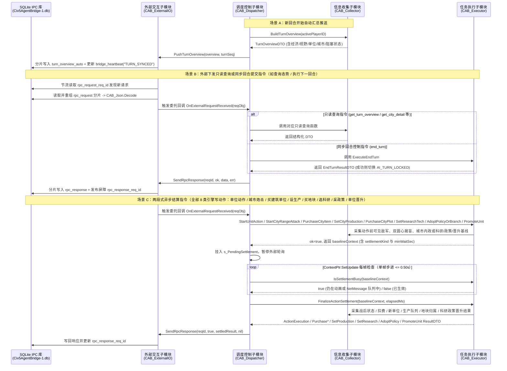

# 模块 1（游戏端纯 Lua 桥接 Mod）模块内部接口设计

> [!IMPORTANT]
> 本文档定义模块 1 内部**四大子模块（信息收集、任务执行、调度控制、外部交互）之间的 Lua 函数调用契约、委托回调签名、内部 DTO 字段定义**，以及由外部交互子模块承载的**对外 SQLite IPC 方法映射表**。严格遵循计划阶段规范：列明函数签名、职责、输入输出与分步实现逻辑，不直接列出具体实现代码。

---

## 一、 子模块命名空间与交互时序总览

### 1.1 全局命名空间约定
在 `Civ5AgentBridgeUI` 所在的 `<LuaContext>` 内，各子模块通过**守卫式按需加载规范**（`if CAB_X == nil then include("CAB_X") end`）按依赖顺序加载，防止 Civ5 VFS 重复执行 `include()` 重置子模块私有 `local` 状态，同时天然支持离线测试桩或临时真机垫片预先注入全局表而后续正式装配零改代码；统一导出带 `CAB_` 前缀的模块表，禁止跨子模块读写私有 `local` 状态变量：

* `CAB_Config`（来自 `Lua/CAB_Config.lua`）：只读参数常量表
* `CAB_Json`（来自 `Lua/Civ5AgentBridgeJson.lua`）：纯 Lua JSON 序列化/反序列化工具表
* `CAB_ExternalIO`（来自 `Lua/CAB_ExternalIO.lua`）：外部交互子模块接口表
* `CAB_Collector`（来自 `Lua/CAB_InfoCollector.lua`）：游戏内信息收集子模块接口表
* `CAB_Executor`（来自 `Lua/CAB_TaskExecutor.lua`）：游戏内任务执行子模块接口表
* `CAB_Dispatcher`（来自 `Lua/CAB_Dispatcher.lua`）：调度控制子模块接口表

### 1.2 核心交互时序图

---

## 二、 子模块间回调委托契约（Delegates）

为避免底层通信模块反向依赖上层调度模块、避免调度模块硬编码耦合 UI 控件名，定义以下 2 个注入式委托签名：

### 2.1 新外部消息到达通知委托
* **委托类型名**：`OnExternalRequestCallback`
* **签名**：`function(reqObj: table) -> nil`
* **注册方式**：由 `CAB_Dispatcher` 在启动时传入 `CAB_ExternalIO.Initialize(onMessageCallback)`。
* **传入参数 `reqObj` 结构**：
  * `req_id` (`number`)：本次请求的唯一递增序号
  * `session_id` (`string | nil`)：外部客户端会话标识（可选）
  * `method` (`string`)：RPC 方法名（如 `"get_turn_overview"`、`"purchase_city_item"`、`"end_turn"`）
  * `params` (`table`)：方法参数字典（始终保证为非空 table）
* **触发保证**：仅当 SQLite 中出现未处理的新请求且 JSON 成功解码为合法对象时触发一次；解码异常由 `CAB_ExternalIO` 自行拦截写回错误响应，不向上冒泡脏数据。

### 2.2 UI 状态栏刷新委托
* **委托类型名**：`OnUiStatusUpdateCallback`
* **签名**：`function(statusText: string) -> nil`
* **注册方式**：由 `Civ5AgentBridgeUI.lua` 在启动时传入 `CAB_Dispatcher.Initialize(uiStatusCallback)`。
* **职责**：安全判断 `Controls.BridgeStatusLabel` 存在后更新右上角提示文本（例如 `"Agent: Turn 45 Synced"`、`"Agent: Settled #108"`、`"Agent: AI Turn..."`）。

---

## 三、 子模块 4：外部交互子模块接口设计（`CAB_ExternalIO` & `CAB_Json`）

### 3.1 `CAB_Json.Encode` / `CAB_Json.Decode`
* **签名**：
  * `CAB_Json.Encode(val: any) -> string`
  * `CAB_Json.Decode(jsonStr: string) -> (any | nil, string | nil)`
* **主要工作**：提供沙箱安全的纯 Lua JSON 编解码能力。
* **实现逻辑说明**：
  * `Encode` 递归遍历 Lua 值；对携带 `__is_object = true` 元标记的表强制序列化为 JSON 对象 `{...}`（解决 Lua 空表 `{}` 默认与空数组 `[]` 无法区分的问题），对字符串控制字符转义并保留 UTF-8 中文字符原样输出；
  * `Decode` 使用 `pcall` 包裹递归下降解析器，支持 `\uXXXX` Unicode 转 UTF-8 字节流；解析成功返回 `(parsedTable, nil)`，任何语法损坏均安全捕获返回 `(nil, errorMessage)`。

### 3.2 `CAB_ExternalIO.Initialize`
* **签名**：`CAB_ExternalIO.Initialize(onMessageCallback: function) -> (boolean, string | nil)`
* **主要工作**：打开 `ModUserData` SQLite 数据库句柄，校准初始请求游标，保存消息通知委托。
* **输入**：`onMessageCallback`（调度控制子模块的请求处理入口函数）。
* **输出**：`(ok, errMsg)`。
* **实现逻辑说明**：
  1. 调用 `Modding.OpenUserData(CAB_Config.DB_NAME, CAB_Config.DB_VERSION)` 获取 `s_BridgeDB`；若返回空则返回 `(false, "OpenUserData failed")`；
  2. 读取库内已有的 `rpc_request_req_id` 与 `rpc_session_id` 初始化 `s_LastProcessedReqId` 与 `s_ActiveSessionId`（防止重载存档时重复执行历史残留指令）；
  3. 绑定 `s_OnMessageCallback = onMessageCallback`，返回 `(true, nil)`。

### 3.3 `CAB_ExternalIO.WritePayload` & `CAB_ExternalIO.ReadPayload`
* **签名**：
  * `CAB_ExternalIO.WritePayload(key: string, strValue: string, forceChunked: boolean | nil) -> boolean`
  * `CAB_ExternalIO.ReadPayload(key: string) -> string | nil`
* **主要工作**：屏蔽 `SimpleValues` 表的大字符串分片与重组细节。
* **实现逻辑说明**：
  * 写入时若字节长度超过 `CAB_Config.CHUNK_SIZE_BYTES`（3000 字节）或 `forceChunked == true`，按 `1..N` 切片依次写入 `<key>#chunk_1 .. <key>#chunk_N`，写入 `<key>#chunk_count = tostring(N)`，主槽位 `<key>` 仅写入 `"__CHUNKED__:<byteLen>"`；否则直接写入 `<key>` 并将 `<key>#chunk_count` 置 `"0"`；**UTF-8 多字节切片边界防护（M1Sub3 WP5 真机实证固化）**：切片右边界若落于多字节 UTF-8 续字节（`0x80..0xBF`）上，须自动向前回退对齐至完整字符边界，避免截断 3 字节中文字符引发外部 Python `sqlite3` 按片读取 `OperationalError: Could not decode to UTF-8`；同时建议 Python 客户端读取分片时采用 `text_factory = bytes` 拼接完整字节流后再统一 UTF-8 解码；
  * 读取时先读 `<key>#chunk_count`，若大于 `0` 则循环读取 `1..N` 并 `table.concat` 拼接返回，否则直接返回 `GetValue(key)`。

### 3.4 `CAB_ExternalIO.PushTurnOverview` & `CAB_ExternalIO.WriteHeartbeat`
* **签名**：
  * `CAB_ExternalIO.PushTurnOverview(overviewTable: table, turnSeq: number) -> boolean`
  * `CAB_ExternalIO.WriteHeartbeat(statusStr: string, turnSeq: number) -> boolean`
* **主要工作**：向外部智能体推送回合自动快照与桥接存活心跳。
* **实现逻辑说明**：
  * `PushTurnOverview` 将 `overviewTable` 经 `CAB_Json.Encode` 编码后调用 `WritePayload("turn_overview_auto", jsonStr)`，随后立即调用 `WriteHeartbeat("TURN_SYNCED", turnSeq)`；
  * `WriteHeartbeat` 组装 `{ turn, active_player, is_turn_active, status, turn_seq, last_req_id, clock_ms }` 写入 `bridge_heartbeat` 键。

### 3.5 `CAB_ExternalIO.SendRpcResponse`
* **签名**：`CAB_ExternalIO.SendRpcResponse(reqId: number, ok: boolean, dataTable: table | nil, errMsg: string | nil, forceChunked: boolean | nil) -> boolean`
* **主要工作**：将调度层处理完毕的 RPC 响应原子化发布回 SQLite。
* **实现逻辑说明**：
  1. 组装标准信封 `{ __is_object = true, req_id = reqId, ok = ok, data = dataTable, error = errMsg }`；
  2. 编码为 JSON 字符串并调用 `WritePayload("rpc_response", encoded, forceChunked)` 落盘全部分片；
  3. **最后一步**执行 `s_BridgeDB.SetValue("rpc_response_req_id", tostring(reqId))` 作为原子发布屏障，确保外部 Python 读到匹配的 `req_id` 时分片已 100% 写完。

### 3.6 `CAB_ExternalIO.PollIncomingRequest`
* **签名**：`CAB_ExternalIO.PollIncomingRequest() -> boolean`
* **主要工作**：由调度层在空闲帧节流调用，轻量检查库中是否有外部新消息并在发现后主动触发回调通知。
* **输出**：若本次检测到并处理了一条新请求返回 `true`，无新请求返回 `false`。
* **实现逻辑说明**：
  1. 读取 `reqIdStr = s_BridgeDB.GetValue("rpc_request_req_id")` 转为数字 `reqId`；
  2. 检查可选会话号 `incomingSession = s_BridgeDB.GetValue("rpc_session_id")`：若外部更换了非空新 `session_id`，重置 `s_LastProcessedReqId = 0` 并记录新会话号（解决外部 MCP Server 重启后 `req_id` 从 1 重新计数被旧水位线拦截的问题）；
  3. 若 `reqId > s_LastProcessedReqId`：
     * 立即更新 `s_LastProcessedReqId = reqId`；
     * 调用 `ReadPayload("rpc_request")` 与 `CAB_Json.Decode`；
     * 若解码失败，直接调用 `SendRpcResponse(reqId, false, nil, "JSON decode error: ...")`；
     * 若解码成功，补齐 `reqObj.req_id = reqId`、`reqObj.params = reqObj.params or {}`，通过 `pcall` 调用 `s_OnMessageCallback(reqObj)` 通知调度控制子模块（若回调内发生未捕获 Lua 异常，兜底调用 `SendRpcResponse` 返回运行时错误信息）。

---

## 四、 子模块 1：信息收集子模块接口设计（`CAB_Collector`）

> [!NOTE]
> **通用实现与安全契约（已于 M1Sub1 验收固化）**：
> 1. **零外部依赖与零状态缓存**：仅 `include("CAB_Config")` 一次，不依赖 `Civ5AgentBridgeJson` 或第三方空袭 Mod；模块内部不保留跨调用可变状态缓存（连 `GameDefines` 亦按次实时读取），全面兼容原生 BNW v1.0.3.279 与 IGE 动态修改。
> 2. **DTO 编码与可空约定**：所有 JSON 对象表均携带 `__is_object = true`；可空字段无值时直接留 Lua `nil`（省略键）。
> 3. **结构化错误返回**：当 `activePlayerID` 无效/未存活，或 `unitID`/`cityID` 不存在/已阵亡/非己方所属，或 `radius` 为非法非数字时，主查询接口绝不抛未捕获 Lua 异常，统一返回 `{ __is_object = true, error = "<英文错误说明>" }`（其中 `GetVisibilitySummary` 返回 `({ __is_object = true, visible_enemies = {}, visible_enemy_cities = {}, error = "..." }, {})`，`CaptureRevealedPlotsSet` 返回 `{}`）。
> 4. **战争迷雾与防侧信道红线**：可见敌军须同时满足 `pPlot:IsVisible(activeTeam, false) == true` 与 `pUnit:IsInvisible(activeTeam, false) ~= true`；单位与城市枚举远程目标时，`CanRangeStrikeAt` **仅允许对实时可见格或已探索交战敌城格调用**，严禁探测普通迷雾格或黑雾格；`REVEALED_FOG` 迷雾格省略 `improvement` / `friendly_unit_id` / `enemy_unit`；可购地块资源经 `GetResourceType(activeTeam)` 过滤科技可见性。

### 4.1 `CAB_Collector.GetEmpireEconomy`
* **签名**：`CAB_Collector.GetEmpireEconomy(activePlayerID: number) -> table`
* **主要工作**：采集当前玩家的国库金币、回合金、科研、文化、信仰、快乐度及战略/奢侈资源明细。
* **输入**：`activePlayerID`（当前人类玩家 ID）。
* **输出（`EconomyDTO`）**：
  * `gold` (`int`)：国库当前金币（`pPlayer:GetGold()`）
  * `gold_per_turn` (`int`)：回合金净收支（`pPlayer:CalculateGoldRate()`）
  * `science_per_turn` (`int`)：每回合科研值（`pPlayer:GetScience()`）
  * `culture_per_turn` (`int`)：每回合文化值（`pPlayer:GetTotalJONSCulturePerTurn()`）
  * `faith_per_turn` (`int`)：每回合信仰值（`pPlayer:GetTotalFaithPerTurn()`）
  * `faith_total` (`int`)：当前累计信仰值（`pPlayer:GetFaith()`）
  * `happiness` (`int`)：帝国净快乐度（`pPlayer:GetExcessHappiness()`）
  * `is_golden_age` (`bool`)：是否处于黄金时代（`pPlayer:IsGoldenAge()`）
  * `strategic_resources` (`dict[str, int]`)：可用战略资源余量表（如 `RESOURCE_IRON`, `RESOURCE_HORSES`）
  * `luxury_resources` (`dict[str, int]`)：已接入奢侈品数量表
* **实现逻辑说明**：读取 `Players[activePlayerID]` 各项产出接口；遍历 `GameInfo.Resources()`，按 `Game.GetResourceUsageType(res.ID)` 区分战略资源（`RESOURCEUSAGE_STRATEGIC`）与奢侈资源（`RESOURCEUSAGE_LUXURY`），记录可用量 `> 0` 的条目。

### 4.2 `CAB_Collector.GetVisibilitySummary` & `CAB_Collector.CaptureRevealedPlotsSet`
* **签名**：
  * `CAB_Collector.GetVisibilitySummary(activePlayerID: number) -> (table, table)`
  * `CAB_Collector.CaptureRevealedPlotsSet(activePlayerID: number, centerX: number, centerY: number, radius: number) -> table`
* **主要工作**：执行严格符合战争迷雾边界的全图敌情扫描与局部探索基线快照。
* **输出**：
  * `GetVisibilitySummary` 返回 `(VisibilitySummaryDTO, visibleEnemyMap)`，其中 `VisibilitySummaryDTO` 含 `visible_enemies`（仅 `IsVisible(activeTeam, false) == true` 且 `not IsInvisible(activeTeam, false)` 的敌方/蛮族存活单位列表）与 `visible_enemy_cities`（`IsRevealed(activeTeam, false) == true` 的非己方城市列表，含复合 `city_id`（`"<ownerID>:<id>"`）、`owner_id`、`owner_name`、`name`、`is_minor_civ`、`is_at_war`、`x`、`y`、`hp`、`pop`、`in_fog`）；`visibleEnemyMap` 为按复合 `enemy_id`（`"<ownerID>:<unitID>"`）索引的字典供执行层 O(1) 对比战损；
  * `CaptureRevealedPlotsSet` 返回以 `(centerX, centerY)` 为中心、半径 `radius`（缺省取 `CAB_Config.DELTA_REVEAL_SCAN_RADIUS` 并钳制至 `[0, CAB_Config.MAX_SCAN_RADIUS]`；非法入参或负半径返回 `{}`）内所有 `IsRevealed == true` 的纯坐标键集合 `{"x:y" = true}`（不带 `__is_object`）。

### 4.3 `CAB_Collector.GetEndTurnStatus`
* **签名**：`CAB_Collector.GetEndTurnStatus(activePlayerID: number) -> table`
* **主要工作**：诊断当前回合是否可直接结束，或返回阻塞下一回合的具体待办事项。
* **输出（`EndTurnStatusDTO`）**：
  * `is_turn_active` (`bool`)：当前是否为该玩家的活动回合
  * `can_end_turn_now` (`bool`)：当前是否无任何阻塞可直接执行下一回合
  * `blocking_type_id` (`int`)：引擎 `GetEndTurnBlockingType()` 原始枚举值
  * `blocking_type_name` (`str`)：可读枚举名（如 `"NO_BLOCKING"`、`"ENDTURN_BLOCKING_UNITS"`、`"ENDTURN_BLOCKING_PRODUCTION"`、`"ENDTURN_BLOCKING_RESEARCH"`、`"ENDTURN_BLOCKING_POLICY"`、`"ENDTURN_BLOCKING_UNIT_PROMOTION"` 等）
  * `blocking_unit_id` (`int | nil`)：若因待命/叠栈/待晋升单位阻塞，返回首个待处理单位 ID
  * `blocking_city_id` (`int | nil`)：若因城市未选生产项目阻塞，返回首个闲置城市 ID
  * `notification_summary` (`str | nil`)：关联的阻塞通知文本摘要
* **实现逻辑说明**：参照官方 `ActionInfoPanel.lua:117-175, 333-490`，读取 `pPlayer:GetEndTurnBlockingType()`；若为待命单位类则通过 `pPlayer:GetFirstReadyUnit()` 提取 `unit_id`；若为晋升类则遍历 `pPlayer:Units()` 找 `IsPromotionReady()`；若为生产类则遍历 `pPlayer:Cities()` 找 `GetOrderQueueLength() == 0` 的非傀儡非占领暴动城市。

### 4.4 `CAB_Collector.BuildTurnOverview`
* **签名**：`CAB_Collector.BuildTurnOverview(activePlayerID: number) -> table`
* **主要工作**：汇总新回合或全局查询所需的全量可见态势（**100% 向下兼容《03_接口设计说明书》§2.1 `TurnOverviewDTO`**，并附带扩展经济与回合状态字段）。
* **输出（`TurnOverviewDTO`）**：
  * 兼容核心字段：`turn_number`、`active_player_id`、`player_civ`、`yields`（含 `gold`、`gold_per_turn`、`science_per_turn`、`culture_per_turn`、`faith_per_turn`、`happiness`、`strategic_resources`）、`our_units`（`list[UnitSummaryDTO]`）、`visible_enemies`（`list[EnemyUnitDTO]`）、`our_cities`（`list[CitySummaryDTO]`，含坐标、人口、血量、当前生产品项、剩余回合数、分项产出概要及 `can_range_strike`）、`visible_enemy_cities`（`list[EnemyCityDTO]`）；
  * 新增辅助字段：`end_turn_status`（`EndTurnStatusDTO`，供智能体判断是否具备结束回合条件）。

### 4.5 `CAB_Collector.BuildUnitContextAndCandidates`
* **签名**：`CAB_Collector.BuildUnitContextAndCandidates(activePlayerID: number, unitID: number, radius: number | nil) -> table`
* **主要工作**：提取单个己方单位周边局部六边形网格及全部引擎校验合法的候选动作（**100% 对齐《03_接口设计说明书》§2.2 `UnitTacticalContextDTO`**）。
* **输出**：`{ unit, surrounding_tiles, candidate_actions }`（若单位不存在、已阵亡、非己方所属或 `radius` 非法，返回 `{ __is_object = true, error = "..." }`）。
* **实现逻辑说明**：
  1. 将传入 `radius`（缺省取 `CAB_Config.DEFAULT_SCAN_RADIUS`）钳制至 `[0, CAB_Config.MAX_SCAN_RADIUS]`；内部 `scanRadius` 自动覆盖邻格与单位真实射程（空军上限 `MAX_AIR_SCAN_RADIUS = 20`，非空军上限 `MAX_SCAN_RADIUS`）；对 `dist <= r` 且 `IsRevealed` 的地块导出地形、丘陵、河流、可见单位（军民叠栈优先暴露战斗单位并过滤 `IsInvisible`）与城市归属（`REVEALED_FOG` 迷雾格省略 `improvement` 与单位）；
  2. 枚举相邻格 `MOVE_STEP`（对未探索黑雾格仅允许非空军且有移动力单位生成无预览探路移动，绝不导出地形；对已探索格复用 `CanUnitMoveThrough` + `HasSameClassFriendlyUnit` 1UPT 检查）、相邻敌军/敌城 `MELEE_ATTACK`（校验陆海兵种域、不可通行格、`IsCanAttack` 与敌城真实血量）、射程内 `RANGE_ATTACK` / `AIR_STRIKE`（基于原生 BNW 引擎接口，不引入外部空袭 Mod；**严禁对普通迷雾格或黑雾格调用 `CanRangeStrikeAt`**，仅允许实时可见格或已探索交战敌城格）、以及 `pcall` 保护下临时选中单位经 `FindGameActionIndex` 判定的 `SETUP_FOR_RANGED`、`FORTIFY`、`HEAL`、`SKIP_TURN`，退出前无条件恢复原选中单位（原无选中则 `UI.ClearSelectionList()`，绝不触碰 `UI.SetInterfaceMode`）。

### 4.6 `CAB_Collector.GetCityDetail`
* **签名**：`CAB_Collector.GetCityDetail(activePlayerID: number, cityID: number, includePurchasable: boolean | nil) -> table`
* **主要工作**：提供单座己方城市的深度内政、城防与购买决策面板数据（供购买建筑/购买地块前精确询价）。
* **输入**：`activePlayerID`、`cityID`、`includePurchasable`（默认 `true`；显式 `false` 时三类购买数组返回空表）。
* **输出（`CityDetailDTO`）**：
  * `city`：基础属性与状态标记（`city_id`、`name`、`x`、`y`、`pop`、`hp`、`max_hp`、`combat_str`（`math.floor(GetStrengthValue() / 100)`）、`is_capital`、`is_puppet`、`is_occupied`、`is_in_resistance`、`is_razing`）
  * `yields`：本城每回合产出（`food`、`food_net`、`turns_to_growth`（造移民/停滞/饥荒时返回 `-1`）、`production`、`gold`、`science`、`culture`、`faith`）
  * `production_state`：`{ current_item, order_queue_length, turns_left }`
  * `garrison_unit_id` (`int | nil`)：驻城己方存活军事单位 ID（无有效驻军时省略键）
  * `built_buildings` (`list[dict]`)：本城已拥有的真实建筑列表 `{ building_id, building_type, name, count }`（`GetNumRealBuilding > 0`）
  * `ranged_attack_targets` (`list[dict]`)：若 `pCity:CanRangeStrikeNow() == true`，仅扫描 `CITY_ATTACK_RANGE` 内实时可见格，经 `InspectPlotUnits` 过滤隐形后对交战敌军/蛮族调用 `CanRangeStrikeAt(tx, ty, true, true)` 输出目标坐标、距离、敌军 ID 与血量
  * `purchasable_buildings` (`list[dict]`)：所有满足前置条件的待购建筑 `{ building_id, building_type, name, gold_cost, faith_cost, can_afford_gold_now, can_afford_faith_now }`
  * `purchasable_units` (`list[dict]`)：所有满足前置条件的待购单位 `{ unit_type_id, unit_type, name, gold_cost, faith_cost, can_afford_gold_now, can_afford_faith_now }`
  * `purchasable_plots` (`list[dict]`)：所有可扩张购买的周边地块 `{ x, y, gold_cost, can_afford_now, terrain, feature, is_hills, resource_type }`
* **实现逻辑说明**：
  * 购买建筑/单位列表遍历 `GameInfo.Buildings` / `GameInfo.Units`，先以 `IsCanPurchase(false, false, ..., YIELD_GOLD/YIELD_FAITH)` 筛出候选池并读取 `GetBuildingPurchaseCost` / `GetBuildingFaithPurchaseCost` / `GetUnitPurchaseCost` / `GetUnitFaithPurchaseCost(unitTypeId, true)`，再以 `IsCanPurchase(true, true, ...)` 填写 `can_afford_*_now`；
  * 购买地块列表在 `GameDefines.BUY_PLOTS_DISABLED == 0` 且城市非傀儡/非抵抗/非焚城时，遍历 `0 .. pCity:GetNumCityPlots()-1` 的已探索地块，用 `CanBuyPlotAt(px, py, true)` 筛出规则合法的可扩张格，用 `CanBuyPlotAt(px, py, false)` 填写 `can_afford_now`，用 `GetBuyPlotCost(px, py)` 读取金币报价（资源经 `GetResourceType(activeTeam)` 过滤科技可见性）。

### 4.7 供任务执行子模块复用的纯只读辅助函数（`H1` ~ `H7`）

为确保 `CAB_TaskExecutor` 在动作前置校验、动作前基线采集与战后状态序列化时与 `CAB_Collector` 保持 100% 同源口径，`CAB_Collector` 公开以下 7 个无副作用纯只读辅助函数：

| 编号 | 函数签名 | 输入 / 输出 | 核心职责说明 |
| :---: | :--- | :--- | :--- |
| **H1** | `CAB_Collector.SerializeUnitSummary(pUnit)` | `Unit -> UnitSummaryDTO \| nil` | 序列化存活（过滤 `IsDead`/`IsDelayedDeath`）己方单位；结合 `MovesLeft() > 0` 与 `IsReadyToMove() == true` 精准判定 `can_act`，移动力除以 `MOVE_DENOMINATOR` 保留两位小数截断。 |
| **H2** | `CAB_Collector.SerializeEnemyUnit(pEnemyUnit)` | `Unit -> EnemyUnitDTO \| nil` | 序列化存活的可见敌方/蛮族单位，生成 `"<ownerID>:<unitID>"` 复合 `enemy_id`。 |
| **H3** | `CAB_Collector.SerializeCitySummary(pCity)` | `City -> CitySummaryDTO \| nil` | 序列化己方城市摘要（含 7 项分项 `yields` 与 `can_range_strike`），供 `BuildTurnOverview` 及内政购买后回读复用。 |
| **H4** | `CAB_Collector.InspectPlotUnits(pPlot, activePlayerID)` | `(Plot, int) -> (int \| nil, EnemyUnitDTO \| nil)` | 扫描可见地块存活单位返回 `(friendlyId, enemyDto)`；军民叠栈优先保留主战单位（`IsCombatUnit()`），并强制过滤 `IsInvisible(activeTeam, false)` 隐形敌军。 |
| **H5** | `CAB_Collector.CanUnitMoveThrough(pUnit, pPlot)` | `(Unit, Plot) -> boolean` | `pcall` 安全包裹 `pUnit:CanMoveThrough(pPlot)`，规避原版 BNW DLL `CanMoveOrAttackInto` 恒假缺陷。 |
| **H6** | `CAB_Collector.HasSameClassFriendlyUnit(pPlot, activePlayerID, isSelfCombat)` | `(Plot, int, bool) -> boolean` | 判定目标格是否已存在同类别（同战斗或同民用）己方存活单位，支撑 1UPT 停靠规则判定。 |
| **H7** | `CAB_Collector.FindGameActionIndex(actionTypeStr)` | `string -> int \| nil` | 遍历 `GameInfoActions` 并双重校验 `Game.CanHandleAction(iAction, 0, 1)` 与 `Game.CanHandleAction(iAction)`，返回当前选中单位可执行的动作索引。 |

### 4.8 三大回合硬阻塞候选项查询接口（`F8` ~ `F10`，M1Sub3 WP5 增补，导出总计 `14 → 17`）

以下 3 项新增只读查询接口全部遵守零 UI 选区副作用、零跨调用缓存、对象带 `__is_object = true` 及非法参数返回结构化错误表契约，可安全在非活动回合白名单中放行：

1. **`CAB_Collector.GetResearchOptions(activePlayerID: number) -> ResearchOptionsDTO`（`F8`）**
   * **主要工作**：采集科研开关、当前研究与全部合法可选科技（含免费科技过滤），服务 `ENDTURN_BLOCKING_RESEARCH` 与 `ENDTURN_BLOCKING_FREE_TECH`。
   * **输出字段**：`science_disabled`、`science_per_turn`、`overflow_research`、`free_techs_available`、`is_free_tech_pending`、`current_research`（可空对象 `{ tech_id, tech_type, name, era, cost, progress, turns_left }`）、`available_techs`（每项含 `tech_id`/`tech_type`/`name`/`era`/`cost`/`progress`/`turns_left`/`is_current`/`grid_x`/`grid_y`）、`researched_techs`（`list[str]`）。
   * **实现要点**：参照 `TechPopup.lua` 与 `TechTree.lua`，校验 `GAMEOPTION_NO_SCIENCE`、`pPlayer:CanResearch(techID)`，并在 `GetNumFreeTechs() > 0` 时追加 `pPlayer:CanResearchForFree(techID)` 过滤。
2. **`CAB_Collector.GetPolicyOptions(activePlayerID: number) -> PolicyOptionsDTO`（`F9`）**
   * **主要工作**：采集文化余额、政策花费、免费政策/信条数、9 大常规政策分支态及当前可开启分支/可采纳政策与意识形态信条，服务 `ENDTURN_BLOCKING_POLICY` 与 `ENDTURN_BLOCKING_FREE_POLICY`。
   * **输出字段**：`policies_disabled`、`culture`、`culture_per_turn`、`next_policy_cost`、`free_policies`、`free_tenets`、`num_cities`、`can_adopt_now`、`ideology_branch_id`（可空）、`ideology_branch_type`（可空）、`policy_branches`、`unlockable_branches`、`adoptable_policies`（含 `is_tenet` 与 `level`）、`adopted_policies`（`list[str]`）。
   * **实现要点**：严格参照官方 `SocialPolicyPopup.lua`，分支开启校验使用原生 **`pPlayer:CanUnlockPolicyBranch(branchID)`**（非 `CanAdoptPolicyBranch`），过滤 `PolicyBranchType == nil` 自动开/关门政策与未选 `PurchaseByLevel == true` 意识形态分支，守卫 `GetNumCities() > 0`；已选定意识形态后经 `GetAvailableTenets(lvl)` 与 `GetTenet` 槽位规则枚举可采纳信条。
3. **`CAB_Collector.GetUnitPromotions(activePlayerID: number, unitID: number) -> UnitPromotionsDTO`（`F10`）**
   * **主要工作**：查询指定己方存活单位的经验、等级、晋升就绪态、已获得晋升与当前可获取晋升列表，服务 `ENDTURN_BLOCKING_UNIT_PROMOTION`。
   * **输出字段**：`unit_id`、`unit_type`、`name`、`hp`、`max_hp`、`level`、`experience`、`experience_needed`、`is_promotion_ready`、`can_promote`、`earned_promotions`、`available_promotions`（每项含 `promotion_id`/`promotion_type`/`name`/`help`/`is_insta_heal`）。
   * **实现要点**：直接调用原生 `Unit` C++ 只读方法（`IsPromotionReady`、`CanPromote`、`CanAcquirePromotion`、`IsHasPromotion`、`GetExperience`、`ExperienceNeeded`、`GetLevel`），零 `UI.SelectUnit` 副作用，过滤 `CannotBeChosen` 与满血单位的 `InstaHeal`。

---

## 五、 子模块 2：任务执行子模块接口设计（`CAB_Executor`）

### 5.1 `CAB_Executor.Initialize`
* **签名**：`CAB_Executor.Initialize() -> boolean`
* **主要工作**：初始化任务执行环境，校验 `CAB_Config` 与 `CAB_Collector` 依赖就绪并置位 `s_Initialized`（基于原生 BNW v1.0.3.279 + IGE 兼容基线，不引入外部空袭 Mod 联动探测）。

### 5.2 `CAB_Executor.StartUnitAction`
* **签名**：`CAB_Executor.StartUnitAction(activePlayerID: number, unitID: number, actionType: string, targetX: number | nil, targetY: number | nil, allowDeclareWar: boolean | nil) -> (boolean, string | nil, table | nil)`
* **主要工作**：校验并向引擎下发 8 种单位战术动作，同时采集动作前视野、敌情、敌城与双圆心揭盲基线供异步结算使用。
* **输入**：`activePlayerID`、`unitID`、`actionType`（8 种枚举之一）、`targetX`、`targetY`（原地动作可省略）、`allowDeclareWar`（可选，默认 `false`）。
* **输出**：`(ok, errMsg, baselineContext)`。
* **实现逻辑说明**：
  1. 执行写操作三重门控（合法存活玩家、`pPlayer:IsTurnActive() == true`、`not Game.IsProcessingMessages()`），校验单位存活与目标格坐标合法（复用 `CAB_Collector.InspectPlotUnits` / `CanUnitMoveThrough` / `HasSameClassFriendlyUnit` / `FindGameActionIndex` 保持与采集层 100% 同源；原地动作探测在 `pcall` 下临时选中单位并无条件恢复原 UI 选区，确保校验失败零写副作用）；
  2. **迷雾防侧信道与无弹窗宣战护栏**：`RANGE_ATTACK` / `AIR_STRIKE` 仅允许对实时可见格或已探索非己方城市格校验，严禁对普通迷雾与黑雾格调用 `CanRangeStrikeAt`；默认拦截对非交战中立势力的攻击，当 `allowDeclareWar == true` 时先检 `pTeam:CanDeclareWar(targetTeam)`（和约期拦截），对实时可见中立目标先以 `bNeedWar = false` 预检射程，全部前置校验通过后再显式调用 `pTeam:DeclareWar(targetTeam)`（避免引擎弹出模态确认框卡死自动化）并记录 `warDeclared` / `warDeclaredInfo`；
  3. 采集双圆心联合已探索集合 `revealedBefore = CaptureRevealedPlotsSet(id, beforeX, beforeY, min(r+1, MAX_SCAN_RADIUS)) ∪ CaptureRevealedPlotsSet(id, targetX, targetY, r)`、`baselineEnemyMap`、`targetEnemyBefore` 与 `targetCityBefore`；
  4. 调用 `UI.SelectUnit(pUnit)` 选中单位，按 `actionType` 分发原版官方指令（`SelectionListMove` / `SelectionListGameNetMessage` / `Game.HandleAction`；空军 `AIR_STRIKE` 使用原生 `MISSION_MOVE_TO`）；
  5. 封装 `baselineContext`（`settlementKind = "UNIT_ACTION"`、`minWaitSec = CAB_Config.DEFAULT_UNIT_SETTLE_SEC`、`maxTimeoutSec = CAB_Config.MAX_SETTLE_TIMEOUT_SEC`）返回给调度控制子模块挂起等待。

### 5.3 `CAB_Executor.StartCityRangeAttack`
* **签名**：`CAB_Executor.StartCityRangeAttack(activePlayerID: number, cityID: number, targetX: number, targetY: number, allowDeclareWar: boolean | nil) -> (boolean, string | nil, table | nil)`
* **主要工作**：驱动具备远程反击能力的己方城市轰击射程内实时可见敌军（战斗功能的城防补充）。
* **输入**：`activePlayerID`、`cityID`、`targetX`、`targetY`、`allowDeclareWar`（可选，默认 `false`）。
* **输出**：`(ok, errMsg, baselineContext)`。
* **实现逻辑说明**：
  1. 执行活动回合与消息队列门控，校验城市归属当前玩家、`pCity:CanRangeStrikeNow() == true`、目标格在实时读取的 `CITY_ATTACK_RANGE` 射程内；
  2. **防迷雾侧信道与宣战护栏**：目标格必须实时可见（`IsVisible == true`），经 `CAB_Collector.InspectPlotUnits` 过滤隐形敌军（严禁对普通迷雾或黑雾调用 `CanRangeStrikeAt`）；交战态或 `allowDeclareWar == true`（经 `CanDeclareWar` 守卫，且中立预检调用 `pCity:CanRangeStrikeAt(targetX, targetY, false, true)` 确保失败零宣战零写入）校验通过后，按需显式调用 `pTeam:DeclareWar(targetTeam)`；
  3. 采集双圆心 `revealedBefore`、`baselineEnemyMap`、`targetEnemyBefore` 与 `targetCityBefore`；
  4. 参照官方 `WorldView.lua:519`：执行 `UI.ClearSelectionList()` $\rightarrow$ `UI.SelectCity(pCity)` $\rightarrow$ `Game.SelectedCitiesGameNetMessage(GameMessageTypes.GAMEMESSAGE_DO_TASK, TaskTypes.TASK_RANGED_ATTACK, targetX, targetY)` $\rightarrow$ 触发 `SpecificCityInfoDirty` $\rightarrow$ `UI.ClearSelectedCities()`；
  5. 返回 `baselineContext`（`settlementKind = "CITY_ATTACK"`、`minWaitSec = CAB_Config.DEFAULT_UNIT_SETTLE_SEC`）进入两段式结算，捕获 `city_after`、受击敌军残血/击杀与显式宣战标记。

### 5.4 `CAB_Executor.PurchaseCityItem`
* **签名**：`CAB_Executor.PurchaseCityItem(activePlayerID: number, cityID: number, itemCategory: string | nil, itemKeyOrId: string | number, yieldTypeStr: string | nil) -> (boolean, string | nil, table | nil)`
* **主要工作**：在指定己方城市使用金币（默认）或信仰购买建筑或单位，并返回短延迟异步结算基线（BNW v1.0.3.279 真机实证 `Game.CityPurchaseBuilding/Unit` 经 C++ NetMessage 队列跨帧落地）。
* **输入**：
  * `cityID` (`int`)：目标城市 ID
  * `itemCategory` (`"BUILDING" | "UNIT" | nil`)：购买类别（默认 `"BUILDING"`）
  * `itemKeyOrId` (`str | int`)：建筑/单位的数据库 `Type` 字符串（如 `"BUILDING_WALLS"`、`"UNIT_ARCHER"`）或整数 ID
  * `yieldTypeStr` (`"GOLD" | "FAITH" | nil`)：支付货币类型，默认 `"GOLD"`
* **输出**：`(ok, errMsg, baselineContext)`（`settlementKind = "PURCHASE_ITEM"`，`minWaitSec = CAB_Config.PLOT_BUY_SETTLE_SEC = 0.10`，`maxTimeoutSec = CAB_Config.MAX_SETTLE_TIMEOUT_SEC = 1.50`）；经调度器短延迟结算后由 `FinalizeActionSettlement` 返回 `PurchaseItemResultDTO`：
  * `purchased` (`bool`)、`error_reason` (`str | nil`)、`city_id` (`int`)、`item_category` (`str`)、`item_type` (`str`)、`yield_type` (`str`)
  * `expected_cost` (`int`)、`cost_paid` (`int`)：预期报价与本次实际消耗的金币或信仰
  * `gold_before` / `gold_after` (`int`)、或 `faith_before` / `faith_after` (`int`)
  * `spawned_unit_id` (`int | nil`)：若购买的是单位，通过前后存活单位集合差分返回新生成单位的 `unit_id`
  * `city_summary_after` (`CitySummaryDTO`)：购买落地后的最新城市摘要
  * `settle_wait_ms` (`number`)、`timed_out` (`bool`)
* **实现逻辑说明**：
  1. 执行活动回合与消息队列门控；解析 `itemKeyOrId` 定位 `GameInfo.Buildings` 或 `GameInfo.Units` 中的数字 ID（防止空表误判）；
  2. 参照 `ProductionPopup.lua:136-161` 调用 `pCity:IsCanPurchase(true, true, unitID, buildingID, -1, eYield)` 执行全规则校验；若不通过，进一步调用 `IsCanPurchase(false, false, ...)` 细分错误原因（区分“科技/前置建筑未满足或已拥有该建筑” vs “金币/信仰余额不足（附精确报价与余额）或城内驻军叠栈”）；
  3. 记录购买前余额、预期报价、建筑数量 `beforeBuildingCount`（买建筑）及己方存活单位 ID 集合 `beforeUnitIds`（买单位），调用 `Game.CityPurchaseBuilding(pCity, buildingID, eYield)` 或 `Game.CityPurchaseUnit(pCity, unitID, eYield)` 并发送 `Events.SpecificCityInfoDirty`；
  4. 返回 `baselineContext`（`settlementKind = "PURCHASE_ITEM"`），交由调度层经 `IsSettlementBusy` + `FinalizeActionSettlement` 确认建筑数递增或新生 `spawned_unit_id` 现身后回读精确扣费与城市摘要。

### 5.5 `CAB_Executor.SetCityProduction`
* **签名**：`CAB_Executor.SetCityProduction(activePlayerID: number, cityID: number, orderCategory: string, itemKeyOrId: string | number, clearQueue: boolean | nil) -> (boolean, string | nil, table | nil)`
* **主要工作**：为非傀儡/非抵抗/非焚城城市设置或追加生产队列项目（`BUILDING` / `UNIT` / `PROJECT` / `PROCESS`），并返回短延迟异步结算基线（BNW v1.0.3.279 真机实证 `Game.CityPushOrder` 经 C++ NetMessage 队列跨帧生效）。
* **输出**：`(ok, errMsg, baselineContext)`（`settlementKind = "SET_PRODUCTION"`，`minWaitSec = CAB_Config.PLOT_BUY_SETTLE_SEC = 0.10`，`maxTimeoutSec = CAB_Config.MAX_SETTLE_TIMEOUT_SEC = 1.50`）；经短延迟结算后由 `FinalizeActionSettlement` 返回 `SetProductionResultDTO`：
  * `{ __is_object = true, executed, error_reason, city_id, order_category, item_type, clear_queue, current_production, turns_left, order_queue_length, settle_wait_ms, timed_out }`。
* **实现逻辑说明**：执行活动回合与消息队列门控，拦截傀儡/抵抗/焚城城市，校验 `pCity:CanConstruct` / `pCity:CanTrain` / `pCity:CanCreate` / `pCity:CanMaintain` 合法后，记录 `queueLenBefore`，参照 `ProductionPopup.lua:133` 调用 `Game.CityPushOrder(pCity, eOrder, iData, false, clearQueue ~= false, true)` 并触发 `Events.SpecificCityInfoDirty`，返回 `SET_PRODUCTION` 基线待跨帧回读确认。

### 5.6 `CAB_Executor.PurchaseCityPlot`
* **签名**：`CAB_Executor.PurchaseCityPlot(activePlayerID: number, cityID: number, plotX: number, plotY: number) -> (boolean, string | nil, table | nil)`
* **主要工作**：驱动指定城市花费国库金币购买周边可扩展领土地块。
* **输入**：`activePlayerID`、`cityID`、`plotX`、`plotY`。
* **输出**：`(ok, errMsg, baselineContext)`。
* **实现逻辑说明**：
  1. 执行活动回合与消息队列门控，实时读取 `GameDefines["BUY_PLOTS_DISABLED"] == 0`（零缓存），校验城市属于当前激活玩家且非傀儡/占领抵抗/焚城受限态；
  2. 参照 `CityView.lua:2003, 2143`：校验 `pCity:CanBuyPlotAt(plotX, plotY, false)`；若返回 `false`，用 `CanBuyPlotAt(plotX, plotY, true)` 判断是“金币不足（附所需金额 `GetBuyPlotCost` 与当前余额）”还是“该坐标不在本城合法买地范围内”；
  3. 记录买地前 `goldBefore` 与 `expectedCost = pCity:GetBuyPlotCost(plotX, plotY)`，调用 `Network.SendCityBuyPlot(cityID, plotX, plotY)`（若城市界面打开则安全调 `UI.UpdateCityScreen()`）；
  4. 返回 `baselineContext`（`settlementKind = "BUY_PLOT"`），经调度器短等待（`0.10s` 或检测到 `pPlot:GetOwner() == activePlayerID`）后在 `FinalizeActionSettlement` 中按实时归属判真返回 `{ __is_object = true, purchased, error_reason, city_id, x, y, cost_paid, expected_cost, gold_before, gold_after, new_owner_id, settle_wait_ms, timed_out }`。

### 5.7 `CAB_Executor.ExecuteEndTurn`
* **签名**：`CAB_Executor.ExecuteEndTurn(activePlayerID: number, autoSkipReadyUnits: boolean | nil) -> (boolean, string | nil, table | nil)`
* **主要工作**：安全执行“下一回合”操作，采取“诊断优先 + 守卫式自动跳过”策略，在存在硬性待办阻塞时零浪费返回结构化诊断。
* **输入**：`activePlayerID`、`autoSkipReadyUnits`（默认 `false`）。
* **输出**：`(ok, errMsg, EndTurnResultDTO | nil)`（门控失败时第 3 项为 `nil`；阻塞拒绝或成功提交时返回 `EndTurnResultDTO`）：
  * `turn_ended` (`bool`)：是否已成功向引擎提交回合结束指令
  * `ended_turn_number` (`int`)：结束的回合号
  * `auto_skipped_unit_ids` (`list[int]`)：本次因 `autoSkipReadyUnits == true` 自动跳过回合的单位 ID 列表
  * `status` (`"WAITING_NEXT_TURN" | "BLOCKED"`)
  * `blocking_info` (`EndTurnStatusDTO | nil`)：若被阻塞未能结束回合，附带完整阻塞诊断（成功时省略键）
* **实现逻辑说明**：
  1. 检查 `pPlayer:IsTurnActive()` 且 `not Game.IsProcessingMessages()`，不满足则零写入直接拒绝；
  2. **诊断优先**：先调用 `CAB_Collector.GetEndTurnStatus(activePlayerID)` 查询当前阻塞态；
  3. **守卫式自动跳过**：仅当 `autoSkipReadyUnits == true` 且当前阻塞属于可跳过的待命单位类（`ENDTURN_BLOCKING_UNITS` / `ENDTURN_BLOCKING_UNIT_NEEDS_ORDERS`）时，才遍历 `pPlayer:Units()`，跳过满足“存活、`IsReadyToMove() == true`、非自动化（`not IsAutomated()`）、非待晋升（`not IsPromotionReady()`）、非同格同类非法叠栈（允许合法军民叠栈及空军叠栈）”的单位，在 `pcall` 保护下依次下发 `MISSION_SKIP` 并无条件恢复原 UI 选区，随后重新调用 `GetEndTurnStatus` 复查；若初始已存在硬阻塞（如生产/科研/政策/待晋升），零跳过直接进入第 4 步，绝不浪费单位行动力（注：原生 BNW 下 `MISSION_SKIP` 经消息队列跨帧生效约需 1 帧；若首次调用返回 `BLOCKED` 附非空 `auto_skipped_unit_ids`，外部间隔约 1 帧再次调用 `end_turn` 即可见 `NO_BLOCKING` 并顺利提交）；
  4. 若复查结果 `can_end_turn_now ~= true`：安全中止，返回 `(false, "End turn blocked: " .. blocking_type_name, resultDto)`；
  5. 若无阻塞（`can_end_turn_now == true`）：参照 `ActionInfoPanel.lua:174-175` 调用 `Game.DoControl(GameInfoTypes.CONTROL_ENDTURN)`，立即返回 `(true, nil, resultDto)`。

### 5.8 `CAB_Executor.IsSettlementBusy` & `CAB_Executor.FinalizeActionSettlement`
* **签名**：
  * `CAB_Executor.IsSettlementBusy(baselineContext: table) -> boolean`
  * `CAB_Executor.FinalizeActionSettlement(baselineContext: table, settleWaitMs: number) -> table`
* **主要工作**：全程只读零写入、零迷雾侧信道，配合调度控制子模块的帧循环完成全部 **8 类 `settlementKind`** 的异步状态检测与结算 DTO 组装。
* **实现逻辑说明**：
  * **`IsSettlementBusy`**（非法/空 `baselineContext` 安全返回 `false`）：
    1. `UNIT_ACTION`：单位仍存活时检查 `pUnit:IsBusy()`、`pUnit:IsFighting()` 或单位当前格 `IsFighting()`；同时检查目标格 `pTargetPlot:IsFighting()`；
    2. `CITY_ATTACK`：检查目标格 `pTargetPlot:IsFighting()`；
    3. `BUY_PLOT`：检查 `pTargetPlot:GetOwner() ~= activePlayerID`；
    4. `PURCHASE_ITEM`：建筑检查 `pCity:GetNumRealBuilding(itemId) > beforeBuildingCount` 未达成、单位检查前后存活单位集合差分尚未出现新生 `spawned_unit_id`；
    5. `SET_PRODUCTION`：追加队列（`clearQueue == false` 且 `queueLenBefore > 0`）检查 `GetOrderQueueLength() > queueLenBefore` 未达成，清空/首项设产检查原生 `GetProductionBuilding/Unit/Project/Process() == itemId` 未达成；
    6. `SET_RESEARCH`：免费科技检查 `HasTech(techId)` 与 `GetNumFreeTechs() < freeTechsBefore` 均未达成；常规科研检查 `GetCurrentResearch() == techId` 未达成；
    7. `ADOPT_POLICY`：`"BRANCH"` 检查 `IsPolicyBranchUnlocked(targetId)` 未达成；`"POLICY"` 检查 `HasPolicy(targetId)` 未达成；
    8. `PROMOTE_UNIT`：单位死亡返回 `false`；否则检查 `GetLevel() > levelBefore`、常规晋升 `IsHasPromotion(promoId)`，或 `PROMOTION_INSTA_HEAL` 的降伤/`not IsPromotionReady()` 均未达成。
  * **`FinalizeActionSettlement`**（统一附带 `settle_wait_ms` 与 `timed_out = IsSettlementBusy(baselineContext)`；非法/未知 `baselineContext` 零异常返回结构化错返 DTO）：
    1. `UNIT_ACTION`：对比双圆心联合 `revealedBefore` 与最新 `CaptureRevealedPlotsSet` 精准计算 `newly_revealed_tiles_count`（消除 1 格移动假阳性），复用 `GetVisibilitySummary` 与 `SerializeUnitSummary` 生成完全兼容《03》§2.3 的 `ActionExecutionResultDTO`（含 `executed`、`action_type`、`target_x/y`、`settle_wait_ms`、`timed_out`、`unit_died`、`unit_after`、显式宣战时的 `war_declared` / `war_declared_target_player_id` / `war_declared_target_team_id`，以及 `delta_observation = { newly_revealed_tiles_count, newly_spotted_enemies（过滤隐形）, newly_spotted_count, target_enemy_after, target_city_after（含 city_id/owner_id/hp/max_hp/captured/destroyed）}`）；
    2. `CITY_ATTACK`：返回 `{ executed, action_type = "CITY_RANGE_ATTACK", city_id, city_after（复用 SerializeCitySummary）, target_x, target_y, settle_wait_ms, timed_out, war_declared*, delta_observation }`；
    3. `BUY_PLOT`：按实时归属 `newOwner == activePlayerID` 判定 `purchased` 真值，返回 `PurchasePlotResultDTO`（未翻转时附 `error_reason`）；
    4. `PURCHASE_ITEM`：回读真实扣费 `cost_paid`、前后金币或信仰、新生 `spawned_unit_id` 与 `city_summary_after`，返回 `PurchaseItemResultDTO`（超时未生效时 `purchased = false` 并附 `error_reason`）；
    5. `SET_PRODUCTION`：回读 `current_production`、`turns_left`、`order_queue_length`，返回 `SetProductionResultDTO`（超时未生效时 `executed = false` 并附 `error_reason`）；
    6. `SET_RESEARCH`：返回 `SetResearchResultDTO`：`{ executed, error_reason, tech_id, tech_type, is_free_tech, current_research_id, current_research_type, free_techs_before, free_techs_after, turns_left, settle_wait_ms, timed_out }`；
    7. `ADOPT_POLICY`：返回 `AdoptPolicyResultDTO`：`{ adopted, error_reason, target_category, target_id, target_type, culture_before, culture_after, free_policies_before, free_policies_after, next_policy_cost_after, settle_wait_ms, timed_out }`；
    8. `PROMOTE_UNIT`：返回 `PromoteUnitResultDTO`：`{ promoted, error_reason, unit_id, promotion_id, promotion_type, is_insta_heal, level_before, level_after, is_promotion_ready_after, unit_after, settle_wait_ms, timed_out }`。

### 5.9 三大回合硬阻塞安全写动作接口（`E10` ~ `E12`，M1Sub3 WP5 增补，导出总计 `9 → 12`）

三者均严格执行活动回合与消息队列门控（`E-01`）及前置校验失败零写入（`E-02`），经原生 BNW 真机实证均走跨帧异步队列，统一返回 `minWaitSec = CAB_Config.PLOT_BUY_SETTLE_SEC (0.10)`、`maxTimeoutSec = CAB_Config.MAX_SETTLE_TIMEOUT_SEC (1.50)` 的短延迟结算基线：

1. **`CAB_Executor.SetResearchTech(activePlayerID: number, techKeyOrId: string | number) -> (boolean, string | nil, table | nil)`（`E10`）**
   * 校验 `GAMEOPTION_NO_SCIENCE`、科技条目合法性、拦截已研究非 Repeat 科技及 `CanResearch` / `CanResearchForFree`，调用 `Network.SendResearch(techId, freeTechsBefore, -1, false)`，返回 `settlementKind = "SET_RESEARCH"` 基线。
2. **`CAB_Executor.AdoptPolicyOrBranch(activePlayerID: number, targetCategory: string | nil, keyOrId: string | number) -> (boolean, string | nil, table | nil)`（`E11`）**
   * `targetCategory` 支持 `"BRANCH"` 或 `"POLICY"`（缺省 `"POLICY"`）；校验 `GAMEOPTION_NO_POLICIES`、`GetNumCities() > 0`、排除自动开/关门政策与需走 `SendIdeologyChoice` 的意识形态分支；分支按 `CanUnlockPolicyBranch` 校验、政策按 `CanAdoptPolicy` 校验、已选意识形态信条按 `GetAvailableTenets` + `GetTenet` 槽位校验并细分时代不足/文化不足/已拥有错因；调用 `Network.SendUpdatePolicies(targetId, isPolicyFlag, true)`，返回 `settlementKind = "ADOPT_POLICY"` 基线。
3. **`CAB_Executor.PromoteUnit(activePlayerID: number, unitID: number, promotionKeyOrId: string | number) -> (boolean, string | nil, table | nil)`（`E12`）**
   * 校验己方存活单位、`IsPromotionReady()`、晋升条目合法性、非 `CannotBeChosen`、非重复晋升、非满血 `InstaHeal` 及 `CanAcquirePromotion`；在 `withTempUnitSelection`（`pcall` + 无条件恢复原 UI 选区，绝不触碰 `UI.SetInterfaceMode`）保护下定位 `GameInfoActions` 中的 `ACTIONSUBTYPE_PROMOTION` 动作并执行 `Game.HandleAction(iAction)`，返回 `settlementKind = "PROMOTE_UNIT"` 基线。

---

## 六、 子模块 3：调度控制子模块接口设计（`CAB_Dispatcher`，精确 7 项导出 `D1`~`D7`）

| 函数签名 | 触发源 | 主要工作与调度逻辑 |
| :--- | :--- | :--- |
| `CAB_Dispatcher.Initialize(uiStatusCallback) -> boolean` | `Civ5AgentBridgeUI` 启动或热重载时 | 1. **热重载抢占刷写保护**：若存在未决 `s_PendingSettlement`，先经 `pcall(FinalizeActionSettlement)` 刷写 `SendRpcResponse`（异常降级写中断错返）再清槽； 2. 逐项自检 `CAB_Config`（6 键）、`CAB_Collector`（10 项查询接口）、`CAB_Executor`（全部 12 项接口）与 `CAB_ExternalIO`（7 项契约接口）； 3. 绑定 `uiStatusCallback`（调用经 `pcall` 隔离），依次初始化 `CAB_Executor.Initialize()` 与 `CAB_ExternalIO.Initialize(CAB_Dispatcher.OnExternalRequestReceived)`； 4. 按当前 `pPlayer:IsTurnActive()` 双态分流：玩家活动回合置 `"IDLE"`、`s_TurnEventSeq + 1` 并立即导出首帧态势；非活动回合置 `"AI_TURN_LOCKED"`（记录锁定来源）并写入 `"AI_TURN_PROCESSING"` 初始心跳。 |
| `CAB_Dispatcher.OnActivePlayerTurnStart() -> nil` | `Events.ActivePlayerTurnStart` | 1. **抢占刷写防死锁**：若存在残留 `s_PendingSettlement`，先刷写结算回执再清空槽位，确保请求-响应 `1:1` 幂等； 2. 重置节流累加器与锁定来源元信息，置 `s_BridgeState = "IDLE"`，`s_TurnEventSeq` 自增 1； 3. 经 `pcall` 调 `CAB_Collector.BuildTurnOverview(activePlayerID)` 与 `CAB_ExternalIO.PushTurnOverview(overview, s_TurnEventSeq)` 写库并刷新 UI（采集/推送异常时降级写 `"IDLE"` 心跳自愈）。 |
| `CAB_Dispatcher.OnActivePlayerTurnEnd() -> nil` | `Events.ActivePlayerTurnEnd` | 若存在在途 `s_PendingSettlement` 先抢占刷写防死锁并清槽；将 `s_BridgeState` 切换为 `"AI_TURN_LOCKED"` 并记录锁定来源（当前回合号/玩家 ID），调用 `CAB_ExternalIO.WriteHeartbeat("AI_TURN_PROCESSING", s_TurnEventSeq)`，刷新 UI 为 `"Agent: AI Turn..."`。 |
| `CAB_Dispatcher.OnManualSyncClicked() -> nil` | 右上角状态按钮点击事件 | **多状态护栏与序号隔离**：未初始化、`WAITING_SETTLEMENT`、`EXECUTING_SYNC`、`AI_TURN_LOCKED` 或非活动回合严禁调用 `PushTurnOverview` 覆写快照（仅刷新 UI 提示）；合法 `IDLE` 活动回合强制导出 `turn_overview_auto` 且**严格不递增 `s_TurnEventSeq`**。 |
| `CAB_Dispatcher.OnExternalRequestReceived(reqObj) -> nil` | `CAB_ExternalIO` 新消息委托回调 | 1. **互斥守卫**：未初始化、挂起态或同步执行期重入立返 `ok=false` Busy 错返，绝不污染在途结算； 2. **锁定来源自校准与非活动回合白名单门控**：结合锁定来源元信息与 `IsTurnActive()` 交叉对齐（防 `end_turn` 当帧窗口误解锁，支持读档/IGE 切人失步自校准）；非活动回合放行 **10 项零 UI 选区副作用只读/诊断方法**（`ping`、`test_large_payload`、`get_end_turn_status`、`get_empire_economy`、`get_visibility_summary`、`get_turn_overview`、`get_city_detail`、`get_research_options`、`get_policy_options`、`get_unit_promotions`），拦截全部 **9 项写指令及 `get_unit_context`**（共 10 项，零下游调用立返 `"Player turn is not active (AI turn in progress)"`）； 3. **全量 20 项 IPC 路由与信封保真映射**（`pcall` 异常自愈）：查询含 `error` 或写动作前置失败返 `ok=false`；`end_turn` 遇阻塞（`status="BLOCKED"`）以 `ok=true, data=EndTurnResultDTO` 保真透传 `blocking_info` 并维持 `"IDLE"`，`turn_ended==true` 时立返 `ok=true` 并切 `"AI_TURN_LOCKED"`；全部 **8 类写动作**（`StartUnitAction` 退役 `sync_frame_comparison` 且 `settle_delay_sec` 钳制于 `[0, MAX_SETTLE_TIMEOUT_SEC]`、`StartCityRangeAttack`、`PurchaseCityItem`、`SetCityProduction`、`PurchaseCityPlot`、`SetResearchTech`、`AdoptPolicyOrBranch`、`PromoteUnit`）统一挂入 `s_PendingSettlement` 切入 `"WAITING_SETTLEMENT"`。 |
| `CAB_Dispatcher.OnFrameUpdate(deltaTime) -> nil` | `ContextPtr:SetUpdate` 每帧回调 | 1. **帧时钟净化与尖峰防护**：过滤 `nil`/非数/`NaN`/`<=0`/`±inf`；结算单帧步进钳制 `<= 0.50s` 并使用 `1e-9` 浮点累加容差； 2. **分支一（`s_PendingSettlement ~= nil`）**：挂起期暂停 `PollIncomingRequest`，累加计时并经 `pcall` 检测 `IsSettlementBusy`；满 `minWaitSec` 且非忙碌或达 `MAX_SETTLE_TIMEOUT_SEC (1.50s)` 时先清槽恢复合法态，再经 `pcall` 调 `FinalizeActionSettlement`，产出 DTO（含超时未达成）均以 `ok=true` 保真写回，仅下游抛错兜底 `ok=false`； 3. **分支二（无挂起）**：按 `0.20s` 节流调 `CAB_ExternalIO.PollIncomingRequest()`（若触发挂起即结束本帧），按 `2.00s` 刷新 `"IDLE"` 或 `"AI_TURN_PROCESSING"` 心跳。 |
| `CAB_Dispatcher.GetRuntimeState() -> table` | 诊断面板 / 测试套件主动查询 | 返回内部运行态纯只读浅拷贝快照（带 `__is_object = true`，零私有引用暴露）：`{ initialized, bridge_state, turn_event_seq, has_pending_settlement, pending_req_id, pending_method, pending_kind, pending_elapsed_sec, pending_min_wait_sec, pending_max_timeout_sec, poll_accum_sec, heartbeat_accum_sec }`。 |

---

## 七、 对外 SQLite IPC 协议方法映射总表（`rpc_request.method`，共 20 项）

下表汇总外部智能体（MCP Server）经 SQLite 向模块 1 发送的全部 **20 项** RPC 方法。其中前 4 项与《03_接口设计说明书》100% 保持原样兼容，其余 16 项为正式工程化扩展与诊断能力：

* **统一信封保真规则**：协议/门控/参数错误、查询含 `error` 字段或写动作前置校验失败统一返 `ok = false`；**已产出结构化业务 DTO 的分支**——含 `end_turn` 阻塞回传（`status = "BLOCKED"`）与全部 8 类异步结算结果（含超时未达成）——统一以 `ok = true, data = ResultDTO` 保真回传，避免外部客户端抛异常丢弃关键诊断详情。
* **历史字段退役与别名兼容**：`execute_unit_action` 正式退役 EXP-04 遗留字段 `sync_frame_comparison`（`settle_delay_sec` 钳制于 `[0, MAX_SETTLE_TIMEOUT_SEC]`）；`purchase_city_plot` 主契约 `target_x`/`target_y` 兼容别名 `plot_x`/`plot_y`；WP5 三项写方法分别兼容 `tech_type`/`tech_id`、`policy`/`branch`、`promotion_type`/`promotion_id`。

| 类别 | `method` 名称 | AI 回合放行 | 输入 `params` 字段 | 路由目标函数 | 结算模式 | 输出 `data` 核心结构 |
| :---: | :--- | :---: | :--- | :--- | :---: | :--- |
| **基线兼容** | `ping` | ✅ | `{ echo?: str }` | `CAB_Dispatcher` 内建 | 同步即时 | `{ pong, turn, active_player, is_turn_active, status, turn_seq }` |
| **基线兼容** | `get_turn_overview` | ✅ | `{}` | `CAB_Collector.BuildTurnOverview` | 同步即时 | `TurnOverviewDTO`（含单位/城市/回合金/资源/可见敌情/阻塞状态） |
| **基线兼容** | `get_unit_context` | ❌ | `{ unit_id: int, radius?: int }` | `CAB_Collector.BuildUnitContextAndCandidates` | 同步即时 | `UnitTacticalContextDTO`（局部网格 + 合法候选动作） |
| **基线兼容** | `execute_unit_action` | ❌ | `{ unit_id: int, action_type: str, target_x?: int, target_y?: int, allow_declare_war?: bool, settle_delay_sec?: float }` | `CAB_Executor.StartUnitAction` + 异步结算 | **两段式帧结算** (`UNIT_ACTION`) | `ActionExecutionResultDTO`（含 `unit_after`、`timed_out`、`war_declared?` 与 `delta_observation`） |
| **信息查询扩展** | `get_empire_economy` | ✅ | `{}` | `CAB_Collector.GetEmpireEconomy` | 同步即时 | `EconomyDTO`（金币、回合金、科研、文化、信仰、快乐、战略/奢侈资源） |
| **信息查询扩展** | `get_visibility_summary` | ✅ | `{}` | `CAB_Collector.GetVisibilitySummary` | 同步即时 | `VisibilitySummaryDTO`（全图可见敌军 + 已探索敌城及迷雾态） |
| **信息查询扩展** | `get_city_detail` | ✅ | `{ city_id: int, include_purchasable?: bool }` | `CAB_Collector.GetCityDetail` | 同步即时 | `CityDetailDTO`（城市产出、队列、已有建筑、可购建筑/单位/地块报价单） |
| **信息查询扩展** | `get_end_turn_status` | ✅ | `{}` | `CAB_Collector.GetEndTurnStatus` | 同步即时 | `EndTurnStatusDTO`（能否结束回合、具体阻塞原因与待办对象 ID） |
| **信息查询扩展** | `get_research_options` | ✅ | `{}` | `CAB_Collector.GetResearchOptions` | 同步即时 | `ResearchOptionsDTO`（当前研究、科研产出、免费科技与可选/已研科技） |
| **信息查询扩展** | `get_policy_options` | ✅ | `{}` | `CAB_Collector.GetPolicyOptions` | 同步即时 | `PolicyOptionsDTO`（文化余额、花费、政策分支态、可开分支与可采政策/信条） |
| **信息查询扩展** | `get_unit_promotions` | ✅ | `{ unit_id: int }` | `CAB_Collector.GetUnitPromotions` | 同步即时 | `UnitPromotionsDTO`（经验、等级、待晋升态、已获与可获晋升列表） |
| **任务执行扩展** | `purchase_city_item` | ❌ | `{ city_id: int, item_category?: "BUILDING"\|"UNIT", item: str\|int, yield_type?: "GOLD"\|"FAITH" }` | `CAB_Executor.PurchaseCityItem` + 短确认 | **短延迟帧结算** (`PURCHASE_ITEM`) | `PurchaseItemResultDTO`（花费、前后余额、新单位 ID、最新城市摘要、`timed_out`） |
| **任务执行扩展** | `set_city_production` | ❌ | `{ city_id: int, order_category: "BUILDING"\|"UNIT"\|"PROJECT"\|"PROCESS", item: str\|int, clear_queue?: bool }` | `CAB_Executor.SetCityProduction` + 短确认 | **短延迟帧结算** (`SET_PRODUCTION`) | `SetProductionResultDTO`（`executed`、当前生产项、剩余回合数、队列长度、`timed_out`） |
| **任务执行扩展** | `purchase_city_plot` | ❌ | `{ city_id: int, target_x: int, target_y: int }`（兼容 `plot_x`/`plot_y`） | `CAB_Executor.PurchaseCityPlot` + 短确认 | **短延迟帧结算** (`BUY_PLOT`) | `PurchasePlotResultDTO`（买地坐标、花费、前后金币、最新领土归属、`timed_out`） |
| **任务执行扩展** | `execute_city_attack` | ❌ | `{ city_id: int, target_x: int, target_y: int, allow_declare_war?: bool }` | `CAB_Executor.StartCityRangeAttack` + 异步结算 | **两段式帧结算** (`CITY_ATTACK`) | `ActionExecutionResultDTO`（含 `city_after`、受击敌军残血/击杀、`war_declared?`、`timed_out`） |
| **任务执行扩展** | `set_research_tech` | ❌ | `{ tech: str\|int }`（兼容 `tech_type`/`tech_id`） | `CAB_Executor.SetResearchTech` + 短确认 | **短延迟帧结算** (`SET_RESEARCH`) | `SetResearchResultDTO`（`executed`、当前研究、免费科技前后计数、剩余回合、`timed_out`） |
| **任务执行扩展** | `adopt_policy` | ❌ | `{ target_category?: "BRANCH"\|"POLICY", target: str\|int }`（兼容 `policy`/`branch`） | `CAB_Executor.AdoptPolicyOrBranch` + 短确认 | **短延迟帧结算** (`ADOPT_POLICY`) | `AdoptPolicyResultDTO`（`adopted`、目标分支/政策、文化前后余额、下一次花费、`timed_out`） |
| **任务执行扩展** | `promote_unit` | ❌ | `{ unit_id: int, promotion: str\|int }`（兼容 `promotion_type`/`promotion_id`） | `CAB_Executor.PromoteUnit` + 短确认 | **短延迟帧结算** (`PROMOTE_UNIT`) | `PromoteUnitResultDTO`（`promoted`、`is_insta_heal`、前后等级、后续待晋升态、`unit_after`、`timed_out`） |
| **任务执行扩展** | `end_turn` | ❌ | `{ auto_skip_ready_units?: bool }` | `CAB_Executor.ExecuteEndTurn` | 同步提交 + 跨回合异步推送 | `EndTurnResultDTO`（阻塞时 `ok=true` 透传 `blocking_info`；提交成功后立返并切 `AI_TURN_LOCKED`） |
| **压测诊断** | `test_large_payload` | ✅ | `{ target_bytes?: int, use_chunk?: bool, payload?: str }` | `CAB_Dispatcher` 诊断分支 | 同步即时 | `{ received_len, generated_len, payload_blob }`（上限钳制 512KB，供 IPC 分片回归验收） |
