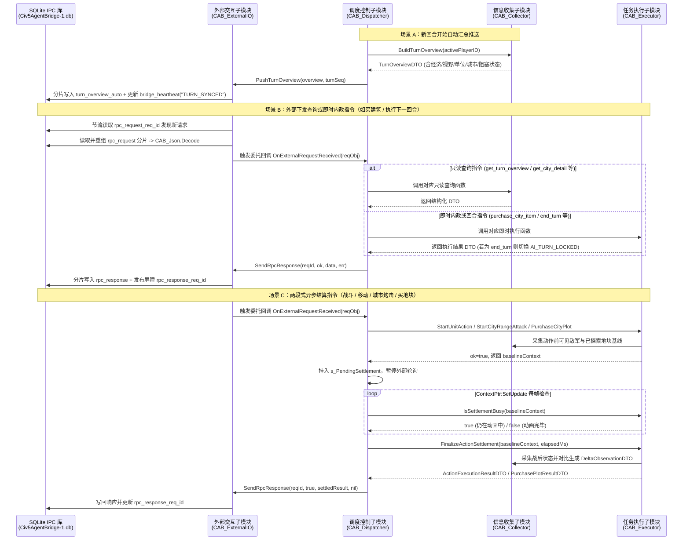

# 模块 1（游戏端纯 Lua 桥接 Mod）模块内部接口设计

> [!IMPORTANT]
> 本文档定义模块 1 内部**四大子模块（信息收集、任务执行、调度控制、外部交互）之间的 Lua 函数调用契约、委托回调签名、内部 DTO 字段定义**，以及由外部交互子模块承载的**对外 SQLite IPC 方法映射表**。严格遵循计划阶段规范：列明函数签名、职责、输入输出与分步实现逻辑，不直接列出具体实现代码。

---

## 一、 子模块命名空间与交互时序总览

### 1.1 全局命名空间约定
在 `Civ5AgentBridgeUI` 所在的 `<LuaContext>` 内，各子模块通过 `include()` 按依赖顺序加载，统一导出带 `CAB_` 前缀的模块表，禁止跨子模块读写私有 `local` 状态变量：

* `CAB_Config`（来自 `Lua/CAB_Config.lua`）：只读参数常量表
* `CAB_Json`（来自 `Lua/Civ5AgentBridgeJson.lua`）：纯 Lua JSON 序列化/反序列化工具表
* `CAB_ExternalIO`（来自 `Lua/CAB_ExternalIO.lua`）：外部交互子模块接口表
* `CAB_Collector`（来自 `Lua/CAB_InfoCollector.lua`）：游戏内信息收集子模块接口表
* `CAB_Executor`（来自 `Lua/CAB_TaskExecutor.lua`）：游戏内任务执行子模块接口表
* `CAB_Dispatcher`（来自 `Lua/CAB_Dispatcher.lua`）：调度控制子模块接口表

### 1.2 核心交互时序图

---

## 二、 子模块间回调委托契约（Delegates）

为避免底层通信模块反向依赖上层调度模块、避免调度模块硬编码耦合 UI 控件名，定义以下 2 个注入式委托签名：

### 2.1 新外部消息到达通知委托
* **委托类型名**：`OnExternalRequestCallback`
* **签名**：`function(reqObj: table) -> nil`
* **注册方式**：由 `CAB_Dispatcher` 在启动时传入 `CAB_ExternalIO.Initialize(onMessageCallback)`。
* **传入参数 `reqObj` 结构**：
  * `req_id` (`number`)：本次请求的唯一递增序号
  * `session_id` (`string | nil`)：外部客户端会话标识（可选）
  * `method` (`string`)：RPC 方法名（如 `"get_turn_overview"`、`"purchase_city_item"`、`"end_turn"`）
  * `params` (`table`)：方法参数字典（始终保证为非空 table）
* **触发保证**：仅当 SQLite 中出现未处理的新请求且 JSON 成功解码为合法对象时触发一次；解码异常由 `CAB_ExternalIO` 自行拦截写回错误响应，不向上冒泡脏数据。

### 2.2 UI 状态栏刷新委托
* **委托类型名**：`OnUiStatusUpdateCallback`
* **签名**：`function(statusText: string) -> nil`
* **注册方式**：由 `Civ5AgentBridgeUI.lua` 在启动时传入 `CAB_Dispatcher.Initialize(uiStatusCallback)`。
* **职责**：安全判断 `Controls.BridgeStatusLabel` 存在后更新右上角提示文本（例如 `"Agent: Turn 45 Synced"`、`"Agent: Settled #108"`、`"Agent: AI Turn..."`）。

---

## 三、 子模块 4：外部交互子模块接口设计（`CAB_ExternalIO` & `CAB_Json`）

### 3.1 `CAB_Json.Encode` / `CAB_Json.Decode`
* **签名**：
  * `CAB_Json.Encode(val: any) -> string`
  * `CAB_Json.Decode(jsonStr: string) -> (any | nil, string | nil)`
* **主要工作**：提供沙箱安全的纯 Lua JSON 编解码能力。
* **实现逻辑说明**：
  * `Encode` 递归遍历 Lua 值；对携带 `__is_object = true` 元标记的表强制序列化为 JSON 对象 `{...}`（解决 Lua 空表 `{}` 默认与空数组 `[]` 无法区分的问题），对字符串控制字符转义并保留 UTF-8 中文字符原样输出；
  * `Decode` 使用 `pcall` 包裹递归下降解析器，支持 `\uXXXX` Unicode 转 UTF-8 字节流；解析成功返回 `(parsedTable, nil)`，任何语法损坏均安全捕获返回 `(nil, errorMessage)`。

### 3.2 `CAB_ExternalIO.Initialize`
* **签名**：`CAB_ExternalIO.Initialize(onMessageCallback: function) -> (boolean, string | nil)`
* **主要工作**：打开 `ModUserData` SQLite 数据库句柄，校准初始请求游标，保存消息通知委托。
* **输入**：`onMessageCallback`（调度控制子模块的请求处理入口函数）。
* **输出**：`(ok, errMsg)`。
* **实现逻辑说明**：
  1. 调用 `Modding.OpenUserData(CAB_Config.DB_NAME, CAB_Config.DB_VERSION)` 获取 `s_BridgeDB`；若返回空则返回 `(false, "OpenUserData failed")`；
  2. 读取库内已有的 `rpc_request_req_id` 与 `rpc_session_id` 初始化 `s_LastProcessedReqId` 与 `s_ActiveSessionId`（防止重载存档时重复执行历史残留指令）；
  3. 绑定 `s_OnMessageCallback = onMessageCallback`，返回 `(true, nil)`。

### 3.3 `CAB_ExternalIO.WritePayload` & `CAB_ExternalIO.ReadPayload`
* **签名**：
  * `CAB_ExternalIO.WritePayload(key: string, strValue: string, forceChunked: boolean | nil) -> boolean`
  * `CAB_ExternalIO.ReadPayload(key: string) -> string | nil`
* **主要工作**：屏蔽 `SimpleValues` 表的大字符串分片与重组细节。
* **实现逻辑说明**：
  * 写入时若字节长度超过 `CAB_Config.CHUNK_SIZE_BYTES`（3000 字节）或 `forceChunked == true`，按 `1..N` 切片依次写入 `<key>#chunk_1 .. <key>#chunk_N`，写入 `<key>#chunk_count = tostring(N)`，主槽位 `<key>` 仅写入 `"__CHUNKED__:<byteLen>"`；否则直接写入 `<key>` 并将 `<key>#chunk_count` 置 `"0"`；
  * 读取时先读 `<key>#chunk_count`，若大于 `0` 则循环读取 `1..N` 并 `table.concat` 拼接返回，否则直接返回 `GetValue(key)`。

### 3.4 `CAB_ExternalIO.PushTurnOverview` & `CAB_ExternalIO.WriteHeartbeat`
* **签名**：
  * `CAB_ExternalIO.PushTurnOverview(overviewTable: table, turnSeq: number) -> boolean`
  * `CAB_ExternalIO.WriteHeartbeat(statusStr: string, turnSeq: number) -> boolean`
* **主要工作**：向外部智能体推送回合自动快照与桥接存活心跳。
* **实现逻辑说明**：
  * `PushTurnOverview` 将 `overviewTable` 经 `CAB_Json.Encode` 编码后调用 `WritePayload("turn_overview_auto", jsonStr)`，随后立即调用 `WriteHeartbeat("TURN_SYNCED", turnSeq)`；
  * `WriteHeartbeat` 组装 `{ turn, active_player, is_turn_active, status, turn_seq, last_req_id, clock_ms }` 写入 `bridge_heartbeat` 键。

### 3.5 `CAB_ExternalIO.SendRpcResponse`
* **签名**：`CAB_ExternalIO.SendRpcResponse(reqId: number, ok: boolean, dataTable: table | nil, errMsg: string | nil, forceChunked: boolean | nil) -> boolean`
* **主要工作**：将调度层处理完毕的 RPC 响应原子化发布回 SQLite。
* **实现逻辑说明**：
  1. 组装标准信封 `{ __is_object = true, req_id = reqId, ok = ok, data = dataTable, error = errMsg }`；
  2. 编码为 JSON 字符串并调用 `WritePayload("rpc_response", encoded, forceChunked)` 落盘全部分片；
  3. **最后一步**执行 `s_BridgeDB.SetValue("rpc_response_req_id", tostring(reqId))` 作为原子发布屏障，确保外部 Python 读到匹配的 `req_id` 时分片已 100% 写完。

### 3.6 `CAB_ExternalIO.PollIncomingRequest`
* **签名**：`CAB_ExternalIO.PollIncomingRequest() -> boolean`
* **主要工作**：由调度层在空闲帧节流调用，轻量检查库中是否有外部新消息并在发现后主动触发回调通知。
* **输出**：若本次检测到并处理了一条新请求返回 `true`，无新请求返回 `false`。
* **实现逻辑说明**：
  1. 读取 `reqIdStr = s_BridgeDB.GetValue("rpc_request_req_id")` 转为数字 `reqId`；
  2. 检查可选会话号 `incomingSession = s_BridgeDB.GetValue("rpc_session_id")`：若外部更换了非空新 `session_id`，重置 `s_LastProcessedReqId = 0` 并记录新会话号（解决外部 MCP Server 重启后 `req_id` 从 1 重新计数被旧水位线拦截的问题）；
  3. 若 `reqId > s_LastProcessedReqId`：
     * 立即更新 `s_LastProcessedReqId = reqId`；
     * 调用 `ReadPayload("rpc_request")` 与 `CAB_Json.Decode`；
     * 若解码失败，直接调用 `SendRpcResponse(reqId, false, nil, "JSON decode error: ...")`；
     * 若解码成功，补齐 `reqObj.req_id = reqId`、`reqObj.params = reqObj.params or {}`，通过 `pcall` 调用 `s_OnMessageCallback(reqObj)` 通知调度控制子模块（若回调内发生未捕获 Lua 异常，兜底调用 `SendRpcResponse` 返回运行时错误信息）。

---

## 四、 子模块 1：信息收集子模块接口设计（`CAB_Collector`）

> [!NOTE]
> **通用实现与安全契约（已于 M1Sub1 验收固化）**：
> 1. **零外部依赖与零状态缓存**：仅 `include("CAB_Config")` 一次，不依赖 `Civ5AgentBridgeJson` 或第三方空袭 Mod；模块内部不保留跨调用可变状态缓存（连 `GameDefines` 亦按次实时读取），全面兼容原生 BNW v1.0.3.279 与 IGE 动态修改。
> 2. **DTO 编码与可空约定**：所有 JSON 对象表均携带 `__is_object = true`；可空字段无值时直接留 Lua `nil`（省略键）。
> 3. **结构化错误返回**：当 `activePlayerID` 无效/未存活，或 `unitID`/`cityID` 不存在/已阵亡/非己方所属，或 `radius` 为非法非数字时，主查询接口绝不抛未捕获 Lua 异常，统一返回 `{ __is_object = true, error = "<英文错误说明>" }`（其中 `GetVisibilitySummary` 返回 `({ __is_object = true, visible_enemies = {}, visible_enemy_cities = {}, error = "..." }, {})`，`CaptureRevealedPlotsSet` 返回 `{}`）。
> 4. **战争迷雾与防侧信道红线**：可见敌军须同时满足 `pPlot:IsVisible(activeTeam, false) == true` 与 `pUnit:IsInvisible(activeTeam, false) ~= true`；单位与城市枚举远程目标时，`CanRangeStrikeAt` **仅允许对实时可见格或已探索交战敌城格调用**，严禁探测普通迷雾格或黑雾格；`REVEALED_FOG` 迷雾格省略 `improvement` / `friendly_unit_id` / `enemy_unit`；可购地块资源经 `GetResourceType(activeTeam)` 过滤科技可见性。

### 4.1 `CAB_Collector.GetEmpireEconomy`
* **签名**：`CAB_Collector.GetEmpireEconomy(activePlayerID: number) -> table`
* **主要工作**：采集当前玩家的国库金币、回合金、科研、文化、信仰、快乐度及战略/奢侈资源明细。
* **输入**：`activePlayerID`（当前人类玩家 ID）。
* **输出（`EconomyDTO`）**：
  * `gold` (`int`)：国库当前金币（`pPlayer:GetGold()`）
  * `gold_per_turn` (`int`)：回合金净收支（`pPlayer:CalculateGoldRate()`）
  * `science_per_turn` (`int`)：每回合科研值（`pPlayer:GetScience()`）
  * `culture_per_turn` (`int`)：每回合文化值（`pPlayer:GetTotalJONSCulturePerTurn()`）
  * `faith_per_turn` (`int`)：每回合信仰值（`pPlayer:GetTotalFaithPerTurn()`）
  * `faith_total` (`int`)：当前累计信仰值（`pPlayer:GetFaith()`）
  * `happiness` (`int`)：帝国净快乐度（`pPlayer:GetExcessHappiness()`）
  * `is_golden_age` (`bool`)：是否处于黄金时代（`pPlayer:IsGoldenAge()`）
  * `strategic_resources` (`dict[str, int]`)：可用战略资源余量表（如 `RESOURCE_IRON`, `RESOURCE_HORSES`）
  * `luxury_resources` (`dict[str, int]`)：已接入奢侈品数量表
* **实现逻辑说明**：读取 `Players[activePlayerID]` 各项产出接口；遍历 `GameInfo.Resources()`，按 `Game.GetResourceUsageType(res.ID)` 区分战略资源（`RESOURCEUSAGE_STRATEGIC`）与奢侈资源（`RESOURCEUSAGE_LUXURY`），记录可用量 `> 0` 的条目。

### 4.2 `CAB_Collector.GetVisibilitySummary` & `CAB_Collector.CaptureRevealedPlotsSet`
* **签名**：
  * `CAB_Collector.GetVisibilitySummary(activePlayerID: number) -> (table, table)`
  * `CAB_Collector.CaptureRevealedPlotsSet(activePlayerID: number, centerX: number, centerY: number, radius: number) -> table`
* **主要工作**：执行严格符合战争迷雾边界的全图敌情扫描与局部探索基线快照。
* **输出**：
  * `GetVisibilitySummary` 返回 `(VisibilitySummaryDTO, visibleEnemyMap)`，其中 `VisibilitySummaryDTO` 含 `visible_enemies`（仅 `IsVisible(activeTeam, false) == true` 且 `not IsInvisible(activeTeam, false)` 的敌方/蛮族存活单位列表）与 `visible_enemy_cities`（`IsRevealed(activeTeam, false) == true` 的非己方城市列表，含复合 `city_id`（`"<ownerID>:<id>"`）、`owner_id`、`owner_name`、`name`、`is_minor_civ`、`is_at_war`、`x`、`y`、`hp`、`pop`、`in_fog`）；`visibleEnemyMap` 为按复合 `enemy_id`（`"<ownerID>:<unitID>"`）索引的字典供执行层 O(1) 对比战损；
  * `CaptureRevealedPlotsSet` 返回以 `(centerX, centerY)` 为中心、半径 `radius`（缺省取 `CAB_Config.DELTA_REVEAL_SCAN_RADIUS` 并钳制至 `[0, CAB_Config.MAX_SCAN_RADIUS]`；非法入参或负半径返回 `{}`）内所有 `IsRevealed == true` 的纯坐标键集合 `{"x:y" = true}`（不带 `__is_object`）。

### 4.3 `CAB_Collector.GetEndTurnStatus`
* **签名**：`CAB_Collector.GetEndTurnStatus(activePlayerID: number) -> table`
* **主要工作**：诊断当前回合是否可直接结束，或返回阻塞下一回合的具体待办事项。
* **输出（`EndTurnStatusDTO`）**：
  * `is_turn_active` (`bool`)：当前是否为该玩家的活动回合
  * `can_end_turn_now` (`bool`)：当前是否无任何阻塞可直接执行下一回合
  * `blocking_type_id` (`int`)：引擎 `GetEndTurnBlockingType()` 原始枚举值
  * `blocking_type_name` (`str`)：可读枚举名（如 `"NO_BLOCKING"`、`"ENDTURN_BLOCKING_UNITS"`、`"ENDTURN_BLOCKING_PRODUCTION"`、`"ENDTURN_BLOCKING_RESEARCH"`、`"ENDTURN_BLOCKING_POLICY"`、`"ENDTURN_BLOCKING_UNIT_PROMOTION"` 等）
  * `blocking_unit_id` (`int | nil`)：若因待命/叠栈/待晋升单位阻塞，返回首个待处理单位 ID
  * `blocking_city_id` (`int | nil`)：若因城市未选生产项目阻塞，返回首个闲置城市 ID
  * `notification_summary` (`str | nil`)：关联的阻塞通知文本摘要
* **实现逻辑说明**：参照官方 `ActionInfoPanel.lua:117-175, 333-490`，读取 `pPlayer:GetEndTurnBlockingType()`；若为待命单位类则通过 `pPlayer:GetFirstReadyUnit()` 提取 `unit_id`；若为晋升类则遍历 `pPlayer:Units()` 找 `IsPromotionReady()`；若为生产类则遍历 `pPlayer:Cities()` 找 `GetOrderQueueLength() == 0` 的非傀儡非占领暴动城市。

### 4.4 `CAB_Collector.BuildTurnOverview`
* **签名**：`CAB_Collector.BuildTurnOverview(activePlayerID: number) -> table`
* **主要工作**：汇总新回合或全局查询所需的全量可见态势（**100% 向下兼容《03_接口设计说明书》§2.1 `TurnOverviewDTO`**，并附带扩展经济与回合状态字段）。
* **输出（`TurnOverviewDTO`）**：
  * 兼容核心字段：`turn_number`、`active_player_id`、`player_civ`、`yields`（含 `gold`、`gold_per_turn`、`science_per_turn`、`culture_per_turn`、`faith_per_turn`、`happiness`、`strategic_resources`）、`our_units`（`list[UnitSummaryDTO]`）、`visible_enemies`（`list[EnemyUnitDTO]`）、`our_cities`（`list[CitySummaryDTO]`，含坐标、人口、血量、当前生产品项、剩余回合数、分项产出概要及 `can_range_strike`）、`visible_enemy_cities`（`list[EnemyCityDTO]`）；
  * 新增辅助字段：`end_turn_status`（`EndTurnStatusDTO`，供智能体判断是否具备结束回合条件）。

### 4.5 `CAB_Collector.BuildUnitContextAndCandidates`
* **签名**：`CAB_Collector.BuildUnitContextAndCandidates(activePlayerID: number, unitID: number, radius: number | nil) -> table`
* **主要工作**：提取单个己方单位周边局部六边形网格及全部引擎校验合法的候选动作（**100% 对齐《03_接口设计说明书》§2.2 `UnitTacticalContextDTO`**）。
* **输出**：`{ unit, surrounding_tiles, candidate_actions }`（若单位不存在、已阵亡、非己方所属或 `radius` 非法，返回 `{ __is_object = true, error = "..." }`）。
* **实现逻辑说明**：
  1. 将传入 `radius`（缺省取 `CAB_Config.DEFAULT_SCAN_RADIUS`）钳制至 `[0, CAB_Config.MAX_SCAN_RADIUS]`；内部 `scanRadius` 自动覆盖邻格与单位真实射程（空军上限 `MAX_AIR_SCAN_RADIUS = 20`，非空军上限 `MAX_SCAN_RADIUS`）；对 `dist <= r` 且 `IsRevealed` 的地块导出地形、丘陵、河流、可见单位（军民叠栈优先暴露战斗单位并过滤 `IsInvisible`）与城市归属（`REVEALED_FOG` 迷雾格省略 `improvement` 与单位）；
  2. 枚举相邻格 `MOVE_STEP`（对未探索黑雾格仅允许非空军且有移动力单位生成无预览探路移动，绝不导出地形；对已探索格复用 `CanUnitMoveThrough` + `HasSameClassFriendlyUnit` 1UPT 检查）、相邻敌军/敌城 `MELEE_ATTACK`（校验陆海兵种域、不可通行格、`IsCanAttack` 与敌城真实血量）、射程内 `RANGE_ATTACK` / `AIR_STRIKE`（基于原生 BNW 引擎接口，不引入外部空袭 Mod；**严禁对普通迷雾格或黑雾格调用 `CanRangeStrikeAt`**，仅允许实时可见格或已探索交战敌城格）、以及 `pcall` 保护下临时选中单位经 `FindGameActionIndex` 判定的 `SETUP_FOR_RANGED`、`FORTIFY`、`HEAL`、`SKIP_TURN`，退出前无条件恢复原选中单位（原无选中则 `UI.ClearSelectionList()`，绝不触碰 `UI.SetInterfaceMode`）。

### 4.6 `CAB_Collector.GetCityDetail`
* **签名**：`CAB_Collector.GetCityDetail(activePlayerID: number, cityID: number, includePurchasable: boolean | nil) -> table`
* **主要工作**：提供单座己方城市的深度内政、城防与购买决策面板数据（供购买建筑/购买地块前精确询价）。
* **输入**：`activePlayerID`、`cityID`、`includePurchasable`（默认 `true`；显式 `false` 时三类购买数组返回空表）。
* **输出（`CityDetailDTO`）**：
  * `city`：基础属性与状态标记（`city_id`、`name`、`x`、`y`、`pop`、`hp`、`max_hp`、`combat_str`（`math.floor(GetStrengthValue() / 100)`）、`is_capital`、`is_puppet`、`is_occupied`、`is_in_resistance`、`is_razing`）
  * `yields`：本城每回合产出（`food`、`food_net`、`turns_to_growth`（造移民/停滞/饥荒时返回 `-1`）、`production`、`gold`、`science`、`culture`、`faith`）
  * `production_state`：`{ current_item, order_queue_length, turns_left }`
  * `garrison_unit_id` (`int | nil`)：驻城己方存活军事单位 ID（无有效驻军时省略键）
  * `built_buildings` (`list[dict]`)：本城已拥有的真实建筑列表 `{ building_id, building_type, name, count }`（`GetNumRealBuilding > 0`）
  * `ranged_attack_targets` (`list[dict]`)：若 `pCity:CanRangeStrikeNow() == true`，仅扫描 `CITY_ATTACK_RANGE` 内实时可见格，经 `InspectPlotUnits` 过滤隐形后对交战敌军/蛮族调用 `CanRangeStrikeAt(tx, ty, true, true)` 输出目标坐标、距离、敌军 ID 与血量
  * `purchasable_buildings` (`list[dict]`)：所有满足前置条件的待购建筑 `{ building_id, building_type, name, gold_cost, faith_cost, can_afford_gold_now, can_afford_faith_now }`
  * `purchasable_units` (`list[dict]`)：所有满足前置条件的待购单位 `{ unit_type_id, unit_type, name, gold_cost, faith_cost, can_afford_gold_now, can_afford_faith_now }`
  * `purchasable_plots` (`list[dict]`)：所有可扩张购买的周边地块 `{ x, y, gold_cost, can_afford_now, terrain, feature, is_hills, resource_type }`
* **实现逻辑说明**：
  * 购买建筑/单位列表遍历 `GameInfo.Buildings` / `GameInfo.Units`，先以 `IsCanPurchase(false, false, ..., YIELD_GOLD/YIELD_FAITH)` 筛出候选池并读取 `GetBuildingPurchaseCost` / `GetBuildingFaithPurchaseCost` / `GetUnitPurchaseCost` / `GetUnitFaithPurchaseCost(unitTypeId, true)`，再以 `IsCanPurchase(true, true, ...)` 填写 `can_afford_*_now`；
  * 购买地块列表在 `GameDefines.BUY_PLOTS_DISABLED == 0` 且城市非傀儡/非抵抗/非焚城时，遍历 `0 .. pCity:GetNumCityPlots()-1` 的已探索地块，用 `CanBuyPlotAt(px, py, true)` 筛出规则合法的可扩张格，用 `CanBuyPlotAt(px, py, false)` 填写 `can_afford_now`，用 `GetBuyPlotCost(px, py)` 读取金币报价（资源经 `GetResourceType(activeTeam)` 过滤科技可见性）。

### 4.7 供任务执行子模块复用的纯只读辅助函数（`H1` ~ `H7`）

为确保 `CAB_TaskExecutor` 在动作前置校验、动作前基线采集与战后状态序列化时与 `CAB_Collector` 保持 100% 同源口径，`CAB_Collector` 公开以下 7 个无副作用纯只读辅助函数：

| 编号 | 函数签名 | 输入 / 输出 | 核心职责说明 |
| :---: | :--- | :--- | :--- |
| **H1** | `CAB_Collector.SerializeUnitSummary(pUnit)` | `Unit -> UnitSummaryDTO \| nil` | 序列化存活（过滤 `IsDead`/`IsDelayedDeath`）己方单位；结合 `MovesLeft() > 0` 与 `IsReadyToMove() == true` 精准判定 `can_act`，移动力除以 `MOVE_DENOMINATOR` 保留两位小数截断。 |
| **H2** | `CAB_Collector.SerializeEnemyUnit(pEnemyUnit)` | `Unit -> EnemyUnitDTO \| nil` | 序列化存活的可见敌方/蛮族单位，生成 `"<ownerID>:<unitID>"` 复合 `enemy_id`。 |
| **H3** | `CAB_Collector.SerializeCitySummary(pCity)` | `City -> CitySummaryDTO \| nil` | 序列化己方城市摘要（含 7 项分项 `yields` 与 `can_range_strike`），供 `BuildTurnOverview` 及内政购买后回读复用。 |
| **H4** | `CAB_Collector.InspectPlotUnits(pPlot, activePlayerID)` | `(Plot, int) -> (int \| nil, EnemyUnitDTO \| nil)` | 扫描可见地块存活单位返回 `(friendlyId, enemyDto)`；军民叠栈优先保留主战单位（`IsCombatUnit()`），并强制过滤 `IsInvisible(activeTeam, false)` 隐形敌军。 |
| **H5** | `CAB_Collector.CanUnitMoveThrough(pUnit, pPlot)` | `(Unit, Plot) -> boolean` | `pcall` 安全包裹 `pUnit:CanMoveThrough(pPlot)`，规避原版 BNW DLL `CanMoveOrAttackInto` 恒假缺陷。 |
| **H6** | `CAB_Collector.HasSameClassFriendlyUnit(pPlot, activePlayerID, isSelfCombat)` | `(Plot, int, bool) -> boolean` | 判定目标格是否已存在同类别（同战斗或同民用）己方存活单位，支撑 1UPT 停靠规则判定。 |
| **H7** | `CAB_Collector.FindGameActionIndex(actionTypeStr)` | `string -> int \| nil` | 遍历 `GameInfoActions` 并双重校验 `Game.CanHandleAction(iAction, 0, 1)` 与 `Game.CanHandleAction(iAction)`，返回当前选中单位可执行的动作索引。 |

---

## 五、 子模块 2：任务执行子模块接口设计（`CAB_Executor`）

### 5.1 `CAB_Executor.Initialize`
* **签名**：`CAB_Executor.Initialize() -> boolean`
* **主要工作**：初始化任务执行环境，校验 `CAB_Config` 与 `CAB_Collector` 依赖就绪并置位 `s_Initialized`（基于原生 BNW v1.0.3.279 + IGE 兼容基线，不引入外部空袭 Mod 联动探测）。

### 5.2 `CAB_Executor.StartUnitAction`
* **签名**：`CAB_Executor.StartUnitAction(activePlayerID: number, unitID: number, actionType: string, targetX: number, targetY: number) -> (boolean, string | nil, table | nil)`
* **主要工作**：校验并向引擎下发单位战术动作，同时采集动作前视野与敌情基线供异步结算使用。
* **输入**：`activePlayerID`、`unitID`、`actionType`（8 种枚举之一）、`targetX`、`targetY`。
* **输出**：`(ok, errMsg, baselineContext)`。
* **实现逻辑说明**：
  1. 校验玩家处于活动回合、单位存在且未死亡、目标格坐标合法（复用 `CAB_Collector.CanUnitMoveThrough` / `HasSameClassFriendlyUnit` / `FindGameActionIndex` 保持前置校验与采集层同源）；
  2. 调用 `CAB_Collector.GetVisibilitySummary` 与 `CaptureRevealedPlotsSet` 记录动作前可见敌军映射表 `baselineEnemyMap`、目标格受击敌军战前快照 `targetEnemyBefore` 及周边已探索格集合 `revealedBefore`；
  3. 调用 `UI.SelectUnit(pUnit)` 选中单位，按 `actionType` 分发原版官方指令（`SelectionListMove` / `SelectionListGameNetMessage` / `Game.HandleAction`）；
  4. 封装 `baselineContext`（标记 `settlementKind = "UNIT_ACTION"`）返回给调度控制子模块挂起等待。

### 5.3 `CAB_Executor.StartCityRangeAttack`
* **签名**：`CAB_Executor.StartCityRangeAttack(activePlayerID: number, cityID: number, targetX: number, targetY: number) -> (boolean, string | nil, table | nil)`
* **主要工作**：驱动具备远程反击能力的己方城市轰击射程内敌军（战斗功能的城防补充）。
* **实现逻辑说明**：
  1. 校验城市归属当前玩家、`pCity:CanRangeStrikeNow() == true` 且 `pCity:CanRangeStrikeAt(targetX, targetY, true, true) == true`；
  2. 采集动作前可见敌军与目标格敌军基线；
  3. 参照官方 `WorldView.lua:519`：执行 `UI.ClearSelectionList()` $\rightarrow$ `UI.SelectCity(pCity)` $\rightarrow$ `Game.SelectedCitiesGameNetMessage(GameMessageTypes.GAMEMESSAGE_DO_TASK, TaskTypes.TASK_RANGED_ATTACK, targetX, targetY)` $\rightarrow$ 触发 `SpecificCityInfoDirty` $\rightarrow$ `UI.ClearSelectedCities()`；
  4. 返回 `baselineContext`（标记 `settlementKind = "CITY_ATTACK"`）进入两段式结算，捕获受击敌军残血或击杀结果。

### 5.4 `CAB_Executor.PurchaseCityItem`
* **签名**：`CAB_Executor.PurchaseCityItem(activePlayerID: number, cityID: number, itemCategory: string, itemKeyOrId: string | number, yieldTypeStr: string | nil) -> (boolean, string | nil, table | nil)`
* **主要工作**：在指定己方城市使用金币（默认）或信仰立即购买建筑或单位。
* **输入**：
  * `cityID` (`int`)：目标城市 ID
  * `itemCategory` (`"BUILDING" | "UNIT"`)：购买类别（默认 `"BUILDING"`）
  * `itemKeyOrId` (`str | int`)：建筑/单位的数据库 `Type` 字符串（如 `"BUILDING_WALLS"`、`"UNIT_ARCHER"`）或整数 ID
  * `yieldTypeStr` (`"GOLD" | "FAITH" | nil`)：支付货币类型，默认 `"GOLD"`
* **输出**：`(ok, errMsg, PurchaseItemResultDTO)`，其中 `PurchaseItemResultDTO` 含：
  * `purchased` (`bool`)、`city_id` (`int`)、`item_category` (`str`)、`item_type` (`str`)、`yield_type` (`str`)
  * `cost_paid` (`int`)：本次实际消耗的金币或信仰
  * `gold_before` / `gold_after` (`int`)、或 `faith_before` / `faith_after` (`int`)
  * `spawned_unit_id` (`int | nil`)：若购买的是单位，返回城内新生成单位的 `unit_id`
  * `city_summary_after` (`CitySummaryDTO`)：购买完成后的最新城市摘要
* **实现逻辑说明**：
  1. 解析 `itemKeyOrId` 定位 `GameInfo.Buildings` 或 `GameInfo.Units` 中的数字 ID，若不存在返回明确错误；
  2. 参照 `ProductionPopup.lua:136-142` 调用 `pCity:IsCanPurchase(true, true, unitID, buildingID, -1, eYield)` 执行全规则校验；若不通过，进一步调用 `IsCanPurchase(false, false, ...)` 细分错误原因（区分“科技/前置建筑未满足或已拥有该建筑” vs “金币/信仰余额不足或城内已有同类驻军叠栈”）；
  3. 记录购买前余额与城内单位集合，调用 `Game.CityPurchaseBuilding(pCity, buildingID, eYield)` 或 `Game.CityPurchaseUnit(pCity, unitID, eYield)`，发送 `Events.SpecificCityInfoDirty` 刷新 UI；
  4. 同步采样扣费后余额（及新诞生单位 ID）构造结果直接返回（即时生效，无需帧挂起）。

### 5.5 `CAB_Executor.SetCityProduction`
* **签名**：`CAB_Executor.SetCityProduction(activePlayerID: number, cityID: number, orderCategory: string, itemKeyOrId: string | number, clearQueue: boolean | nil) -> (boolean, string | nil, table | nil)`
* **主要工作**：为非傀儡城市设置或更换当前生产队列项目（建造建筑、训练单位、创建项目或维持经济/科研转化），支撑全自动回合闭环。
* **输出**：`(ok, errMsg, { city_id, current_production, turns_left, order_queue_length })`。
* **实现逻辑说明**：参照 `ProductionPopup.lua:133`，校验非傀儡城及 `pCity:CanConstruct` / `pCity:CanTrain` / `pCity:CanCreate` / `pCity:CanMaintain` 合法后，调用 `Game.CityPushOrder(pCity, eOrder, iData, false, clearQueue ~= false, true)` 并刷新城市生产脏事件。

### 5.6 `CAB_Executor.PurchaseCityPlot`
* **签名**：`CAB_Executor.PurchaseCityPlot(activePlayerID: number, cityID: number, plotX: number, plotY: number) -> (boolean, string | nil, table | nil)`
* **主要工作**：驱动指定城市花费国库金币购买周边可扩展领土地块。
* **输入**：`activePlayerID`、`cityID`、`plotX`、`plotY`。
* **输出**：`(ok, errMsg, baselineContext)`。
* **实现逻辑说明**：
  1. 校验 `GameDefines["BUY_PLOTS_DISABLED"] == 0`、城市属于当前激活玩家且非傀儡/占领暴动受限态；
  2. 参照 `CityView.lua:2003, 2143`：校验 `pCity:CanBuyPlotAt(plotX, plotY, false)`；若返回 `false`，用 `CanBuyPlotAt(plotX, plotY, true)` 判断是“金币不足（附所需金额 `GetBuyPlotCost`）”还是“该坐标不在本城合法买地范围内（如距离超 3 格、无相邻领土或已被占有）”；
  3. 记录买地前 `goldBefore` 与 `expectedCost = pCity:GetBuyPlotCost(plotX, plotY)`，调用 `Network.SendCityBuyPlot(cityID, plotX, plotY)`（若城市界面打开则调 `UI.UpdateCityScreen()`）；
  4. 返回 `baselineContext`（标记 `settlementKind = "BUY_PLOT"`），经调度器短等待（`0.10s` 或检测到 `pPlot:GetOwner() == activePlayerID`）后在 `FinalizeActionSettlement` 中返回 `{ purchased = true, city_id, x, y, cost_paid, gold_before, gold_after, new_owner_id }`。

### 5.7 `CAB_Executor.ExecuteEndTurn`
* **签名**：`CAB_Executor.ExecuteEndTurn(activePlayerID: number, autoSkipReadyUnits: boolean | nil) -> (boolean, string | nil, table | nil)`
* **主要工作**：安全执行“下一回合”操作，处理可选的剩余待命单位自动跳过，并在存在硬性待办阻塞时返回结构化诊断。
* **输入**：`activePlayerID`、`autoSkipReadyUnits`（默认 `false`）。
* **输出**：`(ok, errMsg, EndTurnResultDTO)`，其中 `EndTurnResultDTO` 含：
  * `turn_ended` (`bool`)：是否已成功向引擎提交回合结束指令
  * `ended_turn_number` (`int`)：结束的回合号
  * `auto_skipped_unit_ids` (`list[int]`)：本次因 `autoSkipReadyUnits == true` 自动跳过回合的单位 ID 列表
  * `status` (`"WAITING_NEXT_TURN" | "BLOCKED"`)
  * `blocking_info` (`EndTurnStatusDTO | nil`)：若被阻塞未能结束回合，附带完整阻塞诊断
* **实现逻辑说明**：
  1. 检查 `pPlayer:IsTurnActive()` 且 `not Game.IsProcessingMessages()`，不满足则返回拒绝；
  2. 若 `autoSkipReadyUnits == true`：遍历 `pPlayer:Units()`，对满足 `IsReadyToMove() == true` 且非待晋升、非同格非法叠栈的单位依次选中并下发 `MISSION_SKIP`，记录其 ID；
  3. 调用 `CAB_Collector.GetEndTurnStatus(activePlayerID)` 检查最新阻塞状态：
     * 若仍存在阻塞（如未选科技、闲置城市需指定生产、政策未选、单位待晋升、两军同格叠栈未移开），不强行调 `CONTROL_ENDTURN`，而是返回 `(false, "End turn blocked: " .. blocking_type_name, resultDto)`，交智能体先调用生产/移动接口或提示玩家处理；
     * 若无阻塞（`can_end_turn_now == true`），参照 `ActionInfoPanel.lua:174-175` 调用 `Game.DoControl(GameInfoTypes.CONTROL_ENDTURN)`，立即返回 `(true, nil, resultDto)`。

### 5.8 `CAB_Executor.IsSettlementBusy` & `CAB_Executor.FinalizeActionSettlement`
* **签名**：
  * `CAB_Executor.IsSettlementBusy(baselineContext: table) -> boolean`
  * `CAB_Executor.FinalizeActionSettlement(baselineContext: table, settleWaitMs: number) -> table`
* **主要工作**：配合调度控制子模块的帧循环完成异步状态检测与战后结算报告组装。
* **实现逻辑说明**：
  * `IsSettlementBusy`：若 `settlementKind == "UNIT_ACTION"`，检查单位未阵亡时的 `pUnit:IsBusy()`、`pUnit:IsFighting()` 或所在格 `pPlot:IsFighting()`；若 `settlementKind == "CITY_ATTACK"`，检查目标格 `pTargetPlot:IsFighting()`；若 `settlementKind == "BUY_PLOT"`，检查 `pTargetPlot:GetOwner() ~= activePlayerID`；
  * `FinalizeActionSettlement`：若为单位动作或城市炮击，对比 `baselineContext` 与最新 `GetVisibilitySummary` / `CaptureRevealedPlotsSet`，生成完全符合《03_接口设计说明书》§2.3 的 `ActionExecutionResultDTO`（含 `unit_after`、`unit_died`、`newly_revealed_tiles_count`、`newly_spotted_enemies`、`target_enemy_after`）；若为买地块，生成 `PurchasePlotResultDTO`。

---

## 六、 子模块 3：调度控制子模块接口设计（`CAB_Dispatcher`）

| 函数签名 | 触发源 | 主要工作与调度逻辑 |
| :--- | :--- | :--- |
| `CAB_Dispatcher.Initialize(uiStatusCallback) -> boolean` | `Civ5AgentBridgeUI` 启动时 | 1. 绑定 `uiStatusCallback`； 2. 初始化 `CAB_Executor.Initialize()`； 3. 初始化 `CAB_ExternalIO.Initialize(CAB_Dispatcher.OnExternalRequestReceived)`； 4. 根据当前 `pPlayer:IsTurnActive()` 置状态为 `"IDLE"` 或 `"AI_TURN_LOCKED"`，若在玩家回合则立即触发一次初始全局态势导出。 |
| `CAB_Dispatcher.OnActivePlayerTurnStart() -> nil` | `Events.ActivePlayerTurnStart` | 1. 清空任何异常残留的 `s_PendingSettlement`； 2. 将 `s_BridgeState` 设为 `"IDLE"`，`s_TurnEventSeq` 自增 1； 3. 调用 `CAB_Collector.BuildTurnOverview(activePlayerID)` 汇总新回合态势； 4. 调用 `CAB_ExternalIO.PushTurnOverview(overview, s_TurnEventSeq)` 写库并广播 `"TURN_SYNCED"` 心跳，刷新 UI 状态栏。 |
| `CAB_Dispatcher.OnActivePlayerTurnEnd() -> nil` | `Events.ActivePlayerTurnEnd` | 将 `s_BridgeState` 切换为 `"AI_TURN_LOCKED"`，调用 `CAB_ExternalIO.WriteHeartbeat("AI_TURN_PROCESSING", s_TurnEventSeq)`，刷新 UI 为 `"Agent: AI Turn..."`。 |
| `CAB_Dispatcher.OnManualSyncClicked() -> nil` | 右上角状态按钮点击事件 | 若处于玩家回合，立即调用 `CAB_Collector.BuildTurnOverview` + `CAB_ExternalIO.PushTurnOverview` 强制刷新库内 `turn_overview_auto` 快照。 |
| `CAB_Dispatcher.OnExternalRequestReceived(reqObj) -> nil` | `CAB_ExternalIO` 新消息委托回调 | 1. 门控检查：若处于 `"AI_TURN_LOCKED"` 或非玩家活动回合，除 `ping` / `get_end_turn_status` 外一律调用 `SendRpcResponse(reqId, false, nil, "Player turn is not active (AI turn in progress)")` 返回； 2. 按 `reqObj.method` 查路由分发表调用 `CAB_Collector`（同步写回）或 `CAB_Executor`（即时写回，或创建 `s_PendingSettlement` 切入 `"WAITING_SETTLEMENT"`，或成功 `end_turn` 后写回响应并切入 `"AI_TURN_LOCKED"`）。 |
| `CAB_Dispatcher.OnFrameUpdate(deltaTime) -> nil` | `ContextPtr:SetUpdate` 每帧回调 | 1. 若 `s_PendingSettlement ~= nil`：累加 `elapsedSec`，检查是否达到 `minWaitSec` 且 `not CAB_Executor.IsSettlementBusy(...)`（或达到 `MAX_SETTLE_TIMEOUT_SEC`）；一旦满足则调 `FinalizeActionSettlement` -> `SendRpcResponse` -> 清空挂起并恢复 `"IDLE"`； 2. 若无挂起：累加 `s_PollAccumSec` 满 `0.20s` 调 `CAB_ExternalIO.PollIncomingRequest()`；累加 `s_HeartbeatAccumSec` 满 `2.0s` 刷新一次存活心跳。 |

---

## 七、 对外 SQLite IPC 协议方法映射总表（`rpc_request.method`）

下表汇总外部智能体（MCP Server）经 SQLite 向模块 1 发送的全部 RPC 方法。其中前 4 项与《03_接口设计说明书》100% 保持原样兼容，后 7 项（加 `test_large_payload` 诊断接口）为本次模块 1 正式工程化新增能力：

| 类别 | `method` 名称 | 输入 `params` 字段 | 路由目标函数 | 结算模式 | 输出 `data` 核心结构 |
| :---: | :--- | :--- | :--- | :---: | :--- |
| **基线兼容** | `ping` | `{ echo?: str }` | `CAB_Dispatcher` 内建 | 同步即时 | `{ pong, turn, active_player, is_turn_active, status, turn_seq }` |
| **基线兼容** | `get_turn_overview` | `{}` | `CAB_Collector.BuildTurnOverview` | 同步即时 | `TurnOverviewDTO`（含单位/城市/回合金/资源/可见敌情/阻塞状态） |
| **基线兼容** | `get_unit_context` | `{ unit_id: int, radius?: int }` | `CAB_Collector.BuildUnitContextAndCandidates` | 同步即时 | `UnitTacticalContextDTO`（局部网格 + 合法候选动作） |
| **基线兼容** | `execute_unit_action` | `{ unit_id: int, action_type: str, target_x: int, target_y: int, settle_delay_sec?: float }` | `CAB_Executor.StartUnitAction` + 异步结算 | **两段式帧结算** | `ActionExecutionResultDTO`（含 `unit_after` 与 `delta_observation`） |
| **信息查询扩展** | `get_empire_economy` | `{}` | `CAB_Collector.GetEmpireEconomy` | 同步即时 | `EconomyDTO`（金币、回合金、科研、文化、信仰、快乐、战略/奢侈资源） |
| **信息查询扩展** | `get_visibility_summary` | `{}` | `CAB_Collector.GetVisibilitySummary` | 同步即时 | `VisibilitySummaryDTO`（全图可见敌军 + 已探索敌城及迷雾态） |
| **信息查询扩展** | `get_city_detail` | `{ city_id: int, include_purchasable?: bool }` | `CAB_Collector.GetCityDetail` | 同步即时 | `CityDetailDTO`（城市产出、队列、已有建筑、可购建筑/单位/地块报价单） |
| **信息查询扩展** | `get_end_turn_status` | `{}` | `CAB_Collector.GetEndTurnStatus` | 同步即时 | `EndTurnStatusDTO`（能否结束回合、具体阻塞原因与待办对象 ID） |
| **任务执行扩展** | `purchase_city_item` | `{ city_id: int, item_category: "BUILDING"\|"UNIT", item: str\|int, yield_type?: "GOLD"\|"FAITH" }` | `CAB_Executor.PurchaseCityItem` | 同步即时 | `PurchaseItemResultDTO`（花费、前后余额、新单位 ID、最新城市摘要） |
| **任务执行扩展** | `set_city_production` | `{ city_id: int, order_category: "BUILDING"\|"UNIT"\|"PROJECT"\|"PROCESS", item: str\|int, clear_queue?: bool }` | `CAB_Executor.SetCityProduction` | 同步即时 | `{ city_id, current_production, turns_left, order_queue_length }` |
| **任务执行扩展** | `purchase_city_plot` | `{ city_id: int, target_x: int, target_y: int }` | `CAB_Executor.PurchaseCityPlot` + 短确认 | **短延迟帧结算** | `PurchasePlotResultDTO`（买地坐标、花费、前后金币、最新领土归属） |
| **任务执行扩展** | `execute_city_attack` | `{ city_id: int, target_x: int, target_y: int }` | `CAB_Executor.StartCityRangeAttack` + 异步结算 | **两段式帧结算** | `ActionExecutionResultDTO`（城市远程炮击后受击敌军残血/击杀状态） |
| **任务执行扩展** | `end_turn` | `{ auto_skip_ready_units?: bool }` | `CAB_Executor.ExecuteEndTurn` | 同步提交 + 跨回合异步推送 | `EndTurnResultDTO`（提交成功后立返；下回合初自动推送 `turn_overview_auto`） |
| **压测诊断** | `test_large_payload` | `{ target_bytes?: int, use_chunk?: bool, payload?: str }` | `CAB_Dispatcher` 诊断分支 | 同步即时 | `{ received_len, generated_len, payload_blob }`（保留供 IPC 回归验收使用） |
