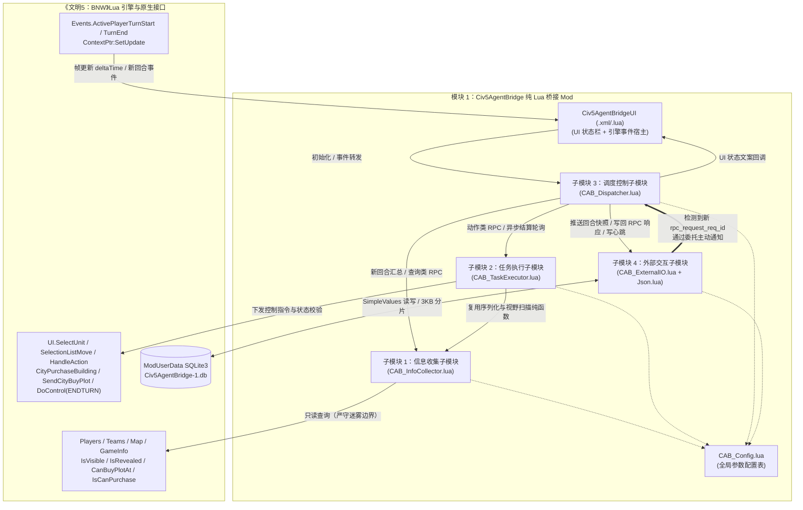
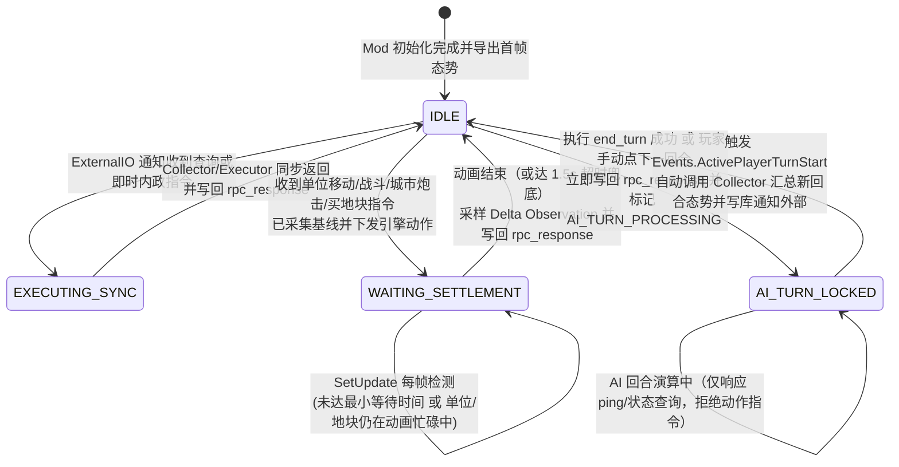

# 模块 1（游戏端纯 Lua 桥接 Mod）模块设计说明

> [!IMPORTANT]
> 本文档定义 **Civ5 Agent Command** 系统中 **模块 1：游戏端纯 Lua 桥接 Mod（`MODS/Civ5AgentBridge/`）** 的正式工程架构、四大子模块职责边界、核心状态变量、事件委托与异步任务机制。本文档处于**设计审查阶段**，严格列明变量、函数职责、输入输出与实现逻辑，不包含具体代码实现。

---

## 一、 模块定位、设计目标与工程约束

### 1.1 模块定位
模块 1 运行于《文明5：美丽新世界（BNW v1.0.3.279）》游戏客户端的 Lua 5.1 UI 沙箱内，是连接**游戏内部实时沙盘**与**外部三层智能体指挥系统（MCP Server / 编排引擎）**的唯一桥梁。在前期可行性验证（`EXP-03` / `EXP-04`）原型基础上，正式版将单体脚本解耦重构为**信息收集、任务执行、调度控制、外部交互**四大独立子模块，并从纯军事单位控制扩展至涵盖**城市购买建筑/地块、城防反击与执行下一回合**的完整回合闭环能力。

### 1.2 核心架构约束与开发红线
1. **零 C++ 侵入与存档无污染**：纯 Lua（`InGameUIAddin`）+ 内置 SQLite3（`Modding.OpenUserData("Civ5AgentBridge", 1)`）实现跨进程通信；`AffectsSavedGames = 0`，不在游戏存档 `ScriptData` 中写入持久化脏数据，支持任意新局或旧存档随时开关。
2. **战争迷雾严格合规**：所有对外输出的数据必须经过当前激活玩家所属团队（`activeTeam`）的视野过滤：
   * **实时可见（`IsVisible == true`）**：可导出地形、地貌、改良设施、城市及格上敌方/蛮族单位详情；
   * **已探索迷雾（`IsRevealed == true` 且 `IsVisible == false`）**：仅导出静态地形、地貌与已探索城市基础信息（显式标记 `in_fog = true`），**严禁泄露迷雾下的敌方单位或动态改良状态**；
   * **未探索黑雾（`IsRevealed == false`）**：严禁导出任何地形、资源、城市或单位信息（仅允许对单位相邻 1 格黑雾生成探路移动候选动作 `MOVE_STEP`）。
3. **空壳 Loader 装配纪律**：严格遵循工作区 `AGENTS.md` 硬性纪律，所有文件路径在 `.modinfo` 中统一使用正斜杠 `/`，全部被 `include()` 或 `<LuaContext>` 引用的文件置 `import="1"`，入口固定为空壳 `Civ5AgentBridgeLoader.lua` + `Civ5AgentBridgeLoader.xml` 子上下文装配模式，杜绝原生装配闪退。
4. **单向分层依赖与参数集中管理**：全部可调阈值（轮询周期、分片字节上限、动画结算超时等）集中收敛于 `CAB_Config.lua`，禁止在业务子模块散落硬编码；子模块之间采用**单向调用 + 回调委托注入**解耦，避免循环依赖。

---

## 二、 文件目录结构与子模块拓扑

### 2.1 目录与文件职责规划
正式版模块 1 源码位于 `Civ5AgentBridge/mod/`（通过部署脚本同步至游戏 `MODS/Civ5AgentBridge/`），在保留已实证的 Loader 与 UI 壳层基础上，按四大子模块拆分如下：

| 文件相对路径（`.modinfo` 登记） | `import` | 所属层次 / 子模块 | 核心职责说明 |
| :--- | :---: | :--- | :--- |
| `Civ5AgentBridge.modinfo` | — | Mod 清单入口 | 声明 Mod 元数据、全量 VFS 导入文件列表及 `InGameUIAddin` 空壳入口 |
| `Lua/CAB_Config.lua` | `1` | 公共配置层 | 全局只读配置表 `CAB_Config`（DB 名称/版本、分片大小、轮询间隔、结算等待阈值、调试开关等） |
| `Lua/Civ5AgentBridgeJson.lua` | `1` | 外部交互子模块（序列化底座） | 零依赖纯 Lua JSON 编解码器（处理 UTF-8 中文、转义符、空数组/空字典区分标记 `__is_object`） |
| `Lua/CAB_ExternalIO.lua` | `1` | **子模块 4：外部交互子模块** | 唯一持有 SQLite 句柄；负责 3KB 自动分片读写、发布游标管理、对外推送写库、轻量轮询新请求并回调通知调度层 |
| `Lua/CAB_InfoCollector.lua` | `1` | **子模块 1：信息收集子模块** | 纯只读查询游戏态势：全局概览、回合金与资源收益、视野/迷雾扫描、单位局部网格与候选动作、城市详情与可购建筑/地块报价、回合结束阻塞检查 |
| `Lua/CAB_TaskExecutor.lua` | `1` | **子模块 2：任务执行子模块** | 校验并驱动游戏动作：单位移动/近战/远程/空袭/架设/驻扎/休整/跳过、城市买建筑/买单位/换生产/买地块/远程炮击、执行下一回合、动作前后增量视野（`Delta Observation`）采样 |
| `Lua/CAB_Dispatcher.lua` | `1` | **子模块 3：调度控制子模块** | 核心协调器：响应新回合事件自动采集并推送全局态势、接收外部交互子模块的新请求通知并路由执行、维护异步结算挂起任务与跨回合门控状态机 |
| `Lua/Civ5AgentBridgeUI.xml` + `.lua` | `1` | UI 宿主壳层（归属调度层入口） | 承载右上角桥接状态指示栏与手动同步按钮，挂载引擎 `Events.*` 与 `ContextPtr:SetUpdate` 并转发给 `CAB_Dispatcher` |
| `Lua/Civ5AgentBridgeLoader.xml` + `.lua` | `1` | 空壳装配器 | `InGameUIAddin` 唯一入口，通过 `<LuaContext FileName="Civ5AgentBridgeUI"/>` 安全加载桥接上下文 |

> [!NOTE]
> 原型期遗留的单体大文件 `Civ5AgentBridgeCore.lua` 在正式重构后将拆入上述四个子模块并退役（或仅保留空转发壳以兼容旧验收脚本）。修改 `.modinfo` 的 `<Files>` 清单后，部署时必须清理 `cache/Civ5*.db` 五个缓存数据库文件以确保 VFS 注册表刷新。

### 2.2 子模块依赖与交互拓扑图

---

## 三、 四大子模块详细设计

### 3.1 子模块 1：游戏内信息收集子模块（`CAB_InfoCollector`）
* **职责定位**：作为游戏状态的**只读传感器**，负责将引擎底层 C++ 导出的 `Player`、`City`、`Unit`、`Plot`、`Team` 对象转换为结构化、可 JSON 序列化的纯 Lua 字典/数组，并严格执行战争迷雾过滤。
* **核心功能域**：
  1. **帝国经济与全局收益采集**：提取当前回合号、文明信息、国库总金币（`GetGold`）、回合金净收益（`CalculateGoldRate`）、每回合科研产出（`GetScience`）、全国净快乐度（`GetExcessHappiness`）、文化/信仰产出及可用战略资源/奢侈品储量字典。
  2. **视野与全局敌情扫描**：
     * 扫描全图对 `activeTeam` 实时可见（`IsVisible == true`）的所有敌方与蛮族存活单位；
     * 扫描全图对 `activeTeam` 已探索（`IsRevealed == true`）的非己方城市（含敌国与城邦，附带外交交战态 `is_at_war` 与迷雾遮蔽标记 `in_fog`）；
     * 支持提取以指定中心坐标、指定半径内的已探索地块集合快照（用于动作前后计算新揭盲地块数）。
  3. **己方单位位置与局部战术上下文采集**：
     * 汇总全体己方存活单位的坐标、血量、剩余/最大移动力、近战/远程战力、射程、驻扎态及当前回合是否仍可行动（结合 `MovesLeft() > 0` 与 `IsReadyToMove()` 精确排除已驻扎/跳过回合的单位）；
     * 提取指定单位周边半径 $R$ 格的六边形网格详情（处理军民同格叠栈时优先暴露战斗单位），并调用引擎原生判定函数枚举全部合法候选动作（`MOVE_STEP` 含相邻黑雾探路、`MELEE_ATTACK`、`RANGE_ATTACK`、`AIR_STRIKE`、`SETUP_FOR_RANGED`、`FORTIFY`、`HEAL`、`SKIP_TURN`）。
  4. **城市详细情况与可购买项查询**：
     * 采集己方城市基础面板（坐标、人口、城防血量、傀儡/占领/暴动状态、食物/产能/金币/科研/文化/信仰分项产出、当前建造品项与剩余回合数、驻防单位 ID、已建成真实建筑列表、当前城市能否发起远程炮击及射程内可轰击目标列表）；
     * **可购买建筑/单位报价单**：遍历 `GameInfo.Buildings` 与 `GameInfo.Units`，利用官方 `ProductionPopup.lua` 同款双层 `pCity:IsCanPurchase` 判定，输出所有符合科技/前置条件的可购项、金币/信仰价格，以及当前时刻是否满足余额与叠栈条件可立即成交（`can_afford_now`）；
     * **可购买地块报价单**：遍历城市管辖范围（`0 .. GetNumCityPlots()-1`），利用官方 `CityView.lua` 同款 `pCity:CanBuyPlotAt(x, y, bIgnoreCost)` 与 `GetBuyPlotCost(x, y)`，输出所有可扩展购买的相邻地块坐标、金币价格、地形资源详情及当前金币是否够买。
  5. **回合结束就绪度与阻塞诊断**：调用官方 `ActionInfoPanel.lua` 同款 `pPlayer:GetEndTurnBlockingType()` 与 `UI.CanEndTurn()`，诊断当前能否直接进入下一回合；若存在阻塞，精确定位阻塞枚举名称（如待命单位、城市缺生产项、未选科技、未选政策、单位待晋升等）及关联的 `unit_id` / `city_id`。

---

### 3.2 子模块 2：任务执行子模块（`CAB_TaskExecutor`）
* **职责定位**：作为游戏内的**指令执行器**，对调度层传入的结构化动作指令做前置合法性校验，调用经本机官方 UI 脚本实证的原生 API 驱动执行，并负责采集动作前后增量态势。
* **核心功能域**：
  1. **单位战术动作执行（两段式异步结算）**：
     * 支持移动（`MOVE_STEP`）、近战/攻城攻击（`MELEE_ATTACK`）、陆海远程攻击（`RANGE_ATTACK`）、空军打击（`AIR_STRIKE`，优先走原版空袭，若目标为无驻军敌城或改良地块且已加载 `AirRaidLegacyUnits` 则经 `AR_ExecuteStrike` 联动执行对地打击）、攻城器械架设（`SETUP_FOR_RANGED`）、驻扎/警戒（`FORTIFY`）、休整（`HEAL`）、跳过本回合（`SKIP_TURN`）；
     * 执行前通过 `CAB_InfoCollector` 记录可见敌军字典、目标格敌军战前血量与周边已探索地块集合基线；动作下发后提供单位动画忙碌态探测接口（检查 `pUnit:IsBusy()`、`pUnit:IsFighting()`、`pPlot:IsFighting()`），待结算完成后对比生成 `DeltaObservationDTO`（新揭盲格数、新发现敌军列表、受击敌军战后残血或击杀状态）。
  2. **城市内政与城防动作执行（即时/短延迟结算）**：
     * **购买建筑（及同源购买单位）**：校验当前为玩家活动回合且 `pCity:IsCanPurchase(true, true, ...)` 为真后，调用 `Game.CityPurchaseBuilding(pCity, buildingID, eYield)`（或 `Game.CityPurchaseUnit`），触发 `Events.SpecificCityInfoDirty` 刷新城市横幅与生产面板，立即返回扣减后的国库金币与最新城市摘要；
     * **切换/追加城市生产项目**：支持通过 `Game.CityPushOrder` 为闲置或需改产的城市下达建造建筑/训练单位/维持转化指令（辅助消除回合结束时的城市闲置阻塞）；
     * **购买地块**：校验 `GameDefines["BUY_PLOTS_DISABLED"] == 0` 且 `pCity:CanBuyPlotAt(tx, ty, false)` 为真后，调用 `Network.SendCityBuyPlot(cityID, tx, ty)`，确认领土归属变更为当前玩家并返回扣费金额与地块详情；
     * **城市远程炮击**：当敌军逼近城下且 `pCity:CanRangeStrikeNow()` 及 `pCity:CanRangeStrikeAt(tx, ty, true, true)` 为真时，临时选中城市调用 `Game.SelectedCitiesGameNetMessage(GAMEMESSAGE_DO_TASK, TASK_RANGED_ATTACK, tx, ty)` 并清空城市选中态，复用两段式战斗结算返回受击敌军残血/击杀结果。
  3. **执行下一回合（`end_turn`）**：
     * 前置检查 `pPlayer:IsTurnActive()` 且 `not Game.IsProcessingMessages()`；
     * 若传入参数 `auto_skip_ready_units == true` 且当前阻塞项仅为普通待命单位（`ENDTURN_BLOCKING_UNITS` / `UNIT_NEEDS_ORDERS`），可自动遍历剩余待命单位下发 `MISSION_SKIP`；
     * 再次调用 `CAB_InfoCollector` 检查阻塞态：若仍有硬阻塞（如未选科技、城市无生产项目、待选政策、叠栈单位未移开），安全中止并返回 `executed = false`、阻塞类型码及关联对象详情，绝不强行绕过引擎状态机；
     * 若无阻塞，调用官方 `Game.DoControl(GameInfoTypes.CONTROL_ENDTURN)` 正式提交回合结束，并通知调度层切入“等待新回合过渡态”。

---

### 3.3 子模块 3：调度控制子模块（`CAB_Dispatcher` + `Civ5AgentBridgeUI`）
* **职责定位**：模块 1 的**运行时状态机与事件总线枢纽**，统筹游戏生命周期事件、外部异步 RPC 请求路由与两段式结算时序，自身不直接写 SQL 语句也不直接拼装底层引擎字段。
* **核心控制流**：
  1. **新回合自动汇总流**：监听 `Events.ActivePlayerTurnStart`（以及玩家点击右上角手动同步按钮）。每当进入玩家新回合时，解除跨回合门控锁，清理任何残留挂起状态，调用 `CAB_InfoCollector` 生成完整全局态势快照，交由 `CAB_ExternalIO` 写入 `turn_overview_auto` 槽位并更新 `bridge_heartbeat`（含递增的回合状态序列与 `"TURN_SYNCED"` 标记），使外部智能体第一时间感知新回合就绪。
  2. **外部消息被动接收与路由流**：在初始化阶段向 `CAB_ExternalIO` 注册消息到达回调委托 `CAB_Dispatcher_OnMessageReceived(reqObj)`。收到新请求通知后：
     * 若当前处于 **AI 回合演算期（`AI_TURN_LOCKED`）** 或 `not pPlayer:IsTurnActive()`：仅放行 `ping` 与只读状态查询（或附带非活动回合提示），拒绝所有修改类动作指令并立即返回明确错误码，防止在 AI 回合注入非法网络包；
     * 若为**只读查询指令**（全局态势、单位上下文、城市详情、经济视野等）：同步调用 `CAB_InfoCollector` 对应接口，立即交 `CAB_ExternalIO` 写回响应；
     * 若为**即时内政/回合指令**（购买建筑、切换生产、执行下一回合）：调用 `CAB_TaskExecutor` 执行并立即写回响应（若成功触发下一回合，则将调度器状态切换为 `AI_TURN_LOCKED` 并刷新心跳为 `"AI_TURN_PROCESSING"`，不等 AI 走完即刻释放本次 RPC，避免外部超时）；
     * 若为**需等待引擎动画/网络包结算的指令**（单位移动/攻击/空袭、城市炮击、购买地块短确认）：调用 `CAB_TaskExecutor` 下发动作并获取动作前基线，构造挂起上下文存入 `g_PendingSettlement`，暂停读取新 RPC 请求。
  3. **帧更新异步结算推进流**：在每帧 `ContextPtr:SetUpdate(deltaTime)` 驱动下，优先检查 `g_PendingSettlement`：若存在挂起任务，递减最小等待计时器并调用 `CAB_TaskExecutor` 检测动画忙碌态；一旦满足“等待满最小帧延迟且非忙碌”（或达到最大兜底超时 `1.5s`），立即采集结算结果与 `Delta Observation`，调用 `CAB_ExternalIO` 写回响应并清空挂起槽位；仅在无挂起任务时，驱动 `CAB_ExternalIO` 按节流周期（默认 `0.20s`）轮询外部新消息。

---

### 3.4 子模块 4：外部交互子模块（`CAB_ExternalIO` + `Civ5AgentBridgeJson`）
* **职责定位**：模块 1 与外部智能体（Python MCP Server）之间的**通信防腐层（Anti-Corruption Layer）**。封装 SQLite `ModUserData` 连接、JSON 编解码、大载荷分片重组与请求游标原子屏障。
* **核心交互机制**：
  1. **出站写库/推送能力（Lua $\rightarrow$ SQLite $\rightarrow$ 外部智能体）**：
     * **RPC 响应写回**：将调度层传入的结果表序列化为 JSON，若超过 `3000` 字节自动按 `1-based` 写入 `rpc_response#chunk_1..N` 与 `rpc_response#chunk_count`，主槽位写短标记 `"__CHUNKED__:<len>"`，**最后一步**写入 `rpc_response_req_id` 作为原子完成屏障；
     * **主动态势推送**：将新回合自动采集的全局态势序列化并分片写入 `turn_overview_auto`；
     * **心跳与回合信号广播**：写入 `bridge_heartbeat`（包含当前回合号 `turn`、激活玩家 `active_player`、调度器运行态 `status`、最后处理的 `last_req_id`、回合切换递增序号 `turn_seq` 与游戏时钟 `clock_ms`）。
  2. **入站轮询与主动通知能力（外部智能体 $\rightarrow$ SQLite $\rightarrow$ 调度控制子模块）**：
     * 维护已消费请求水位线 `s_LastProcessedReqId`（Mod 重载初始化时对齐库内已有 `rpc_request_req_id`，支持外部新会话重置检测：若外部显式写入更小的正整数且带会话重置标记或从 `1` 重新握手，提供安全对齐机制）；
     * 每次节流轮询仅执行一次极轻量的 `db.GetValue("rpc_request_req_id")`；仅当检测到新请求 ID 时，才读取并重组 `rpc_request` 分片、调用 `CAB_JsonDecode` 反序列化；
     * 若 JSON 解码失败，直接在通信层构造协议级错误响应写回；若解码成功，立即调用已注册的调度层委托回调，**主动通知调度控制子模块**接管业务处理。

---

## 四、 主要功能变量清单

### 4.1 全局只读配置变量（`Lua/CAB_Config.lua` -> `CAB_Config` 表）

| 配置项键名 | 类型 | 默认值 | 用途与设计原因 |
| :--- | :--- | :--- | :--- |
| `DB_NAME` / `DB_VERSION` | `string` / `number` | `"Civ5AgentBridge"` / `1` | 对应 `ModUserData/Civ5AgentBridge-1.db` 文件名与版本号 |
| `CHUNK_SIZE_BYTES` | `number` | `3000` | 单字段自动分片字节阈值，规避定长缓冲区风险 |
| `POLL_INTERVAL_SEC` | `number` | `0.20` | 空闲态轮询 SQLite 新请求的节流间隔（兼顾 `~200ms` 低延迟与零帧率损耗） |
| `HEARTBEAT_INTERVAL_SEC` | `number` | `2.00` | 空闲态周期性刷新 `bridge_heartbeat` 的间隔，供外部监控游戏存活态 |
| `DEFAULT_UNIT_SETTLE_SEC` | `number` | `0.35` | 单位移动/攻击动作下发后的最小结算等待秒数（确保异步动画揭盲生效） |
| `PLOT_BUY_SETTLE_SEC` | `number` | `0.10` | `Network.SendCityBuyPlot` 本地网络消息队列结算确认的短等待秒数 |
| `MAX_SETTLE_TIMEOUT_SEC` | `number` | `1.50` | 战斗/移动动画等待的最大硬超时上限，防止异常卡动画导致 IPC 永久挂起 |
| `DEFAULT_SCAN_RADIUS` | `number` | `3` | 查询单位局部战术网格时的默认六边形半径（与《03》接口说明书默认值一致） |
| `DELTA_REVEAL_SCAN_RADIUS` | `number` | `5` | 统计单步动作新揭开迷雾地块数时的周边采样半径（覆盖侦察兵登高望远视野） |
| `ENABLE_DEBUG_LOG` | `boolean` | `true` | 是否向 `Logs/Lua.log` 输出关键状态流转与异常诊断日志 |

### 4.2 各子模块内部核心状态变量

| 所属子模块 | 变量名 | 类型 | 初始值 | 状态职责说明 |
| :--- | :--- | :--- | :--- | :--- |
| **外部交互 (`CAB_ExternalIO`)** | `s_BridgeDB` | `userdata \| nil` | `nil` | `Modding.OpenUserData` 打开的 SQLite 数据库连接句柄 |
| **外部交互 (`CAB_ExternalIO`)** | `s_LastProcessedReqId` | `number` | `0` | 已消费处理的最新 `rpc_request_req_id`，防止同一请求重复触发 |
| **外部交互 (`CAB_ExternalIO`)** | `s_ActiveSessionId` | `string` | `""` | 可选会话标识，允许外部 Python 重启后通过新 `session_id` 安全重置 `req_id` 水位线 |
| **外部交互 (`CAB_ExternalIO`)** | `s_OnMessageCallback` | `function \| nil` | `nil` | 调度控制子模块注入的新消息通知委托函数引用 |
| **调度控制 (`CAB_Dispatcher`)** | `s_BridgeState` | `string` | `"UNINITIALIZED"` | 桥接器运行状态枚举：`"IDLE"` / `"EXECUTING_SYNC"` / `"WAITING_SETTLEMENT"` / `"AI_TURN_LOCKED"` |
| **调度控制 (`CAB_Dispatcher`)** | `s_PollAccumSec` | `number` | `0.0` | 帧间隔累加器，用于控制 `POLL_INTERVAL_SEC` 节流触发 |
| **调度控制 (`CAB_Dispatcher`)** | `s_HeartbeatAccumSec` | `number` | `0.0` | 心跳间隔累加器，用于周期刷新存活心跳 |
| **调度控制 (`CAB_Dispatcher`)** | `s_TurnEventSeq` | `number` | `0` | 本局游戏内递增的回合同步事件计数，每次 `ActivePlayerTurnStart` 加 1 |
| **调度控制 (`CAB_Dispatcher`)** | `s_PendingSettlement` | `table \| nil` | `nil` | 当前正在异步等待结算的任务上下文（含 `reqId`、`settlementKind`、`baselineInfo`、`elapsedSec`、`minWaitSec`、`maxTimeoutSec`） |
| **调度控制 (`CAB_Dispatcher`)** | `s_UiStatusCallback` | `function \| nil` | `nil` | `Civ5AgentBridgeUI` 注入的右上角状态栏文本刷新回调 |
| **任务执行 (`CAB_TaskExecutor`)** | `s_HasAirRaidLegacy` | `boolean` | `false` | 启动时经 `pcall(include, "AirRaidCore")` 探测本机联动空袭 Mod 是否已激活 |

---

## 五、 事件委托与异步任务设计

### 5.1 引擎事件与内部委托清单

| 委托/事件名称 | 挂载源 $\rightarrow$ 监听方 | 触发时机 | 处理逻辑概述 |
| :--- | :--- | :--- | :--- |
| `Events.ActivePlayerTurnStart` | Civ5 引擎 $\rightarrow$ `CAB_Dispatcher` | 轮到人类玩家新回合开始时 | 解除 `AI_TURN_LOCKED` 锁 $\rightarrow$ 清空残留挂起态 $\rightarrow$ `s_TurnEventSeq + 1` $\rightarrow$ 调用 `CAB_InfoCollector` 汇总全局态势 $\rightarrow$ 调 `CAB_ExternalIO` 写入 `turn_overview_auto` 与 `"TURN_SYNCED"` 心跳 |
| `Events.ActivePlayerTurnEnd` | Civ5 引擎 $\rightarrow$ `CAB_Dispatcher` | 玩家手动或经智能体指令结束回合时 | 将 `s_BridgeState` 切换为 `"AI_TURN_LOCKED"`，写入 `"AI_TURN_PROCESSING"` 心跳，拦截 AI 回合期间的误操作指令 |
| `Controls.BridgeSyncButton` (`Mouse.eLClick`) | UI 控件 $\rightarrow$ `CAB_Dispatcher` | 玩家左键点击右上角桥接状态栏按钮时 | 立即强制执行一次当前回合全局态势采集与写库推送，刷新按钮文字提示 |
| `ContextPtr:SetUpdate` | Civ5 UI 帧循环 $\rightarrow$ `CAB_Dispatcher` | 游戏渲染每一帧回调（传入 `deltaTime`） | 驱动两类异步任务：① 推进 `s_PendingSettlement` 两段式结算采样；② 空闲时节流触发 `CAB_ExternalIO.PollIncomingRequest` 与周期心跳 |
| `OnExternalMessageCallback(reqObj)` | `CAB_ExternalIO` $\rightarrow$ `CAB_Dispatcher` | 外部交互子模块从 SQLite 读到新请求并成功解码时 | 主动将结构化请求包 `{ req_id, session_id, method, params }` 推入调度控制子模块路由表执行 |
| `OnUiStatusUpdateCallback(statusText)` | `CAB_Dispatcher` $\rightarrow$ `Civ5AgentBridgeUI` | 桥接状态变更、收到指令、结算完成或新回合同步时 | 更新右上角 `BridgeStatusLabel` 显示文本，实现逻辑层与 UI 控件树解耦 |

### 5.2 异步结算与跨回合状态流转图

---

## 六、 已核实的《文明5：BNW》引擎接口依据与避坑清单

为确保后续分会话编码零返工，本设计涉及的全部底层引擎调用均已在本机《文明5》安装目录官方脚本及 DLL 导出表中完成查证：

1. **原版 DLL 移动判定 Bug 避坑（定论）**：
   * `pUnit:CanMoveOrAttackInto(pPlot)` 在原版 BNW `CvGameCore_Expansion2.dll`（`0x102bef50`）中硬编码返回 `false`，**严禁调用**；
   * 移动合法性统一采用 `pUnit:CanMoveThrough(pPlot)` 配合己方同类单位 1UPT 停靠检查（`IsCombatUnit()` 同类互斥）判定。
2. **单位待命态精确识别（出处：`ActionInfoPanel.lua:444`）**：
   * 驻扎或跳过回合后的单位 `MovesLeft()` 仍大于 `0`；必须同时检查 `pUnit:IsReadyToMove() == true` 才能标记 `can_act = true`，避免智能体对已跳过单位死循环派单。
3. **购买建筑与单位官方接口（出处：`Expansion2/UI/InGame/Popups/ProductionPopup.lua:136-161, 428-605`）**：
   * 候选池查询：`pCity:IsCanPurchase(false, false, unitID, buildingID, projectID, eYield)`（忽略当前余额测试科技与前置条件）；
   * 即时成交校验：`pCity:IsCanPurchase(true, true, unitID, buildingID, projectID, eYield)`（校验余额、驻军叠栈与产能限制）；
   * 价格查询：`pCity:GetBuildingPurchaseCost(buildingID)` / `pCity:GetUnitPurchaseCost(unitID)`；
   * 执行购买：`Game.CityPurchaseBuilding(pCity, buildingID, eYield)` / `Game.CityPurchaseUnit(pCity, unitID, eYield)`，执行后调用 `Events.SpecificCityInfoDirty` 刷新 UI。
4. **购买地块官方接口（出处：`Expansion2/UI/InGame/CityView/CityView.lua:2003, 2138-2161`）**：
   * 遍历范围：`0 .. pCity:GetNumCityPlots() - 1` 经 `pCity:GetCityIndexPlot(i)` 获取地块；
   * 校验与报价：`pCity:CanBuyPlotAt(plotX, plotY, false)`（含金币校验）、`pCity:CanBuyPlotAt(plotX, plotY, true)`（忽略金币仅看扩张规则）、`pCity:GetBuyPlotCost(plotX, plotY)`；
   * 执行买地：`Network.SendCityBuyPlot(pCity:GetID(), plotX, plotY)`。
5. **城市远程炮击官方接口（出处：`Expansion2/UI/InGame/WorldView.lua:517-521`, `CityBannerManager.lua:37`）**：
   * 校验：`pCity:CanRangeStrikeNow()` 且 `pCity:CanRangeStrikeAt(tx, ty, true, true)`；
   * 执行：临时选中城市 `UI.SelectCity(pCity)` 后调用 `Game.SelectedCitiesGameNetMessage(GameMessageTypes.GAMEMESSAGE_DO_TASK, TaskTypes.TASK_RANGED_ATTACK, tx, ty)`，随后 `UI.ClearSelectedCities()` 恢复界面。
6. **执行下一回合与阻塞诊断官方接口（出处：`Expansion2/UI/InGame/WorldView/ActionInfoPanel.lua:97-177, 333-495`）**：
   * 活动态检查：`pPlayer:IsTurnActive()` 且 `not Game.IsProcessingMessages()`；
   * 阻塞诊断：`pPlayer:GetEndTurnBlockingType()` 对比 `EndTurnBlockingTypes.*` 枚举；
   * 触发结束回合：`Game.DoControl(GameInfoTypes.CONTROL_ENDTURN)`。
