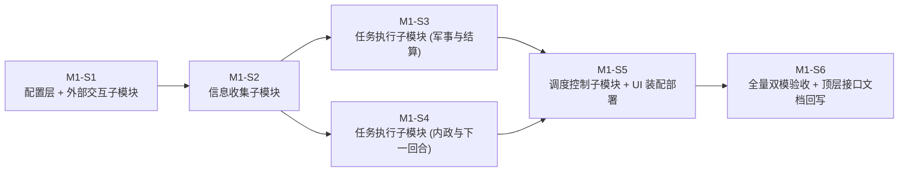

# 模块 1（游戏端纯 Lua 桥接 Mod）模块设计进度与多会话推进计划

> [!NOTE]
> 本文档用于跨会话追踪 **模块 1：游戏端纯 Lua 桥接 Mod（`MODS/Civ5AgentBridge/`）** 的**设计确认进度**与**分批次编码/验收进度**。后续每个会话在开始前应先阅读本文档定位当前任务包，完成后就地更新对应勾选框与交接记录。

---

## 一、 阶段一：模块 1 设计工作进度看板

| 序号 | 设计工作项 | 产出文档 / 章节 | 状态 | 备注说明 |
| :---: | :--- | :--- | :---: | :--- |
| D-01 | 总体设计约束、战争迷雾红线与本机引擎 API 核实 | `模块设计说明.md` §一、§六 | ✅ 已完成 | 已在本机官方 `ProductionPopup.lua`、`CityView.lua`、`ActionInfoPanel.lua`、`WorldView.lua` 中核实买建筑、买地块、城市炮击、下一回合全部原生接口 |
| D-02 | 文件目录结构与四大子模块拆分拓扑设计 | `模块设计说明.md` §二、§三 | ✅ 已完成 | 拆分为信息收集（`CAB_InfoCollector`）、任务执行（`CAB_TaskExecutor`）、调度控制（`CAB_Dispatcher`）、外部交互（`CAB_ExternalIO`）四大独立子模块 + `CAB_Config` |
| D-03 | 主要功能变量、事件委托与异步结算状态机设计 | `模块设计说明.md` §四、§五 | ✅ 已完成 | 明确全部配置项、私有状态变量、引擎事件、模块间注入委托及 `IDLE / WAITING_SETTLEMENT / AI_TURN_LOCKED` 状态流转 |
| D-04 | 四大子模块内部函数签名、输入输出与实现逻辑设计 | `模块内部接口设计.md` §一 ~ §六 | ✅ 已完成 | 逐函数定义签名、DTO 结构与分步逻辑，外部交互子模块通过回调委托主动通知调度层 |
| D-05 | 对外 SQLite IPC 方法全集映射设计（兼容基线 + 新增扩展） | `模块内部接口设计.md` §七 | ✅ 已完成 | 100% 兼容《03》既有 4 个 IPC 方法，新增城市详情、经济/视野查询、买建筑/单位、换生产、买地块、城市炮击、执行下一回合等扩展方法 |
| **D-06** | **用户审查确认设计方案与关键决策项拍板** | **见下文 §二** | ⏳ **待用户确认** | **当前卡点：待用户审阅确认后进入阶段二编码** |

---

## 二、 待用户审查确认的关键设计决策项

在启动后续编码会话前，请确认以下 4 项设计边界（若无异议将按默认推荐方案推进）：

1. **现有原型文件的重构策略（默认：模块化拆分替换）**：
   * 保留 `Civ5AgentBridge/mod/` 下已通过实机验证的 `Civ5AgentBridgeLoader.lua/.xml`、`Civ5AgentBridgeUI.xml` 与 `Civ5AgentBridgeJson.lua`；
   * 新增 `CAB_Config.lua` 及四大子模块文件（`CAB_ExternalIO.lua`、`CAB_InfoCollector.lua`、`CAB_TaskExecutor.lua`、`CAB_Dispatcher.lua`），精简重构 `Civ5AgentBridgeUI.lua` 为纯事件挂载壳层，退役原单体 `Civ5AgentBridgeCore.lua`（并更新 `.modinfo` 后清理 `cache/Civ5*.db`）。
2. **城市内政执行接口的覆盖范围（默认：买建筑 + 买地块 + 买单位 + 设生产项 + 城市炮击）**：
   * 除明确要求的“购买建筑、购买地块”外，设计中顺带纳入了同源官方 API 的**购买单位（`Game.CityPurchaseUnit`）**、**设置城市生产队列（`Game.CityPushOrder`）**以及**城市远程炮击（`TASK_RANGED_ATTACK`）**——这能让智能体在遇到“闲置城市阻塞下一回合”或“敌军攻城”时具备完整闭环处理能力。请确认是否保留这三项同源扩展。
3. **“执行下一回合（`end_turn`）”的阻塞处理与异步返回语义（默认：安全诊断优先 + 可选自动跳过待命单位 + 立即回执）**：
   * 默认 `auto_skip_ready_units = false`：只要存在未行动单位或未选科技/生产/政策等阻塞项，安全拒绝并返回详细阻塞诊断（含阻塞类型及关联 `unit_id` / `city_id`）；当智能体显式传 `auto_skip_ready_units = true` 时，自动跳过普通待命单位后再尝试结束回合；
   * 触发 `CONTROL_ENDTURN` 后**立即写回 RPC 成功回执**并进入 `AI_TURN_LOCKED` 门控态（不等漫长的 AI 回合演算完，避免外部 RPC 超时），待下一回合触发 `Events.ActivePlayerTurnStart` 时由调度控制子模块自动采集新回合全量态势写入 `turn_overview_auto` 并更新 `bridge_heartbeat` 通知外部。
4. **顶层文档同步时机（默认：在 M1 编码验收完成后统一增补回写）**：
   * 本次模块 1 新增的扩展 IPC 方法（`purchase_city_item`、`purchase_city_plot`、`end_turn`、`get_city_detail` 等），是否待模块 1 实机验收定型后，在收尾会话统一同步更新至 `docs/02_软件总体设计说明书.md` 与 `docs/03_接口设计说明书.md`（供模块 2 MCP Server 封装对齐）？

---

## 三、 阶段二：模块 1 编码与验证多会话拆分计划

考虑到单次会话的上下文窗口长度与代码质量要求（详尽中文函数级注释 + 边界防护 + 自动化验收），在设计获批后，将模块 1 的编写工作拆分为 **6 个自底向上、边界清晰的会话任务包（`M1-S1` ~ `M1-S6`）**：

### 会话工作包明细表

| 会话编号 | 任务包名称 | 涉及新增/修改文件 | 核心工作内容 | 独立完成标准（Done Criteria） | 当前状态 |
| :---: | :--- | :--- | :--- | :--- | :---: |
| **`M1-S1`** | **公共配置与外部交互子模块编写** | `Lua/CAB_Config.lua` `Lua/Civ5AgentBridgeJson.lua` `Lua/CAB_ExternalIO.lua` | 1. 编写全局配置表 `CAB_Config`； 2. 为 `Civ5AgentBridgeJson.lua` 补充 `CAB_Json` 命名空间包装（保留旧全局函数兼容）； 3. 实现 `CAB_ExternalIO` 全套接口（句柄初始化、3KB 分片读写、会话 ID 游标防卡死、主动回调通知机制、响应发布屏障与心跳写库）。 | 通过本地 Lua 语法/模拟桩自测：32KB 分片往返 100% 无损，新 `req_id` 准确触发一次委托回调，损坏 JSON 自动拦截报错不崩溃。 | `[ ] 待执行` |
| **`M1-S2`** | **游戏内信息收集子模块编写** | `Lua/CAB_InfoCollector.lua` | 1. 实现 `GetEmpireEconomy`（金币/回合金/科研/文化/信仰/快乐/战略与奢侈资源）； 2. 实现严格遵守迷雾边界的 `GetVisibilitySummary` 与 `CaptureRevealedPlotsSet`； 3. 实现 `BuildTurnOverview`、`BuildUnitContextAndCandidates`（含原版 DLL 移动判定避坑与 1UPT 检查）、`GetCityDetail`（含可购建筑/单位/地块双层校验报价单）及 `GetEndTurnStatus`。 | 全部只读函数签名与 DTO 字段 100% 对齐 `模块内部接口设计.md` §四，无任何越界泄露黑雾/迷雾隐军逻辑，附完整中文函数级注释。 | `[ ] 待执行` |
| **`M1-S3`** | **任务执行子模块（上：军事动作与增量结算）** | `Lua/CAB_TaskExecutor.lua`（上半部分） | 1. 实现 `Initialize`（安全联动探测 `AirRaidCore`）； 2. 实现 `StartUnitAction`（移动、近战、远程、原版/联动空袭、攻城架设、驻扎、休整、跳过）与 `StartCityRangeAttack`（城市远程炮击）； 3. 实现 `IsSettlementBusy` 与 `FinalizeActionSettlement`（精确计算 `newly_revealed_tiles_count`、`newly_spotted_enemies`、`target_enemy_after`）。 | 军事动作分支全覆盖，战后残血与击杀判定严密，同格多单位与阵亡边界安全无空指针。 | `[ ] 待执行` |
| **`M1-S4`** | **任务执行子模块（下：城市内政与下一回合）** | `Lua/CAB_TaskExecutor.lua`（下半部分） | 1. 实现 `PurchaseCityItem`（金币/信仰购买建筑与单位，细分前置不符 vs 余额不足错误）； 2. 实现 `SetCityProduction`（切换/追加建造队列）与 `PurchaseCityPlot`（金币买地块及短延迟归属确认）； 3. 实现 `ExecuteEndTurn`（活动态校验、可选自动跳过普通待命单位、阻塞诊断返回与安全调用 `CONTROL_ENDTURN`）。 | 内政与回合控制全部接口就绪，错误提示清晰可读，绝不在非活动回合或硬阻塞态强推引擎状态。 | `[ ] 待执行` |
| **`M1-S5`** | **调度控制子模块、UI 装配与 Mod 部署** | `Lua/CAB_Dispatcher.lua` `Lua/Civ5AgentBridgeUI.lua/.xml` `Civ5AgentBridge.modinfo` `scripts/deploy_mod.ps1` | 1. 实现 `CAB_Dispatcher`（新回合自动汇总写库、`AI_TURN_LOCKED` 门控、全量 14 个 IPC 方法路由、帧更新异步结算与节流轮询驱动）； 2. 重构 `Civ5AgentBridgeUI.lua` 挂载引擎事件与按钮； 3. 更新 `.modinfo` 登记全部新文件（正斜杠 + `import="1"`），退役旧单体文件，执行部署脚本同步至 `MODS/Civ5AgentBridge/` 并清理未运行态的 `cache/Civ5*.db`。 | `MODS/Civ5AgentBridge/` 文件与 `.modinfo` 100% 匹配，VFS 导入标记无遗漏，缓存已清理。 | `[ ] 待执行` |
| **`M1-S6`** | **全功能验收测试与顶层设计文档回写** | `tests/run_m1_full_acceptance.py` `docs/02_软件总体设计说明书.md` `docs/03_接口设计说明书.md` | 1. 编写覆盖全部 14 个 IPC 方法的验收脚本（支持 `--mode simulate` 双进程模拟与 `--mode live` 实机验收，验证新回合推送、查询、移动战斗揭盲、买建筑、买地块、执行下一回合）； 2. 跑通模拟验收（及配合用户进图完成实机验收并检查 `Logs/Lua.log` 零报错）； 3. 按审批结论将模块 1 新增 IPC 契约同步更新回《02》《03》设计说明书。 | 模拟与实机验收 100% 通过，`Lua.log` 零异常，文档契约完全闭环。 | `[ ] 待执行` |

---

## 四、 多会话接力指南（供后续新会话阅读）

1. **接力必读清单**：新会话启动时，按顺序阅读：
   * 工作区根目录 `AGENTS.md`（掌握《文明5：BNW》Mod 11 条硬性开发纪律）；
   * `Civ5AgentBridge/docs/M1/模块设计进度.md`（本文档，确认当前待执行的 `M1-S*` 编号及用户已批复的决策结论）；
   * `Civ5AgentBridge/docs/M1/模块设计说明.md` 与 `Civ5AgentBridge/docs/M1/模块内部接口设计.md`（严格按已确认的函数签名与字段名实现，不得私自更改 JSON 键名）。
2. **代码注释与质量规范**：
   * 每个 Lua 文件头部写明文件职责、依赖关系与本机官方引擎接口出处；
   * 每个函数上方必须添加中文注释，写明**做什么（What）**、**为什么这么做（Why，特别是引擎避坑原因）**、输入参数与返回值结构。
3. **进度回写规范**：每完成一个 `M1-S*` 任务包，立即在本文档 §三 表格中将状态更新为 `✅ 已完成`，并在下方「五、会话交接日志」追加简短完成记录。

---

## 五、 会话交接日志（Session Log）

* **2026-11-24（设计初始化会话）**：
  * 完成《01》《02》《03》说明书研读与现有 `EXP-03/04` 原型代码梳理；
  * 在本机《文明5：BNW》安装目录官方脚本中核实买建筑、买单位、设生产、买地块、城市远程炮击与执行下一回合全部原生 Lua API；
  * 创建 `Civ5AgentBridge/docs/M1/` 目录，完成《模块设计说明.md》《模块内部接口设计.md》《模块设计进度.md》初稿编写，提交用户审查确认。
