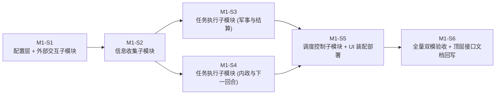

# 模块 1（游戏端纯 Lua 桥接 Mod）模块设计进度与多会话推进计划

> [!NOTE]
> 本文档用于跨会话追踪 **模块 1：游戏端纯 Lua 桥接 Mod（`MODS/Civ5AgentBridge/`）** 的**设计确认进度**与**分批次编码/验收进度**。后续每个会话在开始前应先阅读本文档定位当前任务包，完成后就地更新对应勾选框与交接记录。

---

## 一、 阶段一：模块 1 设计工作进度看板

| 序号 | 设计工作项 | 产出文档 / 章节 | 状态 | 备注说明 |
| :---: | :--- | :--- | :---: | :--- |
| D-01 | 总体设计约束、战争迷雾红线与本机引擎 API 核实 | `模块设计说明.md` §一、§六 | ✅ 已完成 | 已在本机官方 `ProductionPopup.lua`、`CityView.lua`、`ActionInfoPanel.lua`、`WorldView.lua` 中核实买建筑、买地块、城市炮击、下一回合全部原生接口 |
| D-02 | 文件目录结构与四大子模块拆分拓扑设计 | `模块设计说明.md` §二、§三 | ✅ 已完成 | 拆分为信息收集（`CAB_InfoCollector`）、任务执行（`CAB_TaskExecutor`）、调度控制（`CAB_Dispatcher`）、外部交互（`CAB_ExternalIO`）四大独立子模块 + `CAB_Config` |
| D-03 | 主要功能变量、事件委托与异步结算状态机设计 | `模块设计说明.md` §四、§五 | ✅ 已完成 | 明确全部配置项、私有状态变量、引擎事件、模块间注入委托及 `IDLE / WAITING_SETTLEMENT / AI_TURN_LOCKED` 状态流转 |
| D-04 | 四大子模块内部函数签名、输入输出与实现逻辑设计 | `模块内部接口设计.md` §一 ~ §六 | ✅ 已完成 | 逐函数定义签名、DTO 结构与分步逻辑，外部交互子模块通过回调委托主动通知调度层 |
| D-05 | 对外 SQLite IPC 方法全集映射设计（兼容基线 + 新增扩展） | `模块内部接口设计.md` §七 | ✅ 已完成 | 100% 兼容《03》既有 4 个 IPC 方法，新增城市详情、经济/视野查询、买建筑/单位、换生产、买地块、城市炮击、执行下一回合等扩展方法 |
| **D-06** | **用户审查确认设计方案与关键决策项拍板** | **见下文 §二** | 🟡 **部分推进** | **子模块 1（`CAB_Config` + `CAB_InfoCollector`）、子模块 2（`CAB_TaskExecutor`，覆盖 `M1-S3`+`M1-S4`）与子模块 3（`CAB_Dispatcher` 调度核 + WP5 三大硬阻塞全栈能力，覆盖 `M1-S5` 核心部分）均已正式验收，且 `SYNC-01`~`05`、`SYNC-M2-01`~`06` 与 `SYNC-M3-01`~`05` 已全部回写上位文档；待确认 §二 决策项 1、4** |

---

## 二、 待用户审查确认的关键设计决策项

在启动后续编码会话前，请确认以下 4 项设计边界（若无异议将按默认推荐方案推进）：

1. **现有原型文件的重构策略（默认：模块化拆分替换）**：
   * 保留 `Civ5AgentBridge/mod/` 下已通过实机验证的 `Civ5AgentBridgeLoader.lua/.xml`、`Civ5AgentBridgeUI.xml` 与 `Civ5AgentBridgeJson.lua`；
   * 新增 `CAB_Config.lua` 及四大子模块文件（`CAB_ExternalIO.lua`、`CAB_InfoCollector.lua`、`CAB_TaskExecutor.lua`、`CAB_Dispatcher.lua`），精简重构 `Civ5AgentBridgeUI.lua` 为纯事件挂载壳层，退役原单体 `Civ5AgentBridgeCore.lua`（并更新 `.modinfo` 后清理 `cache/Civ5*.db`）。
2. **城市内政执行接口的覆盖范围（默认：买建筑 + 买地块 + 买单位 + 设生产项 + 城市炮击，✅ 2026-11-27 M1Sub2 已拍板确认，对应 `SYNC-M2-01`）**：
   * 除明确要求的“购买建筑、购买地块”外，已正式确认保留同源官方 API 的**购买单位（`Game.CityPurchaseUnit`）**、**设置城市生产队列（`Game.CityPushOrder`）**以及**城市远程炮击（`TASK_RANGED_ATTACK`）**——已由 `CAB_TaskExecutor` 全量实现并通过离线与真机实证。
3. **“执行下一回合（`end_turn`）”的阻塞处理与异步返回语义（默认：安全诊断优先 + 守卫式自动跳过待命单位 + 立即回执，✅ 2026-11-27 M1Sub2 已拍板确认，对应 `SYNC-M2-01`）**：
   * 默认 `auto_skip_ready_units = false`：只要存在未行动单位或未选科技/生产/政策等阻塞项，安全拒绝并返回详细阻塞诊断（含阻塞类型及关联 `unit_id` / `city_id`）；当智能体显式传 `auto_skip_ready_units = true` 时，先查 `GetEndTurnStatus`，仅待命单位类阻塞才守卫式跳过非自动化、非待晋升、非同类非法叠栈单位后再复查（存在硬阻塞时不浪费行动力）；
   * 触发 `CONTROL_ENDTURN` 后**立即写回 RPC 成功回执（`WAITING_NEXT_TURN`）**并进入 `AI_TURN_LOCKED` 门控态（不等漫长的 AI 回合演算完，避免外部 RPC 超时），待下一回合触发 `Events.ActivePlayerTurnStart` 时由调度控制子模块自动采集新回合全量态势写入 `turn_overview_auto` 并更新 `bridge_heartbeat` 通知外部。
4. **顶层文档同步时机（默认：在 M1 编码验收完成后统一增补回写）**：
   * 本次模块 1 新增的扩展 IPC 方法（`purchase_city_item`、`purchase_city_plot`、`end_turn`、`get_city_detail` 等），是否待模块 1 实机验收定型后，在收尾会话统一同步更新至 `docs/02_软件总体设计说明书.md` 与 `docs/03_接口设计说明书.md`（供模块 2 MCP Server 封装对齐）？
5. **M1Sub1 验收引入的上位文档回写项（`SYNC-01` ~ `SYNC-05`，✅ 2026-11-27 已确认并全部同步完成）**：
   * `SYNC-01`（`模块设计说明.md` §4.1）：✅ 已增补 `CAB_Config.MAX_SCAN_RADIUS = 8`；
   * `SYNC-02`（`模块内部接口设计.md` §4.7）：✅ 已登记 `CAB_Collector` 公开的 7 个纯只读复用辅助函数（`H1`~`H7`）；
   * `SYNC-03`（`模块设计说明.md` §1.2/§3.2/§4.2 & `模块内部接口设计.md` §4.5/§5.1/§5.2）：✅ 已确立“原生 BNW v1.0.3.279 + IGE 兼容”对称基线，采集层与执行层统一裁撤 `AirRaidLegacyUnits` / `AirRaidCore` / `AR_EnumerateTargets` / `AR_ExecuteStrike` 联动依赖；
   * `SYNC-04`（`模块内部接口设计.md` §4.1~§4.6 & `模块设计说明.md` §1.2）：✅ 已细化战争迷雾防侧信道契约（`IsInvisible` 屏蔽、禁止对普通迷雾调用 `CanRangeStrikeAt`、科技资源过滤）、可空字段 Lua `nil` 省略键约定与结构化错返格式；
   * `SYNC-05`（`模块设计进度.md` §三）：✅ 已同步更新 `M1-S1` / `M1-S2` / `M1-S3` 进度与范围描述。
6. **M1Sub2 验收引入的上位文档回写项（`SYNC-M2-01` ~ `SYNC-M2-06`，✅ 2026-11-27 已确认并全部同步完成）**：
   * `SYNC-M2-01`（`模块设计进度.md` §二 决策项 2 & 3）：✅ 已同步闭环；
   * `SYNC-M2-02`（`模块内部接口设计.md` §5.2/§5.3/§七）：✅ 已增补 `StartUnitAction` / `StartCityRangeAttack` 可选参数 `allowDeclareWar`（默认 `false`）、无弹窗显式 `CanDeclareWar`+`DeclareWar` 护栏、`war_declared` 结算字段及 IPC 映射表 `allow_declare_war`；
   * `SYNC-M2-03`（`模块内部接口设计.md` §5.6/§5.8）：✅ 已细化双圆心联合揭盲基线 `(before, min(r+1, MAX_SCAN_RADIUS)) ∪ (target, r)`、统一 `timed_out`、`BUY_PLOT` 实时归属判真、`CITY_ATTACK` 的 `city_id`/`city_after` 及攻城 `target_city_after`（含 `captured`/`destroyed`）；
   * `SYNC-M2-04`（`模块设计说明.md` §3.2 & `模块内部接口设计.md` §5.7）：✅ 已细化 `ExecuteEndTurn` 诊断优先与守卫式自动跳过规则（硬阻塞零浪费、保护待晋升/自动化/同类非法叠栈）；
   * `SYNC-M2-05`（`模块设计进度.md` §三 `M1-S3` & `M1-S4`）：✅ 已同步更新为验收通过；
   * `SYNC-M2-06`（`模块设计说明.md` §3.2/§3.3/§4.1/§5.2 & `模块内部接口设计.md` §1.2/§5.4/§5.5/§5.8/§六/§七）：✅ 已按 WP5 真机实证方案 A 将 `PurchaseCityItem`（`PURCHASE_ITEM`）与 `SetCityProduction`（`SET_PRODUCTION`）统一升级为 `0.10s` 短延迟两段式异步结算，扩展 `IsSettlementBusy` / `FinalizeActionSettlement` 与调度层状态机至全部 5 类 `settlementKind`。
7. **M1Sub3 验收引入的上位文档回写项（`SYNC-M3-01` ~ `SYNC-M3-05`，✅ 2026-11-27 已确认并全部同步完成）**：
   * `SYNC-M3-01`（`模块内部接口设计.md` §六 `OnExternalRequestReceived` & `模块设计说明.md` §3.3）：✅ 已同步完成——明确非活动回合（`AI_TURN_LOCKED` / `not IsTurnActive`）放行 10 项零 UI 选区副作用只读/诊断方法（含 WP5 新增 3 项查询），拦截 9 项写指令及 `get_unit_context`（共 10 项）；
   * `SYNC-M3-02`（`模块内部接口设计.md` §六 & `模块设计说明.md` §3.3/§4.2/§5.1/§5.2）：✅ 已同步完成——登记第 7 个公开只读诊断接口 `CAB_Dispatcher.GetRuntimeState()`、跨回合/重初始化抢占刷写防死锁机制、`OnManualSyncClicked` 护栏、锁定来源追踪元信息及 `OnFrameUpdate` 单帧 `0.50s` 钳制与 `1e-9` 浮点容差；
   * `SYNC-M3-03`（`模块内部接口设计.md` §1.1/§六/§七）：✅ 已同步完成——补充 Civ5 VFS 守卫式按需 `include` 规范、明确 `end_turn(BLOCKED)` 与异步结算 DTO 的 `ok = true` 信封保真映射，以及正式退役 `execute_unit_action` 遗留字段 `sync_frame_comparison`；
   * `SYNC-M3-04`（`模块设计进度.md` §三 `M1-S5`）：✅ 已同步完成——拆分登记 `M1-S5` 中 `CAB_Dispatcher` 调度核与 WP5 三大硬阻塞全栈能力已验收通过，剩余 UI 壳层与 `.modinfo` 装配待 M1Sub4 完成后一键合龙；
   * `SYNC-M3-05`（`模块内部接口设计.md` §1.2/§3.3/§4.8/§5.7~§5.9/§六/§七 & `模块设计说明.md` §1.1/§2.1/§3.1~§3.4/§4.1/§5.2/§六）：✅ 已同步完成——增补 WP5 三大回合硬阻塞全栈接口契约（`CAB_Collector` `14→17`、`CAB_Executor` `9→12` 与 `settlementKind` `5→8`、IPC 路由 `14→20`），并固化两项真机工程经验（M1Sub4 `CAB_ExternalIO.WritePayload` 分片需对齐 UTF-8 首字节边界，Python 侧按 `bytes` 拼片解码；`ExecuteEndTurn(autoSkip=true)` 经 `MISSION_SKIP` 跨帧落地）。

---

## 三、 阶段二：模块 1 编码与验证多会话拆分计划

考虑到单次会话的上下文窗口长度与代码质量要求（详尽中文函数级注释 + 边界防护 + 自动化验收），在设计获批后，将模块 1 的编写工作拆分为 **6 个自底向上、边界清晰的会话任务包（`M1-S1` ~ `M1-S6`）**：

### 会话工作包明细表

| 会话编号 | 任务包名称 | 涉及新增/修改文件 | 核心工作内容 | 独立完成标准（Done Criteria） | 当前状态 |
| :---: | :--- | :--- | :--- | :--- | :---: |
| **`M1-S1`** | **公共配置与外部交互子模块编写（M1Sub4）** | `Lua/CAB_Config.lua`（✅ 已验收） `Lua/Civ5AgentBridgeJson.lua` `Lua/CAB_ExternalIO.lua` | 1. ~~编写全局配置表 `CAB_Config`~~（**已由 M1Sub1 先行交付 12 键静态表并通过验收**）； 2. 为 `Civ5AgentBridgeJson.lua` 补充 `CAB_Json` 命名空间包装（保留旧全局函数兼容）； 3. 实现 `CAB_ExternalIO` 全套 7 项契约接口（句柄初始化、3KB 分片读写且**切片边界对齐 UTF-8 多字节首字节防截断中文**、会话 ID 游标防卡死、主动回调通知机制、响应发布屏障与心跳写库）。 | 通过本地 Lua 语法/模拟桩自测：32KB 分片（含多字节中文）往返 100% 无损，新 `req_id` 准确触发一次委托回调，损坏 JSON 自动拦截报错不崩溃。 | `🟡 部分完成（CAB_Config 已验收；待 M1Sub4 补 ExternalIO/Json）` |
| **`M1-S2`** | **游戏内信息收集子模块编写（M1Sub1）** | `Lua/CAB_Config.lua`（12 键） `Lua/CAB_InfoCollector.lua`（1,639 行） `tests/run_m1sub1_tests.py` `tests/m1sub1/engine_stubs.lua` `tests/m1sub1/test_collector.lua` | 1. 实现 `GetEmpireEconomy`、`GetVisibilitySummary`、`CaptureRevealedPlotsSet`、`GetEndTurnStatus`、`BuildTurnOverview`、`BuildUnitContextAndCandidates`、`GetCityDetail` 共 7 个主接口； 2. 公开 7 个供 `CAB_TaskExecutor` 复用的纯只读辅助函数（`H1`~`H7`）； 3. 落地迷雾与防侧信道 6 红线（`F-01`~`F-06`）、零缓存 IGE 兼容、离线 `lupa.lua51` 桩测及真机冒烟。 | 全部只读函数签名与 DTO 字段对齐契约并 100% 兼容《03》§2.1/§2.2；离线语法 `8/8`（含 `3/3` 负向自检）+ 桩测试 `36/36` 通过且只读守卫 `0` 违规；真机连续 9 轮冒烟 `90/90 PASS`、`Lua.log` 零报错；临时挂载已 100% 回滚。详见 `M1Sub1/M1Sub1工作总结报告.md`。 | `✅ 已完成（2026-11-27 验收通过）` |
| **`M1-S3`** | **任务执行子模块（上：军事动作与增量结算，M1Sub2）** | `Lua/CAB_TaskExecutor.lua`（全量 2,281 行） `tests/run_m1sub2_tests.py` `tests/m1sub2/engine_stubs.lua` `tests/m1sub2/test_executor.lua` | 1. 实现 `Initialize`（校验 `CAB_Config` 6 键与 `CAB_Collector` 14 项导出，原生 BNW + IGE 基线）； 2. 实现 `StartUnitAction`（8 种动作 + `allowDeclareWar` 无弹窗宣战护栏 + 双圆心联合揭盲基线）与 `StartCityRangeAttack`； 3. 实现 `IsSettlementBusy` 与 `FinalizeActionSettlement`（支持全部 5 类 `settlementKind`，覆盖 `newly_revealed_tiles_count`、`newly_spotted_enemies`、`target_enemy_after`、`target_city_after`、`city_after`、`timed_out`）。 | 军事动作与结算契约全覆盖；离线语法 `9/9`（含 `3/3` 负向自检）+ 有状态跨模块桩测试 `33/33` 通过（红线违规 `0`、未实现方法 `0`）；M1Sub1 `36/36` 零回归；真机 BNW+IGE 冒烟通过且 `Lua.log` 零报错。详见 `M1Sub2/M1Sub2工作总结报告.md`。 | `✅ 已完成（2026-11-27 验收通过，随 M1Sub2 合并交付）` |
| **`M1-S4`** | **任务执行子模块（下：城市内政与下一回合，M1Sub2）** | `Lua/CAB_TaskExecutor.lua`（同上，与 `M1-S3` 合并交付） | 1. 实现 `PurchaseCityItem`（建筑/单位 × 金币/信仰双通道、双层 `IsCanPurchase` 错误细分；经 WP5 真机实证方案 A 升级为 `PURCHASE_ITEM` `0.10s` 短异步结算以精准回读扣费与 `spawned_unit_id`）； 2. 实现 `SetCityProduction`（4 类订单 + `clearQueue`，同步升级为 `SET_PRODUCTION` `0.10s` 短异步结算）与 `PurchaseCityPlot`（实时读 `BUY_PLOTS_DISABLED` + `BUY_PLOT` 短结算）； 3. 实现 `ExecuteEndTurn`（`D-05` 诊断优先、守卫式自动跳过非晋升/非叠栈待命单位、硬阻塞零浪费与无阻塞提交 `CONTROL_ENDTURN`）。 | 内政与安全下一回合全部 4 接口就绪并通过离线跨帧桩测与真机实证（含 `Turn 0 → Turn 1` 真实切换、`10P/2S/0F`、临时挂载 100% 回滚）。详见 `M1Sub2/M1Sub2工作总结报告.md`。 | `✅ 已完成（2026-11-27 验收通过，随 M1Sub2 合并交付）` |
| **`M1-S5`** | **调度控制子模块（M1Sub3）、UI 装配与 Mod 部署** | **已验收（M1Sub3）**： `Lua/CAB_Dispatcher.lua`（1,503 行） `Lua/CAB_InfoCollector.lua`（WP5 扩至 2,147 行 / 17 导出） `Lua/CAB_TaskExecutor.lua`（WP5 扩至 2,970 行 / 12 导出） `tests/run_m1sub3_tests.py` `tests/m1sub3/*`（及同步扩充 `m1sub1`/`m1sub2` 桩测） **待合龙（M1Sub4 后）**： `Lua/Civ5AgentBridgeUI.lua/.xml` `Civ5AgentBridge.modinfo` `scripts/deploy_mod.ps1` | 1. ~~实现 `CAB_Dispatcher`（守卫式加载、精确 7 导出 `D1`~`D7`、5 态状态机、新回合自动汇总写库、10 项 AI 白名单门控、全量 20 项 IPC 路由、8 类异步结算与跨回合抢占防死锁）及 WP5 三大回合硬阻塞（科研/社会政策/单位晋升）全栈采集/执行/路由能力~~（**已由 M1Sub3 正式交付并通过验收**）； 2. **待 M1Sub4（`CAB_ExternalIO`）验收后一键合龙**：重构 `Civ5AgentBridgeUI.lua` 为纯事件挂载壳层，更新 `.modinfo` 登记全部新文件（正斜杠 + `import="1"`），退役旧单体文件，执行部署脚本同步至 `MODS/Civ5AgentBridge/` 并清理 `cache/Civ5*.db`。 | **M1Sub3 已达成**：离线三套件 `107/107` 全绿（`m1sub1` `40/40`、`m1sub2` `38/38`、`m1sub3` `29/29`，红线违规 `0`）；原生 BNW+IGE 两轮真机实证通过（WP4 `17/17` + WP5 零手工点击纯 RPC 解除科研/政策/晋升硬阻塞并 `Turn 0 → Turn 1`，`Lua.log` 零报错且临时挂载 100% 回滚）。详见 `M1Sub3/M1Sub3工作总结报告.md`。 **合龙待达成**：`MODS/Civ5AgentBridge/` 文件与 `.modinfo` 100% 匹配，VFS 导入标记无遗漏，缓存已清理。 | `🟡 部分完成（CAB_Dispatcher 调度核与 WP5 三大硬阻塞全栈已于 2026-11-27 验收通过；待 M1Sub4 后收口 UI 与 .modinfo 装配）` |
| **`M1-S6`** | **全功能验收测试与顶层设计文档回写** | `tests/run_m1_full_acceptance.py` `docs/02_软件总体设计说明书.md` `docs/03_接口设计说明书.md` | 1. 编写覆盖全部 20 个 IPC 方法的验收脚本（支持 `--mode simulate` 双进程模拟与 `--mode live` 实机验收，验证新回合推送、查询、移动战斗揭盲、买建筑、买地块、科研/政策/晋升解除硬阻塞、执行下一回合，并加固 Python 侧 UTF-8 字节拼片解码）； 2. 跑通模拟验收（及配合用户进图完成实机验收并检查 `Logs/Lua.log` 零报错）； 3. 按审批结论将模块 1 新增 IPC 契约同步更新回《02》《03》设计说明书。 | 模拟与实机验收 100% 通过，`Lua.log` 零异常，文档契约完全闭环。 | `[ ] 待执行` |

---

## 四、 多会话接力指南（供后续新会话阅读）

1. **接力必读清单**：新会话启动时，按顺序阅读：
   * 工作区根目录 `AGENTS.md`（掌握《文明5：BNW》Mod 11 条硬性开发纪律）；
   * `Civ5AgentBridge/docs/M1/模块设计进度.md`（本文档，确认当前待执行的 `M1-S*` 编号及用户已批复的决策结论）；
   * `Civ5AgentBridge/docs/M1/模块设计说明.md` 与 `Civ5AgentBridge/docs/M1/模块内部接口设计.md`（严格按已确认的函数签名与字段名实现，不得私自更改 JSON 键名）。
2. **代码注释与质量规范**：
   * 每个 Lua 文件头部写明文件职责、依赖关系与本机官方引擎接口出处；
   * 每个函数上方必须添加中文注释，写明**做什么（What）**、**为什么这么做（Why，特别是引擎避坑原因）**、输入参数与返回值结构。
3. **进度回写规范**：每完成一个 `M1-S*` 任务包，立即在本文档 §三 表格中将状态更新为 `✅ 已完成`，并在下方「五、会话交接日志」追加简短完成记录。

---

## 五、 会话交接日志（Session Log）

* **2026-11-24（设计初始化会话）**：
  * 完成《01》《02》《03》说明书研读与现有 `EXP-03/04` 原型代码梳理；
  * 在本机《文明5：BNW》安装目录官方脚本中核实买建筑、买单位、设生产、买地块、城市远程炮击与执行下一回合全部原生 Lua API；
  * 创建 `Civ5AgentBridge/docs/M1/` 目录，完成《模块设计说明.md》《模块内部接口设计.md》《模块设计进度.md》初稿编写，提交用户审查确认。
* **2026-11-27（M1Sub1 成果验收与进度更新会话）**：
  * 审阅 `docs/M1/M1Sub1/M1Sub1工作总结报告.md` 与 `M1Sub1工作进度.md`，逐项核验 `mod/Lua/CAB_Config.lua`（55 行，12 键）与 `mod/Lua/CAB_InfoCollector.lua`（1,639 行，7 主接口 + 7 纯只读复用辅助函数）源码实现，对照《03_接口设计说明书.md》§2.1/§2.2 及《模块内部接口设计.md》§四完成契约与迷雾防侧信道复查；
  * 独立复跑 `python Civ5AgentBridge/tests/run_m1sub1_tests.py` 验证通过（退出码 `0`：Lua 5.1 语法 `8/8` + 负向自检 `3/3`；引擎桩测试 `T-00`~`T-35` 共 `36/36` 通过；只读守卫违规 `0` 次、未实现桩方法 `0` 次）；核查 `ModUserData/Civ5AgentBridge-1.db` 中 `m1sub1_smoke_pass_1` ~ `m1sub1_smoke_pass_9` 真机冒烟落盘证据属实；核查 `git -C Civ5AgentBridge status --short` 与 `MODS/Civ5AgentBridge/` 确认文件隔离与临时挂载 100% 回滚合规；
  * **验收结论**：M1Sub1（`A-01` ~ `A-10`）全部达标，**正式验收通过**（记录 1 项非阻塞小建议：`isInteger` 后续可补 `math.huge` 判非无穷大）；
  * 已执行 `SYNC-05` 更新本文档看板（标记 `M1-S2` 为 `✅ 已完成（2026-11-27 验收通过）`、`M1-S1` 为 `🟡 部分完成`）；并经用户确认，同步完成 `SYNC-01` ~ `SYNC-04` 对 `模块设计说明.md` 与 `模块内部接口设计.md` 的全量回写（新增 `MAX_SCAN_RADIUS = 8`、登记 `CAB_Collector` 7 个复用辅助函数 `H1`~`H7`、全量裁撤 `AirRaidCore` / `AR_EnumerateTargets` / `AR_ExecuteStrike` 确立原生 BNW + IGE 对称基线、补全迷雾防侧信道与错返契约），同时更新 `M1-S3` 任务包范围。下一步可直接推进 `M1-S1` 剩余部分（`CAB_ExternalIO` + `CAB_Json`）或启动 `M1-S3`（`CAB_TaskExecutor`）。
* **2026-11-27（M1Sub2 成果验收与进度更新会话）**：
  * 审阅 `docs/M1/M1Sub2/M1Sub2工作总结报告.md`、`M1Sub2工作进度.md` 与 `M1Sub2工作计划.md`，全文逐行复核 `mod/Lua/CAB_TaskExecutor.lua`（2,281 行，唯一全局 `CAB_Executor` 精确 9 个公开接口 `E1`~`E9`、5 类 `settlementKind`、6 条安全红线 `E-01`~`E-06`），对照《模块设计说明.md》与《模块内部接口设计.md》完成契约、迷雾防侧信道、无弹窗宣战护栏与短延迟异步结算机制复查；
  * 独立复跑 `python Civ5AgentBridge/tests/run_m1sub2_tests.py` 验证通过（退出码 `0`：Lua 5.1 语法 `9/9` + 负向自检 `3/3`；有状态引擎桩跨模块联调 `T-00`~`T-32` 共 `33/33` 通过；红线违规 `0` 次、桩未实现方法 `0` 次、有效写操作审计 `65` 次），复跑 `python Civ5AgentBridge/tests/run_m1sub1_tests.py` 验证通过（退出码 `0`：语法 `8/8` + `3/3` 负向自检 + `36/36` 通过，M1Sub1 零回归）；
  * 独立核查 `ModUserData/Civ5AgentBridge-1.db` 中 `m1sub2_smoke_latest` / `m1sub2_smoke_pass_1`（3,786 字节分片 JSON，`10P/2S/0F`）与 `Logs/Lua.log`（1,948 行，`0` 条语法/运行时/堆栈错误）确认真机量化证据属实；核查 `git -C Civ5AgentBridge log -n 2 --stat`、`git status --short` 与 `MODS/Civ5AgentBridge/` 确认仅触碰白名单 7 文件且 WP5 临时挂载已 100% 回滚合规；
  * **验收结论**：M1Sub2（`A-01` ~ `A-10`，覆盖原 `M1-S3` + `M1-S4`）全部达标，**正式验收通过**（记录 2 项非阻塞小建议：① `CAB_TaskExecutor.lua` 第 1203–1210 行与第 1332 行存在 WP5 插入辅助函数导致的 `IsSettlementBusy` 注释块截断，后续顺手整理即可；② `isInteger`（第 92 行）与 M1Sub1 一样未排除 `±math.huge`，可后续一并补齐）；
  * 已执行 `SYNC-M2-01` 与 `SYNC-M2-05` 更新本文档看板（闭环 §二 决策项 2 & 3，标记 `M1-S3` 与 `M1-S4` 为 `✅ 已完成（2026-11-27 验收通过，随 M1Sub2 合并交付）`）；并经用户确认，同步完成 `SYNC-M2-02`、`SYNC-M2-03`、`SYNC-M2-04`、`SYNC-M2-06` 对 `模块设计说明.md` 与 `模块内部接口设计.md` 的全量回写（增补 `allowDeclareWar` 无弹窗宣战护栏与 `war_declared` 字段、细化双圆心联合揭盲与 `target_city_after`/`city_after`、细化 `ExecuteEndTurn` 守卫式自动跳过规则，并按 WP5 真机实证方案 A 将 `PurchaseCityItem`/`SetCityProduction` 统一升级为 `0.10s` 短延迟两段式异步结算，对齐全部 5 类 `settlementKind` 与调度层状态机）。下一步可直接推进 `M1-S1` 剩余部分（`CAB_ExternalIO` + `CAB_Json`）或启动 `M1-S5`（`CAB_Dispatcher` + UI 装配部署）。
* **2026-11-27（M1Sub3 成果验收与进度更新会话）**：
  * 审阅 `docs/M1/M1Sub3/M1Sub3工作总结报告.md`、`M1Sub3工作计划.md` 与 `M1Sub3工作进度.md`，全文逐行复核 `mod/Lua/CAB_Dispatcher.lua`（1,503 行，守卫式按需加载、唯一全局 `CAB_Dispatcher` 精确 7 公开接口 `D1`~`D7`、5 态状态机、10 项 AI 白名单门控、20 项 `RPC_HANDLERS`、8 类异步帧结算与跨回合抢占防死锁）及 WP5 按 `D-08` 特批向后兼容扩充的 `mod/Lua/CAB_InfoCollector.lua`（2,147 行，新增第 6 节 `F8`~`F10`，导出 `14→17`）与 `mod/Lua/CAB_TaskExecutor.lua`（2,970 行，新增第 6 节 `E10`~`E12` 与 3 类结算分支，导出 `9→12`、`settlementKind` `5→8`）；
  * 独立复跑全部三套离线测试套件验证通过（退出码均为 `0`，总计 `107/107` 桩用例通过、红线违规 `0` 次、未实现桩方法 `0` 次）：
    * `python Civ5AgentBridge/tests/run_m1sub1_tests.py`：Lua 5.1 语法 `8/8` + 负向自检 `3/3`；桩测试 `40/40`（含 WP5 `T-36`~`T-39`）；
    * `python Civ5AgentBridge/tests/run_m1sub2_tests.py`：Lua 5.1 语法 `9/9` + 负向自检 `3/3`；桩测试 `38/38`（含 WP5 `T-33`~`T-37`，有效写审计 `76` 次）；
    * `python Civ5AgentBridge/tests/run_m1sub3_tests.py`：Lua 5.1 语法 `10/10` + 负向自检 `3/3`；桩测试 `29/29`（`T-00`~`T-28`，有效写审计 `51` 次，外部 IO 审计态势 `67`/心跳 `89`/RPC `126`/轮询 `42`）；
  * 独立核查 `ModUserData/Civ5AgentBridge-1.db`（`bridge_heartbeat` 终态 `turn=1, turn_seq=2, last_req_id=93, status="IDLE"`、`rpc_session_id="wp5-012a3c47"`、`turn_overview_auto_seq=2`、`rpc_response` `req_id=93` 为勇士 16385 晋升完毕态）与 `Logs/Lua.log`（656 行，`0` 条语法/运行时/堆栈错误，39 条 `[CAB_*]` 全链路日志覆盖 `SetResearchTech`、`SetCityProduction`、`ExecuteEndTurn` 及 `Turn overview synced: turn=1 seq=2`）确认真机量化证据属实；核查 `git -C Civ5AgentBridge status --short`、`git diff --stat` 与 `MODS/Civ5AgentBridge/` 确认严守 `D-01`/`D-08` 白名单边界，临时冒烟垫片 `CAB_M1Sub3Smoke.lua` 已彻底删除、`.modinfo` 与 `Civ5AgentBridgeUI.lua` 已 100% 回滚合规；
  * **验收结论**：M1Sub3（`A-01` ~ `A-11`，覆盖 `M1-S5` 调度核心 + WP5 三大回合硬阻塞全栈能力）全部达标，**正式验收通过**（记录 3 项非阻塞小建议供后续顺手整理：① `CAB_Dispatcher.lua` 部分旧注释行（如 L26-27/309/536/644/1255/1299/1401）及 `CAB_TaskExecutor.lua` L1518-1523 仍保留 WP5 前的 `14/7/5` 字样，可顺手刷新一致；② `CAB_TaskExecutor.AdoptPolicyOrBranch` 结算 DTO 可按需补出 `free_tenets_before`/`free_tenets_after` 标量；③ `AdoptPolicyOrBranch` 校验 1 级信条槽位时可与 `GetPolicyOptions` 对称补上 `l1Count < 7` 守卫）；
  * 已执行 `SYNC-M3-04` 更新本文档看板（更新 `D-06`、§二 增补第 7 项 `SYNC-M3-01`~`SYNC-M3-05` 回写台账、将 `M1-S5` 标记为 `🟡 部分完成（CAB_Dispatcher 调度核与 WP5 三大硬阻塞全栈已于 2026-11-27 验收通过；待 M1Sub4 后收口 UI 与 .modinfo 装配）`，并在 `M1-S1` / `M1-S6` 标注 M1Sub4 UTF-8 分片首字节对齐与 20 项 IPC 验收要求）；并经用户确认，同步完成 `SYNC-M3-01`、`SYNC-M3-02`、`SYNC-M3-03`、`SYNC-M3-05` 对 `模块设计说明.md` 与 `模块内部接口设计.md` 的全量回写（统一非活动回合 10 项只读白名单门控、登记 `GetRuntimeState()` 及抢占刷写防死锁/单帧 `0.50s` 钳制/锁定来源追踪、补充守卫式 `include` 与信封保真契约及退役 `sync_frame_comparison`、增补 WP5 科研/社会政策/单位晋升全栈接口至 20 项 IPC 与 8 类 `settlementKind`，并固化 M1Sub4 UTF-8 分片边界对齐与 `MISSION_SKIP` 跨帧生效真机要点）。下一步可直接启动 **M1Sub4（`CAB_ExternalIO` + `CAB_Json`，对应 `M1-S1` 剩余部分）** 并最终完成 UI/`.modinfo` 壳层合龙。
